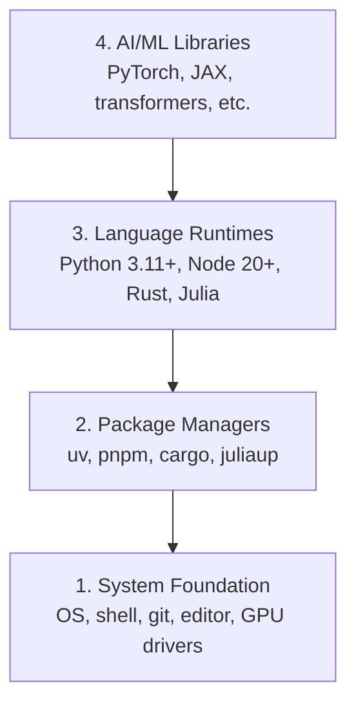

# Dev Environment

> Ваши инструменты формируют ваше мышление. Настройте их один раз — и настройте правильно.

**Type:** Build
**Languages:** Python, Node.js, Rust
**Prerequisites:** Нет
**Time:** ~45 минут

## Learning Objectives

- Установить с нуля инструментарий Python 3.11+, Node.js 20+ и Rust
- Настроить виртуальные окружения и менеджеры пакетов для воспроизводимых сборок
- Проверить доступ к GPU через CUDA/MPS и выполнить тестовую операцию над тензором
- Разобраться в четырёхуровневом стеке: система, пакеты, runtime-среды, AI-библиотеки

## The Problem

Вам предстоит изучить инженерию ИИ в более чем 500 уроках, используя Python, TypeScript, Rust и Julia. Если ваше окружение неисправно, каждый урок превращается в борьбу с инструментами вместо обучения.

Большинство людей пропускают настройку окружения. А потом часами отлаживают ошибки импорта, конфликты версий и отсутствующие драйверы CUDA. Мы сделаем это один раз, но правильно.

## The Concept

Окружение для инженерии ИИ состоит из четырёх уровней:



Устанавливаем снизу вверх. Каждый уровень зависит от того, что находится ниже.

```figure
s0-env-stack
```

## Build It

### Step 1: Основа системы

Проверьте свою систему и установите базовые инструменты.

```bash
# macOS
xcode-select --install
brew install git curl wget

# Ubuntu/Debian
sudo apt update && sudo apt install -y build-essential git curl wget unzip

# Windows (use WSL2)
wsl --install -d Ubuntu-24.04
```

### Step 2: Python с uv

Мы используем `uv` — он в 10-100 раз быстрее, чем pip, и автоматически управляет виртуальными окружениями.

```bash
curl -LsSf https://astral.sh/uv/install.sh | sh

uv python install 3.12

uv venv
source .venv/bin/activate  # or .venv\Scripts\activate on Windows

uv pip install numpy matplotlib jupyter
```

Проверка:

```python
import sys
print(f"Python {sys.version}")

import numpy as np
print(f"NumPy {np.__version__}")
a = np.array([1, 2, 3])
print(f"Vector: {a}, dot product with itself: {np.dot(a, a)}")
```

### Step 3: Node.js с pnpm

Для уроков по TypeScript (агенты, MCP-серверы, веб-приложения).

```bash
curl -fsSL https://fnm.vercel.app/install | bash
fnm install 22
fnm use 22

npm install -g pnpm

node -e "console.log('Node', process.version)"
```

Установщик fnm сначала проверяет наличие `unzip` и завершается с `Not installing fnm due to missing dependencies.`, если его нет: в Linux он распаковывает zip-архив, в macOS устанавливает через Homebrew. В macOS `unzip` поставляется из коробки; в Ubuntu, Debian и WSL2 он берётся из строки apt на шаге 1 (`sudo apt install -y unzip`, если вы пропустили этот шаг).

**macOS / Apple Silicon (M1/M2/M3/M4):** Если установка останавливается с ошибкой `Error: Cannot install under Rosetta 2 in ARM default prefix (/opt/homebrew)`, значит ваш терминал работает под Rosetta 2 (`arch` выводит `i386`), в то время как Homebrew — нативная сборка arm64. Установите fnm принудительно под arm64, подключите его к вашей оболочке, затем заново выполните команды выше начиная с `fnm install 22`:

```bash
arch -arm64 brew install fnm
echo 'eval "$(fnm env --use-on-cd)"' >> ~/.zshrc
source ~/.zshrc
```

### Step 4: Rust

Для уроков, критичных к производительности (инференс, системное программирование).

```bash
curl --proto '=https' --tlsv1.2 -sSf https://sh.rustup.rs | sh

rustc --version
cargo --version
```

### Step 5: Julia (опционально)

Для уроков с большим объёмом математики, где Julia особенно хорош.

```bash
curl -fsSL https://install.julialang.org | sh

julia -e 'println("Julia ", VERSION)'
```

### Step 6: Настройка GPU (если он у вас есть)

**NVIDIA (Linux / Windows):**

```bash
nvidia-smi

# Install PyTorch with CUDA
uv pip install torch torchvision torchaudio --index-url https://download.pytorch.org/whl/cu124
```

**macOS / Apple Silicon (M1/M2/M3/M4):** На Mac нет CUDA — это ожидаемо, а не ошибка. **Не** передавайте `--index-url .../cuXXX` (эти wheel-пакеты предназначены только для Linux/Windows, поэтому установка завершится неудачей). Установите обычную сборку, которая включает бэкенд GPU от Apple — MPS (Metal):

```bash
uv pip install torch torchvision torchaudio
```

Проверка (работает на любой платформе):

```python
import torch
print(f"CUDA available: {torch.cuda.is_available()}")           # False on macOS — expected
print(f"MPS available:  {torch.backends.mps.is_available()}")   # True on Apple Silicon
if torch.cuda.is_available():
    print(f"GPU: {torch.cuda.get_device_name(0)}")
```

Нет GPU? Не беда. Большинство уроков работают на CPU. Для уроков с интенсивным обучением используйте Google Colab или облачные GPU.

### Step 7: Проверьте выбранный вами маршрут

Выполняйте все команды этого урока из корня репозитория — каталога, который
содержит `README.md` и `phases/`. Предварительная проверка (preflight) проверяет
только то, что необходимо для начала выбранного маршрута. По умолчанию она
пропускает инструменты, нужные позже, чтобы новый ученик видел один понятный
ответ, а не стену предупреждений.

Запустить полную последовательность для начинающих:

```bash
python3 phases/00-setup-and-tooling/01-dev-environment/code/verify.py --route beginner
```

Или проверить только нужный вам маршрут:

```bash
python3 phases/00-setup-and-tooling/01-dev-environment/code/verify.py --route ml-foundations
python3 phases/00-setup-and-tooling/01-dev-environment/code/verify.py --route llm-engineering
python3 phases/00-setup-and-tooling/01-dev-environment/code/verify.py --route agents
python3 phases/00-setup-and-tooling/01-dev-environment/code/verify.py --route mcp
python3 phases/00-setup-and-tooling/01-dev-environment/code/verify.py --route agent-skills
python3 phases/00-setup-and-tooling/01-dev-environment/code/verify.py --route certification
```

Добавьте `--show-later`, если хотите, чтобы та же предварительная проверка
анализировала опциональные инструменты и зависимости, используемые в более
поздних уроках. Отсутствие инструмента, нужного позже, никогда не блокирует
выбранный маршрут.

Каждая неудачная обязательная проверка сопровождается обнаруженным путём или
ошибкой импорта, а также точной командой для исправления. Маршруты Agent
Skills и сертификации также показывают проверки, которые нужно выполнить
вручную, поскольку скрипт на Python не может доказать, что AI-хост обнаружил
навык (skill) или что выбранная вами область видимости навыка доступна для
записи.

Когда предварительная проверка для начинающих пройдена успешно, она выводит
точное название первого урока, который можно запускать:

```text
Ready to start Beginner course.
Next: python3 phases/01-math-foundations/01-linear-algebra-intuition/code/vectors.py
```

## Use It

Ваше окружение готово для старта выбранного вами маршрута. Устанавливайте
инструменты, нужные позже, когда их потребует конкретный урок, а не
блокируйте свой первый урок настройкой всего стека сразу. Вот что вы будете
использовать на протяжении курса:

| Язык | Используется в | Менеджер пакетов |
|----------|---------|-----------------|
| Python | Фазы 1-12 (ML, DL, NLP, Vision, Audio, LLMs) | uv |
| TypeScript | Фазы 13-17 (Инструменты, Агенты, Swarms, Инфраструктура) | pnpm |
| Rust | Фазы 12, 15-17 (Системы, критичные к производительности) | cargo |
| Julia | Фаза 1 (Математические основы) | Pkg |

## Ship It

Результатом этого урока является скрипт проверки, который может запустить любой, чтобы проверить свою настройку.

См. `outputs/prompt-env-check.md` — промпт, который помогает AI-ассистентам диагностировать проблемы окружения.

## Exercises

1. Запустите скрипт проверки и исправьте все обнаруженные ошибки
2. Создайте виртуальное окружение Python для этого курса и установите PyTorch
3. Напишите «hello world» на всех четырёх языках и запустите каждый из них