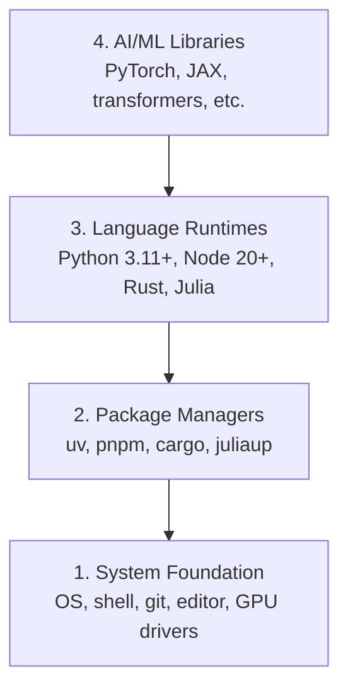

# Окружающая среда

> Ваши инструменты формируют ваше мышление.

**Type:** Build
**Languages:** Python, Node.js, Rust
**Prerequisites:** None
**Time:** ~45 minutes

## Цели обучения

- Настройка Python 3.11+, Node.js 20+, и Rust цепочек инструментов с нуля
- Конфигурировать виртуальные среды и управляющие пакетами для воспроизводимых конструкций
- Проверьте доступ к GPU с помощью CUDA/MPS и выполните операцию тестирования тензора
- Понимать четырехслойный стак: система, пакеты, время запуска, библиотеки ИИ

## Проблема

Вы собираетесь научиться инженерии ИИ на 500+ уроков с использованием Python, TypeScript, Rust и Julia. Если ваша среда сломается, каждый урок становится борьбой с инструментами вместо обучения.

Большинство людей пропустили настройку среды, а затем потратили часы на дебгурирование ошибок импорта, конфликтов версий и отсутствия драйверов CUDA.

## Концепция

Инженерная среда ИИ имеет четыре уровня:



Мы устанавливаем снизу вверх. Каждый слой зависит от того, что находится ниже него.

```figure
s0-env-stack
```

## Создайте его

### Шаг 1: Основание системы

Проверьте систему и установить основы.

```bash
# macOS
xcode-select --install
brew install git curl wget

# Ubuntu/Debian
sudo apt update && sudo apt install -y build-essential git curl wget unzip

# Windows (use WSL2)
wsl --install -d Ubuntu-24.04
```

### Шаг 2: Python с UV

Мы используем`uv` это 10-100 раз быстрее, чем Pip и автоматически обрабатывает виртуальные среды.

```bash
curl -LsSf https://astral.sh/uv/install.sh | sh

uv python install 3.12

uv venv
source .venv/bin/activate  # or .venv\Scripts\activate on Windows

uv pip install numpy matplotlib jupyter
```

Проверьте:

```python
import sys
print(f"Python {sys.version}")

import numpy as np
print(f"NumPy {np.__version__}")
a = np.array([1, 2, 3])
print(f"Vector: {a}, dot product with itself: {np.dot(a, a)}")
```

### Шаг 3: Node.js с pnpm

Для занятий TypeScript (агенты, серверы MCP, веб-приложения).

```bash
curl -fsSL https://fnm.vercel.app/install | bash
fnm install 22
fnm use 22

npm install -g pnpm

node -e "console.log('Node', process.version)"
```

Инсталлятор fnm проверяет`unzip`Первый и выходит с `Not installing fnm due to missing dependencies.`когда он отсутствует: на Linux он расширяет zip-архив, на macOS он устанавливается через Homebrew. macOS корабли `unzip`; Ubuntu, Debian и WSL2 получают его из строки "Стап 1 apt" (`sudo apt install -y unzip`если вы пропустили этот шаг).

**macOS / Apple Silicon (M1/M2/M3/M4):**Если установщик перестанет работать с `Error: Cannot install under Rosetta 2 in ARM default prefix (/opt/homebrew)`, ваш терминал работает под Розетта 2 (`arch`отпечатки`i386`Включите фНМ-усилительный арм64, включите его в свою оболочку, а затем перезапустите команды с выше.`fnm install 22`В следующем случае:

```bash
arch -arm64 brew install fnm
echo 'eval "$(fnm env --use-on-cd)"' >> ~/.zshrc
source ~/.zshrc
```

### Шаг 4: Растение

Для уроков критической эффективности (инференции, систем).

```bash
curl --proto '=https' --tlsv1.2 -sSf https://sh.rustup.rs | sh

rustc --version
cargo --version
```

### Шаг 5: Джулия (необязательно)

Для тяжелых уроков математики, где Джулия блестит.

```bash
curl -fsSL https://install.julialang.org | sh

julia -e 'println("Julia ", VERSION)'
```

### Шаг 6: Настройка GPU (если у вас есть)

**NVIDIA (Linux / Windows):**

```bash
nvidia-smi

# Install PyTorch with CUDA
uv pip install torch torchvision torchaudio --index-url https://download.pytorch.org/whl/cu124
```

**macOS / Apple Silicon (M1/M2/M3/M4):**На Mac нет никакой CUDA, которая ожидается, не провал.**not**Проход`--index-url .../cuXXX`(это колеса только для Linux/Windows, поэтому установка не работает).

```bash
uv pip install torch torchvision torchaudio
```

Проверка (работает на любой платформе):

```python
import torch
print(f"CUDA available: {torch.cuda.is_available()}")           # False on macOS — expected
print(f"MPS available:  {torch.backends.mps.is_available()}")   # True on Apple Silicon
if torch.cuda.is_available():
    print(f"GPU: {torch.cuda.get_device_name(0)}")
```

Большинство уроков работают на процессоре. Для занятий с тяжелым обучением используйте Google Colab или облачные GPU.

### Шаг 7: проверьте маршрут, с которого хотите начать

Запустите все команды в этом уроке из корня хранилища, каталога, который
содержит `README.md`и `phases/`- В предлетном кабинете проверяется только то , что нужно .
По умолчанию, выпускается позднее инструмент, чтобы новый ученик видел
Один ясный ответ вместо стены предупреждений.

Начните полную последовательность начинающих:

```bash
python3 phases/00-setup-and-tooling/01-dev-environment/code/verify.py --route beginner
```

Или проверьте только маршрут, который вы хотите:

```bash
python3 phases/00-setup-and-tooling/01-dev-environment/code/verify.py --route ml-foundations
python3 phases/00-setup-and-tooling/01-dev-environment/code/verify.py --route llm-engineering
python3 phases/00-setup-and-tooling/01-dev-environment/code/verify.py --route agents
python3 phases/00-setup-and-tooling/01-dev-environment/code/verify.py --route mcp
python3 phases/00-setup-and-tooling/01-dev-environment/code/verify.py --route agent-skills
python3 phases/00-setup-and-tooling/01-dev-environment/code/verify.py --route certification
```

Добавить`--show-later`когда вы хотите, чтобы один и тот же предлетный осмотр инструментов
Недостаток позднего инструмента никогда не блокирует
выбранный маршрут.

Каждый неудачный проверка требуется включает обнаруженный путь или ошибку ввоза и
Уровень квалификации агента и маршруты сертификации также показывают, что
Руковые проверки хоста, потому что скрипт Python не может доказать, что хост ИИ имеет
Вы обнаружили навык или вы выбрали навык, который можно написать.

Когда начальник проходит передлет, он печатает первый урок:

```text
Ready to start Beginner course.
Next: python3 phases/01-math-foundations/01-linear-algebra-intuition/code/vectors.py
```

## Используйте его

В окружающем пространстве уже есть возможность запуска маршрута, который вы проверили.
когда урок просит их вместо того, чтобы полностью блокировать ваш первый урок
Вот что вы будете использовать в учебной программе:

| Language | Used In | Package Manager |
|----------|---------|-----------------|
| Python | Phases 1-12 (ML, DL, NLP, Vision, Audio, LLMs) | uv |
| TypeScript | Phases 13-17 (Tools, Agents, Swarms, Infra) | pnpm |
| Rust | Phases 12, 15-17 (Performance-critical systems) | cargo |
| Julia | Phase 1 (Math foundations) | Pkg |

## Погрузи его

В этом уроке создается скрипт проверки, который любой может запустить, чтобы проверить свою настройку.

Посмотрите .`outputs/prompt-env-check.md`для запроса, который помогает помощникам ИИ диагностировать проблемы с окружающей средой.

## Упражнения

1. Запустите скрипт проверки и исправите любые ошибки
2. Создать виртуальную среду Python для этого курса и установить PyTorch
3. Напиши "привет миру" на всех четырех языках и запусти каждый
