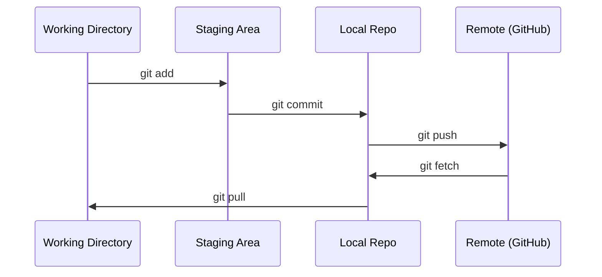

# Git & Collaboration

> Каждый эксперимент, каждый модель, каждый урок, который вы создаете здесь отслеживается.

**Type:** Learn
**Languages:** --
**Prerequisites:** Phase 0, Lesson 01
**Time:** ~30 minutes

## Цели обучения

- Настройка гит-идентификации и использование ежедневного рабочего потока добавления, обязательства и толчки
- Создать и объединить ветви для изолированных экспериментов без разрыва основных
- Напиши .`.gitignore`исключает контрольные пункты модели и большие бинарные файлы
- Проверьте историю обязательств с помощью `git log`понимание развития проекта

## Проблема

Вы собираетесь написать сотни файлов кода на 20 этапах. Без контроля версии вы потеряете работу, разрушите вещи, которые не можете отменить, и не сможете сотрудничать с другими.

Git - это инструмент. GitHub - это место, где живет код. Этот урок охватывает то, что вам нужно для этого курса и ничего больше.

## Концепция



Три вещи , которые нужно помнить:
1. Часто сохраняйте (`git commit`)
2. Нажать на дистанционный (`git push`)
3. Отделение по экспериментам (`git checkout -b experiment`)

```figure
s0-commit-dag
```

## Создайте его

### Шаг 1: Настройка git

```bash
git config --global user.name "Your Name"
git config --global user.email "you@example.com"
```

### Шаг 2: Ежедневный рабочий процесс

```bash
git status
git add file.py
git commit -m "Add perceptron implementation"
git push origin main
```

### Шаг 3: Развитие для экспериментов

```bash
git checkout -b experiment/new-optimizer

# ... make changes, commit ...

git checkout main
git merge experiment/new-optimizer
```

### Шаг 4: работа с репо курса

Вы не можете нажать на сам репо курса  только удерживающие имеют доступ к записи. Первый развернуть его на GitHub (на кнопке Fork, справа вверху) так `origin`Вы можете написать в своем экземпляре:

```bash
git clone https://github.com/YOUR-USERNAME/ai-engineering-from-scratch.git
cd ai-engineering-from-scratch

git checkout -b my-progress
# work through lessons, commit your code
git push origin my-progress
```

## Используйте его

Для этого курса вам нужны именно эти команды:

| Command | When |
|---------|------|
| `git clone` | Get the course repo |
| `git add` + `git commit` | Save your work |
| `git push` | Back it up to GitHub |
| `git checkout -b` | Try something without breaking main |
| `git log --oneline` | See what you've done |

Для этого курса не нужны ребасе, вишневый выбор или подмодулы.

## Упражнения

1. Разверните эту репо, клонируйте вилку, создавайте отделку под названием `my-progress`, сделать файл, обязать его, толкать его
2. Создать `.gitignore`исключает модели файлов контрольно-пропускных пунктов (`.pt`- Я не знаю .`.pth`- Я не знаю .`.safetensors`)
3. Посмотрите на историю сделок этого репо с `git log --oneline`и прочитать , как были добавлены уроки

## Ключевые условия

| Term | What people say | What it actually means |
|------|----------------|----------------------|
| Commit | "Saving" | A snapshot of your entire project at a point in time |
| Branch | "A copy" | A pointer to a commit that moves forward as you work |
| Merge | "Combining code" | Taking changes from one branch and applying them to another |
| Remote | "The cloud" | A copy of your repo hosted somewhere else (GitHub, GitLab) |
