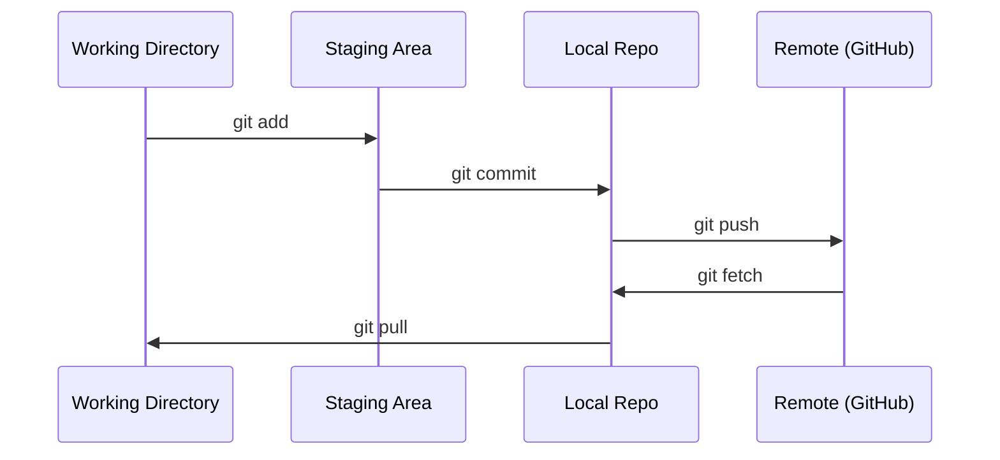

# Git и совместная работа

> Контроль версий — это не опционально. Каждый эксперимент, каждая модель, каждый урок, который вы создаёте здесь, отслеживается.

**Type:** Изучение
**Languages:** --
**Prerequisites:** Этап 0, Урок 01
**Time:** ~30 минут

## Цели обучения

- Настроить идентификацию в git и использовать ежедневный рабочий процесс add, commit и push
- Создавать и сливать ветки для изолированных экспериментов, не ломая main
- Написать `.gitignore`, исключающий чекпойнты моделей и крупные бинарные файлы
- Перемещаться по истории коммитов с помощью `git log`, чтобы понять эволюцию проекта

## Проблема

Вам предстоит написать сотни файлов кода в рамках 20 этапов. Без контроля версий вы потеряете работу, сломаете то, что нельзя будет отменить, и не сможете сотрудничать с другими.

Git — это инструмент. GitHub — это место, где живёт код. В этом уроке рассматривается только то, что нужно для этого курса, и ничего лишнего.

## Концепция



Три вещи, которые нужно запомнить:
1. Сохраняйтесь часто (`git commit`)
2. Отправляйте изменения в удалённый репозиторий (`git push`)
3. Создавайте ветки для экспериментов (`git checkout -b experiment`)

```figure
s0-commit-dag
```

## Реализация

### Шаг 1: Настройка git

```bash
git config --global user.name "Your Name"
git config --global user.email "you@example.com"
```

### Шаг 2: Ежедневный рабочий процесс

```bash
git status
git add file.py
git commit -m "Add perceptron implementation"
git push origin main
```

### Шаг 3: Ветвление для экспериментов

```bash
git checkout -b experiment/new-optimizer

# ... make changes, commit ...

git checkout main
git merge experiment/new-optimizer
```

### Шаг 4: Работа с репозиторием этого курса

Вы не можете отправлять изменения напрямую в репозиторий курса — право на запись есть только у мейнтейнеров. Сначала сделайте форк на GitHub (кнопка Fork в правом верхнем углу), чтобы `origin` указывал на вашу собственную копию:

```bash
git clone https://github.com/YOUR-USERNAME/ai-engineering-from-scratch.git
cd ai-engineering-from-scratch

git checkout -b my-progress
# work through lessons, commit your code
git push origin my-progress
```

## Применение

Для этого курса вам понадобятся ровно следующие команды:

| Команда | Когда |
|---------|------|
| `git clone` | Получить репозиторий курса |
| `git add` + `git commit` | Сохранить свою работу |
| `git push` | Сделать резервную копию на GitHub |
| `git checkout -b` | Попробовать что-то, не ломая main |
| `git log --oneline` | Посмотреть, что вы сделали |

Это всё. Для этого курса вам не нужны rebase, cherry-pick или submodules.

## Упражнения

1. Сделайте форк этого репозитория, склонируйте свой форк, создайте ветку с именем `my-progress`, создайте файл, закоммитьте его, отправьте его
2. Создайте `.gitignore`, исключающий файлы чекпойнтов моделей (`.pt`, `.pth`, `.safetensors`)
3. Изучите историю коммитов этого репозитория с помощью `git log --oneline` и прочитайте, как добавлялись уроки

## Ключевые термины

| Термин | Что обычно говорят | Что это на самом деле означает |
|------|----------------|----------------------|
| Commit | «Сохранение» | Снимок всего вашего проекта в определённый момент времени |
| Branch | «Копия» | Указатель на коммит, который продвигается вперёд по мере работы |
| Merge | «Объединение кода» | Перенос изменений из одной ветки и их применение к другой |
| Remote | «Облако» | Копия вашего репозитория, размещённая где-то ещё (GitHub, GitLab) |