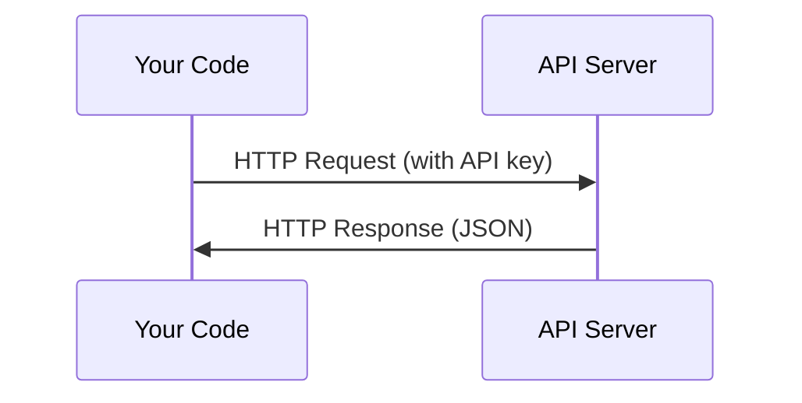

# API и ключи

> Каждый AI API работает одинаково: отправлять запрос, получать ответ. Детали меняются, а узоры не.

**Type:** Build
**Languages:** Python, TypeScript
**Prerequisites:** Phase 0, Lesson 01
**Time:** ~30 minutes

## Цели обучения

- Сохранить ключи API безопасно с использованием переменных окружающей среды и `.env`файлы
- Составьте LLM API-звон с использованием SDK Anthropic Python и сырого HTTP
- Сравнение формат запроса/ответа HTTP на основе SDK и сырых формат для дебъга.
- Идентифицировать и обрабатывать общие ошибки API, включая аутентификационные и тарифные ограничения

## Проблема

Начиная с 11 фазы, вы будете называть LLM API (Anthropic, OpenAI, Google). В 13-16 фазе вы будете создавать агентов, которые используют эти API в петлях. Вам нужно знать, как работают ключи API, как хранить их безопасно, и как сделать свой первый API звонок.

## Концепция



Каждый API-звон имеет:
1. Конечный пункт (URL)
2. Ключ API (автентификация)
3. Орган обращения (что вы хотите)
4. Ответный орган (что вы получаете обратно)

```figure
s0-secret-inject
```

## Создайте его

### Шаг 1: Сохраняйте ключи API в безопасном режиме

Никогда не вставляйте API-ключи в код.

```bash
export ANTHROPIC_API_KEY="sk-ant-..."
export OPENAI_API_KEY="sk-..."
```

Или используйте `.env`файл (добавить его в `.gitignore`):

```
ANTHROPIC_API_KEY=sk-ant-...
OPENAI_API_KEY=sk-...
```

### Шаг 2: Первый API-звон (Python)

```python
import os

import anthropic

client = anthropic.Anthropic()

MODEL = os.environ.get("LLM_MODEL", "claude-sonnet-5")

response = client.messages.create(
    model=MODEL,
    max_tokens=256,
    messages=[{"role": "user", "content": "What is a neural network in one sentence?"}]
)

print(response.content[0].text)
```

`LLM_MODEL`Другие провайдеры (OpenAI, Google и другие) следуют тому же шаблону ключа плюс идентификатор модели, но у каждого есть свой собственный SDK, конечный пункт и схема запроса / ответа.

### Шаг 3: Первый API-звон (TypeScript)

```typescript
import Anthropic from "@anthropic-ai/sdk";

const client = new Anthropic();

const MODEL = process.env.LLM_MODEL ?? "claude-sonnet-5";

const response = await client.messages.create({
  model: MODEL,
  max_tokens: 256,
  messages: [{ role: "user", content: "What is a neural network in one sentence?" }],
});

console.log(response.content[0].text);
```

### Шаг 4: Raw HTTP (без SDK)

```python
import os
import urllib.request
import json

url = "https://api.anthropic.com/v1/messages"
headers = {
    "Content-Type": "application/json",
    "x-api-key": os.environ["ANTHROPIC_API_KEY"],
    "anthropic-version": "2023-06-01",
}
body = json.dumps({
    "model": os.environ.get("LLM_MODEL", "claude-sonnet-5"),
    "max_tokens": 256,
    "messages": [{"role": "user", "content": "What is a neural network in one sentence?"}],
}).encode()

req = urllib.request.Request(url, data=body, headers=headers, method="POST")
with urllib.request.urlopen(req) as resp:
    result = json.loads(resp.read())
    print(result["content"][0]["text"])
```

Это то, что делают SDK под капотом. Понимание сырого HTTP-звона помогает при дебэг-диске.

## Используйте его

Для этого курса:

| API | When you need it | Free tier |
|-----|-----------------|-----------|
| Anthropic (Claude) | Phases 11-16 (agents, tools) | $5 credit on signup |
| OpenAI | Phase 11 (comparison) | $5 credit on signup |
| Hugging Face | Phases 4-10 (models, datasets) | Free |

Не надо их всех сейчас, но приготовь их, когда потребуется урок.

## Погрузи его

Этот урок дает результаты:
- `outputs/prompt-api-troubleshooter.md`- диагностировать распространенные ошибки API

## Упражнения

1. Получите ключ антропологического API и произнесите свой первый API звонок
2. Попробуйте сырую версию HTTP и сравнить формат ответа с версией SDK
3. Умышленно используйте неправильный ключ API и прочитайте сообщение об ошибке

## Ключевые условия

| Term | What people say | What it actually means |
|------|----------------|----------------------|
| API key | "Password for the API" | A unique string that identifies your account and authorizes requests |
| Rate limit | "They're throttling me" | Maximum requests per minute/hour to prevent abuse and ensure fair usage |
| Token | "A word" (in API context) | A billing unit: input and output tokens are counted and charged separately |
| Streaming | "Real-time responses" | Getting the response word by word instead of waiting for the full response |
