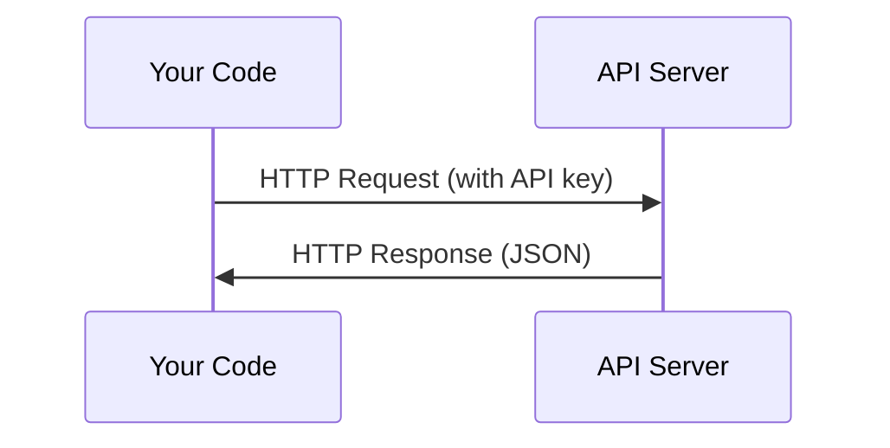

# API и ключи доступа

> Каждый API для работы с ИИ работает одинаково: отправляешь запрос, получаешь ответ. Детали меняются, паттерн — нет.

**Type:** Build
**Languages:** Python, TypeScript
**Prerequisites:** Phase 0, Lesson 01
**Time:** ~30 минут

## Цели обучения

- Безопасно хранить API-ключи с помощью переменных окружения и файлов `.env`
- Сделать вызов LLM API как через Python SDK Anthropic, так и через «сырой» HTTP
- Сравнить форматы запроса/ответа на основе SDK и «сырого» HTTP для отладки
- Распознавать и обрабатывать типичные ошибки API, включая ошибки аутентификации и превышение лимита запросов

## Проблема

Начиная с Phase 11 вы будете вызывать LLM API (Anthropic, OpenAI, Google). В Phase 13-16 вы будете строить агентов, которые используют эти API в циклах. Вам нужно понимать, как работают API-ключи, как их безопасно хранить и как сделать свой первый вызов API.

## Концепция



Каждый вызов API состоит из:
1. Эндпоинта (URL)
2. API-ключа (аутентификация)
3. Тела запроса (то, что вы хотите получить)
4. Тела ответа (то, что вы получаете обратно)

```figure
s0-secret-inject
```

## Реализация

### Шаг 1: Безопасное хранение API-ключей

Никогда не помещайте API-ключи в код. Используйте переменные окружения.

```bash
export ANTHROPIC_API_KEY="sk-ant-..."
export OPENAI_API_KEY="sk-..."
```

Либо используйте файл `.env` (добавьте его в `.gitignore`):

```
ANTHROPIC_API_KEY=sk-ant-...
OPENAI_API_KEY=sk-...
```

### Шаг 2: Первый вызов API (Python)

```python
import os

import anthropic

client = anthropic.Anthropic()

MODEL = os.environ.get("LLM_MODEL", "claude-sonnet-5")

response = client.messages.create(
    model=MODEL,
    max_tokens=256,
    messages=[{"role": "user", "content": "What is a neural network in one sentence?"}]
)

print(response.content[0].text)
```

`LLM_MODEL` задаёт идентификатор модели Anthropic, и по умолчанию используется алиас Sonnet без указания даты. Другие провайдеры (OpenAI, Google и другие) следуют тому же паттерну — ключ плюс идентификатор модели, — но у каждого свой SDK, эндпоинт и схема запроса/ответа.

### Шаг 3: Первый вызов API (TypeScript)

```typescript
import Anthropic from "@anthropic-ai/sdk";

const client = new Anthropic();

const MODEL = process.env.LLM_MODEL ?? "claude-sonnet-5";

const response = await client.messages.create({
  model: MODEL,
  max_tokens: 256,
  messages: [{ role: "user", content: "What is a neural network in one sentence?" }],
});

console.log(response.content[0].text);
```

### Шаг 4: «Сырой» HTTP (без SDK)

```python
import os
import urllib.request
import json

url = "https://api.anthropic.com/v1/messages"
headers = {
    "Content-Type": "application/json",
    "x-api-key": os.environ["ANTHROPIC_API_KEY"],
    "anthropic-version": "2023-06-01",
}
body = json.dumps({
    "model": os.environ.get("LLM_MODEL", "claude-sonnet-5"),
    "max_tokens": 256,
    "messages": [{"role": "user", "content": "What is a neural network in one sentence?"}],
}).encode()

req = urllib.request.Request(url, data=body, headers=headers, method="POST")
with urllib.request.urlopen(req) as resp:
    result = json.loads(resp.read())
    print(result["content"][0]["text"])
```

Это именно то, что SDK делают «под капотом». Понимание «сырого» HTTP-вызова помогает при отладке.

## Применение

Для этого курса:

| API | Когда понадобится | Бесплатный тариф |
|-----|-----------------|-----------|
| Anthropic (Claude) | Phases 11-16 (агенты, инструменты) | $5 кредита при регистрации |
| OpenAI | Phase 11 (сравнение) | $5 кредита при регистрации |
| Hugging Face | Phases 4-10 (модели, датасеты) | Бесплатно |

Прямо сейчас вам не нужны все эти API сразу. Настраивайте их по мере того, как этого требует урок.

## Результат

Этот урок даёт:
- `outputs/prompt-api-troubleshooter.md` — диагностика типичных ошибок API

## Упражнения

1. Получите API-ключ Anthropic и сделайте свой первый вызов API
2. Попробуйте версию с «сырым» HTTP и сравните формат ответа с версией через SDK
3. Намеренно используйте неверный API-ключ и изучите сообщение об ошибке

## Ключевые термины

| Термин | Что говорят люди | Что это на самом деле значит |
|------|----------------|----------------------|
| API-ключ | «Пароль для API» | Уникальная строка, которая идентифицирует вашу учётную запись и авторизует запросы |
| Rate limit (лимит запросов) | «Меня троттлят» | Максимальное число запросов в минуту/час для предотвращения злоупотреблений и обеспечения справедливого использования |
| Token (токен) | «Слово» (в контексте API) | Единица тарификации: входные и выходные токены считаются и оплачиваются отдельно |
| Streaming (потоковая передача) | «Ответы в реальном времени» | Получение ответа слово за словом вместо ожидания полного ответа целиком |