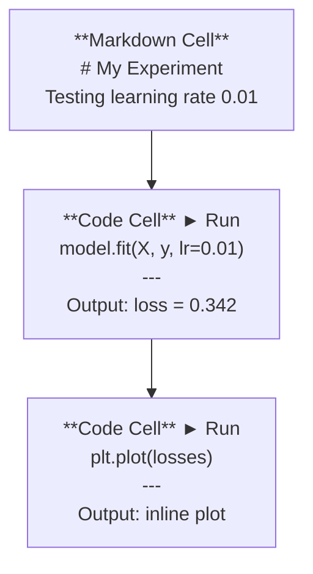
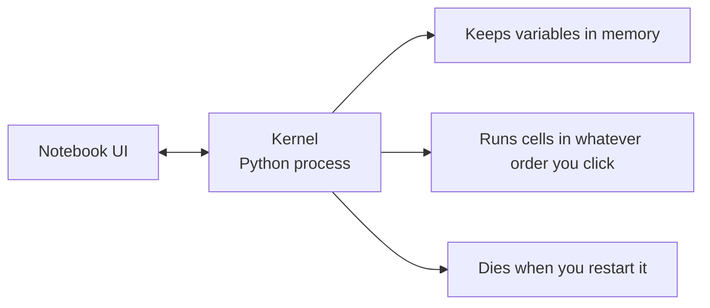

# Ноутбуки Jupyter

> Ноутбуки - это лаборатория искусственного инженерия. Вы прототип здесь, а затем переместите то, что работает в производство.

**Type:** Build
**Languages:** Python
**Prerequisites:** Phase 0, Lesson 01
**Time:** ~30 minutes

## Цели обучения

- Установка и запуск JupyterLab, Jupyter Notebook или VS Code с расширением Jupyter
- Используйте магические команды (`%timeit`- Я не знаю .`%%time`- Я не знаю .`%matplotlib inline`) для сравнения и визуализации встроенной
- Различить время использования ноутбуков от сценариев и применить рабочий процесс "исследуй в ноутбуках, отправляй в сценарии"
- Выявление и избегание общих ловушек ноутбуков: неисправное исполнение, скрытое состояние и утечки памяти

## Проблема

Каждый конкурс ИИ, учебник и кагггл используют ноутбуки Jupyter. Они позволяют запускать код в кусочках, видеть выходы в линейке, смешивать код с объяснениями и повторять быстро. Если вы пытаетесь научиться ИИ без ноутбуков, вы делаете домашнее задание по математике без скрещивания бумаги.

Но в ноутбуках есть настоящие ловушки. Люди используют их для всего, в том числе для вещей, в которых они ужасны. Знание, когда использовать ноутбук и когда использовать сценарий, спасет вас от дебгажа кошмаров позже.

## Концепция

Ноутбук - это список клеток. Каждая клетка - это код или текст.



Ядро - это процесс Python, который работает в фоне. Когда вы запускаете ячейку, она отправляет код в ядре, который выполняет его и отправляет результат. Все ячейки разделяют один и тот же ядре, поэтому переменные сохраняются между ячейками.



Эта часть "какой бы приказ ты ни нажала" - это как супердержава, так и пистолет.

```figure
s0-cell-order
```

## Создайте его

### Шаг 1: Выберите свой интерфейс

Три варианта, один формат:

| Interface | Install | Best for |
|-----------|---------|----------|
| JupyterLab | `pip install jupyterlab` then `jupyter lab` | Full IDE experience, multiple tabs, file browser, terminal |
| Jupyter Notebook | `pip install notebook` then `jupyter notebook` | Simple, lightweight, one notebook at a time |
| VS Code | Install "Jupyter" extension | Already in your editor, git integration, debugging |

Все трое читают и пишут одинаково .`.ipynb`Я знаю, что это не так, но я знаю, что это не так.

```bash
pip install jupyterlab
jupyter lab
```

### Шаг 2: Кнопка клавиатуры, которая имеет значение

Вы работаете в двух режимах.`Escape`для режима команды (синий строчок слева), `Enter`для режима редактирования (зеленый бар).

**Command mode (most used):**

| Key | Action |
|-----|--------|
| `Shift+Enter` | Run cell, move to next |
| `A` | Insert cell above |
| `B` | Insert cell below |
| `DD` | Delete cell |
| `M` | Convert to markdown |
| `Y` | Convert to code |
| `Z` | Undo cell operation |
| `Ctrl+Shift+H` | Show all shortcuts |

**Edit mode:**

| Key | Action |
|-----|--------|
| `Tab` | Autocomplete |
| `Shift+Tab` | Show function signature |
| `Ctrl+/` | Toggle comment |

`Shift+Enter`Это тот, который вы будете использовать тысячу раз в день.

### Шаг 3: типы клеток

**Code cells**запустить Python и показать выход:

```python
import numpy as np
data = np.random.randn(1000)
data.mean(), data.std()
```

Выпуск: `(0.0032, 0.9987)`

**Markdown cells**Используйте их для документирования того, что вы делаете и почему. Поддерживает заголовки, толстый, итальянный, математика LaTeX (`$E = mc^2$`), таблицы и изображения.

### Шаг 4: магические команды

Это не Python, а команды, которые начинаются с Jupyter.`%`(линейная магия) или `%%`(клеточная магия).

**Time your code:**

```python
%timeit np.random.randn(10000)
```

Выпуск: `45.2 us +/- 1.3 us per loop`

```python
%%time
model.fit(X_train, y_train, epochs=10)
```

Выпуск: `Wall time: 2.34 s`

`%timeit`просматривает код много раз и в среднем. `%%time`- Попробуй раз.`%timeit`для микробезопасности, `%%time`для тренировочных поездок.

**Enable inline plots:**

```python
%matplotlib inline
```

Каждый .`plt.plot()`или `plt.show()`Теперь он прямо в записной книге.

**Install packages without leaving the notebook:**

```python
!pip install scikit-learn
```

- Да .`!`Префикс выполняет любую команду "Shell".

**Check environment variables:**

```python
%env CUDA_VISIBLE_DEVICES
```

### Шаг 5: отображайте богатый выход в строке

Ноутбуки автоматически отображают последний выражение в ячейке.

```python
import pandas as pd

df = pd.DataFrame({
    "model": ["Linear", "Random Forest", "Neural Net"],
    "accuracy": [0.72, 0.89, 0.94],
    "training_time": [0.1, 2.3, 45.6]
})
df
```

Это делает форматированную таблицу HTML, а не текстовую сборку.

```python
import matplotlib.pyplot as plt

plt.figure(figsize=(8, 4))
plt.plot([1, 2, 3, 4], [1, 4, 2, 3])
plt.title("Inline Plot")
plt.show()
```

Сюжет появляется прямо под ячейкой. Вот почему ноутбуки доминируют в работе ИИ. Вы видите данные, сюжет и код вместе.

Для изображений:

```python
from IPython.display import Image, display
display(Image(filename="architecture.png"))
```

### Шаг 6: Google Colab

Colab - это бесплатный ноутбук Jupyter в облаке. Он дает вам GPU, предварительно установленные библиотеки и интеграцию Google Drive.

1. Иди к [colab.research.google.com](https://colab.research.google.com)
2. Загрузить любой `.ipynb`файл из этого курса
3. Время запуска > Изменение типа времени запуска > T4 GPU (бесплатный)

Различия между Colab и локальным Jupyter:
- Файлы не сохраняются между сессиями (за исключением Drive или скачивания)
- Предварительно установленные: numpy, pandas, matplotlib, факел, tensorflow, sklearn
- `from google.colab import files`загрузить/загрузить файлы
- `from google.colab import drive; drive.mount('/content/drive')`для постоянного хранения
- Время отключения сеансов после 90 минут бездействия (свободный уровень)

## Используйте его

### Ноутбуки против скриптов: когда использовать, что

| Use notebooks for | Use scripts for |
|-------------------|-----------------|
| Exploring a dataset | Training pipelines |
| Prototyping a model | Reusable utilities |
| Visualizing results | Anything with `if __name__` |
| Explaining your work | Code that runs on a schedule |
| Quick experiments | Production code |
| Course exercises | Packages and libraries |

Правило:**explore in notebooks, ship in scripts**- Я не знаю .

Общий рабочий процесс в ИИ:
1. Проверьте данные в ноутбуке
2. Прототип модели в ноутбуке
3. Как только он будет работать, переместите код на `.py`файлы
4. Импортируйте их .`.py`файлы обратно в ноутбук для дальнейших экспериментов

### Общие ловушки

**Out-of-order execution.**Вы запускаете ячейку 5, затем ячейку 2, затем ячейку 7. Ноутбук работает на вашем компьютере, но ломается, когда кто-то запускает его сверху вниз.

**Hidden state.**Вы удаляете ячейку, но она создает переменную, которая все еще находится в памяти. Ноутбук выглядит чистым, но зависит от ячейки призрака.

**Memory leaks.**Загрузка 4 ГБ наборов данных, тренировка модели, загрузка другого набора данных.`del variable_name`и `gc.collect()`, или перезагрузить ядре.

## Погрузи его

Этот урок дает результаты:
- `outputs/prompt-notebook-helper.md`для дебгугирования проблем ноутбуков

## Упражнения

1. Откройте JupyterLab, создавайте ноутбук и используйте `%timeit`Для сравнения понимания списка с нумпи для создания массива из 100 000 случайных чисел
2. Создайте ноутбук с клетками отметки и кода, который загружает CSV, отображает кадр данных и рисует график. Затем запустите Kernel > Restart & Run All, чтобы проверить, что он работает сверху вниз
3. Возьмите код из `code/notebook_tips.py`, вставьте его в ноутбук Colab, и запустите его с бесплатным GPU

## Ключевые условия

| Term | What people say | What it actually means |
|------|----------------|----------------------|
| Kernel | "The thing running my code" | A separate Python process that executes cells and keeps variables in memory |
| Cell | "A code block" | An independently runnable unit in a notebook, either code or markdown |
| Magic command | "Jupyter tricks" | Special commands prefixed with `%` or `%%` that control the notebook environment |
| `.ipynb` | "Notebook file" | A JSON file containing cells, outputs, and metadata. Stands for IPython Notebook |

## Дальнейшее чтение

- [JupyterLab Docs](https://jupyterlab.readthedocs.io/)для полного комплекта функций
- [Google Colab FAQ](https://research.google.com/colaboratory/faq.html)для пределов и особенностей, специфических для Colab
- [28 Jupyter Notebook Tips](https://www.dataquest.io/blog/jupyter-notebook-tips-tricks-shortcuts/)для скоростей для пользователей электроэнергии
