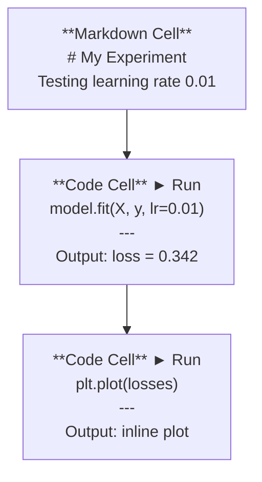
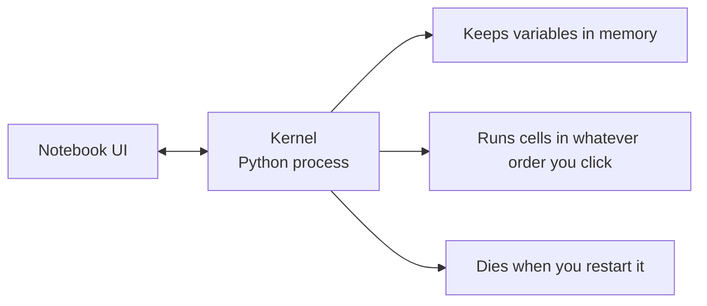

# Jupyter Notebooks

> Ноутбуки — это лабораторный стол инженера ИИ. Здесь вы прототипируете, а затем переносите то, что работает, в продакшн.

**Type:** Build
**Languages:** Python
**Prerequisites:** Phase 0, Lesson 01
**Time:** ~30 минут

## Цели обучения

- Установить и запустить JupyterLab, Jupyter Notebook или VS Code с расширением Jupyter
- Использовать магические команды (`%timeit`, `%%time`, `%matplotlib inline`) для бенчмаркинга и визуализации прямо в ноутбуке
- Понимать, когда использовать ноутбуки, а когда скрипты, и применять подход "исследуй в ноутбуках, отгружай в скриптах"
- Выявлять и избегать типичные ловушки ноутбуков: выполнение ячеек не по порядку, скрытое состояние и утечки памяти

## Проблема

Каждая статья по ИИ, туториал и соревнование на Kaggle используют Jupyter notebooks. Они позволяют выполнять код по частям, видеть результат сразу же, сочетать код с пояснениями и быстро итерироваться. Если вы пытаетесь изучать ИИ без ноутбуков, это всё равно что делать домашку по математике без черновика.

Но у ноутбуков есть реальные ловушки. Люди используют их для всего подряд, включая вещи, для которых они совершенно не подходят. Понимание того, когда использовать ноутбук, а когда скрипт, избавит вас в будущем от кошмаров отладки.

## Концепция

Ноутбук — это список ячеек. Каждая ячейка — либо код, либо текст.



Ядро (kernel) — это процесс Python, работающий в фоне. Когда вы запускаете ячейку, код отправляется ядру, которое выполняет его и возвращает результат. Все ячейки используют общее ядро, поэтому переменные сохраняются между ячейками.



Эта часть про "в любом порядке, в каком кликнете" — одновременно и суперспособность, и мина замедленного действия.

```figure
s0-cell-order
```

## Создаём

### Шаг 1: Выберите интерфейс

Три варианта, один формат:

| Интерфейс | Установка | Лучше всего подходит для |
|-----------|---------|----------|
| JupyterLab | `pip install jupyterlab` затем `jupyter lab` | Полноценный опыт IDE, несколько вкладок, файловый менеджер, терминал |
| Jupyter Notebook | `pip install notebook` затем `jupyter notebook` | Просто, легко, один ноутбук за раз |
| VS Code | Установите расширение "Jupyter" | Уже есть в вашем редакторе, интеграция с git, отладка |

Все три варианта читают и записывают один и тот же файл `.ipynb`. Выбирайте то, что вам нравится. JupyterLab наиболее распространён в работе с ИИ.

```bash
pip install jupyterlab
jupyter lab
```

### Шаг 2: Важные сочетания клавиш

Вы работаете в двух режимах. Нажмите `Escape` для командного режима (синяя полоса слева), `Enter` для режима редактирования (зелёная полоса).

**Командный режим (используется чаще всего):**

| Клавиша | Действие |
|-----|--------|
| `Shift+Enter` | Запустить ячейку, перейти к следующей |
| `A` | Вставить ячейку выше |
| `B` | Вставить ячейку ниже |
| `DD` | Удалить ячейку |
| `M` | Преобразовать в markdown |
| `Y` | Преобразовать в код |
| `Z` | Отменить операцию над ячейкой |
| `Ctrl+Shift+H` | Показать все сочетания клавиш |

**Режим редактирования:**

| Клавиша | Действие |
|-----|--------|
| `Tab` | Автодополнение |
| `Shift+Tab` | Показать сигнатуру функции |
| `Ctrl+/` | Переключить комментарий |

`Shift+Enter` — это то, что вы будете использовать тысячу раз в день. Выучите это первым делом.

### Шаг 3: Типы ячеек

**Ячейки с кодом** выполняют Python и показывают результат:

```python
import numpy as np
data = np.random.randn(1000)
data.mean(), data.std()
```

Результат: `(0.0032, 0.9987)`

**Ячейки markdown** отображают форматированный текст. Используйте их, чтобы документировать, что вы делаете и зачем. Поддерживают заголовки, жирный шрифт, курсив, математику LaTeX (`$E = mc^2$`), таблицы и изображения.

### Шаг 4: Магические команды

Это не Python. Это специфичные для Jupyter команды, которые начинаются с `%` (строчная магия) или `%%` (ячеечная магия).

**Измерьте время выполнения кода:**

```python
%timeit np.random.randn(10000)
```

Результат: `45.2 us +/- 1.3 us per loop`

```python
%%time
model.fit(X_train, y_train, epochs=10)
```

Результат: `Wall time: 2.34 s`

`%timeit` запускает код много раз и усредняет результат. `%%time` запускает его один раз. Используйте `%timeit` для микробенчмарков, `%%time` для запусков обучения.

**Включите отображение графиков прямо в ноутбуке:**

```python
%matplotlib inline
```

Теперь каждый `plt.plot()` или `plt.show()` отображается прямо в ноутбуке.

**Устанавливайте пакеты, не покидая ноутбук:**

```python
!pip install scikit-learn
```

Префикс `!` запускает любую команду оболочки.

**Проверьте переменные окружения:**

```python
%env CUDA_VISIBLE_DEVICES
```

### Шаг 5: Отображение форматированного вывода прямо в ноутбуке

Ноутбуки автоматически отображают последнее выражение в ячейке. Но вы можете это контролировать:

```python
import pandas as pd

df = pd.DataFrame({
    "model": ["Linear", "Random Forest", "Neural Net"],
    "accuracy": [0.72, 0.89, 0.94],
    "training_time": [0.1, 2.3, 45.6]
})
df
```

Это отрисовывает отформатированную HTML-таблицу, а не текстовый дамп. То же самое с графиками:

```python
import matplotlib.pyplot as plt

plt.figure(figsize=(8, 4))
plt.plot([1, 2, 3, 4], [1, 4, 2, 3])
plt.title("Inline Plot")
plt.show()
```

График появляется прямо под ячейкой. Именно поэтому ноутбуки доминируют в работе с ИИ. Вы видите данные, график и код вместе.

Для изображений:

```python
from IPython.display import Image, display
display(Image(filename="architecture.png"))
```

### Шаг 6: Google Colab

Colab — это бесплатный Jupyter notebook в облаке. Он предоставляет GPU, предустановленные библиотеки и интеграцию с Google Drive. Настройка не требуется.

1. Перейдите на [colab.research.google.com](https://colab.research.google.com)
2. Загрузите любой файл `.ipynb` из этого курса
3. Runtime > Change runtime type > T4 GPU (бесплатно)

Отличия Colab от локального Jupyter:
- Файлы не сохраняются между сессиями (сохраняйте на Drive или скачивайте)
- Предустановлено: numpy, pandas, matplotlib, torch, tensorflow, sklearn
- `from google.colab import files` для загрузки/скачивания файлов
- `from google.colab import drive; drive.mount('/content/drive')` для постоянного хранилища
- Сессии завершаются по тайм-ауту после 90 минут бездействия (бесплатный тариф)

## Применяем

### Ноутбуки против скриптов: когда что использовать

| Используйте ноутбуки для | Используйте скрипты для |
|-------------------|-----------------|
| Исследования датасета | Пайплайнов обучения |
| Прототипирования модели | Переиспользуемых утилит |
| Визуализации результатов | Всего, что связано с `if __name__` |
| Объяснения вашей работы | Кода, который запускается по расписанию |
| Быстрых экспериментов | Продакшн-кода |
| Упражнений курса | Пакетов и библиотек |

Правило: **исследуй в ноутбуках, отгружай в скриптах**.

Типичный workflow в ИИ:
1. Исследуйте данные в ноутбуке
2. Прототипируйте модель в ноутбуке
3. Как только всё заработает, перенесите код в файлы `.py`
4. Импортируйте эти файлы `.py` обратно в ноутбук для дальнейших экспериментов

### Типичные ловушки

**Выполнение ячеек не по порядку.** Вы запускаете ячейку 5, потом ячейку 2, потом ячейку 7. Ноутбук работает на вашей машине, но ломается, когда кто-то запускает его сверху вниз. Решение: Kernel > Restart & Run All перед тем, как делиться ноутбуком.

**Скрытое состояние.** Вы удаляете ячейку, но переменная, которую она создала, всё ещё в памяти. Ноутбук выглядит чистым, но зависит от ячейки-призрака. Решение: регулярно перезапускайте ядро.

**Утечки памяти.** Загрузка 4ГБ датасета, обучение модели, загрузка другого датасета. Ничего не освобождается. Решение: `del variable_name` и `gc.collect()`, либо перезапуск ядра.

## Отгружаем

Этот урок производит:
- `outputs/prompt-notebook-helper.md` для отладки проблем с ноутбуками

## Упражнения

1. Откройте JupyterLab, создайте ноутбук и используйте `%timeit`, чтобы сравнить list comprehension с numpy при создании массива из 100 000 случайных чисел
2. Создайте ноутбук как с markdown-, так и с код-ячейками, который загружает CSV, отображает dataframe и строит график. Затем выполните Kernel > Restart & Run All, чтобы убедиться, что он работает от начала до конца
3. Возьмите код из `code/notebook_tips.py`, вставьте его в ноутбук Colab и запустите с бесплатным GPU

## Ключевые термины

| Термин | Что говорят люди | Что это на самом деле значит |
|------|----------------|----------------------|
| Kernel (ядро) | "Штука, которая выполняет мой код" | Отдельный процесс Python, который выполняет ячейки и хранит переменные в памяти |
| Cell (ячейка) | "Блок кода" | Независимо запускаемая единица в ноутбуке, код или markdown |
| Magic command (магическая команда) | "Фишки Jupyter" | Специальные команды с префиксом `%` или `%%`, управляющие средой ноутбука |
| `.ipynb` | "Файл ноутбука" | JSON-файл, содержащий ячейки, вывод и метаданные. Расшифровывается как IPython Notebook |

## Дополнительное чтение

- [JupyterLab Docs](https://jupyterlab.readthedocs.io/) — полный набор возможностей
- [Google Colab FAQ](https://research.google.com/colaboratory/faq.html) — ограничения и особенности Colab
- [28 Jupyter Notebook Tips](https://www.dataquest.io/blog/jupyter-notebook-tips-tricks-shortcuts/) — советы для продвинутых пользователей