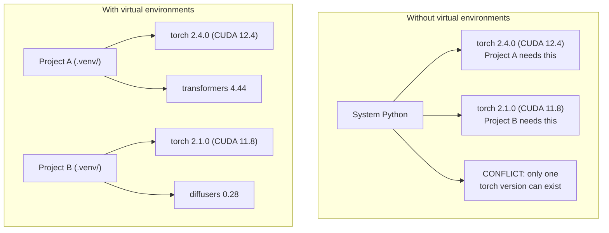

# Python среды

> Виртуальные среды - это лекарство.

**Type:** Build
**Languages:** Shell
**Prerequisites:** Phase 0, Lesson 01
**Time:** ~30 minutes

## Цели обучения

- Создать изолированные виртуальные среды с использованием `uv`- Я не знаю .`venv`, или `conda`
- Напиши .`pyproject.toml`с группами зависимости, которые не могут быть использованы, и генерируют файлы блокировки для воспроизводимости
- Диагностика и устранение распространенных ловушек: глобальные установки, смешивание трубки/конды, несоответствия версии CUDA
- Реализация на каждом этапе стратегии окружающей среды для проектов с противоречивыми зависимостями

## Проблема

Вы устанавливаете PyTorch 2.4 для проекта настройки. На следующей неделе другому проекту нужен PyTorch 2.1 потому что его CUDA-бульд застрял. Вы обновляете глобально, и первый проект перестает работать. Вы понижаете рейтинг, и второй перестает работать.

Это ад зависимости. Это происходит постоянно в работе AI/ML потому, что:

- PyTorch, JAX и TensorFlow отправляют свои собственные CUDA-связи
- Модельные библиотеки написывают конкретные версии рамок
- Глобальный `pip install`Переписывает все , что было там раньше
- Строительство CUDA 11.8 не работает с драйверами CUDA 12.x (и наоборот)

Решаем: каждый проект получает свою собственную изолированную среду с собственными пакетами.

## Концепция



```figure
s0-env-isolation
```

## Создайте его

### Оптимизм 1: uv venv (Рекомендуется)

`uv`Это самый быстрый Python-менеджер пакетов (10-100 раз быстрее pip).

```bash
curl -LsSf https://astral.sh/uv/install.sh | sh

uv python install 3.12

cd your-project
uv venv
source .venv/bin/activate
```

Установка пакетов:

```bash
uv pip install torch numpy
```

Создать проект с `pyproject.toml`в одном шаге:

```bash
uv init my-ai-project
cd my-ai-project
uv add torch numpy matplotlib
```

### Выбор 2: venv (встроенный)

Если не сможешь установить `uv`, Python корабли с `venv`В следующем случае:

```bash
python3 -m venv .venv
source .venv/bin/activate  # Linux/macOS
.venv\Scripts\activate     # Windows

pip install torch numpy
```

Повольно , чем `uv`, но работает везде, где установлена Python.

### Выбор 3: конда (Когда вам это нужно)

Conda управляет не-питонными зависимостями, такими как наборы инструментов CUDA, cuDNN и библиотеки C. Используйте его, когда:

- Вам нужна конкретная версия купа инструментов CUDA без установки на всей системе
- Вы находитесь в общем кластере, где не можете установить системные пакеты
- Указы по установке библиотеки гласят "используйте кондо"

```bash
# Install miniconda (not the full Anaconda)
curl -LsSf https://repo.anaconda.com/miniconda/Miniconda3-latest-Linux-x86_64.sh -o miniconda.sh
bash miniconda.sh -b

conda create -n myproject python=3.12
conda activate myproject

conda install pytorch torchvision torchaudio pytorch-cuda=12.4 -c pytorch -c nvidia
```

Одно правило: если вы используете кондитер для окружающей среды, используйте кондитер для всех упаковок в этой среде.`pip install`В случае с кондитерской системой ВВ возникают конфликты зависимости, которые трудно отрегулировать.

### Для этого курса: Стратегия по этапам

Вы можете создать одну среду для всего курса. Не. Различные фазы нуждаются в разных (иногда противоречивых) зависимостях.

Стратегия:

```
ai-engineering-from-scratch/
├── .venv/                    <-- shared lightweight env for phases 0-3
├── phases/
│   ├── 04-neural-networks/
│   │   └── .venv/            <-- PyTorch env
│   ├── 05-cnns/
│   │   └── .venv/            <-- same PyTorch env (symlink or shared)
│   ├── 08-transformers/
│   │   └── .venv/            <-- might need different transformer versions
│   └── 11-llm-apis/
│       └── .venv/            <-- API SDKs, no torch needed
```

Сценарий в `code/env_setup.sh`создает базовую среду для этого курса.

## pyproject.toml Основы

Каждый проект Python должен иметь `pyproject.toml`- Это заменяет`setup.py`- Я не знаю .`setup.cfg`, и `requirements.txt`в одном файле.

```toml
[project]
name = "ai-engineering-from-scratch"
version = "0.1.0"
requires-python = ">=3.11"
dependencies = [
    "numpy>=1.26",
    "matplotlib>=3.8",
    "jupyter>=1.0",
    "scikit-learn>=1.4",
]

[project.optional-dependencies]
torch = ["torch>=2.3", "torchvision>=0.18"]
llm = ["anthropic>=0.39", "openai>=1.50"]
```

Затем устанавливайте:

```bash
uv pip install -e ".[torch]"    # base + PyTorch
uv pip install -e ".[llm]"     # base + LLM SDKs
uv pip install -e ".[torch,llm]" # everything
```

## Замок

Замок-файл зашифрует все зависимости (включая переходные) на точные версии.

```bash
# uv generates uv.lock automatically when using uv add
uv add numpy

# pip-tools approach
uv pip compile pyproject.toml -o requirements.lock
uv pip install -r requirements.lock
```

Когда кто-то клонирует репо, они устанавливают из файла блокировки и получают идентичные версии.

## Обычные ошибки

### 1. Установка в глобальном масштабе

```bash
pip install torch  # BAD: installs to system Python

source .venv/bin/activate
pip install torch  # GOOD: installs to virtual environment
```

Проверьте, куда отправляются ваши упаковки:

```bash
which python       # should show .venv/bin/python, not /usr/bin/python
which pip           # should show .venv/bin/pip
```

### 2. Смешивание пип и кондо

```bash
conda create -n myenv python=3.12
conda activate myenv
conda install pytorch -c pytorch
pip install some-other-package   # BAD: can break conda's dependency tracking
conda install some-other-package # GOOD: let conda manage everything
```

Если вы должны использовать pip внутри кондо (некоторые пакеты предназначены только для кондо), сначала устанавливайте все кондо, а затем трубки.

### 3. Забудьте активировать

```bash
python train.py           # uses system Python, missing packages
source .venv/bin/activate
python train.py           # uses project Python, packages found
```

В запросе shell должно быть указано название окружающей среды:

```
(.venv) $ python train.py
```

### 4. Принимать .venv к git

```bash
echo ".venv/" >> .gitignore
```

Виртуальные среды 200 МБ-2 ГБ. Они локальны, не переносные между машинами.`pyproject.toml`и вместо этого запись.

### 5. Несовместимость версии CUDA

```bash
nvidia-smi                # shows driver CUDA version (e.g., 12.4)
python -c "import torch; print(torch.version.cuda)"  # shows PyTorch CUDA version

# These must be compatible.
# PyTorch CUDA version must be <= driver CUDA version.
```

## Используйте его

Запустите скрипт настройки для создания курсовой среды:

```bash
bash phases/00-setup-and-tooling/06-python-environments/code/env_setup.sh
```

Это создает `.venv`на корне репо с установкой и проверкой основных зависимостей.

## Упражнения

1. Беги .`env_setup.sh`и проверять прохождение всех проверок
2. Создайте вторую виртуальную среду, установить в ней другую версию numpy и подтвердите, что две среды изолированы
3. Напиши .`pyproject.toml`для проекта, который требует PyTorch и антропологического SDK
4. Умышленно устанавливайте пакет в глобальном масштабе (без активации venv), замечайте, куда он идет, а затем отзагрузите его

## Ключевые условия

| Term | What people say | What it actually means |
|------|----------------|----------------------|
| Virtual environment | "A venv" | An isolated directory containing a Python interpreter and packages, separate from the system Python |
| Lockfile | "Pinned dependencies" | A file listing every package and its exact version, guaranteeing identical installs across machines |
| pyproject.toml | "The new setup.py" | The standard Python project configuration file, replacing setup.py/setup.cfg/requirements.txt |
| Transitive dependency | "A dependency of a dependency" | Package B depends on C; if you install A which depends on B, C is a transitive dependency of A |
| CUDA mismatch | "My GPU isn't working" | PyTorch was compiled for a different CUDA version than what your GPU driver supports |
