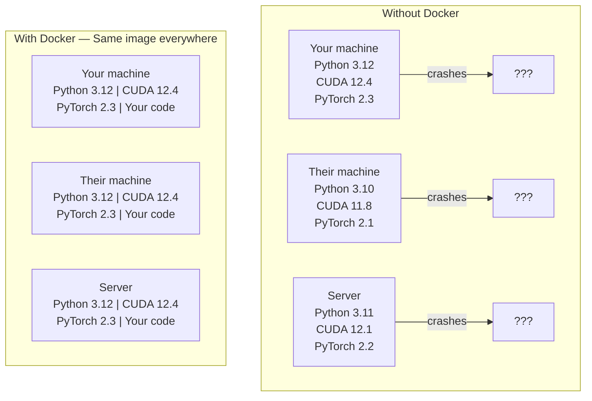

# Докер для ИИ

> Контейнеры делают "работа на моей машине" вещью прошлого.

**Type:** Build
**Languages:** Docker
**Prerequisites:** Phase 0, Lessons 01 and 03
**Time:** ~60 minutes

## Цели обучения

- Создать изображение Docker с GPU с помощью библиотек CUDA, PyTorch и AI из файла Docker
- Настроить каталоги хоста в виде объемов для сохранения моделей, наборов данных и кода в контейнерных реконструированиях
- Настройка набора инструментов NVIDIA Container Toolkit для выявления GPU внутри контейнеров
- Оркестрация многосервисных приложений ИИ (инференс-сервер + векторная база данных) с использованием Docker Compose

## Проблема

Вы обучили модель на ноутбуке с PyTorch 2.3, CUDA 12.4 и Python 3.12. У вашего коллеги есть PyTorch 2.1, CUDA 11.8 и Python 3.10.

ИИ-проекты - это кошмары зависимости. Типичный стак включает Python, PyTorch, драйверы CUDA, cuDNN, библиотеки на системном уровне C и специализированные пакеты, такие как flash-attn, которые требуют точных версий компилятора. Docker упаковывает все это в одно изображение, которое работает идентично везде.

## Концепция

Докер заворачивает ваш код, время запуска, библиотеки и системные инструменты в изолированную единицу под названием контейнер.



### Почему проекты ИИ нуждаются в Докере больше, чем большинство

1. **GPU drivers are fragile.**Код CUDA 12.4 не работает на CUDA 11.8. Docker изолирует набор инструментов CUDA внутри контейнера, разделяя драйвер хоста GPU через набор инструментов NVIDIA Container.

2. **Model weights are large.**Параметр модели 7B составляет 14 ГБ в fp16. Вы не хотите загружать его каждый раз, когда восстанавливаете.

3. **Multi-service architectures are common.**Настоящее приложение ИИ - это не просто скрипт Python. Это сервер выводов, векторная база данных для RAG, возможно, веб-фронтэнд. Docker Compose организует все это одним командом.

### Ключевой словарь

| Term | What it means |
|------|---------------|
| Image | A read-only template. Your recipe. Built from a Dockerfile. |
| Container | A running instance of an image. Your kitchen. |
| Dockerfile | Instructions to build an image. Layer by layer. |
| Volume | Persistent storage that survives container restarts. |
| docker-compose | A tool for defining multi-container applications in YAML. |

### Общие шаблоны контейнеров в ИИ

```
Dev Container
  Full toolkit. Editor support. Jupyter. Debugging tools.
  Used during development and experimentation.

Training Container
  Minimal. Just the training script and dependencies.
  Runs on GPU clusters. No editor, no Jupyter.

Inference Container
  Optimized for serving. Small image. Fast cold start.
  Runs behind a load balancer in production.
```

```figure
s0-image-layers
```

## Создайте его

### Шаг 1: Установите Docker

```bash
# macOS
brew install --cask docker
open /Applications/Docker.app

# Ubuntu
curl -fsSL https://get.docker.com | sh
sudo usermod -aG docker $USER
# Log out and back in for group change to take effect
```

Проверьте:

```bash
docker --version
docker run hello-world
```

### Шаг 2: Установите NVIDIA Container Toolkit (Линукс с NVIDIA GPU)

Это позволяет контейнерам Docker получить доступ к вашему GPU. Пользователи MacOS и Windows (WSL2) могут пропустить это; Docker Desktop обрабатывает GPU по-разному на этих платформах.

```bash
distribution=$(. /etc/os-release;echo $ID$VERSION_ID)
curl -fsSL https://nvidia.github.io/libnvidia-container/gpgkey | sudo gpg --dearmor -o /usr/share/keyrings/nvidia-container-toolkit-keyring.gpg
curl -s -L https://nvidia.github.io/libnvidia-container/$distribution/libnvidia-container.list | \
    sed 's#deb https://#deb [signed-by=/usr/share/keyrings/nvidia-container-toolkit-keyring.gpg] https://#g' | \
    sudo tee /etc/apt/sources.list.d/nvidia-container-toolkit.list

sudo apt-get update
sudo apt-get install -y nvidia-container-toolkit
sudo nvidia-ctk runtime configure --runtime=docker
sudo systemctl restart docker
```

Проверка доступа к графическому процессору внутри контейнера:

```bash
docker run --rm --gpus all nvidia/cuda:12.4.1-base-ubuntu22.04 nvidia-smi
```

Если вы видите информацию о GPU, инструментарий работает.

### Шаг 3: Понимание базовых изображений

Выбор правильного изображения с базы экономит много часов дебгурирования.

```
nvidia/cuda:12.4.1-devel-ubuntu22.04
  Full CUDA toolkit. Compilers included.
  Use for: building packages that need nvcc (flash-attn, bitsandbytes)
  Size: ~4 GB

nvidia/cuda:12.4.1-runtime-ubuntu22.04
  CUDA runtime only. No compilers.
  Use for: running pre-built code
  Size: ~1.5 GB

pytorch/pytorch:2.6.0-cuda12.4-cudnn9-runtime
  PyTorch pre-installed on top of CUDA.
  Use for: skipping the PyTorch install step
  Size: ~6 GB

python:3.12-slim
  No CUDA. CPU only.
  Use for: inference on CPU, lightweight tools
  Size: ~150 MB
```

### Шаг 4: Напишите файл Docker для разработки ИИ

Вот файл Докера в `code/Dockerfile`Прогуляйтесь по ней:

```dockerfile
FROM --platform=linux/amd64 nvidia/cuda:12.4.1-devel-ubuntu22.04

ENV DEBIAN_FRONTEND=noninteractive
ENV PYTHONUNBUFFERED=1

RUN apt-get update && apt-get install -y --no-install-recommends \
    software-properties-common \
    git \
    curl \
    build-essential \
    && add-apt-repository -y ppa:deadsnakes/ppa \
    && apt-get update && apt-get install -y --no-install-recommends \
    python3.12 \
    python3.12-venv \
    python3.12-dev \
    && rm -rf /var/lib/apt/lists/*

RUN update-alternatives --install /usr/bin/python python /usr/bin/python3.12 1

RUN curl -sSL https://raw.githubusercontent.com/pypa/get-pip/3b73145063be545b649ad9ca83ea8da5fc915a4f/public/get-pip.py -o /tmp/get-pip.py \
    && echo "a341e1a43e38001c551a1508a73ff23636a11970b61d901d9a1cad2a18f57055  /tmp/get-pip.py" | sha256sum -c - \
    && python /tmp/get-pip.py \
    && rm /tmp/get-pip.py \
    && update-alternatives --install /usr/bin/pip pip /usr/local/bin/pip3.12 1

RUN python -m pip install --no-cache-dir --upgrade pip setuptools wheel

RUN python -m pip install --no-cache-dir \
    torch==2.6.0+cu124 \
    torchvision==0.21.0+cu124 \
    torchaudio==2.6.0+cu124 \
    --index-url https://download.pytorch.org/whl/cu124

RUN python -m pip install --no-cache-dir \
    numpy \
    pandas \
    scikit-learn \
    matplotlib \
    jupyter \
    transformers \
    datasets \
    accelerate \
    safetensors

WORKDIR /workspace

VOLUME ["/workspace", "/models"]

EXPOSE 8888

CMD ["python"]
```

Создайте его:

```bash
docker build -t ai-dev -f phases/00-setup-and-tooling/07-docker-for-ai/code/Dockerfile .
```

Это занимает некоторое время в первый раз (загрузка базового изображения CUDA + PyTorch).

**macOS / Apple Silicon (M1/M2/M3/M4):**- Да .`--platform=linux/amd64`на `FROM`В основном, это означает, что вы можете использовать и Mac, и вы можете использовать его в качестве приложения.`cu124`колеса только для x86_64, так что `pip install torch==2.6.0+cu124`слой не работает с `No matching distribution found for torch==2.6.0+cu124`. При закреплении платформы вытягивается изображение x86_64 и запускается под эмуляцией: создание медленнее и контейнер не имеет GPU (в Mac нет CUDA в любом случае).`--gpus all`из `docker run`Для работы с графикой на Apple Silicon, запустите уроки на родном языке с помощью MPS build из урока 01 и сохраните это изображение для хостов x86_64 Linux с NVIDIA GPU.

Попробуй:

```bash
docker run --rm -it --gpus all \
    -v $(pwd):/workspace \
    -v ~/models:/models \
    ai-dev python -c "import torch; print(f'PyTorch {torch.__version__}, CUDA: {torch.cuda.is_available()}')"
```

Запустить Jupyter внутри контейнера:

```bash
docker run --rm -it --gpus all \
    -v $(pwd):/workspace \
    -v ~/models:/models \
    -p 8888:8888 \
    ai-dev jupyter notebook --ip=0.0.0.0 --port=8888 --no-browser --allow-root
```

### Шаг 5: Объемные установки для данных и моделей

Без них загрузки 14 ГБ-модели исчезают, когда контейнер останавливается.

```bash
# Mount your code
-v $(pwd):/workspace

# Mount a shared models directory
-v ~/models:/models

# Mount datasets
-v ~/datasets:/data
```

В вашем учебном сценарии, загрузите из установленного пути:

```python
from transformers import AutoModel

model = AutoModel.from_pretrained("/models/llama-7b")
```

Модель работает на вашей файловой системе хоста.

### Шаг 6: Docker Составлять для приложений ИИ для многоуслуг

Для настоящего RAG-приложения нужен сервер выводов и векторная база данных.

Посмотрите .`code/docker-compose.yml`В следующем случае:

```yaml
services:
  ai-dev:
    build:
      context: .
      dockerfile: Dockerfile
    deploy:
      resources:
        reservations:
          devices:
            - driver: nvidia
              count: all
              capabilities: [gpu]
    volumes:
      - ../../../:/workspace
      - ~/models:/models
      - ~/datasets:/data
    ports:
      - "8888:8888"
    stdin_open: true
    tty: true
    command: jupyter notebook --ip=0.0.0.0 --port=8888 --no-browser --allow-root

  qdrant:
    image: qdrant/qdrant:v1.12.5
    ports:
      - "6333:6333"
      - "6334:6334"
    volumes:
      - qdrant_data:/qdrant/storage

volumes:
  qdrant_data:
```

Начните все:

```bash
cd phases/00-setup-and-tooling/07-docker-for-ai/code
docker compose up -d
```

Теперь ваш контейнер для разработки ИИ может получить доступ к вектору базы данных в `http://qdrant:6333`Docker Compose автоматически создает общую сеть.

Проверьте соединение изнутри контейнера ИИ:

```python
from qdrant_client import QdrantClient

client = QdrantClient(host="qdrant", port=6333)
print(client.get_collections())
```

Прекратите все:

```bash
docker compose down
```

Добавить`-v`для удаления также объема qdrant:

```bash
docker compose down -v
```

### Шаг 7: Полезные команды Docker для работы ИИ

```bash
# List running containers
docker ps

# List all images and their sizes
docker images

# Remove unused images (reclaim disk space)
docker system prune -a

# Check GPU usage inside a running container
docker exec -it <container_id> nvidia-smi

# Copy a file from container to host
docker cp <container_id>:/workspace/results.csv ./results.csv

# View container logs
docker logs -f <container_id>
```

## Используйте его

Теперь у вас есть воспроизводимая среда для разработки ИИ.

- Использование`docker compose up`чтобы запустить свою среду разработки и векторную базу данных вместе
- Соедините свой код, модели и данные в виде объемов, чтобы ничего не было потеряно между восстановлениями
- Когда уроку требуется новый пакет Python, добавьте его в файл Docker и восстановить
- Поделитесь своим Докер-файлом с коллегами, они получают точно такую же среду.

### Нет GPU?

Убрать `--gpus all`ПайТорч обнаруживает отсутствие CUDA и автоматически возвращается к процессору.

## Упражнения

1. Создайте Докерфайл и запущите `python -c "import torch; print(torch.__version__)"`внутри контейнера
2. Запустить пакет докер-композиции и проверить доступность Qdrant из контейнера AI на `http://qdrant:6333/collections`
3. Добавить`flask`Перезагрузить файл Docker, восстановить и запустить простый сервер API на порту 5000.`-p 5000:5000`
4. Измерить размер изображения с помощью `docker images`Попробуйте переключить базовый изображение с `devel`к `runtime`и сравнивать размеры

## Ключевые условия

| Term | What people say | What it actually means |
|------|----------------|----------------------|
| Container | "Lightweight VM" | An isolated process using the host kernel, with its own filesystem and network |
| Image layer | "Cached step" | Each Dockerfile instruction creates a layer. Unchanged layers are cached, so rebuilds are fast. |
| NVIDIA Container Toolkit | "GPU in Docker" | A runtime hook that exposes host GPUs to containers via `--gpus` flag |
| Volume mount | "Shared folder" | A directory on the host mapped into the container. Changes persist after the container stops. |
| Base image | "Starting point" | The `FROM` image your Dockerfile builds on top of. Determines what is pre-installed. |
