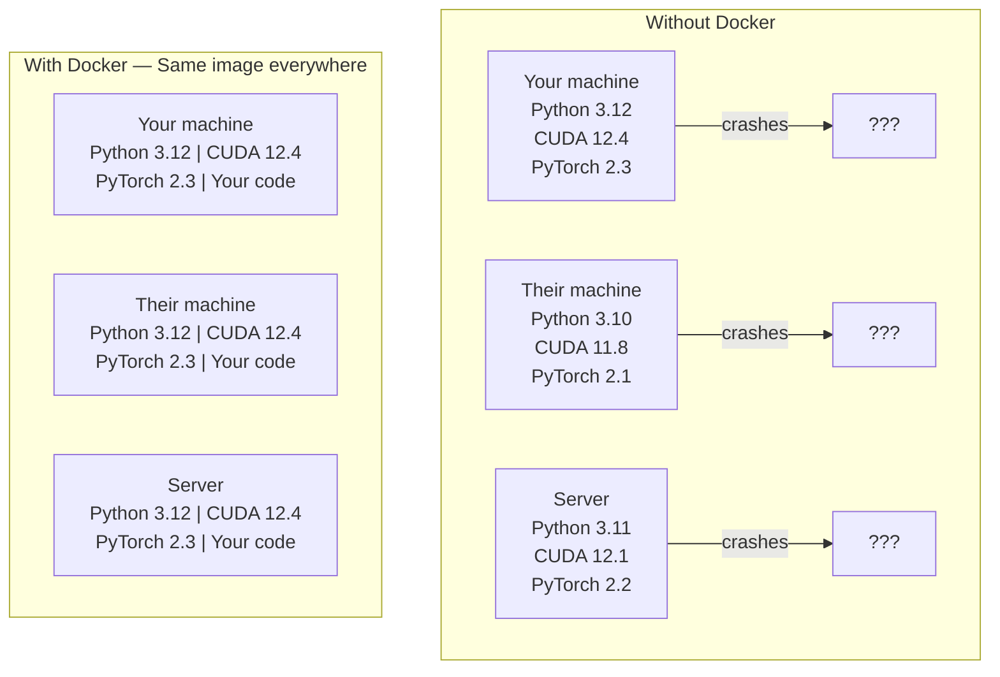

# Docker для ИИ

> Контейнеры делают фразу «на моей машине работает» пережитком прошлого.

**Type:** Build
**Languages:** Docker
**Prerequisites:** Phase 0, Lessons 01 and 03
**Time:** ~60 минут

## Цели обучения

- Собрать Docker-образ с поддержкой GPU, включающий CUDA, PyTorch и библиотеки для ИИ, из Dockerfile
- Монтировать директории хоста как тома для сохранения моделей, датасетов и кода между пересборками контейнера
- Настроить NVIDIA Container Toolkit для предоставления доступа к GPU внутри контейнеров
- Оркестрировать многосервисные ИИ-приложения (сервер инференса + векторная база данных) с помощью Docker Compose

## Проблема

Вы обучили модель на ноутбуке с PyTorch 2.3, CUDA 12.4 и Python 3.12. У вашего коллеги PyTorch 2.1, CUDA 11.8 и Python 3.10. Ваша модель падает на его машине. Ваш Dockerfile работает на обеих машинах.

ИИ-проекты — это кошмар зависимостей. Типичный стек включает Python, PyTorch, драйверы CUDA, cuDNN, системные библиотеки C и специализированные пакеты вроде flash-attn, требующие точных версий компилятора. Docker упаковывает всё это в единый образ, который работает одинаково везде.

## Концепция

Docker оборачивает ваш код, runtime, библиотеки и системные инструменты в изолированную единицу, называемую контейнером. Представьте её как облегчённую виртуальную машину, но с той разницей, что она использует ядро ОС хоста вместо запуска своего собственного, поэтому запускается за секунды, а не минуты.



### Почему ИИ-проектам Docker нужен больше, чем остальным

1. **Драйверы GPU хрупкие.** Код, написанный под CUDA 12.4, не запустится на CUDA 11.8. Docker изолирует набор инструментов CUDA внутри контейнера, при этом разделяя доступ к драйверу GPU хоста через NVIDIA Container Toolkit.

2. **Веса моделей большие.** Модель с 7 млрд параметров весит 14 ГБ в fp16. Вы не хотите скачивать её заново при каждой пересборке. Тома Docker позволяют смонтировать директорию с моделями с хоста.

3. **Многосервисные архитектуры — обычное дело.** Реальное ИИ-приложение — это не просто Python-скрипт. Это сервер инференса, векторная база данных для RAG, возможно, веб-фронтенд. Docker Compose оркестрирует всё это одной командой.

### Ключевые термины

| Термин | Что это значит |
|------|---------------|
| Образ (Image) | Шаблон только для чтения. Ваш рецепт. Собирается из Dockerfile. |
| Контейнер (Container) | Запущенный экземпляр образа. Ваша кухня. |
| Dockerfile | Инструкции для сборки образа. Слой за слоем. |
| Том (Volume) | Постоянное хранилище, которое сохраняется после перезапуска контейнера. |
| docker-compose | Инструмент для описания многоконтейнерных приложений в YAML. |

### Типичные паттерны контейнеров в ИИ

```
Dev Container
  Full toolkit. Editor support. Jupyter. Debugging tools.
  Used during development and experimentation.

Training Container
  Minimal. Just the training script and dependencies.
  Runs on GPU clusters. No editor, no Jupyter.

Inference Container
  Optimized for serving. Small image. Fast cold start.
  Runs behind a load balancer in production.
```

```figure
s0-image-layers
```

## Практика

### Шаг 1: Установка Docker

```bash
# macOS
brew install --cask docker
open /Applications/Docker.app

# Ubuntu
curl -fsSL https://get.docker.com | sh
sudo usermod -aG docker $USER
# Log out and back in for group change to take effect
```

Проверка:

```bash
docker --version
docker run hello-world
```

### Шаг 2: Установка NVIDIA Container Toolkit (Linux с GPU NVIDIA)

Это позволяет контейнерам Docker получать доступ к вашему GPU. Пользователи macOS и Windows (WSL2) могут пропустить этот шаг; Docker Desktop обрабатывает передачу GPU иначе на этих платформах.

```bash
distribution=$(. /etc/os-release;echo $ID$VERSION_ID)
curl -fsSL https://nvidia.github.io/libnvidia-container/gpgkey | sudo gpg --dearmor -o /usr/share/keyrings/nvidia-container-toolkit-keyring.gpg
curl -s -L https://nvidia.github.io/libnvidia-container/$distribution/libnvidia-container.list | \
    sed 's#deb https://#deb [signed-by=/usr/share/keyrings/nvidia-container-toolkit-keyring.gpg] https://#g' | \
    sudo tee /etc/apt/sources.list.d/nvidia-container-toolkit.list

sudo apt-get update
sudo apt-get install -y nvidia-container-toolkit
sudo nvidia-ctk runtime configure --runtime=docker
sudo systemctl restart docker
```

Проверьте доступ к GPU внутри контейнера:

```bash
docker run --rm --gpus all nvidia/cuda:12.4.1-base-ubuntu22.04 nvidia-smi
```

Если вы видите информацию о своём GPU, значит toolkit работает.

### Шаг 3: Разберитесь в базовых образах

Правильный выбор базового образа экономит часы отладки.

```
nvidia/cuda:12.4.1-devel-ubuntu22.04
  Full CUDA toolkit. Compilers included.
  Use for: building packages that need nvcc (flash-attn, bitsandbytes)
  Size: ~4 GB

nvidia/cuda:12.4.1-runtime-ubuntu22.04
  CUDA runtime only. No compilers.
  Use for: running pre-built code
  Size: ~1.5 GB

pytorch/pytorch:2.6.0-cuda12.4-cudnn9-runtime
  PyTorch pre-installed on top of CUDA.
  Use for: skipping the PyTorch install step
  Size: ~6 GB

python:3.12-slim
  No CUDA. CPU only.
  Use for: inference on CPU, lightweight tools
  Size: ~150 MB
```

### Шаг 4: Напишите Dockerfile для разработки ИИ-приложений

Вот Dockerfile в `code/Dockerfile`. Разберём его построчно:

```dockerfile
FROM --platform=linux/amd64 nvidia/cuda:12.4.1-devel-ubuntu22.04

ENV DEBIAN_FRONTEND=noninteractive
ENV PYTHONUNBUFFERED=1

RUN apt-get update && apt-get install -y --no-install-recommends \
    software-properties-common \
    git \
    curl \
    build-essential \
    && add-apt-repository -y ppa:deadsnakes/ppa \
    && apt-get update && apt-get install -y --no-install-recommends \
    python3.12 \
    python3.12-venv \
    python3.12-dev \
    && rm -rf /var/lib/apt/lists/*

RUN update-alternatives --install /usr/bin/python python /usr/bin/python3.12 1

RUN curl -sSL https://raw.githubusercontent.com/pypa/get-pip/3b73145063be545b649ad9ca83ea8da5fc915a4f/public/get-pip.py -o /tmp/get-pip.py \
    && echo "a341e1a43e38001c551a1508a73ff23636a11970b61d901d9a1cad2a18f57055  /tmp/get-pip.py" | sha256sum -c - \
    && python /tmp/get-pip.py \
    && rm /tmp/get-pip.py \
    && update-alternatives --install /usr/bin/pip pip /usr/local/bin/pip3.12 1

RUN python -m pip install --no-cache-dir --upgrade pip setuptools wheel

RUN python -m pip install --no-cache-dir \
    torch==2.6.0+cu124 \
    torchvision==0.21.0+cu124 \
    torchaudio==2.6.0+cu124 \
    --index-url https://download.pytorch.org/whl/cu124

RUN python -m pip install --no-cache-dir \
    numpy \
    pandas \
    scikit-learn \
    matplotlib \
    jupyter \
    transformers \
    datasets \
    accelerate \
    safetensors

WORKDIR /workspace

VOLUME ["/workspace", "/models"]

EXPOSE 8888

CMD ["python"]
```

Соберите его:

```bash
docker build -t ai-dev -f phases/00-setup-and-tooling/07-docker-for-ai/code/Dockerfile .
```

В первый раз это занимает некоторое время (скачивание базового образа CUDA + PyTorch). Последующие сборки используют кэшированные слои.

**macOS / Apple Silicon (M1/M2/M3/M4):** именно `--platform=linux/amd64` в строке `FROM` позволяет этой сборке успешно проходить на Mac. Базовый образ CUDA также поставляется в варианте arm64, и Docker Desktop выбирает его автоматически на Apple Silicon, но PyTorch публикует свои колёса `cu124` только для x86_64, поэтому слой `pip install torch==2.6.0+cu124` завершается ошибкой `No matching distribution found for torch==2.6.0+cu124`. Фиксация платформы приводит к загрузке образа x86_64 и его запуску в режиме эмуляции: сборка идёт медленнее, а в контейнере нет доступа к GPU (на Mac в любом случае нет CUDA). Уберите `--gpus all` из команд `docker run` ниже, если вы на Mac. Для работы с GPU на Apple Silicon запускайте уроки нативно, используя сборку MPS из Lesson 01, а этот образ оставьте для хостов x86_64 Linux с GPU NVIDIA.

Запустите его:

```bash
docker run --rm -it --gpus all \
    -v $(pwd):/workspace \
    -v ~/models:/models \
    ai-dev python -c "import torch; print(f'PyTorch {torch.__version__}, CUDA: {torch.cuda.is_available()}')"
```

Запустите Jupyter внутри контейнера:

```bash
docker run --rm -it --gpus all \
    -v $(pwd):/workspace \
    -v ~/models:/models \
    -p 8888:8888 \
    ai-dev jupyter notebook --ip=0.0.0.0 --port=8888 --no-browser --allow-root
```

### Шаг 5: Монтирование томов для данных и моделей

Монтирование томов критически важно для работы с ИИ. Без него ваша 14-гигабайтная модель исчезнет после остановки контейнера, и её придётся скачивать заново.

```bash
# Mount your code
-v $(pwd):/workspace

# Mount a shared models directory
-v ~/models:/models

# Mount datasets
-v ~/datasets:/data
```

Внутри вашего скрипта обучения загружайте данные из смонтированного пути:

```python
from transformers import AutoModel

model = AutoModel.from_pretrained("/models/llama-7b")
```

Модель хранится на файловой системе хоста. Пересобирайте контейнер сколько угодно раз без повторной загрузки.

### Шаг 6: Docker Compose для многосервисных ИИ-приложений

Настоящему RAG-приложению нужен сервер инференса и векторная база данных. Docker Compose запускает оба компонента одной командой.

См. `code/docker-compose.yml`:

```yaml
services:
  ai-dev:
    build:
      context: .
      dockerfile: Dockerfile
    deploy:
      resources:
        reservations:
          devices:
            - driver: nvidia
              count: all
              capabilities: [gpu]
    volumes:
      - ../../../:/workspace
      - ~/models:/models
      - ~/datasets:/data
    ports:
      - "8888:8888"
    stdin_open: true
    tty: true
    command: jupyter notebook --ip=0.0.0.0 --port=8888 --no-browser --allow-root

  qdrant:
    image: qdrant/qdrant:v1.12.5
    ports:
      - "6333:6333"
      - "6334:6334"
    volumes:
      - qdrant_data:/qdrant/storage

volumes:
  qdrant_data:
```

Запустите всё:

```bash
cd phases/00-setup-and-tooling/07-docker-for-ai/code
docker compose up -d
```

Теперь ваш ИИ dev-контейнер может обращаться к векторной базе данных по адресу `http://qdrant:6333` по имени сервиса. Docker Compose автоматически создаёт общую сеть.

Проверьте соединение изнутри контейнера ИИ:

```python
from qdrant_client import QdrantClient

client = QdrantClient(host="qdrant", port=6333)
print(client.get_collections())
```

Остановите всё:

```bash
docker compose down
```

Добавьте `-v`, чтобы также удалить том qdrant:

```bash
docker compose down -v
```

### Шаг 7: Полезные команды Docker для работы с ИИ

```bash
# List running containers
docker ps

# List all images and their sizes
docker images

# Remove unused images (reclaim disk space)
docker system prune -a

# Check GPU usage inside a running container
docker exec -it <container_id> nvidia-smi

# Copy a file from container to host
docker cp <container_id>:/workspace/results.csv ./results.csv

# View container logs
docker logs -f <container_id>
```

## Применение

Теперь у вас есть воспроизводимое окружение для разработки ИИ. На протяжении оставшейся части курса:

- Используйте `docker compose up`, чтобы одновременно запускать среду разработки и векторную базу данных
- Монтируйте код, модели и данные как тома, чтобы ничего не терялось между пересборками
- Когда в уроке требуется новый пакет Python, добавляйте его в Dockerfile и пересобирайте
- Делитесь своим Dockerfile с коллегами по команде. Они получат точно такое же окружение.

### Нет GPU?

Уберите флаг `--gpus all` и блок deploy NVIDIA. Контейнер по-прежнему будет работать для уроков на CPU. PyTorch обнаруживает отсутствие CUDA и автоматически переключается на CPU.

## Упражнения

1. Соберите Dockerfile и запустите `python -c "import torch; print(torch.__version__)"` внутри контейнера
2. Запустите стек docker-compose и убедитесь, что Qdrant доступен из ИИ-контейнера по адресу `http://qdrant:6333/collections`
3. Добавьте `flask` в Dockerfile, пересоберите и запустите простой API-сервер на порту 5000. Пробросьте порт с помощью `-p 5000:5000`
4. Измерьте размер образа с помощью `docker images`. Попробуйте сменить базовый образ с `devel` на `runtime` и сравните размеры

## Ключевые термины

| Термин | Что обычно говорят | Что это на самом деле означает |
|------|----------------|----------------------|
| Контейнер | «Облегчённая VM» | Изолированный процесс, использующий ядро хоста, со своей файловой системой и сетью |
| Слой образа | «Кэшированный шаг» | Каждая инструкция Dockerfile создаёт слой. Неизменённые слои кэшируются, поэтому пересборки проходят быстро. |
| NVIDIA Container Toolkit | «GPU в Docker» | Хук в runtime, предоставляющий контейнерам доступ к GPU хоста через флаг `--gpus` |
| Монтирование тома | «Общая папка» | Директория на хосте, отображённая в контейнер. Изменения сохраняются после остановки контейнера. |
| Базовый образ | «Отправная точка» | Образ `FROM`, на основе которого строится ваш Dockerfile. Определяет, что уже предустановлено. |