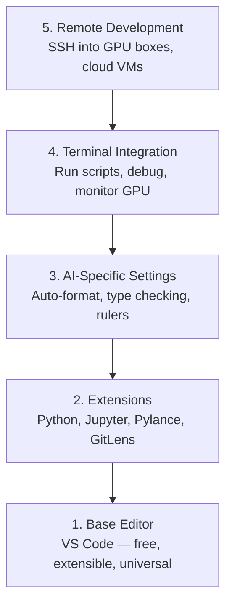

# Настройка редактора

> Редактор - ваш сопилот, настройте его один раз, чтобы он не мешал вам и начал тянуть свой вес.

**Type:** Build
**Languages:** --
**Prerequisites:** Phase 0, Lesson 01
**Time:** ~20 minutes

## Цели обучения

- Установка VS Code с существенными расширениями для Python, Jupyter, linting и удаленного SSH
- Настройка формата на сохранение, проверка типа и прокручивание выхода ноутбука для рабочего потока ИИ
- Настройка Remote SSH для редактирования и дебъюгирования кода на удаленных GPU-машинах , как если бы они были локальными
- Оценить альтернативы редакторам (Cursor, Windsurf, Neovim) и их компромиссы для работы ИИ

## Проблема

Вы потратите тысячи часов внутри редактора, пишущего Python, запуская ноутбуки, дебгурируя тренировочные петли и вводя SSH в ящики GPU. Неисправно настроенный редактор превращает каждую сессию в трение: без автокомплекта, без намеков на написание, без ошибок в линейке, ручной форматировки и неуклюжий рабочий процесс терминала.

Правильная настройка занимает 20 минут, а пропустить её стоит 20 минут каждый день.

## Концепция

Для создания инженерного редактора ИИ требуется пять вещей:



```figure
s0-lsp-roundtrip
```

## Создайте его

### Шаг 1: Установите код VS

VS Code - это рекомендуемый редактор. Он бесплатный, работает на каждой ОС, имеет первоклассную поддержку ноутбуков Jupyter, а экосистема расширений охватывает все, что вам нужно для работы ИИ.

Скачать его с [code.visualstudio.com](https://code.visualstudio.com/)- Я не знаю .

Проверьте с терминала:

```bash
code --version
```

Если`code`не найдено на macOS, открыть VS Code, нажмите `Cmd+Shift+P`, нажмите "Каманда "Shell", и выберите "Установка команды "код" в PATH".

### Шаг 2: устанавливайте необходимые расширения

Откройте интегрированный терминал в код VS (`` Ctrl+``` на каждой платформе) и устанавливать расширения , которые имеют значение для работы ИИ:

```bash
code --install-extension ms-python.python
code --install-extension ms-python.vscode-pylance
code --install-extension ms-toolsai.jupyter
code --install-extension eamodio.gitlens
code --install-extension ms-vscode-remote.remote-ssh
code --install-extension ms-python.debugpy
code --install-extension ms-python.black-formatter
code --install-extension charliermarsh.ruff
```

Что каждый делает:

| Extension | Why |
|-----------|-----|
| Python | Language support, virtual env detection, run/debug |
| Pylance | Fast type checking, autocomplete, import resolution |
| Jupyter | Run notebooks inside VS Code, variable explorer |
| GitLens | See who changed what, inline git blame |
| Remote SSH | Open a folder on a remote GPU box as if it were local |
| Debugpy | Step-through debugging for Python |
| Black Formatter | Auto-format on save, consistent style |
| Ruff | Fast linting, catches common mistakes |

Досье .`code/.vscode/extensions.json`В этом уроке есть полный список рекомендаций. Когда вы открываете папку проекта, VS Code попросит вас установить их.

### Шаг 3: Настройка настроек

Копируйте настройки из `code/.vscode/settings.json`в этом уроке, или применять их вручную через `Settings > Open Settings (JSON)`- Я не знаю .

Ключевые настройки для работы ИИ:

```jsonc
{
    "python.analysis.typeCheckingMode": "basic",
    "editor.formatOnSave": true,
    "editor.rulers": [88, 120],
    "notebook.output.scrolling": true,
    "files.autoSave": "afterDelay"
}
```

Почему это важно:

- **Type checking on basic**: Захватывает неправильные типы аргументов перед запуском. Сберегает время дебгурирования на несоответствия формы тензора и неправильные параметры API.
- **Format on save**Никогда не думай о форматировании.
- **Rulers at 88 and 120**Черный заклад на 88. Маркер 120 показывает, когда документальные строки и комментарии становятся слишком длинными.
- **Notebook output scrolling**В тренировочных петлях печатаются тысячи строк.
- **Auto-save**Вы забудете сохранить. Ваш учебный сценарий будет запускать устаревший код. Авто-спасение предотвращает это.

### Шаг 4: интеграция терминалов

В интегрированном терминале VS Code вы запускаете учебные скрипты, контролируете графические процессоры и управляете средой.

Настройку правильно:

```jsonc
{
    "terminal.integrated.defaultProfile.osx": "zsh",
    "terminal.integrated.defaultProfile.linux": "bash",
    "terminal.integrated.fontSize": 13,
    "terminal.integrated.scrollback": 10000
}
```

Полезные кратковременные пути:

| Action | macOS | Linux/Windows |
|--------|-------|---------------|
| Toggle terminal | `` Ctrl+` `` | `` Ctrl+` `` |
| New terminal | `` Ctrl+Shift+` `` | `` Ctrl+Shift+` `` |
| Split terminal | `Cmd+\` | `Ctrl+Shift+5` |

Сплит-терминалы полезны: один для выполнения скрипта, другой для мониторинга GPU с `nvidia-smi -l 1`или `watch -n 1 nvidia-smi`- Я не знаю .

### Шаг 5: Расстояние развития (SSH в GPU-кробки)

Это самое важное расширение для работы ИИ. Вы будете выполнять обучение на удаленных машинах (облачные виртуальные машины, лабораторные серверы, Lambda, Vast.ai).

Настройка:

1. Установка расширения SSH на расстоянии (находится на этапе 2).
2. Печать `Ctrl+Shift+P`(или `Cmd+Shift+P`), введите в строке "Ремо-SSH: подключение к хосту".
3. Входите .`user@your-gpu-box-ip`- Я не знаю .
4. VS Code устанавливает свой компонент сервера на удаленной машине автоматически.

Для бес парольного доступа настройка ключей SSH:

```bash
ssh-keygen -t ed25519 -C "your-email@example.com"
ssh-copy-id user@your-gpu-box-ip
```

Добавить хозяина к `~/.ssh/config`для удобства:

```
Host gpu-box
    HostName 203.0.113.50
    User ubuntu
    IdentityFile ~/.ssh/id_ed25519
    ForwardAgent yes
```

Теперь .`Remote-SSH: Connect to Host > gpu-box`Сключается мгновенно.

## Альтернативы

### Проклятие

[cursor.com](https://cursor.com)В этом случае все в этом уроке все равно применяется. Импортируйте то же самое `settings.json`и `extensions.json`- Я не знаю .

### Ветерсерф

[windsurf.com](https://windsurf.com)Это еще один вилок VS Code, который был разработан в первую очередь ИИ.

### Вим/Невим

Если вы уже используете Vim или Neovim и продуктивно в нем, оставайтесь там.

- **pyright**или **pylsp**для проверки типа (посредством установки Mason или manual)
- **nvim-lspconfig**для интеграции языковых серверов
- **jupyter-vim**или **molten-nvim**для выполнения, подобного ноутбуку
- **telescope.nvim**для поиска файлов/символов
- **none-ls.nvim**с черным и руфным для форматирования/обличения

Если вы еще не используете Vim, не начинайте сейчас. Кривая обучения будет конкурировать с обучением искусственному инженерии. Используйте VS Code.

## Используйте его

С этой настройкой ваш ежедневный рабочий процесс выглядит так:

1. Откройте папку проекта в VS Code (или подключитесь к ящику GPU через удаленный SSH).
2. Напишите Python в редакторе с автополностью, указаниями на ввод и ошибками в линейке.
3. Запустите ноутбуки Jupyter в соответствии с расширением Jupyter.
4. Используйте интегрированный терминал для подготовки сценариев, `uv pip install`, и мониторинга GPU.
5. Перед тем как принять решение, пересмотреть изменения с GitLens.

## Упражнения

1. Установка кода VS и всех расширений, перечисленных в шаге 2
2. Копируйте `settings.json`из этого урока в ваш VS Код конфигурация
3. Откройте файл Python и убедитесь , что Pylance показывает указания на тип и черный формат на сохранении
4. Если у вас есть доступ к удаленной машине, настройьте Remote SSH и откройте папку на ней

## Ключевые условия

| Term | What people say | What it actually means |
|------|----------------|----------------------|
| LSP | "Autocomplete engine" | Language Server Protocol: a standard for editors to get type info, completions, and diagnostics from a language-specific server |
| Pylance | "The Python plugin" | Microsoft's Python language server using Pyright for type checking and IntelliSense |
| Remote SSH | "Working on the server" | VS Code extension that runs a lightweight server on a remote machine and streams the UI to your local editor |
| Format on save | "Auto-prettier" | The editor runs a formatter (Black, Ruff) every time you save, so code style is always consistent |
