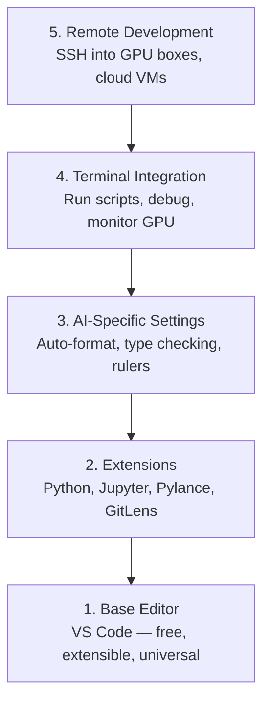

# Настройка редактора

> Ваш редактор — ваш второй пилот. Настройте его один раз, чтобы он не мешал вам, а начал работать на вас.

**Type:** Build
**Languages:** --
**Prerequisites:** Phase 0, Lesson 01
**Time:** ~20 минут

## Цели обучения

- Установить VS Code с основными расширениями для Python, Jupyter, линтинга и удалённого доступа по SSH
- Настроить автоформатирование при сохранении, проверку типов и прокрутку вывода в блокнотах для AI-задач
- Настроить Remote SSH для редактирования и отладки кода на удалённых GPU-машинах так, как будто они локальные
- Оценить альтернативные редакторы (Cursor, Windsurf, Neovim) и их компромиссы для работы с AI

## Проблема

Вы проведёте тысячи часов в редакторе, пиша Python, запуская блокноты, отлаживая циклы обучения и подключаясь по SSH к GPU-машинам. Неправильно настроенный редактор превращает каждую сессию в источник трения: нет автодополнения, нет подсказок по типам, нет встроенных ошибок, ручное форматирование и неудобный терминальный workflow.

Правильная настройка занимает 20 минут. Пропуск этого шага обходится вам в 20 минут каждый день.

## Концепция

Настройка редактора для AI-инженерии требует пяти составляющих:



```figure
s0-lsp-roundtrip
```

## Сборка

### Шаг 1: Установите VS Code

VS Code — рекомендуемый редактор. Он бесплатный, работает на любой ОС, имеет первоклассную поддержку блокнотов Jupyter, а экосистема расширений покрывает всё необходимое для работы с AI.

Скачайте его на [code.visualstudio.com](https://code.visualstudio.com/).

Проверьте из терминала:

```bash
code --version
```

Если `code` не найден на macOS, откройте VS Code, нажмите `Cmd+Shift+P`, введите "Shell Command" и выберите "Install 'code' command in PATH".

### Шаг 2: Установите основные расширения

Откройте встроенный терминал в VS Code (`` Ctrl+` `` на любой платформе) и установите расширения, важные для работы с AI:

```bash
code --install-extension ms-python.python
code --install-extension ms-python.vscode-pylance
code --install-extension ms-toolsai.jupyter
code --install-extension eamodio.gitlens
code --install-extension ms-vscode-remote.remote-ssh
code --install-extension ms-python.debugpy
code --install-extension ms-python.black-formatter
code --install-extension charliermarsh.ruff
```

Что делает каждое из них:

| Расширение | Зачем нужно |
|-----------|-----|
| Python | Поддержка языка, определение виртуальных окружений, запуск/отладка |
| Pylance | Быстрая проверка типов, автодополнение, разрешение импортов |
| Jupyter | Запуск блокнотов внутри VS Code, обозреватель переменных |
| GitLens | Кто что изменил, встроенный git blame |
| Remote SSH | Открыть папку на удалённой GPU-машине так, как будто она локальная |
| Debugpy | Пошаговая отладка для Python |
| Black Formatter | Автоформатирование при сохранении, единый стиль |
| Ruff | Быстрый линтинг, выявление распространённых ошибок |

Файл `code/.vscode/extensions.json` в этом уроке содержит полный список рекомендаций. Когда вы откроете папку проекта, VS Code предложит их установить.

### Шаг 3: Настройте параметры

Скопируйте настройки из `code/.vscode/settings.json` в этом уроке или примените их вручную через `Settings > Open Settings (JSON)`.

Ключевые настройки для работы с AI:

```jsonc
{
    "python.analysis.typeCheckingMode": "basic",
    "editor.formatOnSave": true,
    "editor.rulers": [88, 120],
    "notebook.output.scrolling": true,
    "files.autoSave": "afterDelay"
}
```

Почему это важно:

- **Проверка типов на уровне basic**: отлавливает неверные типы аргументов до запуска. Экономит время на отладке несовпадений форм тензоров и неправильных параметров API.
- **Форматирование при сохранении**: больше не нужно думать о форматировании. Black делает это сам.
- **Линейки на 88 и 120**: Black переносит строки на 88 символах. Маркер на 120 показывает, когда docstring'и и комментарии становятся слишком длинными.
- **Прокрутка вывода в блокнотах**: циклы обучения печатают тысячи строк. Без прокрутки панель вывода разрастается до неуправляемых размеров.
- **Автосохранение**: вы забудете сохранить файл. Ваш тренировочный скрипт запустит устаревший код. Автосохранение этого не допустит.

### Шаг 4: Интеграция терминала

Встроенный терминал VS Code — это место, где вы запускаете тренировочные скрипты, мониторите GPU и управляете окружениями.

Настройте его правильно:

```jsonc
{
    "terminal.integrated.defaultProfile.osx": "zsh",
    "terminal.integrated.defaultProfile.linux": "bash",
    "terminal.integrated.fontSize": 13,
    "terminal.integrated.scrollback": 10000
}
```

Полезные сочетания клавиш:

| Действие | macOS | Linux/Windows |
|--------|-------|---------------|
| Переключить терминал | `` Ctrl+` `` | `` Ctrl+` `` |
| Новый терминал | `` Ctrl+Shift+` `` | `` Ctrl+Shift+` `` |
| Разделить терминал | `Cmd+\` | `Ctrl+Shift+5` |

Разделённые терминалы полезны: один — для запуска скрипта, другой — для мониторинга GPU с помощью `nvidia-smi -l 1` или `watch -n 1 nvidia-smi`.

### Шаг 5: Удалённая разработка (SSH на GPU-машины)

Это самое важное расширение для работы с AI. Вы будете запускать обучение на удалённых машинах (облачные VM, серверы лаборатории, Lambda, Vast.ai). Remote SSH позволяет открыть удалённую файловую систему, редактировать файлы, запускать терминалы и отлаживать код так, как будто всё происходит локально.

Настройка:

1. Установите расширение Remote SSH (сделано в Шаге 2).
2. Нажмите `Ctrl+Shift+P` (или `Cmd+Shift+P`), введите "Remote-SSH: Connect to Host".
3. Введите `user@your-gpu-box-ip`.
4. VS Code автоматически установит серверный компонент на удалённой машине.

Для доступа без пароля настройте SSH-ключи:

```bash
ssh-keygen -t ed25519 -C "your-email@example.com"
ssh-copy-id user@your-gpu-box-ip
```

Добавьте хост в `~/.ssh/config` для удобства:

```
Host gpu-box
    HostName 203.0.113.50
    User ubuntu
    IdentityFile ~/.ssh/id_ed25519
    ForwardAgent yes
```

Теперь `Remote-SSH: Connect to Host > gpu-box` подключается мгновенно.

## Альтернативы

### Cursor

[cursor.com](https://cursor.com) — это форк VS Code со встроенной генерацией кода с помощью AI. Он использует ту же экосистему расширений и формат настроек. Если вы используете Cursor, всё из этого урока по-прежнему применимо. Импортируйте те же `settings.json` и `extensions.json`.

### Windsurf

[windsurf.com](https://windsurf.com) — ещё один AI-ориентированный форк VS Code. Та же история: те же расширения, тот же формат настроек, та же поддержка Remote SSH.

### Vim/Neovim

Если вы уже используете Vim или Neovim и продуктивны в нём, оставайтесь на нём. Минимальная настройка для работы с Python в AI-задачах:

- **pyright** или **pylsp** для проверки типов (через Mason или ручная установка)
- **nvim-lspconfig** для интеграции с языковым сервером
- **jupyter-vim** или **molten-nvim** для выполнения в стиле блокнотов
- **telescope.nvim** для поиска файлов/символов
- **none-ls.nvim** с black и ruff для форматирования/линтинга

Если вы ещё не используете Vim, не начинайте сейчас. Кривая обучения будет конкурировать с изучением AI-инженерии. Используйте VS Code.

## Применение

С этой настройкой ваш ежедневный workflow выглядит так:

1. Откройте папку проекта в VS Code (или подключитесь через Remote SSH к GPU-машине).
2. Пишите Python в редакторе с автодополнением, подсказками по типам и встроенными ошибками.
3. Запускайте блокноты Jupyter прямо в редакторе с помощью расширения Jupyter.
4. Используйте встроенный терминал для тренировочных скриптов, `uv pip install` и мониторинга GPU.
5. Проверяйте изменения с помощью GitLens перед коммитом.

## Упражнения

1. Установите VS Code и все расширения, перечисленные в Шаге 2
2. Скопируйте `settings.json` из этого урока в конфигурацию VS Code
3. Откройте файл Python и убедитесь, что Pylance показывает подсказки по типам, а Black форматирует код при сохранении
4. Если у вас есть доступ к удалённой машине, настройте Remote SSH и откройте на ней папку

## Ключевые термины

| Термин | Что говорят люди | Что это означает на самом деле |
|------|----------------|----------------------|
| LSP | "Движок автодополнения" | Language Server Protocol: стандарт, позволяющий редакторам получать информацию о типах, автодополнения и диагностику от сервера конкретного языка |
| Pylance | "Плагин для Python" | Языковой сервер Python от Microsoft, использующий Pyright для проверки типов и IntelliSense |
| Remote SSH | "Работа на сервере" | Расширение VS Code, которое запускает лёгкий сервер на удалённой машине и передаёт интерфейс в ваш локальный редактор |
| Format on save (форматирование при сохранении) | "Авто-prettier" | Редактор запускает форматировщик (Black, Ruff) при каждом сохранении, так что стиль кода всегда единообразен |