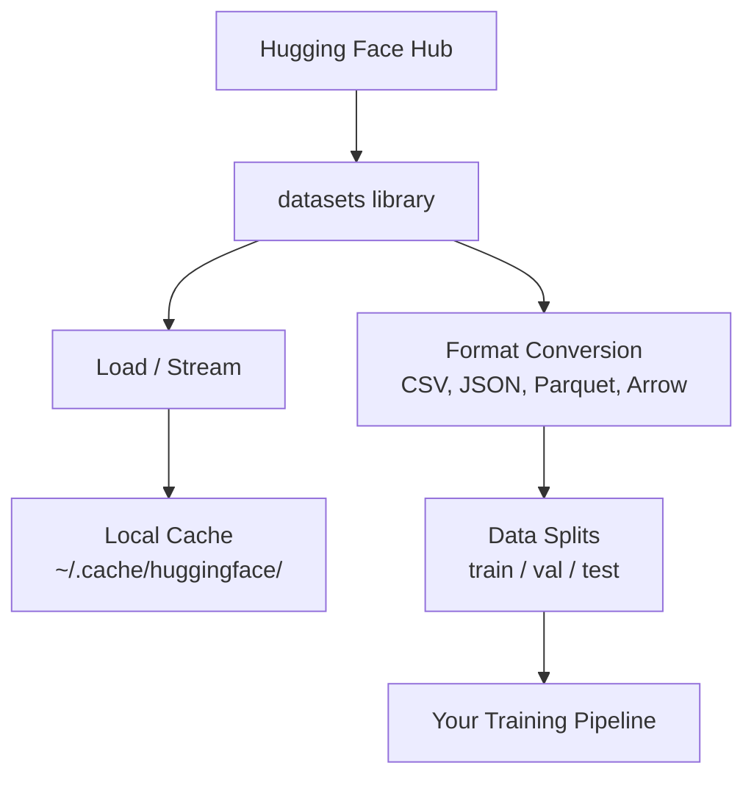

# Управление данными

> Данные - это топливо, и то, как вы управляете ими, определяет, насколько быстро вы двигаетесь.

**Type:** Build
**Language:**Питон
**Prerequisites:** Phase 0, Lesson 01
**Time:** ~45 minutes

## Цели обучения

- Загрузка, потоковые и кеширование наборов данных с помощью обнимающего лица `datasets`библиотека
- Конвертировать формы CSV, JSON, Parquet и Arrow и объяснить их компромиссы
- Создание воспроизводимых разделов поезда/валидации/испытания с фиксированными случайными семьями
- Управлять большими файлами модели и наборов данных с использованием `.gitignore`, Git LFS или DVC

## Проблема

Каждый проект ИИ начинается с данных. Вы должны найти наборы данных, загрузить их, конвертировать их между форматами, разделить их для обучения и оценки, и версировать их так, чтобы эксперименты были воспроизводимы.

## Концепция



Обнимающее лицо`datasets`библиотека - стандартный способ загрузки данных для работы ИИ. Она занимается загрузкой, кешем, конверсией формата и потоком из коробки.

```figure
s0-data-pipeline
```

## Создайте его

### Шаг 1: Установите библиотеку наборов данных

```bash
pip install datasets huggingface_hub
```

### Шаг 2: Загрузка наборов данных

```python
from datasets import load_dataset

dataset = load_dataset("stanfordnlp/imdb")
print(dataset)
print(dataset["train"][0])
```

После первой загрузки он загружается из кеша на `~/.cache/huggingface/datasets/`- Я не знаю .

### Шаг 3: Поток больших наборов данных

Некоторые наборы данных слишком большие, чтобы поместиться на диске.

```python
dataset = load_dataset("wikimedia/wikipedia", "20231101.en", split="train", streaming=True)

for i, example in enumerate(dataset):
    print(example["title"])
    if i >= 4:
        break
```

Стриминг дает вам возможность`IterableDataset`Использование памяти остается постоянным независимо от размера наборов данных.

### Шаг 4: Форматы наборов данных

- Да .`datasets`Вы можете конвертировать в другие форматы в зависимости от того, что нужно вашему трубопроводу.

```python
dataset = load_dataset("stanfordnlp/imdb", split="train")

dataset.to_csv("imdb_train.csv")
dataset.to_json("imdb_train.json")
dataset.to_parquet("imdb_train.parquet")
```

Сравнение формата:

| Format | Size | Read Speed | Best For |
|--------|------|-----------|----------|
| CSV | Large | Slow | Human readability, spreadsheets |
| JSON | Large | Slow | APIs, nested data |
| Parquet | Small | Fast | Analytics, columnar queries |
| Arrow | Small | Fastest | In-memory processing (what `datasets` uses internally) |

Для работы с ИИ Parquet - лучший формат хранения. Стрела - это то, с чем вы работаете в памяти. CSV и JSON для обмена.

### Шаг 5: Распределение данных

Каждому проекту ML нужны три разделы:

- **Train**: Модель учится на этом (обычно 80%)
- **Validation**: Вы проверяете прогресс во время обучения (обычно 10%)
- **Test**: Окончательная оценка после окончания обучения (обычно 10%)

Некоторые наборы данных разделены на две части, а когда нет, разделите их сами.

```python
dataset = load_dataset("stanfordnlp/imdb", split="train")

split = dataset.train_test_split(test_size=0.2, seed=42)
train_val = split["train"].train_test_split(test_size=0.125, seed=42)

train_ds = train_val["train"]
val_ds = train_val["test"]
test_ds = split["test"]

print(f"Train: {len(train_ds)}, Val: {len(val_ds)}, Test: {len(test_ds)}")
```

Всегда устанавливайте семя для воспроизводства.

### Шаг 6: модели загрузки и кеширования

Модели - это большие файлы.`huggingface_hub`библиотека управляет загрузкой и кешем.

```python
from huggingface_hub import hf_hub_download, snapshot_download

model_path = hf_hub_download(
    repo_id="sentence-transformers/all-MiniLM-L6-v2",
    filename="config.json"
)
print(f"Cached at: {model_path}")

model_dir = snapshot_download("sentence-transformers/all-MiniLM-L6-v2")
print(f"Full model at: {model_dir}")
```

Модели вкладки к `~/.cache/huggingface/hub/`После загрузки они загружаются сразу на следующие запуска.

### Шаг 7: обработка больших файлов

Макетные весы и большие наборы данных не должны быть включены в git.

**Option A: .gitignore (simplest)**

```
*.bin
*.safetensors
*.pt
*.onnx
data/*.parquet
data/*.csv
models/
```

**Option B: Git LFS (track large files in git)**

```bash
git lfs install
git lfs track "*.bin"
git lfs track "*.safetensors"
git add .gitattributes
```

Git LFS хранит указатели в вашем репо и фактические файлы на отдельном сервере. GitHub дает вам 1 ГБ бесплатно.

**Option C: DVC (data version control)**

```bash
pip install dvc
dvc init
dvc add data/training_set.parquet
git add data/training_set.parquet.dvc data/.gitignore
git commit -m "Track training data with DVC"
```

DVC создает небольшие `.dvc`Файлы, которые указывают на ваши данные.

| Approach | Complexity | Best For |
|----------|-----------|----------|
| .gitignore | Low | Personal projects, downloaded data you can re-fetch |
| Git LFS | Medium | Teams sharing model weights via git |
| DVC | High | Reproducible experiments, large datasets, teams |

Для этого курса,`.gitignore`Используйте DVC, когда вам нужно воспроизводить точные эксперименты на всех машинах.

### Шаг 8: Узоры хранения

**Local storage**работает для наборов данных менее 10 ГБ. HF кеши обрабатывает это автоматически.

**Cloud storage**для чего-либо большего или разделенного между машинами:

```python
import os

local_path = os.path.expanduser("~/.cache/huggingface/datasets/")

# s3_path = "s3://my-bucket/datasets/"
# gcs_path = "gs://my-bucket/datasets/"
```

DVC интегрируется с S3 и GCS напрямую:

```bash
dvc remote add -d myremote s3://my-bucket/dvc-store
dvc push
```

Для этого курса достаточно локального хранилища. Облачное хранилище становится актуальным, когда вы настраиваете удаленные инстанции GPU.

## Комплексы данных, используемые в этом курсе

| Dataset | Lessons | Size | What It Teaches |
|---------|---------|------|----------------|
| IMDB | Tokenization, classification | 84 MB | Text classification basics |
| WikiText | Language modeling | 181 MB | Next-token prediction |
| SQuAD | QA systems | 35 MB | Question answering, spans |
| Common Crawl (subset) | Embeddings | Varies | Large-scale text processing |
| MNIST | Vision basics | 21 MB | Image classification fundamentals |
| COCO (subset) | Multimodal | Varies | Image-text pairs |

Не нужно загружать все эти уроки сейчас, потому что в каждом уроке указано, что нужно.

## Используйте его

Запустите сценарий для проверки работы:

```bash
python code/data_utils.py
```

Это загружает небольшой набор данных, преобразует его, делится на части и печатает свод.

## Погрузи его

Этот урок дает результаты:
- `code/data_utils.py`- возможность повторного загрузки и кеширования данных
- `outputs/prompt-data-helper.md`- быстро найти правильный набор данных для задачи

## Упражнения

1. Загрузите `glue`набор данных с `mrpc`конфигурировать и осмотреть первые 5 примеров
2. Поток `c4`набор данных и подсчитать, сколько примеров вы можете обработать за 10 секунд
3. Преобразовать набор данных в Parquet и сравнить размер файла в CSV
4. Создать раздел поезда/класса/испытания 70/15/15 с фиксированным семенем и проверить размеры

## Ключевые условия

| Term | What people say | What it actually means |
|------|----------------|----------------------|
| Dataset split | "Training data" | A named subset (train/val/test) used at different stages of the ML lifecycle |
| Streaming | "Load it lazily" | Processing data row by row from a remote source without downloading the full dataset |
| Parquet | "Compressed CSV" | A columnar file format optimized for analytical queries and storage efficiency |
| Arrow | "Fast dataframe" | An in-memory columnar format used internally by the datasets library for zero-copy reads |
| Git LFS | "Git for big files" | An extension that stores large files outside the git repo while keeping pointers in version control |
| DVC | "Git for data" | A version control system for datasets and models that integrates with cloud storage |
| Cache | "Already downloaded" | A local copy of previously fetched data, stored at ~/.cache/huggingface/ by default |
