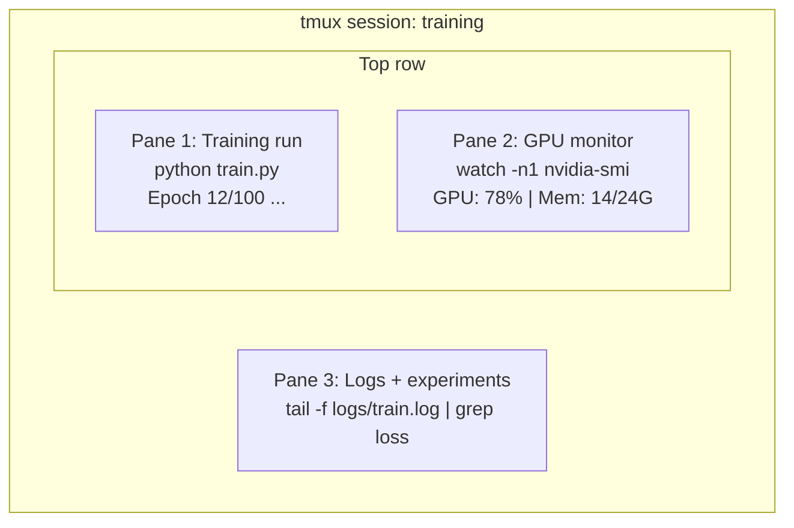

# Терминал & Shell

> Терминал - это место, где живут инженеры ИИ.

**Type:** Learn
**Languages:** --
**Prerequisites:** Phase 0, Lesson 01
**Time:** ~35 minutes

## Цели обучения

- Используйте трубопроводы, перенаправления и `grep`для фильтрации и обработки журналов обучения с командной строки
- Создать постоянные сессии tmux с несколькими панелями для одновременного обучения и мониторинга GPU
- Мониторинг системных и ГПУ ресурсов с `htop`- Я не знаю .`nvtop`, и `nvidia-smi`
- Передача файлов между локальными и удаленными машинами с использованием SSH, `scp`, и `rsync`

## Проблема

Вы будете проводить больше времени в терминале, чем в любом редакторе. тренировочные работы, мониторинг GPU, слежение за журналом, удаленные сессии SSH, управление окружающей средой. Каждый рабочий поток ИИ касается оболочки. Если вы медленны здесь, вы медленны везде.

В этом уроке обсуждаются навыки, которые важны для работы ИИ. Нет истории Unix. Нет глубокого погружения в Bash-сценарий.

## Концепция



Три вещи работают одновременно, один терминал, вы можете отделиться, вернуться домой, вернуться в SSH и подключиться.

```figure
s0-shell-pipeline
```

## Создайте его

### Шаг 1: Познай свою оболочку

Проверь, какую снаружи ты используешь:

```bash
echo $SHELL
```

Большинство систем используют `bash`или `zsh`Оба работают хорошо, команды в этом курсе работают в любом.

Ключевые вещи , которые нужно знать:

```bash
# Move around
cd ~/projects/ai-engineering-from-scratch
pwd
ls -la

# History search (most useful shortcut you'll learn)
# Ctrl+R then type part of a previous command
# Press Ctrl+R again to cycle through matches

# Clear terminal
clear   # or Ctrl+L

# Cancel a running command
# Ctrl+C

# Suspend a running command (resume with fg)
# Ctrl+Z
```

### Шаг 2: трубопроводы и перенаправления

Трубопроводы соединяют команды. Так вы обрабатываете журналы, фильтр и цепные инструменты.

```bash
# Count how many times "loss" appears in a log
cat train.log | grep "loss" | wc -l

# Extract just the loss values from training output
grep "loss:" train.log | awk '{print $NF}' > losses.txt

# Watch a log file update in real time, filtering for errors
tail -f train.log | grep --line-buffered "ERROR"

# Sort experiments by final accuracy
grep "final_accuracy" results/*.log | sort -t= -k2 -n -r

# Redirect stdout and stderr to separate files
python train.py > output.log 2> errors.log

# Redirect both to the same file
python train.py > train_full.log 2>&1
```

Три перенаправления, которые вам нужны:

| Symbol | What it does |
|--------|-------------|
| `>` | Write stdout to file (overwrite) |
| `>>` | Append stdout to file |
| `2>` | Write stderr to file |
| `2>&1` | Send stderr to same place as stdout |
| `\|` | Send stdout of one command as stdin to the next |

### Шаг 3: Процессы по фонду

Тренировки занимают много часов, а терминал не должен быть открыт.

```bash
# Run in background (output still goes to terminal)
python train.py &

# Run in background, immune to hangup (closing terminal won't kill it)
nohup python train.py > train.log 2>&1 &

# Check what's running in background
jobs
ps aux | grep train.py

# Bring a background job to foreground
fg %1

# Kill a background process
kill %1
# or find its PID and kill that
kill $(pgrep -f "train.py")
```

Разница между `&`- Я не знаю .`nohup`, и `screen`- Я не знаю .`tmux`В следующем случае:

| Method | Survives terminal close? | Can reattach? |
|--------|-------------------------|---------------|
| `command &` | No | No |
| `nohup command &` | Yes | No (check log file) |
| `screen` / `tmux` | Yes | Yes |

Причем для чего-либо длиннее нескольких минут используйте тмукс.

### Шаг 4: tmux

tmux позволяет создавать постоянные терминальные сессии с несколькими панелями.

```bash
# Install
# macOS
brew install tmux
# Ubuntu
sudo apt install tmux

# Start a named session
tmux new -s training

# Split horizontally
# Ctrl+B then "

# Split vertically
# Ctrl+B then %

# Navigate between panes
# Ctrl+B then arrow keys

# Detach (session keeps running)
# Ctrl+B then d

# Reattach
tmux attach -t training

# List sessions
tmux ls

# Kill a session
tmux kill-session -t training
```

Типичная сессия рабочего потока ИИ:

```bash
tmux new -s train

# Pane 1: start training
python train.py --epochs 100 --lr 1e-4

# Ctrl+B, " to split, then run GPU monitor
watch -n1 nvidia-smi

# Ctrl+B, % to split vertically, tail the logs
tail -f logs/experiment.log

# Now detach with Ctrl+B, d
# SSH out, go get coffee, come back
# tmux attach -t train
```

### Шаг 5: Мониторинг с помощью htop и nvtop

```bash
# System processes (better than top)
htop

# GPU processes (if you have NVIDIA GPU)
# Install: sudo apt install nvtop (Ubuntu) or brew install nvtop (macOS)
nvtop

# Quick GPU check without nvtop
nvidia-smi

# Watch GPU usage update every second
watch -n1 nvidia-smi

# See which processes are using the GPU
nvidia-smi --query-compute-apps=pid,name,used_memory --format=csv
```

`htop`Ключевые связки, которые вы будете использовать:
- `F6`или `>`сортировать по столбцам (сортировать по памяти для поиска утечек памяти)
- `F5`для переключения вида дерева (см. детские процессы)
- `F9`чтобы убить процесс
- `/`для поиска названия процесса

### Шаг 6: SSH для удаленных ящиков GPU

Когда вы арендуете облачный ГПУ (Lambda, RunPod, Vast.ai), вы подключаетесь через SSH.

```bash
# Basic connection
ssh user@gpu-box-ip

# With a specific key
ssh -i ~/.ssh/my_gpu_key user@gpu-box-ip

# Copy files to remote
scp model.pt user@gpu-box-ip:~/models/

# Copy files from remote
scp user@gpu-box-ip:~/results/metrics.json ./

# Sync a whole directory (faster for many files)
rsync -avz ./data/ user@gpu-box-ip:~/data/

# Port forward (access remote Jupyter/TensorBoard locally)
ssh -L 8888:localhost:8888 user@gpu-box-ip
# Now open localhost:8888 in your browser

# SSH config for convenience
# Add to ~/.ssh/config:
# Host gpu
#     HostName 192.168.1.100
#     User ubuntu
#     IdentityFile ~/.ssh/gpu_key
#
# Then just:
# ssh gpu
```

### Шаг 7: Полезные псевдонимные названия для работы ИИ

Добавьте их к своей `~/.bashrc`или `~/.zshrc`В следующем случае:

```bash
source phases/00-setup-and-tooling/10-terminal-and-shell/code/shell_aliases.sh
```

Или копируйте те, которые вы хотите.

```bash
# GPU status at a glance
alias gpu='nvidia-smi --query-gpu=index,name,utilization.gpu,memory.used,memory.total,temperature.gpu --format=csv,noheader'

# Kill all Python training processes
alias killtraining='pkill -f "python.*train"'

# Quick virtual environment activate
alias ae='source .venv/bin/activate'

# Watch training loss
alias watchloss='tail -f logs/*.log | grep --line-buffered "loss"'
```

Посмотрите .`code/shell_aliases.sh`Для полного комплекта.

### Шаг 8: Общие терминальные модели ИИ

Эти вопросы неоднократно возникают на практике:

```bash
# Run training, log everything, notify when done
python train.py 2>&1 | tee train.log; echo "DONE" | mail -s "Training complete" you@email.com

# Compare two experiment logs side by side
diff <(grep "accuracy" exp1.log) <(grep "accuracy" exp2.log)

# Find the largest model files (clean up disk space)
find . -name "*.pt" -o -name "*.safetensors" | xargs du -h | sort -rh | head -20

# Download a model from Hugging Face
wget https://huggingface.co/model/resolve/main/model.safetensors

# Untar a dataset
tar xzf dataset.tar.gz -C ./data/

# Count lines in all Python files (see how big your project is)
find . -name "*.py" | xargs wc -l | tail -1

# Check disk space (training data fills disks fast)
df -h
du -sh ./data/*

# Environment variable check before training
env | grep -i cuda
env | grep -i torch
```

## Используйте его

Вот когда каждый инструмент вступает в игру во время этого курса:

| Tool | When you use it |
|------|----------------|
| tmux | Every training run (Phases 3+) |
| `tail -f` + `grep` | Monitoring training logs |
| `nohup` / `&` | Quick background tasks |
| `htop` / `nvtop` | Debugging slow training, OOM errors |
| SSH + `rsync` | Working on cloud GPUs |
| Piping + redirects | Processing experiment results |
| Aliases | Saving time on repetitive commands |

## Упражнения

1. Установите tmux, создавайте сессию с тремя панелями и запустите `htop`в одном, `watch -n1 date`В другом, и в третьем, питонный сценарий.
2. Добавьте псевдонима от `code/shell_aliases.sh`Настройка и перезагрузка`source ~/.zshrc`(или `~/.bashrc`)).
3. Создайте поддельный учебный дневник с `for i in $(seq 1 100); do echo "epoch $i loss: $(echo "scale=4; 1/$i" | bc)"; sleep 0.1; done > fake_train.log`и затем использовать `grep`- Я не знаю .`tail`, и `awk`Выводы по потерям.
4. Настройка SSH конфигурации для сервера , к которому вы имеете доступ (или используете `localhost`для практики синтаксиса).

## Ключевые условия

| Term | What people say | What it actually means |
|------|----------------|----------------------|
| Shell | "The terminal" | The program that interprets your commands (bash, zsh, fish) |
| tmux | "Terminal multiplexer" | A program that lets you run multiple terminal sessions inside one window, and detach/reattach |
| Pipe | "The bar thing" | The `\|` operator that sends one command's output as input to another |
| PID | "Process ID" | A unique number assigned to every running process, used to monitor or kill it |
| nohup | "No hangup" | Runs a command immune to the hangup signal, so closing the terminal won't kill it |
| SSH | "Connecting to the server" | Secure Shell, an encrypted protocol for running commands on a remote machine |
