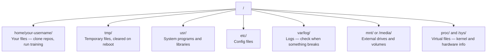

# Linux для ИИ

> Большинство ИИ работает на Linux.

**Type:** Learn
**Languages:** --
**Prerequisites:** Phase 0, Lesson 01
**Time:** ~30 minutes

## Цели обучения

- Навести файловую систему Linux и выполнять основные операции с файлов с командной строки
- Управлять разрешениями файлов с помощью `chmod`и `chown`для решения ошибок "Отказание отклонить"
- Установка системных пакетов с `apt`и установить новый GPU-кробка для работы ИИ
- Выявление различий между MacOS и Linux, которые обычно заставляют разработчиков работать на удаленных компьютерах

## Проблема

Вы развиваетесь на macOS или Windows. Но в тот момент, когда вы загружаете в облачную GPU-скутку, арендуете Lambda-инстанцию или запускаете EC2 - вы приземляетесь в Ubuntu. Терминал - это ваш единственный интерфейс. Нет "Finder", "Explorer", никакого GUI. Если вы не можете просматривать файловую систему, устанавливать пакеты и управлять процессами с командной строки, вы застряли в плаче за нерабочие часы графики, пытаясь найти в Google "как разшифровать файл в Linux".

Это руководство по выживанию. Он включает в себя то, что нужно для работы на удаленной Linux-машине для работы ИИ.

## Дизайн файловой системы

Linux организует все под одним корнем`/`- Нет .`C:\`или `/Volumes`Справочники, которые вы на самом деле касаетесь:



Твоя домашняя справочник `~`или `/home/your-username`Почти все, что ты делаешь, происходит здесь.

## Основные заповеди

Это 15 команд, которые охватывают 95% всего, что вы будете делать на удаленной GPU-кробке.

### Перемещение

```bash
pwd                         # Where am I?
ls                          # What's here?
ls -la                      # What's here, including hidden files with details?
cd /path/to/dir             # Go there
cd ~                        # Go home
cd ..                       # Go up one level
```

### Файлы и каталоги

```bash
mkdir my-project            # Create a directory
mkdir -p a/b/c              # Create nested directories in one shot

cp file.txt backup.txt      # Copy a file
cp -r src/ src-backup/      # Copy a directory (recursive)

mv old.txt new.txt          # Rename a file
mv file.txt /tmp/           # Move a file

rm file.txt                 # Delete a file (no trash, it's gone)
rm -rf my-dir/              # Delete a directory and everything inside
```

`rm -rf`Не нужно отменить, проверьте путь, прежде чем нажать "Enter".

### Читать файлы

```bash
cat file.txt                # Print entire file
head -20 file.txt           # First 20 lines
tail -20 file.txt           # Last 20 lines
tail -f log.txt             # Follow a log file in real time (Ctrl+C to stop)
less file.txt               # Scroll through a file (q to quit)
```

### Поиск

```bash
grep "error" training.log           # Find lines containing "error"
grep -r "learning_rate" .           # Search all files in current directory
grep -i "cuda" config.yaml          # Case-insensitive search

find . -name "*.py"                 # Find all Python files under current dir
find . -name "*.ckpt" -size +1G     # Find checkpoint files larger than 1GB
```

## Разрешения

Каждый файл в Linux имеет владельца и биты разрешений. Вы столкнетесь с этим, когда скрипты не выполняются или вы не можете писать в каталог.

```bash
ls -l train.py
# -rwxr-xr-- 1 user group 2048 Mar 19 10:00 train.py
#  ^^^             owner permissions: read, write, execute
#     ^^^          group permissions: read, execute
#        ^^        everyone else: read only
```

Общие исправления:

```bash
chmod +x train.sh           # Make a script executable
chmod 755 deploy.sh         # Owner: full, others: read+execute
chmod 644 config.yaml       # Owner: read+write, others: read only

chown user:group file.txt   # Change who owns a file (needs sudo)
```

Когда что-то говорит "Пущение отказано", это почти всегда вопрос разрешений. `chmod +x`или `sudo`Это поможет решить большинство дел.

## Управление пакетом (пригодный)

Ubuntu использует `apt`Так устанавливается программное обеспечение на системном уровне.

```bash
sudo apt update             # Refresh the package list (always do this first)
sudo apt install -y htop    # Install a package (-y skips confirmation)
sudo apt install -y build-essential  # C compiler, make, etc. Needed by many Python packages
sudo apt install -y tmux    # Terminal multiplexer (keep sessions alive after disconnect)

apt list --installed        # What's installed?
sudo apt remove htop        # Uninstall
```

Общие пакеты, которые вы установите на свежую ящик GPU:

```bash
sudo apt update && sudo apt install -y \
    build-essential \
    git \
    curl \
    wget \
    tmux \
    htop \
    unzip \
    python3-venv
```

## Пользователи и sudo

Вы обычно входите в систему как обычный пользователь.

```bash
whoami                      # What user am I?
sudo command                # Run a single command as root
sudo su                     # Become root (exit to go back, use sparingly)
```

В облачных GPU-инстанциях вы обычно единственный пользователь и уже имеете доступ к sudo. Не запускайте все как root. Используйте sudo только при необходимости.

## Процессы и системы

Когда тренировка заканчивается, или вам нужно проверить, что происходит:

```bash
htop                        # Interactive process viewer (q to quit)
ps aux | grep python        # Find running Python processes
kill 12345                  # Gracefully stop process with PID 12345
kill -9 12345               # Force kill (use when graceful doesn't work)
nvidia-smi                  # GPU processes and memory usage
```

systemd управляет услугами (западниковые даimoni). Вы будете использовать его, если вы запускаете серверы выводов:

```bash
sudo systemctl start nginx          # Start a service
sudo systemctl stop nginx           # Stop it
sudo systemctl restart nginx        # Restart it
sudo systemctl status nginx         # Check if it's running
sudo systemctl enable nginx         # Start automatically on boot
```

## Дисковое пространство

У GPU-классов часто ограниченное пространство на диске.

```bash
df -h                       # Disk usage for all mounted drives
df -h /home                 # Disk usage for /home specifically

du -sh *                    # Size of each item in current directory
du -sh ~/.cache             # Size of your cache (pip, huggingface models land here)
du -sh /data/checkpoints/   # Check how big your checkpoints are

# Find the biggest space hogs
du -h --max-depth=1 / 2>/dev/null | sort -hr | head -20
```

Общие пространственные сберегатели:

```bash
# Clear pip cache
pip cache purge

# Clear apt cache
sudo apt clean

# Remove old checkpoints you don't need
rm -rf checkpoints/epoch_01/ checkpoints/epoch_02/
```

## Сетевые связи

Вы скачиваете модели, передаете файлы и нажимаете API с командной строки.

```bash
# Download files
wget https://example.com/model.bin                   # Download a file
curl -O https://example.com/data.tar.gz              # Same thing with curl
curl -s https://api.example.com/health | python3 -m json.tool  # Hit an API, pretty-print JSON

# Transfer files between machines
scp model.bin user@remote:/data/                     # Copy file to remote machine
scp user@remote:/data/results.csv .                  # Copy file from remote to local
scp -r user@remote:/data/checkpoints/ ./local-dir/   # Copy directory

# Sync directories (faster than scp for large transfers, resumes on failure)
rsync -avz --progress ./data/ user@remote:/data/
rsync -avz --progress user@remote:/results/ ./results/
```

Использование`rsync`- Я не могу .`scp`Он передает только измененные байты и обрабатывает прерванные соединения.

## Сессии остаются живыми

Когда ты загружаешь пульт в пульт, закрывая ноутбук, ты не можешь тренироваться.

```bash
tmux new -s train           # Start a new session named "train"
# ... start your training, then:
# Ctrl+B, then D            # Detach (training keeps running)

tmux ls                     # List sessions
tmux attach -t train        # Reattach to session

# Inside tmux:
# Ctrl+B, then %            # Split pane vertically
# Ctrl+B, then "            # Split pane horizontally
# Ctrl+B, then arrow keys   # Switch between panes
```

Всегда выполняешь длинные тренировочные работы внутри.

## WSL2 для пользователей Windows

Если вы используете Windows, WSL2 дает вам настоящую среду Linux без двойного загрузки.

```bash
# In PowerShell (admin)
wsl --install -d Ubuntu-24.04

# After restart, open Ubuntu from Start menu
sudo apt update && sudo apt upgrade -y
```

WSL2 работает на настоящем ядре Linux. Всё в этом уроке работает внутри него.`/mnt/c/Users/YourName/`из внутри WSL.

GPU passthrough работает с установкой драйверов NVIDIA на стороне Windows.

## Gotchas: macOS к Linux

Вещи, которые могут вас запутать, если вы приходите из macOS:

| macOS | Linux | Notes |
|-------|-------|-------|
| `brew install` | `sudo apt install` | Different package names sometimes. `brew install htop` vs `sudo apt install htop` works the same, but `brew install readline` vs `sudo apt install libreadline-dev` does not. |
| `open file.txt` | `xdg-open file.txt` | But you won't have a GUI on a remote box. Use `cat` or `less`. |
| `pbcopy` / `pbpaste` | Not available | Pipe to/from clipboard doesn't exist over SSH. |
| `~/.zshrc` | `~/.bashrc` | macOS defaults to zsh. Most Linux servers use bash. |
| `/opt/homebrew/` | `/usr/bin/`, `/usr/local/bin/` | Binaries live in different places. |
| `sed -i '' 's/a/b/' file` | `sed -i 's/a/b/' file` | macOS sed needs an empty string after `-i`. Linux does not. |
| Case-insensitive filesystem | Case-sensitive filesystem | `Model.py` and `model.py` are two different files on Linux. |
| Line endings `\n` | Line endings `\n` | Same. But Windows uses `\r\n`, which breaks bash scripts. Run `dos2unix` to fix. |

## Быстрая справочная карта

```
Navigation:     pwd, ls, cd, find
Files:          cp, mv, rm, mkdir, cat, head, tail, less
Search:         grep, find
Permissions:    chmod, chown, sudo
Packages:       apt update, apt install
Processes:      htop, ps, kill, nvidia-smi
Services:       systemctl start/stop/restart/status
Disk:           df -h, du -sh
Network:        curl, wget, scp, rsync
Sessions:       tmux new/attach/detach
```

```figure
s0-process-fork
```

## Упражнения

1. SSH в любой Linux-машину (или открыть WSL2) и перейти в домашний каталог. Создайте папку проекта, создайте три пустых файла внутри него с `touch`, а потом перечисли их с `ls -la`- Я не знаю .
2. Установка`htop`с apt, запустите его и определите, какой процесс использует больше всего памяти.
3. Начните сеанс, бегите.`sleep 300`внутри него, отключаться, перечислить сессии, и снова присоединиться.
4. Использование`df -h`чтобы проверить доступное пространство на диске, затем используйте `du -sh ~/.cache/*`чтобы найти то, что занимает место в вашем хранилище.
5. Переводить файл с локальной машины на удаленную с помощью `scp`, затем сделайте такую же передачу с `rsync`и сравнивать опыт.
