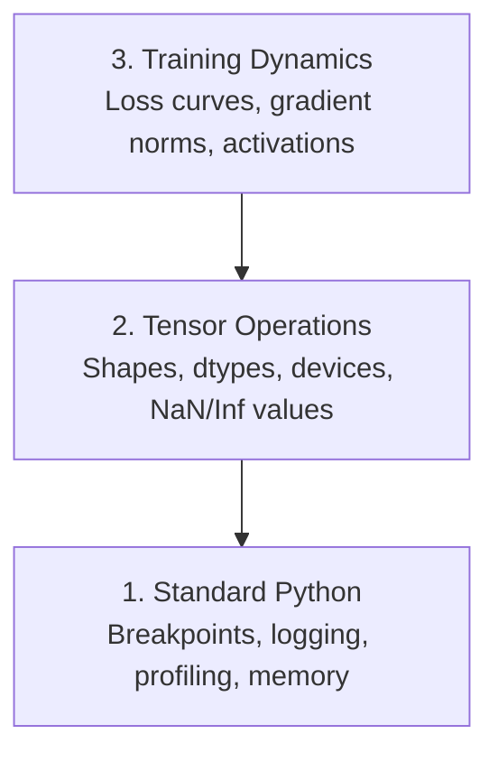

# Обрезание и профилирование

> Худшие интеллектуальные микробы не разбиваются, они молча тренируются на мусоре и сообщают о красивой кривой потерь.

**Type:** Build
**Language:**Питон
**Prerequisites:** Lesson 1 (Dev Environment), basic PyTorch familiarity
**Time:** ~60 minutes

## Цели обучения

- Используйте условные `breakpoint()`и `debug_print`для проверки форм, типов тензоров и значений NaN в середине тренировки
- Профильные тренировочные петли с `cProfile`- Я не знаю .`line_profiler`, и `tracemalloc`найти узлы
- Выявление общих ошибок ИИ: несоответствия формы, потеря NaN, утечка данных и тенсоры неправильного устройства
- Настройка TensorBoard для визуализации кривых потерь, гистограмм веса и распределения градиентов

## Проблема

ИИ-код не работает по-другому, чем обычный код. Веб-приложение сбивается с стеком следа. Неисправно сконфигурированная тренировочная петля работает в течение 8 часов, сжигает $200 в GPU времени, и производит модель, которая предсказывает средний размер каждого ввода. Код никогда не ошибается. ошибка была тензор на неправильном устройстве, забытый `.detach()`, или этикетки, проникающие в черты.

Вам нужны инструменты дебгурования, которые обнаруживают эти молчаливые неисправности, прежде чем они будут тратить ваше время и вычислить.

## Концепция

ИИ дебъгагирование работает на трех уровнях:



Большинство людей переходят прямо на 3-й уровень (посмотрите на TensorBoard). Но 80% ошибок ИИ живут на 1-м и 2-м уровнях.

```figure
s0-flame-hot
```

## Создайте его

### Часть 1: Разработка печатных дебюгеров (да, работает)

Для тензорного кода, целевое заявление напечатки лучше, чем проходить через дебгугер, потому что вам нужно видеть формы, типы и диапазоны значений одновременно.

```python
def debug_print(name, tensor):
    print(f"{name}: shape={tensor.shape}, dtype={tensor.dtype}, "
          f"device={tensor.device}, "
          f"min={tensor.min().item():.4f}, max={tensor.max().item():.4f}, "
          f"mean={tensor.mean().item():.4f}, "
          f"has_nan={tensor.isnan().any().item()}")
```

Позвоните после каждой подозрительной операции, и когда обнаружат ошибку, удалите отпечатки.

### Часть 2: Python Debugger (pdb и breakpoint)

Встроенный дебэггер недооценивается для работы ИИ.`breakpoint()`В свою тренировочную петлю и интерактивно проверять тензоры.

```python
def training_step(model, batch, criterion, optimizer):
    inputs, labels = batch
    outputs = model(inputs)
    loss = criterion(outputs, labels)

    if loss.item() > 100 or torch.isnan(loss):
        breakpoint()

    loss.backward()
    optimizer.step()
```

Когда дебгугер выпускает вас, полезные команды:

- `p outputs.shape`для проверки форм
- `p loss.item()`для оценки стоимости потерь
- `p torch.isnan(outputs).sum()`для подсчета НН
- `p model.fc1.weight.grad`для проверки градиентов
- `c`продолжать,`q`бросить

Это условное дебюгирование, ты останавливаешься только тогда, когда что-то выглядит не так.

### Часть 3: Регистрация на Python

Заменить печатные заявления записью, когда дебъюгирование выходит за рамки быстрой проверки.

```python
import logging

logging.basicConfig(
    level=logging.INFO,
    format="%(asctime)s [%(levelname)s] %(message)s",
    handlers=[
        logging.FileHandler("training.log"),
        logging.StreamHandler()
    ]
)
logger = logging.getLogger(__name__)

logger.info("Starting training: lr=%.4f, batch_size=%d", lr, batch_size)
logger.warning("Loss spike detected: %.4f at step %d", loss.item(), step)
logger.error("NaN loss at step %d, stopping", step)
```

Запись дает вам часовые марки, уровни тяжести и выход файлов. Когда тренировка не работает в 3 утра, вы хотите файл журналов, а не выход терминала, который прокручивается с экрана.

### Часть 4: разделы кодов времени

Знание того, куда идет время, - это первый шаг к оптимизации.

```python
import time

class Timer:
    def __init__(self, name=""):
        self.name = name

    def __enter__(self):
        self.start = time.perf_counter()
        return self

    def __exit__(self, *args):
        elapsed = time.perf_counter() - self.start
        print(f"[{self.name}] {elapsed:.4f}s")

with Timer("data loading"):
    batch = next(dataloader_iter)

with Timer("forward pass"):
    outputs = model(batch)

with Timer("backward pass"):
    loss.backward()
```

Общие выводы: загрузка данных занимает 60% времени обучения.`num_workers > 0`в вашем DataLoader, а не более быстрый GPU.

### Часть 5: cProfile и line_profiiler

Если вам нужно больше, чем ручные таймеры:

```bash
python -m cProfile -s cumtime train.py
```

Это показывает каждый вызов функции, сортированный по кумулятивному времени.

```bash
pip install line_profiler
```

```python
@profile
def train_step(model, data, target):
    output = model(data)
    loss = F.cross_entropy(output, target)
    loss.backward()
    return loss

# Run with: kernprof -l -v train.py
```

### Часть 6: Профилирование памяти

#### Память процессора с трасемалоком

```python
import tracemalloc

tracemalloc.start()

# your code here
model = build_model()
data = load_dataset()

snapshot = tracemalloc.take_snapshot()
top_stats = snapshot.statistics("lineno")
for stat in top_stats[:10]:
    print(stat)
```

#### CPU Memory с memory_profiiler

```bash
pip install memory_profiler
```

```python
from memory_profiler import profile

@profile
def load_data():
    raw = read_csv("data.csv")       # watch memory jump here
    processed = preprocess(raw)       # and here
    return processed
```

Беги с `python -m memory_profiler your_script.py`чтобы увидеть использование памяти строкой за строкой.

#### Память GPU с PyTorch

```python
import torch

if torch.cuda.is_available():
    print(torch.cuda.memory_summary())

    print(f"Allocated: {torch.cuda.memory_allocated() / 1e9:.2f} GB")
    print(f"Cached: {torch.cuda.memory_reserved() / 1e9:.2f} GB")
```

Когда нажимаешь OOM (Out of Memory):

1. Уменьшить размер партии (первое, что нужно попробовать, всегда)
2. Использование`torch.cuda.empty_cache()`для освобождения запасной памяти
3. Использование`del tensor`За ним следует `torch.cuda.empty_cache()`для крупных промежуточных продуктов
4. Используйте смешанную точность (`torch.cuda.amp`) сократить вдвое использование памяти
5. Используйте контрольный показатель градиента для очень глубоких моделей

### Часть 7: Общие интеллектуальные ошибки и как их поймать

#### Несовместимость формы

Самый распространенный бог.`[batch, features]`когда модель ожидает `[batch, channels, height, width]`- Я не знаю .

```python
def check_shapes(model, sample_input):
    print(f"Input: {sample_input.shape}")
    hooks = []

    def make_hook(name):
        def hook(module, inp, out):
            in_shape = inp[0].shape if isinstance(inp, tuple) else inp.shape
            out_shape = out.shape if hasattr(out, "shape") else type(out)
            print(f"  {name}: {in_shape} -> {out_shape}")
        return hook

    for name, module in model.named_modules():
        hooks.append(module.register_forward_hook(make_hook(name)))

    with torch.no_grad():
        model(sample_input)

    for h in hooks:
        h.remove()
```

Проверьте это один раз с помощью образца, он отражает каждое изменение формы в вашей модели.

#### Потеря

Потеря НАН означает что-то взорвано.

- Слишком высокий уровень обучения
- Разделение на нуль в пошлинах
- Логотип нулевого или отрицательного числа
- Взрывные градиенты в РНН

```python
def detect_nan(model, loss, step):
    if torch.isnan(loss):
        print(f"NaN loss at step {step}")
        for name, param in model.named_parameters():
            if param.grad is not None:
                if torch.isnan(param.grad).any():
                    print(f"  NaN gradient in {name}")
                if torch.isinf(param.grad).any():
                    print(f"  Inf gradient in {name}")
        return True
    return False
```

#### Просочивание данных

Ваша модель имеет 99% точности на тестовом наборе.

```python
def check_data_leakage(train_set, test_set, id_column="id"):
    train_ids = set(train_set[id_column].tolist())
    test_ids = set(test_set[id_column].tolist())
    overlap = train_ids & test_ids
    if overlap:
        print(f"DATA LEAKAGE: {len(overlap)} samples in both train and test")
        return True
    return False
```

Также проверьте временные утечки: используйте будущие данные для прогнозирования прошлого.

#### Неправильное устройство

Тенсоры на разных устройствах (CPU против GPU) вызывают ошибки в запуске.

```python
def check_devices(model, *tensors):
    model_device = next(model.parameters()).device
    print(f"Model device: {model_device}")
    for i, t in enumerate(tensors):
        if t.device != model_device:
            print(f"  WARNING: tensor {i} on {t.device}, model on {model_device}")
```

### Часть 8: Основы тензорной доски

Тенсор-Таблица показывает, что происходит внутри тренировок с течением времени.

```bash
pip install tensorboard
```

```python
from torch.utils.tensorboard import SummaryWriter

writer = SummaryWriter("runs/experiment_1")

for step in range(num_steps):
    loss = train_step(model, batch)

    writer.add_scalar("loss/train", loss.item(), step)
    writer.add_scalar("lr", optimizer.param_groups[0]["lr"], step)

    if step % 100 == 0:
        for name, param in model.named_parameters():
            writer.add_histogram(f"weights/{name}", param, step)
            if param.grad is not None:
                writer.add_histogram(f"grads/{name}", param.grad, step)

writer.close()
```

Запустите:

```bash
tensorboard --logdir=runs
```

Что искать:

- **Loss not decreasing**: Слишком низкий уровень обучения или проблема моделирования архитектуры
- **Loss oscillating wildly**: Слишком высокий уровень обучения
- **Loss goes to NaN**: Цифровая нестабильность (см. раздел NaN выше)
- **Train loss decreasing, val loss increasing**Переустановка:
- **Weight histograms collapsing to zero**: Грейденты исчезают
- **Gradient histograms exploding**: Необходимо подрезать градиент

### Часть 9: Деbugger VS Code

Для интерактивной дебъюгирования настройка VS Code с помощью `launch.json`В следующем случае:

```json
{
    "version": "0.2.0",
    "configurations": [
        {
            "name": "Debug Training",
            "type": "debugpy",
            "request": "launch",
            "program": "${file}",
            "console": "integratedTerminal",
            "justMyCode": false
        }
    ]
}
```

Настройка пунктов перерыва нажав на канаву. Используйте панель переменных для проверки свойств тензора. Консоль для дебгу позволяет запускать произвольные Python-выражения в середине исполнения.

Это полезно для прохождения процесса предварительного обработки данных, где вы хотите увидеть каждую трансформацию.

## Используйте его

Вот дебгунг-рабочий процесс, который улавливает большинство ошибок ИИ:

1. **Before training**Встреча`check_shapes`проверять соответствие измерений ввода и вывода ожиданиям.
2. **First 10 steps**Использование:`debug_print`Убедитесь, что ничего не является NaN и что значения в разумных диапазонах.
3. **During training**: потеря журналов, скорость обучения и нормы градиента. Используйте TensorBoard для визуализации.
4. **When something breaks**Сбросьте .`breakpoint()`Инспектируйте тензоры интерактивно.
5. **For performance**Время загрузки данных против перехода вперед против назад.

## Погрузи его

Запустить скрипт инструментального набора дебгугирования:

```bash
python phases/00-setup-and-tooling/12-debugging-and-profiling/code/debug_tools.py
```

Посмотрите .`outputs/prompt-debug-ai-code.md`для запроса, который помогает диагностировать специфические для ИИ ошибки.

## Упражнения

1. Беги .`debug_tools.py`Прочитайте вывод каждого раздела. Измените модель-мадель, чтобы ввести NaN (совет: делитесь на нулю в проходе вперед) и посмотрите, как детектор улавливает его.
2. Профилировать тренировочный цикл с `cProfile`и определить самую медленную функцию.
3. Использование`tracemalloc`чтобы найти, какая строка в трубопроводе загрузки данных распределяет больше всего памяти.
4. Настройка TensorBoard для простых тренировок и определить, слишком ли приличная модель.
5. Использование`breakpoint()`Обучение проверки форм тензора, устройств и значения градиента с запроса дебгугера.
