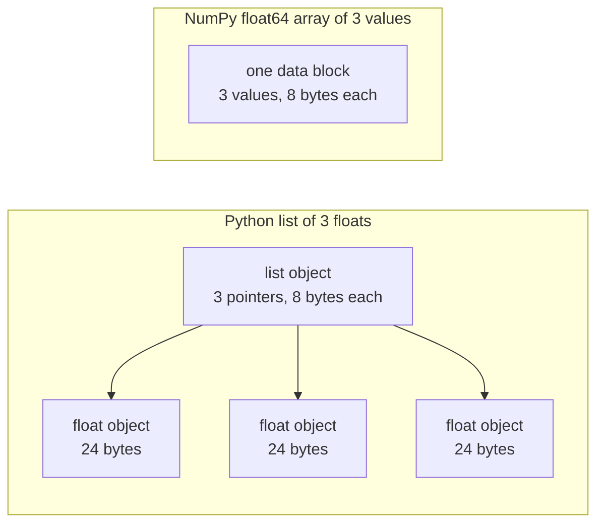

# Python для ИИ-инженерии

> Большинство кодов в этом курсе используют один и тот же небольшой набор Python идиома.

**Type:** Build
**Languages:** Python
**Prerequisites:** Dev Environment, Python Environments
**Time:** ~120 minutes

## Цели обучения

- Читайте и напишите этиомы, которые используют большинство курсовых кодов, от разпаковки и f-strings до классов данных и пониманий.
- Найдите три ошибки Python, которые дают неправильные результаты без ошибок: общие списки, изменяемые дефолты и устаревшие генераторы.
- Создайте загрузчик CSV и JSON, сеенный раздел и мини-генератор с стандартной библиотекой.
- Напишите продукт точек, среднее и стандартное отклонение в чистом Python и измерите их скорость и использование памяти.
- Объясните, почему цикл чистой питона над цифрами медленен, и как трансляция NumPy перемещает цикл в составленный код.

## Проблема

Урок после этого этапа использует простой Python для математики и моделей.`dataclasses`Также 187 файлов звонят.`random.seed`или создать `random.Random`Если эти идиома новые для вас, вы читаете синтаксис, когда хотите прочитать математику.

Python также имеет поведение, которое дает неправильные результаты без сообщения об ошибке. Два имени могут относиться к одному списку, поэтому изменение через одно имя также изменяет другое.

Последняя проблема - это скорость. На нашем ноутбуке-тесте чистый петля Python более миллиона плавучих заложил около 30 миллисекунд. NumPy вычислил тот же продукт точках менее чем за миллисекунд. Вам нужно знать причину, чтобы вы могли выбрать между чистой петлей и операцией массива.

## Концепция

### Что используется в коде курса

Мы проанализировали все 541 файлы Python в `phases/*/*/code/`с `ast`Модуль. таблица подсчитывает файлы, которые используют каждую конструкцию по крайней мере один раз.

| Construct | Files | Share |
|-----------|-------|-------|
| Function definitions | 541 | 100% |
| `if __name__ == "__main__":` | 529 | 98% |
| f-strings | 517 | 96% |
| Tuple unpacking | 448 | 83% |
| Classes | 379 | 70% |
| List comprehensions | 375 | 69% |
| Type hints on functions | 342 | 63% |
| Generator expressions | 326 | 60% |
| Slices | 314 | 58% |
| `lambda` | 175 | 32% |
| `try` and `except` | 120 | 22% |
| `with` statements | 96 | 18% |
| Dict comprehensions | 93 | 17% |
| Generator functions with `yield` | 14 | 3% |

Импорт показывает, какие стандартные модули важны.`from __future__ import annotations`, и 276 импорта `dataclasses`- В .`math`- Я не знаю .`random`, и `json`Модули появятся в 187, 175 и 126 файлах.`collections`модуль появляется в 70 файлах, и `itertools`Появляется только в 4.

Никаких уроков .`map()`или `filter()`- Понимание помогает.`sorted`- Я не знаю .`min`- Я не знаю .`max`, или `.sort`с `key=`В этом уроке больше всего времени проводится на идиомах, которые находятся в верхней части этих списков.

### Имена относятся к объектам

В Python переменная - это имя, которое относится к объекту. Назначение связывает имя с объектом. Оно не копирует объект. Когда два имени относятся к одному списку, изменение через любое из названий видится через оба. Числа, строки и туплы не могут меняться, поэтому это правило не вызывает для них проблем. Списки, дикты и наборы могут меняться, поэтому сделайте копию, когда вам нужна независимая версия.

### Список содержит указатели, массив содержит цифры

Список Python не хранит числа напрямую. Он хранит указатели, и каждый указатель относится к полному объекту Python. На 64-битной построении CPython, каждый указатель занимает 8 байтов и каждый `float`Объект занимает 24 байта.`float64`массив хранит сырые 8-байтные значения бок о бок в одном блоке памяти.



Затем он называет плавающий код умножить и делает объект плавающий Python, чтобы сохранить результат.

NumPy выполняет ту же арифметику в цикле компилированного кода над сырьевыми значениями. Он проверяет тип данных один раз для всего массива, и он не делает никакого объекта Python для каждого элемента. Векторизованный код описывает одну операцию над целым массивом, например `(x - mean) / std`Векторные функции в этом уроке следуют этому правилу. Каждый из них выполняет одну операцию массива, так что вы можете заменить ее одним вызовом NumPy позже.

### Список содержит каждый элемент, генератор содержит один

В списке понимания создается каждый элемент до следующей строки. Генератор создает один элемент каждый раз, когда звончик просит следующий. Память для списка растет с количеством элементов. Память для генератора остается примерно той же для любого числа элементов.

Генератор может работать только один раз.`StopIteration`на каждом запросе, так что секунду `for`Обучающий код читает набор данных один раз в эпоху, поэтому он должен создавать новый генератор для каждой эпохи.

Функции генератора редки в учебном коде. Загрузчики данных, которые используются в уроках глубокого обучения, являются повторяемыми партиями, поэтому идея находится в каждой тренировочной петле.

```figure
s0-list-vs-generator
```

## Идиомы, которые вам нужны

Каждый блок в этом разделе работает самостоятельно.`python3`Блоки нуждаются в Python 3.11 или более поздней версии, которую мы установили в уроке разработки.

### 1. Ценности, коллекции и разпаковка

У Python есть четыре встроенных коллекции. Узнайте, когда использовать каждую.

| Type | Example | Ordered | Can change | Typical use in the course |
|------|---------|---------|------------|---------------------------|
| `list` | `[0.5, 1.2]` | Yes | Yes | Samples, losses, weights |
| `tuple` | `(32, 784)` | Yes | No | Shapes, fixed records, dict keys |
| `dict` | `{"lr": 0.01}` | Insertion order | Yes | Configs, vocabularies, JSON rows |
| `set` | `{"cat", "dog"}` | No | Yes | Unique tokens, overlap checks |

В этом блоке показано, что задание не копирует список.

```python
weights = [0.5, -1.2, 3.0]
alias = weights
alias[0] = 99.0
print(weights)

independent = list(weights)
independent[1] = 0.0
print(weights, independent)

grid = [[0] * 3] * 2
grid[0][0] = 1
print(grid)

grid = [[0] * 3 for _ in range(2)]
grid[0][0] = 1
print(grid)
```

```text
[99.0, -1.2, 3.0]
[99.0, -1.2, 3.0] [99.0, 0.0, 3.0]
[[1, 0, 0], [1, 0, 0]]
[[1, 0, 0], [0, 0, 0]]
```

Выражение`[[0] * 3] * 2`В математической фазе матрицы создаются из списков, поэтому используйте форму понимания.

Разпаковка присваивает элементы последовательности нескольким названиям в одной строке. Звездное имя собирает оставшиеся элементы. F-струнка вставляет значение выражения в строку, с опциональным форматом после колонны.

```python
shape = (32, 784)
batch_size, n_features = shape
first, *middle, last = [1, 2, 3, 4, 5]
x, y = 1.0, 3.0
x, y = y, x

config = {"lr": 0.01, "epochs": 5}
config["seed"] = 7
tokens = ["the", "cat", "sat", "on", "the", "mat"]
vocab = set(tokens)

print(batch_size, n_features, first, middle, last, x, y)
print(config.get("momentum", 0.9), "cat" in vocab, len(vocab))
print(f"lr={config['lr']:.0e} loss={0.123456:.3f} n={60_000:,} {batch_size=}")
```

```text
32 784 1 [2, 3, 4] 5 3.0 1.0
0.9 True 5
lr=1e-02 loss=0.123 n=60,000 batch_size=32
```

`dict.get`возвращает значение по умолчанию, когда ключ отсутствует. `in`Проверка на наборе занимает примерно такое же время для любого размера набора.`{batch_size=}`Форма печатает имя и значение, что помогает при отладке.

Срезка .`a[start:stop:step]`включает в себя `start`и исключает `stop`Отрицательные индексы считаются с конца.

```python
tokens = ["<s>", "the", "cat", "sat", "on", "the", "mat", "</s>"]
print(tokens[1:-1])
print(tokens[:3], tokens[-3:])
print(tokens[::2])
print(tokens[::-1][:2])
windows = [tokens[i:i + 3] for i in range(len(tokens) - 2)]
print(len(windows), windows[0])
```

```text
['the', 'cat', 'sat', 'on', 'the', 'mat']
['<s>', 'the', 'cat'] ['the', 'mat', '</s>']
['<s>', 'cat', 'on', 'mat']
['</s>', 'mat']
6 ['<s>', 'the', 'cat']
```

### 2. Понимание

Понимание создает список, дикт или набор из повторяемого в одном выражении.

```python
scores = [0.91, 0.42, 0.77, 0.15, 0.66]
labels = [1 if s >= 0.5 else 0 for s in scores]
high = [s for s in scores if s > 0.6]
squares = {i: i * i for i in range(4)}
lengths = {len(word) for word in ["a", "bb", "cc", "ddd"]}
sum_sq = sum(s * s for s in scores)

matrix = [[1, 2, 3], [4, 5, 6]]
transposed = [list(column) for column in zip(*matrix)]
flat = [v for row in matrix for v in row]

print(labels, high, squares, lengths, round(sum_sq, 4))
print(transposed, flat)
```

```text
[1, 0, 1, 0, 1] [0.91, 0.77, 0.66] {0: 0, 1: 1, 2: 4, 3: 9} {1, 2, 3} 2.0555
[[1, 4], [2, 5], [3, 6]] [1, 2, 3, 4, 5, 6]
```

Задница .`if`- В первом выражении.`for`может быть условным выражением, `a if condition else b`- Два .`for`клаузы выполняются в том же порядке, что и два заложенных петля.

Круглые скобки создают генераторное выражение.`sum(s * s for s in scores)`- Я не знаю .`sum`Читает по одному квадратному в одно время, и Python не создает никакого списка.`zip(*matrix)`, звезда проходит через каждый ряд как отдельный аргумент, и `zip`пары предметов на каждой позиции.

### 3. Функции, аргументы и замыкания

По умолчанию значение делает аргумент необязательным.`*`само по себе в параметровом списке делает следующие параметры только ключевыми словами.

```python
def clip(value, low=0.0, high=1.0):
    return max(low, min(high, value))


def train(data, *, lr=0.01, epochs=3):
    return f"{len(data)} samples, lr={lr}, epochs={epochs}"


def make_scaler(factor):
    def scale(values):
        return [v * factor for v in values]
    return scale


print(clip(1.7), clip(-3.0, low=-1.0), clip(0.4, high=0.3))
print(train([1, 2, 3], lr=0.1))
to_percent = make_scaler(100)
print(to_percent([0.25, 0.5]))
```

```text
1.0 -1.0 0.3
3 samples, lr=0.1, epochs=3
[25.0, 50.0]
```

С аргументами только ключевых слов, такой вызов, как `train(data, 0.1, 3)`поднимает`TypeError`- Звонок должен написать .`lr=0.1`, так что два числа не могут случайно менять место.

Внутренняя функция`scale`использование `factor`Python сохраняет`factor`на протяжении всего времени`scale`Функция, которая хранит переменные от своего создателя, - это закрытие.

А .`lambda`является функцией одноименного выражения без названия.`key=`функции, что показывает часть 8.

Python оценивает значение по умолчанию один раз, когда он запускает `def`Каждый звонок, использующий дефолт, получает тот же объект.

```python
def add_bad(item, bucket=[]):
    bucket.append(item)
    return bucket


def add_good(item, bucket=None):
    if bucket is None:
        bucket = []
    bucket.append(item)
    return bucket


add_bad("a")
print(add_bad("b"))
add_good("a")
print(add_good("b"))
```

```text
['a', 'b']
['b']
```

Использование`None`Создать новый объект внутри функции.

### 4. Класы и классы данных

- Да .`@dataclass`Декоратор пишет `__init__`- Я не знаю .`__repr__`, и `__eq__`из аннотированных полей.`frozen=True`, объект не может измениться после создания, и вы можете использовать его в качестве диктового клавиша или поставить его в набор.

```python
from dataclasses import dataclass, field


@dataclass(frozen=True)
class Example:
    features: tuple[float, ...]
    label: int


@dataclass
class TrainConfig:
    lr: float = 0.01
    epochs: int = 5
    hidden: list[int] = field(default_factory=lambda: [64, 32])

    def describe(self):
        return f"lr={self.lr} epochs={self.epochs} hidden={self.hidden}"


ex = Example((1.5, 2.0), 1)
print(ex)
print(ex == Example((1.5, 2.0), 1), len({ex, Example((1.5, 2.0), 1)}))
print(TrainConfig(epochs=10).describe())
try:
    ex.label = 0
except AttributeError as err:
    print(type(err).__name__)
```

```text
Example(features=(1.5, 2.0), label=1)
True 1
lr=0.01 epochs=10 hidden=[64, 32]
FrozenInstanceError
```

`field(default_factory=...)`Это решает проблему с дефолтом совместной работы из части 3 внутри класса данных.

Специальные методы связывают класс с синтаксисом Python. `len(ds)`Звонок`__len__`, и `ds[2]`Звонок`__getitem__`- Я не знаю .

```python
class SquaresDataset:
    def __init__(self, n):
        self.n = n

    def __len__(self):
        return self.n

    def __getitem__(self, index):
        if not 0 <= index < self.n:
            raise IndexError(index)
        return index, index * index


ds = SquaresDataset(4)
print(len(ds), ds[2])
print(list(ds))
```

```text
4 (2, 4)
[(0, 0), (1, 1), (2, 4), (3, 9)]
```

- Да .`for`петля внутри `list(ds)`работает без`__iter__`Метод. Python звонит `__getitem__`с 0, 1, 2 и так далее, пока не получится `IndexError`. Сборники данных типа карт PyTorch используют те же два метода, `__len__`и `__getitem__`- Я не знаю .

### 5. Итераторы и генераторы

Итеративный - это любой объект , который `for`Скура принимает. `iter()`получает итератор от него, и `next()`Итератор не имеет больше элементов, он поднимает `StopIteration`- А .`for`Звонок в цикл`next()`Для тебя и останавливается на `StopIteration`- Я не знаю .

```python
numbers = [10, 20, 30]
it = iter(numbers)
print(next(it), next(it), next(it))
try:
    next(it)
except StopIteration:
    print("no more items")


def countdown(n):
    while n > 0:
        yield n
        n -= 1


gen = countdown(3)
print(type(gen).__name__)
print(list(gen))
print(list(gen))
```

```text
10 20 30
no more items
generator
[3, 2, 1]
[]
```

Функция с `yield`В его теле есть генераторная функция. Призыв к нему не запускает ни одного из его кодов и возвращает объект генератора.`next()`Переводит тело к следующему .`yield`И останавливается там.`list(gen)`пустой, потому что первый израсходовал генератор.

Генератор может читать файл по строке.

```python
import os
import tempfile


def read_rows(path):
    with open(path, encoding="utf-8") as fh:
        header = fh.readline().rstrip("\n").split(",")
        for line in fh:
            yield dict(zip(header, line.rstrip("\n").split(",")))


with tempfile.TemporaryDirectory() as tmp:
    path = os.path.join(tmp, "rows.csv")
    with open(path, "w", encoding="utf-8") as fh:
        fh.write("x,label\n")
        fh.writelines(f"{i * 0.5},{i % 2}\n" for i in range(5))
    rows = read_rows(path)
    print(next(rows))
    print(sum(1 for _ in rows))
```

```text
{'x': '0.0', 'label': '0'}
4
```

`read_rows`Сохраняет в памяти одну строку файла за раз.`read_rows`В настоящих файлах CSV могут быть приведены komma внутри цитированных полей, поэтому Build It использует `csv`модуль.

```python
import sys

as_list = [i * i for i in range(1_000_000)]
as_generator = (i * i for i in range(1_000_000))
print(sys.getsizeof(as_list), sys.getsizeof(as_generator))
print(sum(as_list) == sum(as_generator))
```

На 64-битном CPython список сообщает о 8 МБ, а генератор - о 200 байтах. `sys.getsizeof`Build It измеряет реальный пик с `tracemalloc`, который мы использовали в уроке дебгугирования и профилирования.

### 6. Контекстные менеджеры и исключения

А .`with`Затем в заявлении запускается код установки, затем его корпус, а затем код очистки.`open()`- это контекстный менеджер, который закрывает файл.

В уроке дебгугирования и профилирования мы написали `Timer`класс с `__enter__`и `__exit__`- В .`contextlib.contextmanager`Декоратор делает тот же тип объекта из генератора.`yield`- Это установка, и `finally`Блок - это очистка.

```python
import time
from contextlib import contextmanager


@contextmanager
def timer(label):
    start = time.perf_counter()
    try:
        yield
    finally:
        print(f"{label}: {(time.perf_counter() - start) * 1000:.1f} ms")


def parse_label(text):
    try:
        return int(text)
    except ValueError:
        raise ValueError(f"label must be an integer, got {text!r}") from None


with timer("sum of squares"):
    total = sum(i * i for i in range(200_000))

print(parse_label("3"))
try:
    parse_label("cat")
except ValueError as err:
    print("rejected:", err)
```

```text
sum of squares: 9.4 ms
3
rejected: label must be an integer, got 'cat'
```

Время на вашем компьютере будет отличаться.`except`пункт, например `ValueError`или `KeyError`- Я не знаю .`except:`клауза без исключения типа также относится `KeyboardInterrupt`, так что Ctrl+C не может остановить петлю, которая его содержит. Поднимите исключение с четким сообщением, когда ввод неверен. Добавь `from None`Когда ваше сообщение заменяет оригинальный отслеживание.

### 7. Напишите указания, модули и главный охранник

Напишите, что вы хотите, чтобы вы написали, и вы написали, что вы хотите.

```python
from __future__ import annotations

from collections.abc import Iterable, Sequence


def mean(values: Sequence[float]) -> float:
    if not values:
        raise ValueError("mean() needs at least one value")
    return sum(values) / len(values)


def count_tokens(docs: Iterable[str]) -> int:
    return sum(len(doc.split()) for doc in docs)


def main() -> None:
    print(mean([1.0, 2.0, 4.0]))
    print(count_tokens(["the cat sat", "on the mat"]))
    print(mean.__annotations__)


if __name__ == "__main__":
    main()
```

```text
2.3333333333333335
6
{'values': 'Sequence[float]', 'return': 'float'}
```

С `from __future__ import annotations`, Python сохраняет каждый намек как строку, как показывает последняя строка. `Sequence`означает любой объект с `len()`и индексов, таких как список или тупл. `Iterable`означает любой объект, который `for`Многие файлы курса импортируют одни и те же имена из `typing`, что также работает.

Каждый .`.py`файл - это модуль.`python3 file.py`, Python устанавливает свой `__name__`к `"__main__"`. Когда другой файл импортирует его, `__name__`Это название модуля.`main()`В первом случае только в первом случае.`code/tests/`может импортировать `main.py`без начала демонстрации.

### 8. Файлы, JSON, CSV и сортировка

`pathlib.Path`соединяет пути с `/`И может читать или писать весь файл в один раз.`encoding="utf-8"`, потому что дефолтный кодирование зависит от операционной системы.

```python
import csv
import json
import tempfile
from pathlib import Path

rows = [
    {"text": "great movie", "label": 1, "score": 0.93},
    {"text": "boring plot", "label": 0, "score": 0.12},
    {"text": "fine acting", "label": 1, "score": 0.58},
]

with tempfile.TemporaryDirectory() as tmp:
    json_path = Path(tmp) / "reviews.json"
    json_path.write_text(json.dumps(rows, indent=2), encoding="utf-8")
    from_json = json.loads(json_path.read_text(encoding="utf-8"))

    csv_path = Path(tmp) / "reviews.csv"
    with csv_path.open("w", newline="", encoding="utf-8") as fh:
        writer = csv.DictWriter(fh, fieldnames=["text", "label", "score"])
        writer.writeheader()
        writer.writerows(rows)
    with csv_path.open(newline="", encoding="utf-8") as fh:
        from_csv = list(csv.DictReader(fh))

print(from_json == rows)
print(from_csv[0])

by_score = sorted(rows, key=lambda r: r["score"], reverse=True)
print([r["text"] for r in by_score])
print(max(rows, key=lambda r: r["score"])["text"])
print([r["text"] for r in sorted(rows, key=lambda r: (-r["label"], r["text"]))])
```

```text
True
{'text': 'great movie', 'label': '1', 'score': '0.93'}
['great movie', 'fine acting', 'boring plot']
great movie
['fine acting', 'great movie', 'boring plot']
```

JSON сохраняет числа в виде чисел. CSV возвращает каждое поле в виде строки, поэтому вы должны конвертировать каждое поле. Откройте файлы CSV с `newline=""`, как `csv`документация говорит вам.

А .`key=`Функция возвращает значение, которое Python сравнивает для каждого элемента. `sorted`- Я не знаю .`min`, и `max`Все принимают один. Тупл-ключ сортирует по первому значению, и он использует второе значение только для связей. минус знак ставит большую этикетку первой. сортировка Python стабильна, поэтому элементы с равными ключами сохраняют свой оригинальный порядок.

### 9. Инструменты для подсчета, группировки и итераторов

Эти два модуля содержат структуры данных и инструменты итератора, которые не дают вам простые списки и дикты.

```python
from collections import Counter, defaultdict, deque
from itertools import chain, islice, product

labels = ["cat", "dog", "cat", "bird", "cat", "dog"]
counts = Counter(labels)
print(counts.most_common(2))

positions = defaultdict(list)
for i, label in enumerate(labels):
    positions[label].append(i)
print(dict(positions))

recent = deque(maxlen=3)
for loss in [2.0, 1.5, 1.2, 1.1, 0.9]:
    recent.append(loss)
print(list(recent), round(sum(recent) / len(recent), 3))

print(list(product([0.1, 0.01], [16, 32])))
print(list(chain([1, 2], [3], [4, 5])))
print(list(islice(range(100), 5, 10)))
```

```text
[('cat', 3), ('dog', 2)]
{'cat': [0, 2, 4], 'dog': [1, 5], 'bird': [3]}
[1.2, 1.1, 0.9] 1.067
[(0.1, 16), (0.1, 32), (0.01, 16), (0.01, 32)]
[1, 2, 3, 4, 5]
[5, 6, 7, 8, 9]
```

`Counter`считает предметы, которые можно было бы использовать, например, этикетки или токены. `defaultdict(list)`создает пустой список в первый раз, когда вы используете новый ключ, поэтому группировке петли не нужно проверки ключей. `deque(maxlen=3)`убрать самый старый элемент, когда вы добавляете четвертый, что дает передвижение окно по сравнению с недавними потерями. `enumerate`дает каждой статье свой индекс.

`product`дает каждую комбинацию своих входов, что является гиперпараметровой сеткой. `chain`соединяет итерабильные от конца к концу. `islice`В проекте "Сделай это" используется мини-пач генератор.`islice`- Я не знаю .

### 10. Почему цикл за счет числа медленный

- Да .`dis`модуль печатает инструкции байткода, которые выполняется интерпретатором для функции.

```python
import dis


def dot(a, b):
    total = 0.0
    for x, y in zip(a, b):
        total += x * y
    return total


dis.dis(dot)
```

Инструкции от `FOR_ITER`Это примерно десять инструкций для каждого умножения и добавления.

Скура становится быстрее, когда меньше ее шагов выполняется как байт-код. Встроенные функции, такие как `sum`- Я не знаю .`map`, и `zip`Build It измеряет этот эффект в чистом Python, а Use It перемещает всю петлю в NumPy.

## Создайте его

Теперь вы создаете те части, которые понадобятся в последующих уроках.`code/main.py`, и `code/tests/test_main.py`Каждый блок под ним работает самостоятельно.

### Шаг 1: тип записи и загрузчик наборов данных

Загрузчик читает файл CSV или файл JSON в одну форму: тупл плавающих функций и целые числа.

```python
import csv
import json
import tempfile
from dataclasses import dataclass
from pathlib import Path


@dataclass(frozen=True)
class Record:
    features: tuple[float, ...]
    label: int


def row_to_record(row, names, label_field="label"):
    if label_field not in row:
        raise ValueError(f"row has no {label_field!r} field: {row}")
    if set(row) != {*names, label_field}:
        raise ValueError(f"row fields {list(row)} do not match {[*names, label_field]}")
    return Record(tuple(float(row[name]) for name in names), int(row[label_field]))


def load_records(path, label_field="label"):
    path = Path(path)
    if path.suffix == ".json":
        rows = json.loads(path.read_text(encoding="utf-8"))
    elif path.suffix == ".csv":
        with path.open(newline="", encoding="utf-8") as fh:
            rows = list(csv.DictReader(fh))
    else:
        raise ValueError(f"unsupported file type: {path.suffix!r}")
    if not rows:
        return []
    names = [key for key in rows[0] if key != label_field]
    return [row_to_record(row, names, label_field) for row in rows]


with tempfile.TemporaryDirectory() as tmp:
    csv_path = Path(tmp) / "data.csv"
    csv_path.write_text("x1,x2,label\n1.5,60,1\n1.8,82.5,0\n", encoding="utf-8")
    json_path = Path(tmp) / "data.json"
    json_path.write_text('[{"x1": 1.5, "x2": 60, "label": 1}]', encoding="utf-8")
    print(load_records(csv_path))
    print(load_records(json_path))
```

```text
[Record(features=(1.5, 60.0), label=1), Record(features=(1.8, 82.5), label=0)]
[Record(features=(1.5, 60.0), label=1)]
```

В первом ряду указываются названия и порядок их. `DictReader`и `json.loads`Определяет порядок, в котором ключи были добавлены.`row_to_record`Затем, если вы не видите, что вы не можете найти файл, вы можете найти файл, который не будет доступен для использования.`ValueError`с сообщением, так что плохая файл останавливает работу в начале. `main.py`Также есть `save_records`, который пишет одинаковые два формата.

### Шаг 2: Семенный поезд и испытательный раздел

```python
import random


def train_test_split(items, test_fraction=0.2, seed=0):
    if not 0.0 < test_fraction < 1.0:
        raise ValueError(f"test_fraction must be between 0 and 1, got {test_fraction}")
    if len(items) < 2:
        raise ValueError(f"need at least 2 items to split, got {len(items)}")
    order = list(range(len(items)))
    random.Random(seed).shuffle(order)
    n_test = min(max(1, round(len(items) * test_fraction)), len(items) - 1)
    test = [items[i] for i in order[:n_test]]
    train = [items[i] for i in order[n_test:]]
    return train, test


items = list(range(10))
print(train_test_split(items, seed=1))
print(train_test_split(items, seed=1) == train_test_split(items, seed=1))
print(train_test_split(items, seed=2)[1])
print(items)
```

```text
([9, 7, 5, 3, 0, 4, 1, 2], [6, 8])
True
[5, 9]
[0, 1, 2, 3, 4, 5, 6, 7, 8, 9]
```

`random.Random(seed)`создает частный генератор случайных чисел. `random.seed(seed)`Реставрирует один глобальный генератор, который разделяют все модули, так что звонок в другой библиотеке может изменить вашу последовательность.`random.seed`и 96 создать `random.Random`Используйте частный генератор в новом коде.

Функция смешивает список индексов, поэтому список ввода остается неизменным.`ValueError`В уроке дебгугирования и профилирования мы увидели, что перекрытие между данными поезда и теста дает слишком высокие результаты.

### Шаг 3: мини-электронный генератор

```python
from itertools import islice


def batches(items, batch_size, drop_last=False):
    if batch_size < 1:
        raise ValueError(f"batch_size must be at least 1, got {batch_size}")
    return _batch_iter(iter(items), batch_size, drop_last)


def _batch_iter(iterator, batch_size, drop_last):
    while True:
        batch = list(islice(iterator, batch_size))
        if not batch or (drop_last and len(batch) < batch_size):
            return
        yield batch


print(list(batches(range(10), 4)))
print(list(batches(range(10), 4, drop_last=True)))
squares = (i * i for i in range(7))
print([len(b) for b in batches(squares, 3)])

for epoch in range(2):
    sizes = [len(b) for b in batches(range(10), 4)]
    print(f"epoch {epoch}: {sizes}")
```

```text
[[0, 1, 2, 3], [4, 5, 6, 7], [8, 9]]
[[0, 1, 2, 3], [4, 5, 6, 7]]
[3, 3, 1]
epoch 0: [4, 4, 2]
epoch 1: [4, 4, 2]
```

`islice`- Да , это не так .`batch_size`элементы из итератора. `batches`только нужды `iter()`Последнее партийное количество меньше, когда длина не является кратным размера партии. `drop_last=True`убрать партию для модели, которая нуждается в фиксированной форме партии.

Работа состоит из двух функций , потому что генераторная функция не запускает код до первого `next()`С чеком внутри генератора.`batches(data, 0)`Возвращение без ошибок. ошибка произойдет позже, изнутри тренировочной петли. внешняя функция является нормальной функцией, поэтому она проверяет аргумент сразу.`batches()`И это происходит по каждой эпохе, потому что генератор дает свои элементы только один раз.

### Шаг 4: Вектора математики и стандартизатор

```python
import math


def dot(a, b):
    return sum(x * y for x, y in zip(a, b, strict=True))


def mean(values):
    if not values:
        raise ValueError("mean() needs at least one value")
    return sum(values) / len(values)


def std(values):
    mu = mean(values)
    return math.sqrt(sum((v - mu) ** 2 for v in values) / len(values))


def make_standardizer(rows):
    columns = list(zip(*rows))
    means = [mean(c) for c in columns]
    scales = [s if s > 0 else 1.0 for s in (std(c) for c in columns)]

    def standardize(row):
        return [(v - m) / s for v, m, s in zip(row, means, scales, strict=True)]

    return standardize


print(dot([1.0, 2.0, 3.0], [4.0, 5.0, 6.0]))
values = [2.0, 4.0, 4.0, 4.0, 5.0, 5.0, 7.0, 9.0]
print(mean(values), std(values))

train_rows = [(1.0, 100.0), (2.0, 300.0), (3.0, 500.0)]
standardize = make_standardizer(train_rows)
print([[round(v, 3) for v in standardize(r)] for r in train_rows])
print([round(v, 3) for v in standardize((4.0, 700.0))])
```

```text
32.0
5.0 2.0
[[-1.225, -1.225], [0.0, 0.0], [1.225, 1.225]]
[2.449, 2.449]
```

С `strict=True`- Я не знаю .`zip`поднимает`ValueError`Если два вектора имеют разные длины, без него`zip`Затем он останавливается в конце короткого ввода и возвращает неправильный ответ без ошибок.`strict`Аргумент нуждается в Python 3.10 или более позднем.

`std`Раздел на `n`, так что дает населению стандартное отклонение, как `statistics.pstdev`Разделите на `n - 1`когда вы оцениваете распространение большей популяции из образца.

`make_standardizer`Однократно рассчитывается средний и стандартный отклонения от учебных рядов, а также `standardize`Вы используете ту же функцию на испытательные ряды, так что данные испытания не влияют на статистику.

### Шаг 5: полный пробег

`code/main.py`Он соединяет части. Он делает 400 записей из двух кластеров, сохраняет их в виде CSV и JSON, и загружает оба файла обратно.

Классификатор ближайшего центра, хранящий средний вектор характеристик каждого класса, предсказывает класс, среднее которого находится ближе к вводу. `fit_centroids`соединяет ряд в один пакет, поэтому ему никогда не нужно полное обучение, установленное в памяти. `predict`использование `min()`с `key=`Функция, чтобы найти ближайший центр.

```bash
python3 phases/00-setup-and-tooling/13-python-for-ai-engineering/code/main.py
```

```text
Python for AI engineering: a standard-library toolkit
data     400 records, CSV and JSON load back unchanged: True
split    320 train, 80 test, records in both: 0
batches  size 48: [48, 48, 48, 48, 48, 48, 32]
scale    train feature means after standardizing: [0.0, 0.0]
model    nearest-centroid test accuracy: raw 0.86, standardized 0.89
speed    dot product of 200,000 floats, best of 5:
           index loop         6.60 ms
           zip generator      5.93 ms
           map + mul          2.89 ms
memory   peak bytes to sum 100,000 squares:
           list              4,000,616
           generator               472
```

Вторая функция имеет в десять раз больше расстояния, чем первая, поэтому она контролирует расстояния на сырой основе, а точность на сырой основе меньше.

### Шаг 6: Измерить скорость и память

```python
import operator
import random
import time
import tracemalloc


def dot_index_loop(a, b):
    total = 0.0
    for i in range(len(a)):
        total += a[i] * b[i]
    return total


def dot_zip(a, b):
    return sum(x * y for x, y in zip(a, b, strict=True))


def dot_map(a, b):
    return sum(map(operator.mul, a, b))


def best_time(fn, *args, repeat=5):
    times = []
    for _ in range(repeat):
        start = time.perf_counter()
        fn(*args)
        times.append(time.perf_counter() - start)
    return min(times)


def peak_bytes(fn):
    tracemalloc.start()
    try:
        fn()
        return tracemalloc.get_traced_memory()[1]
    finally:
        tracemalloc.stop()


rng = random.Random(0)
a = [rng.random() for _ in range(1_000_000)]
b = [rng.random() for _ in range(1_000_000)]
for fn in (dot_index_loop, dot_zip, dot_map):
    print(f"{fn.__name__:15} {best_time(fn, a, b) * 1000:7.2f} ms")

print(peak_bytes(lambda: sum([i * i for i in range(100_000)])))
print(peak_bytes(lambda: sum(i * i for i in range(100_000))))
```

`best_time`В результате, в результате чего, по сравнению с другими программами, требуется увеличение времени, поэтому минимальная стоимость составляет наиболее близкое к фактическим затратам.`timeit`модуль дает те же советы.

На нашем ноутбуке с Python 3.11, цикл индекса занял около 33 мс.`map`Все три делают одну и ту же арифметику.`map`версия быстрее , потому что `map`и `operator.mul`В результате, в каждом элементе выполняется меньше инструкций для байткода.

## Используйте его

### Стандартные библиотечные версии

В стандартной библиотеке есть проверенная версия большинства твоих произведений.

| You built | Standard library | Note |
|-----------|------------------|------|
| `mean`, `std` | `statistics.fmean`, `statistics.pstdev` | The tests compare against these |
| `dot` | `math.sumprod` | Python 3.12 or newer |
| `batches` | `itertools.batched` | Python 3.12 or newer, gives tuples |
| `best_time` | `timeit.repeat` | Also turns off garbage collection during the runs |
| `peak_bytes` | `tracemalloc` | The same module, with snapshots and per-line statistics |

```python
import statistics
import sys

values = [2.0, 4.0, 4.0, 4.0, 5.0, 5.0, 7.0, 9.0]
print(statistics.fmean(values), statistics.pstdev(values))

if sys.version_info >= (3, 12):
    import math
    from itertools import batched

    print(math.sumprod([1.0, 2.0, 3.0], [4.0, 5.0, 6.0]))
    print(list(batched(range(10), 4)))
```

```text
5.0 2.0
32.0
[(0, 1, 2, 3), (4, 5, 6, 7), (8, 9)]
```

Курс поддерживает Python 3.11, так что `main.py`использует собственный `dot`и `batches`На Python 3.11, блок отпечатывает только первую строку.

### Та же математика с составленными массивами

Установка NumPy в виртуальной среде из урока Python environments, например с `uv pip install numpy`Урок и тесты не нуждаются в нем.

```python
import time

import numpy as np

n = 1_000_000
rng = np.random.default_rng(0)
a = rng.random(n)
b = rng.random(n)
a_list, b_list = a.tolist(), b.tolist()

start = time.perf_counter()
slow = sum(x * y for x, y in zip(a_list, b_list))
python_ms = (time.perf_counter() - start) * 1000

start = time.perf_counter()
fast = float(a @ b)
numpy_ms = (time.perf_counter() - start) * 1000

print(f"pure Python {python_ms:8.2f} ms")
print(f"NumPy       {numpy_ms:8.2f} ms")
print(f"difference  {abs(slow - fast):.1e}")
print(a.dtype, a.itemsize, a.nbytes)
```

На нашем тестовом ноутбуке NumPy заняло менее 1 мс, а версия Pure-Python заняла около 30 мс. Два результата отличаются в последних цифрах, потому что две версии добавляют продукты в другом порядке.

NumPy быстрее по трем причинам:

- Массив хранит сырые `float64`Список плавучих значений требует указателя 8 байтов и объекта 24 байтов для каждого значения.
- Схема выполняется в компилированном коде. NumPy проверяет тип данных один раз для всего массива и не делает объекта Python для каждого элемента.
- Значения, которые сидят бок о бок в памяти позволяют NumPy использовать инструкции SIMD, которые обрабатывают несколько значений с одной инструкцией.

Для очень небольших массивов фиксированная стоимость одного звонка NumPy может быть больше, чем короткая петля Python.

### Радиовещание

Телевещание позволяет NumPy сочетать массивы разных форм без петли в вашем коде.`make_standardizer`от 4 шага.

```python
import numpy as np

X = np.array([[1.0, 100.0], [2.0, 300.0], [3.0, 500.0]])
mu = X.mean(axis=0)
sigma = X.std(axis=0)
Z = (X - mu) / sigma
print(X.shape, mu.shape, Z.shape)
print(Z.round(3))

norms = np.sqrt((X ** 2).sum(axis=1, keepdims=True))
print(norms.shape, (X / norms).shape)
```

```text
(3, 2) (2,) (3, 2)
[[-1.225 -1.225]
 [ 0.     0.   ]
 [ 1.225  1.225]]
(3, 1) (3, 2)
```

NumPy сравнивает две формы от последнего измерения обратно к первому. Два измерения совместимы, когда они равны или когда один из них 1.

| Shape of `X` | Shape of the other array | Result |
|--------------|--------------------------|--------|
| `(3, 2)` | `(2,)`, column means | `(3, 2)` |
| `(3, 2)` | `(3, 1)`, row norms with `keepdims=True` | `(3, 2)` |
| `(3, 2)` | `(3,)`, row norms without `keepdims` | `ValueError` |

Последнее строка является распространенной ошибкой. NumPy сравнивает следовую 2 с 3, и ни один из них не 1.`keepdims=True`когда вы сокращаете число рядов, а затем сочетаете результат с оригинальным массивом.

## Погрузи его

Этот урок дает результаты .`outputs/prompt-python-review.md`. Это прокат для обзора кода Python в ИИ и данных проектов. Дайте ему файл или диф. Он проверяет код на идиома и безмолвные ошибки из этого урока:

- Совместные ссылки и изменяемые аргументы по умолчанию
- Генераторы , которые читают вторая эпоха после их использования
- Случайные числа без семени или только с глобальным семенем
- Статистика, полученная из разделов испытаний
- Чистые Python петли на больших числовых массивах

В нем сообщается о каждом обнаружении с местоположением, проблемой и исправлением.

## Упражнения

1. Беги .`run_demo(seed=8)`от `main.py`Найдите выходное число, которое меняется, и число, которое остается неизменным.
2. Напиши .`median(values)`В чистой Python.`statistics.median`в списках с необычной длиной и равной длиной.
3. Напиши .`stream_records(path)`, генератор , который дает один `Record`Сделайте файл из 200 000 строк. Сравните максимальную память`stream_records`и `load_records`с `tracemalloc`- Я не знаю .
4. Напиши .`matvec(matrix, vector)`В чистом Python и в NumPy.`best_time`Найдите размер, где NumPy становится быстрее на вашем компьютере.
5. Напишите сканирование конструкции из "Концепции". Используйте `ast.parse`и `ast.walk`на каждом файле в `phases/*/*/code/*.py`Считайте файлы , которые содержатся в них .`ast.ListComp`- Я не знаю .`ast.Yield`, и `ast.With`, и сравнить свои счеты с таблицей.

## Ключевые условия

| Term | What people say | What it means |
|------|----------------|----------------------|
| Iterable | "Something you can loop over" | An object that `iter()` accepts, such as a list, a file, or a generator |
| Iterator | "A cursor" | An object whose `__next__` method returns one item per call and raises `StopIteration` at the end |
| Generator | "A lazy list" | An iterator from a `yield` function or a generator expression. It makes each item on request and runs only once. |
| Comprehension | "A one-line loop" | An expression that builds a list, dict, or set from an iterable, with an optional filter |
| Closure | "A function inside a function" | A function that keeps variables from the function that created it |
| Dataclass | "A struct" | A class whose `__init__`, `__repr__`, and `__eq__` methods Python writes from the annotated fields |
| Context manager | "A with block" | An object that runs setup code at the start of a `with` block and cleanup code at the end, even after an exception |
| Seed | "The random number" | The start value of a pseudo-random generator. The same seed gives the same sequence. |
| Vectorized code | "Fast code" | Code that applies one operation to a whole array, so that compiled code runs the loop |
| Broadcasting | "Automatic shape matching" | The NumPy rules that combine arrays of different shapes by using size-1 dimensions again, with no copy |

## Дальнейшее чтение

- [The Python Tutorial: Data Structures](https://docs.python.org/3/tutorial/datastructures.html): списки, туплы, наборы, дикты и понимания.
- [The Python Tutorial: Classes](https://docs.python.org/3/tutorial/classes.html): сферы, классы, итераторы и генераторы.
- [dataclasses](https://docs.python.org/3/library/dataclasses.html): все варианты декоратора, включая `frozen`и `field`- Я не знаю .
- [collections](https://docs.python.org/3/library/collections.html):`Counter`- Я не знаю .`defaultdict`- Я не знаю .`deque`, и других типов контейнеров.
- [itertools](https://docs.python.org/3/library/itertools.html):`islice`- Я не знаю .`chain`- Я не знаю .`product`- Я не знаю .`batched`, и рецепты, которые сочетают их.
- [Sorting Techniques](https://docs.python.org/3/howto/sorting.html): ключевые функции, стабильные сорты и сорты на нескольких клавишах.
- [timeit](https://docs.python.org/3/library/timeit.html): как измерять мелкие части кода и почему сообщать о минимуме.
- [random](https://docs.python.org/3/library/random.html): глобальный генератор, `random.Random`Примеры и воспроизводимость.
- [PEP 255: Simple Generators](https://peps.python.org/pep-0255/): предложение, которое добавил `yield`, с причинами его проектирования.
- [NumPy: Broadcasting](https://numpy.org/doc/stable/user/basics.broadcasting.html): правила полного формата с помощью диаграмм.
- [Harris et al., Array programming with NumPy, Nature 585, 2020](https://doi.org/10.1038/s41586-020-2649-2): конструкция массива NumPy и причины его скорости.
