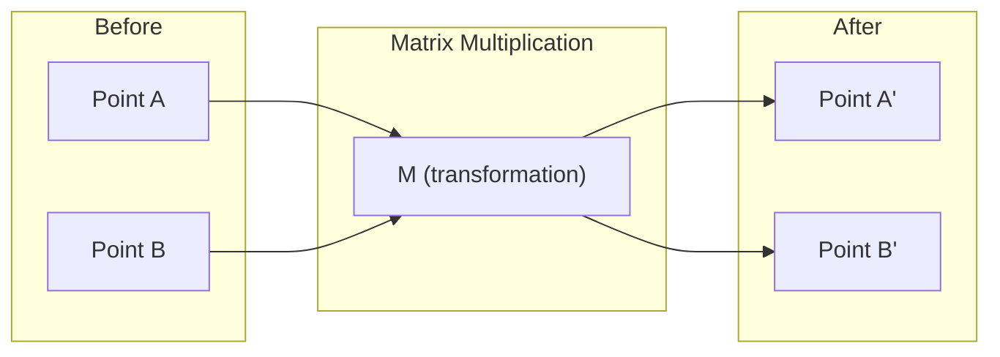
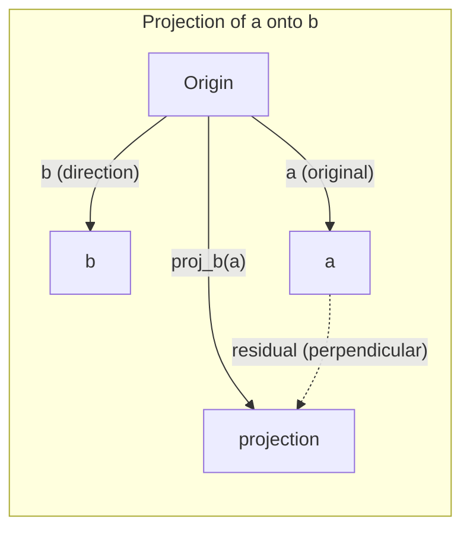

# Линейная алгебра — интуиция

> Каждая модель AI — это просто матричная математика в красивой упаковке.

**Type:** Learn
**Languages:** Python, Julia
**Prerequisites:** Phase 0
**Time:** ~60 minutes

## Learning Objectives

- Implement vector and matrix operations (addition, dot product, matrix multiply) from scratch in Python
- Explain geometrically what the dot product, projection, and Gram-Schmidt process do
- Determine linear independence, rank, and basis of a set of vectors using row reduction
- Connect linear algebra concepts to their AI applications: embeddings, attention scores, and LoRA

## The Problem

Откройте любую статью по ML. На первой странице вы увидите векторы, матрицы, скалярные произведения и преобразования. Без интуиции линейной алгебры это просто символы. С ней вы сможете увидеть, что на самом деле делает нейронная сеть — перемещает точки в пространстве.

Вам не нужно быть математиком. Вам нужно понять, что эти операции означают геометрически, а затем закодировать их самостоятельно.

## The Concept

### Векторы — это точки (и направления)

Вектор — это просто список чисел. Но эти числа что-то значат — это координаты в пространстве.

**2D вектор [3, 2]:**

| x | y | Точка |
|---|---|-------|
| 3 | 2 | Вектор указывает из начала координат (0,0) на точку (3, 2) на плоскости |

Вектор имеет величину sqrt(3^2 + 2^2) = sqrt(13) и указывает вверх и вправо.

В AI векторы представляют всё:
- Слово → вектор из 768 чисел (его "смысл" в пространстве вложений)
- Изображение → вектор из миллионов значений пиксельности
- Пользователь → вектор предпочтений

### Матрицы — это преобразования

Матрица преобразует один вектор в другой. Она может вращать, масштабировать, растягивать или проектировать.



В AI матрицы ЯВЛЯЮТСЯ моделью:
- Веса нейронной сети → матрицы, преобразующие входные данные на выходные
- Оценки внимания → матрицы, определяющие, на что обратить внимание
- Вложения → матрицы, сопоставляющие слова с векторами

### Скалярное произведение измеряет сходство

Скалярное произведение двух векторов показывает, насколько они похожи друг на друга.

```
a · b = a₁×b₁ + a₂×b₂ + ... + aₙ×bₙ

Same direction:      a · b > 0  (similar)
Perpendicular:       a · b = 0  (unrelated)
Opposite direction:  a · b < 0  (dissimilar)
```

Это буквально то, как работают поисковые системы, системы рекомендаций и RAG — найти векторы с высокими скалярными произведениями.

### Линейная независимость

Векторы линейно независимы, если ни один вектор в наборе не может быть записан как комбинация остальных. Если v1, v2, v3 независимы, они охватывают 3D-пространство. Если один является комбинацией остальных, они охватывают только плоскость.

Почему это важно для AI: матрица ваших признаков должна иметь линейно независимые столбцы. Если два признака идеально коррелируют (линейно зависимы), модель не может различить их эффекты. Это вызывает мультиколлинеарность в регрессии — матрица весов становится нестабильной, и небольшие изменения входных данных дают дикие колебания выходных данных.

**Конкретный пример:**

```
v1 = [1, 0, 0]
v2 = [0, 1, 0]
v3 = [2, 1, 0]   # v3 = 2*v1 + v2
```

v1 и v2 независимы — ни один не является скалярным кратным или комбинацией другого. Но v3 = 2*v1 + v2, поэтому {v1, v2, v3} — зависимое множество. Эти три вектора лежат в плоскости xy. Независимо от того, как их комбинировать, вы не можете достичь [0, 0, 1]. У вас есть три вектора, но только две степени свободы.

В наборе данных: если feature_3 = 2*feature_1 + feature_2, добавление feature_3 дает модели нулевую новую информацию. Хуже того, это делает нормальные уравнения сингулярными — нет единственного решения для весов.

### Базис и ранг

Базис — это минимальный набор линейно независимых векторов, охватывающих всё пространство. Количество базисных векторов — это размерность пространства.

Стандартный базис для 3D-пространства — {[1,0,0], [0,1,0], [0,0,1]}. Но любые три независимых вектора в 3D образуют допустимый базис. Выбор базиса — это выбор системы координат.

Ранг матрицы = количество линейно независимых столбцов = количество линейно независимых строк. Если ранг < min(строк, столбцов), матрица имеет дефицитный ранг. Это означает:
- Система имеет бесконечно много решений (или ни одного)
- Информация теряется при преобразовании
- Матрицу невозможно обратить

| Ситуация | Ранг | Что это означает для ML |
|-----------|------|---------------------|
| Полный ранг (ранг = min(m, n)) | Максимально возможный | Существует единственное решение наименьших квадратов. Модель хорошо обусловлена. |
| Дефицитный ранг (ранг < min(m, n)) | Ниже максимума | Признаки избыточны. Бесконечно много решений для весов. Необходима регуляризация. |
| Ранг 1 | 1 | Каждый столбец — масштабированная копия одного вектора. Все данные лежат на линии. |
| Близко к дефицитному рангу (малые сингулярные числа) | Численно низкий | Матрица плохо обусловлена. Крошечный шум входа вызывает большие изменения выхода. Используйте SVD-усечение или ridge-регрессию. |

### Проекция

Проектирование вектора **a** на вектор **b** дает компоненту **a** в направлении **b**:

```
proj_b(a) = (a dot b / b dot b) * b
```

Остаток (a - proj_b(a)) перпендикулярен b. Это ортогональное разложение — основа подгонки методом наименьших квадратов.

Проекция есть везде в ML:
- Линейная регрессия минимизирует расстояние от наблюдений до пространства столбцов — решение ЕСТЬ проекция
- PCA проектирует данные на направления максимальной дисперсии
- Внимание в трансформерах вычисляет проекции запросов на ключи



**Пример:** a = [3, 4], b = [1, 0]

proj_b(a) = (3*1 + 4*0) / (1*1 + 0*0) * [1, 0] = 3 * [1, 0] = [3, 0]

Проекция отбрасывает y-компоненту. Это снижение размерности в простейшей форме — отбросить направления, которые вам не нужны.

### Процесс Грама-Шмидта

Преобразование любого набора независимых векторов в ортонормальный базис. Ортонормальность означает, что каждый вектор имеет длину 1 и каждая пара перпендикулярна.

Алгоритм:
1. Возьмите первый вектор, нормализуйте его
2. Возьмите второй вектор, вычтите его проекцию на первый, нормализуйте
3. Возьмите третий вектор, вычтите его проекции на все предыдущие векторы, нормализуйте
4. Повторите для оставшихся векторов

```
Input:  v1, v2, v3, ... (linearly independent)

u1 = v1 / |v1|

w2 = v2 - (v2 dot u1) * u1
u2 = w2 / |w2|

w3 = v3 - (v3 dot u1) * u1 - (v3 dot u2) * u2
u3 = w3 / |w3|

Output: u1, u2, u3, ... (orthonormal basis)
```

Так работает QR-разложение внутри. Q — ортонормальный базис, R фиксирует коэффициенты проекции. QR-разложение используется в:
- Решении линейных систем (более стабильно, чем исключение Гаусса)
- Вычислении собственных значений (QR-алгоритм)
- Регрессии наименьших квадратов (стандартный численный метод)

```figure
eigen-directions
```

## Build It

### Step 1: Векторы с нуля (Python)

```python
class Vector:
    def __init__(self, components):
        self.components = list(components)
        self.dim = len(self.components)

    def __add__(self, other):
        return Vector([a + b for a, b in zip(self.components, other.components)])

    def __sub__(self, other):
        return Vector([a - b for a, b in zip(self.components, other.components)])

    def dot(self, other):
        return sum(a * b for a, b in zip(self.components, other.components))

    def magnitude(self):
        return sum(x**2 for x in self.components) ** 0.5

    def normalize(self):
        mag = self.magnitude()
        return Vector([x / mag for x in self.components])

    def cosine_similarity(self, other):
        return self.dot(other) / (self.magnitude() * other.magnitude())

    def __repr__(self):
        return f"Vector({self.components})"


a = Vector([1, 2, 3])
b = Vector([4, 5, 6])

print(f"a + b = {a + b}")
print(f"a · b = {a.dot(b)}")
print(f"|a| = {a.magnitude():.4f}")
print(f"cosine similarity = {a.cosine_similarity(b):.4f}")
```

### Step 2: Матрицы с нуля (Python)

```python
class Matrix:
    def __init__(self, rows):
        self.rows = [list(row) for row in rows]
        self.shape = (len(self.rows), len(self.rows[0]))

    def __matmul__(self, other):
        if isinstance(other, Vector):
            return Vector([
                sum(self.rows[i][j] * other.components[j] for j in range(self.shape[1]))
                for i in range(self.shape[0])
            ])
        rows = []
        for i in range(self.shape[0]):
            row = []
            for j in range(other.shape[1]):
                row.append(sum(
                    self.rows[i][k] * other.rows[k][j]
                    for k in range(self.shape[1])
                ))
            rows.append(row)
        return Matrix(rows)

    def transpose(self):
        return Matrix([
            [self.rows[j][i] for j in range(self.shape[0])]
            for i in range(self.shape[1])
        ])

    def __repr__(self):
        return f"Matrix({self.rows})"


rotation_90 = Matrix([[0, -1], [1, 0]])
point = Vector([3, 1])

rotated = rotation_90 @ point
print(f"Original: {point}")
print(f"Rotated 90°: {rotated}")
```

### Step 3: Почему это важно для AI

```python
import random

random.seed(42)
weights = Matrix([[random.gauss(0, 0.1) for _ in range(3)] for _ in range(2)])
input_vector = Vector([1.0, 0.5, -0.3])

output = weights @ input_vector
print(f"Input (3D): {input_vector}")
print(f"Output (2D): {output}")
print("This is what a neural network layer does -- matrix multiplication.")
```

### Step 4: Версия на Julia

```julia
a = [1.0, 2.0, 3.0]
b = [4.0, 5.0, 6.0]

println("a + b = ", a + b)
println("a · b = ", a ⋅ b)       # Julia supports unicode operators
println("|a| = ", √(a ⋅ a))
println("cosine = ", (a ⋅ b) / (√(a ⋅ a) * √(b ⋅ b)))

# Matrix-vector multiplication
W = [0.1 -0.2 0.3; 0.4 0.5 -0.1]
x = [1.0, 0.5, -0.3]
println("Wx = ", W * x)
println("This is a neural network layer.")
```

### Step 5: Линейная независимость и проекция с нуля (Python)

```python
def is_linearly_independent(vectors):
    n = len(vectors)
    dim = len(vectors[0].components)
    mat = Matrix([v.components[:] for v in vectors])
    rows = [row[:] for row in mat.rows]
    rank = 0
    for col in range(dim):
        pivot = None
        for row in range(rank, len(rows)):
            if abs(rows[row][col]) > 1e-10:
                pivot = row
                break
        if pivot is None:
            continue
        rows[rank], rows[pivot] = rows[pivot], rows[rank]
        scale = rows[rank][col]
        rows[rank] = [x / scale for x in rows[rank]]
        for row in range(len(rows)):
            if row != rank and abs(rows[row][col]) > 1e-10:
                factor = rows[row][col]
                rows[row] = [rows[row][j] - factor * rows[rank][j] for j in range(dim)]
        rank += 1
    return rank == n


def project(a, b):
    scalar = a.dot(b) / b.dot(b)
    return Vector([scalar * x for x in b.components])


def gram_schmidt(vectors):
    orthonormal = []
    for v in vectors:
        w = v
        for u in orthonormal:
            proj = project(w, u)
            w = w - proj
        if w.magnitude() < 1e-10:
            continue
        orthonormal.append(w.normalize())
    return orthonormal


v1 = Vector([1, 0, 0])
v2 = Vector([1, 1, 0])
v3 = Vector([1, 1, 1])
basis = gram_schmidt([v1, v2, v3])
for i, u in enumerate(basis):
    print(f"u{i+1} = {u}")
    print(f"  |u{i+1}| = {u.magnitude():.6f}")

print(f"u1 · u2 = {basis[0].dot(basis[1]):.6f}")
print(f"u1 · u3 = {basis[0].dot(basis[2]):.6f}")
print(f"u2 · u3 = {basis[1].dot(basis[2]):.6f}")
```

## Use It

Теперь то же самое с NumPy — то, что вы на самом деле будете использовать:

```python
import numpy as np

a = np.array([1, 2, 3], dtype=float)
b = np.array([4, 5, 6], dtype=float)

print(f"a + b = {a + b}")
print(f"a · b = {np.dot(a, b)}")
print(f"|a| = {np.linalg.norm(a):.4f}")
print(f"cosine = {np.dot(a, b) / (np.linalg.norm(a) * np.linalg.norm(b)):.4f}")

W = np.random.randn(2, 3) * 0.1
x = np.array([1.0, 0.5, -0.3])
print(f"Wx = {W @ x}")
```

### Ранг, проекция и QR с NumPy

```python
import numpy as np

A = np.array([[1, 2], [2, 4]])
print(f"Rank: {np.linalg.matrix_rank(A)}")

a = np.array([3, 4])
b = np.array([1, 0])
proj = (np.dot(a, b) / np.dot(b, b)) * b
print(f"Projection of {a} onto {b}: {proj}")

Q, R = np.linalg.qr(np.random.randn(3, 3))
print(f"Q is orthogonal: {np.allclose(Q @ Q.T, np.eye(3))}")
print(f"R is upper triangular: {np.allclose(R, np.triu(R))}")
```

### PyTorch — тензоры — это векторы с автоматическим дифференцированием

```python
import torch

x = torch.randn(3, requires_grad=True)
y = torch.tensor([1.0, 0.0, 0.0])

similarity = torch.dot(x, y)
similarity.backward()

print(f"x = {x.data}")
print(f"y = {y.data}")
print(f"dot product = {similarity.item():.4f}")
print(f"d(dot)/dx = {x.grad}")
```

Градиент скалярного произведения относительно x — это просто y. PyTorch вычислил это автоматически. Каждая операция в нейронной сети построена из операций, подобных этой — матричные умножения, скалярные произведения, проекции — и автоматическое дифференцирование отслеживает градиенты через все их.

Вы только что построили с нуля то, что NumPy делает в одной строке. Теперь вы знаете, что происходит под капотом.

## Ship It

Этот урок производит:
- `outputs/prompt-linear-algebra-tutor.md` -- подсказка для AI-ассистентов для обучения линейной алгебре через геометрическую интуицию

## Connections

Всё в этом уроке соединяется с конкретными частями современного AI:

| Концепция | Где она появляется |
|---------|------------------|
| Скалярное произведение | Оценки внимания в трансформерах, косинусное сходство в RAG |
| Матричное умножение | Каждый слой нейронной сети, каждое линейное преобразование |
| Линейная независимость | Выбор признаков, избежание мультиколлинеарности |
| Ранг | Определение разрешимости системы, LoRA (низкоранговая адаптация) |
| Проекция | Линейная регрессия (проекция на пространство столбцов), PCA |
| Грама-Шмидт / QR | Численные решатели, вычисление собственных значений |
| Ортонормальный базис | Стабильные численные вычисления, отбеливающие преобразования |

LoRA заслуживает особого упоминания. Она тонко настраивает большие языковые модели путём разложения обновлений весов на низкоранговые матрицы. Вместо обновления матрицы весов 4096x4096 (16M параметров), LoRA обновляет две матрицы размером 4096x16 и 16x4096 (131K параметров). Ограничение ранга-16 означает, что LoRA предполагает, что обновление веса живёт в 16-мерном подпространстве полного 4096-мерного пространства. Это линейная алгебра, делающая реальную работу.

## Exercises

1. Реализуйте `Vector.angle_between(other)`, который возвращает угол в градусах между двумя векторами
2. Создайте матрицу масштабирования 2D, которая удваивает x-координату и утраивает y-координату, затем применить её к вектору [1, 1]
3. Даны 5 случайных векторов вроде слов (размерность 50), найдите два наиболее похожих, используя косинусное сходство
4. Убедитесь, что выход Грама-Шмидта действительно ортонормален: проверьте, что каждая пара имеет скалярное произведение 0 и каждый вектор имеет величину 1
5. Создайте матрицу 3x3 с рангом 2. Проверьте, используя метод `rank()`. Затем объясните, какой геометрический объект охватывают столбцы.
6. Спроектируйте вектор [1, 2, 3] на [1, 1, 1]. Что результат представляет геометрически?

## Key Terms

| Термин | Что говорят люди | Что это на самом деле означает |
|------|----------------|----------------------|
| Вектор | "Стрелка" | Список чисел, представляющих точку или направление в n-мерном пространстве |
| Матрица | "Таблица чисел" | Преобразование, которое отображает векторы из одного пространства в другое |
| Скалярное произведение | "Умножить и сложить" | Мера того, насколько выровнены два вектора — ядро поиска сходства |
| Вложение | "Какая-то магия AI" | Вектор, представляющий смысл чего-либо (слова, изображения, пользователя) |
| Линейная независимость | "Они не перекрываются" | Ни один вектор в наборе не может быть записан как комбинация остальных |
| Ранг | "Сколько измерений" | Количество линейно независимых столбцов (или строк) в матрице |
| Проекция | "Тень" | Компонента одного вектора в направлении другого |
| Базис | "Оси координат" | Минимальный набор независимых векторов, охватывающих пространство |
| Ортонормальный | "Перпендикулярные единичные векторы" | Векторы, взаимно перпендикулярные и каждый имеет длину 1 |