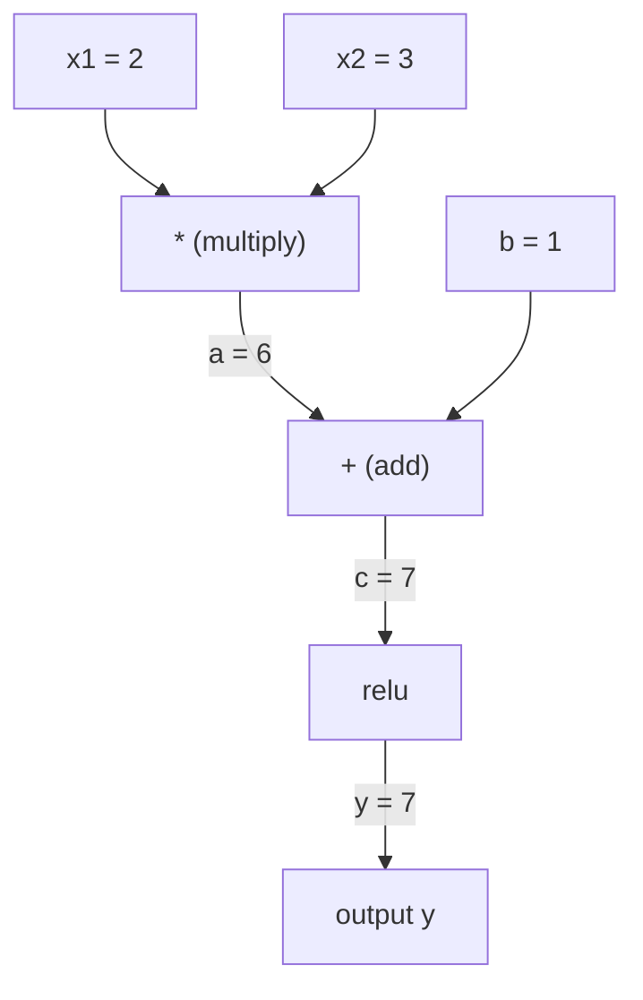
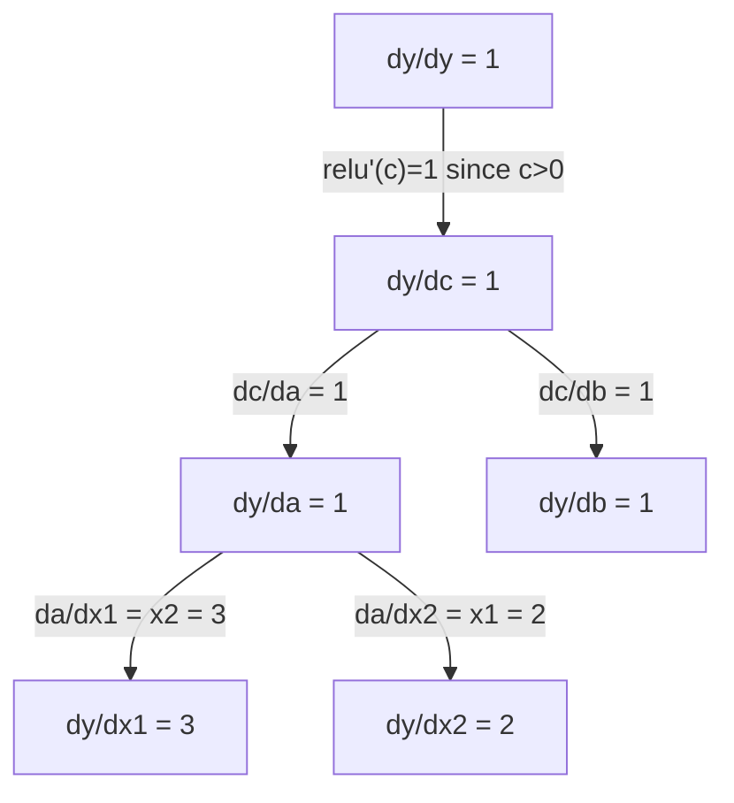

# Цепное правило и автоматическое дифференцирование

> Цепное правило — это двигатель, лежащий в основе каждой обучающейся нейронной сети.

**Type:** Build
**Language:** Python
**Prerequisites:** Phase 1, Lesson 04 (Derivatives & Gradients)
**Time:** ~90 минут

## Цели обучения

- Построить минимальный движок autograd (класс Value), который записывает операции и вычисляет градиенты с помощью обратного режима автодифференцирования
- Реализовать прямой и обратный проходы через вычислительный граф с использованием топологической сортировки
- Построить и обучить многослойный перцептрон на задаче XOR, используя только написанный с нуля движок autograd
- Проверить корректность автодифференцирования с помощью сравнения градиентов с численными конечными разностями

## Проблема

Вы умеете вычислять производные простых функций. Но нейронная сеть — не простая функция. Это сотни функций, скомпонованных вместе: матричное умножение, добавление смещения, применение функции активации, снова матричное умножение, softmax, функция потерь кросс-энтропии. Выход — это функция от функции от функции.

Чтобы обучить сеть, вам нужен градиент функции потерь по каждому отдельному весу. Сделать это вручную невозможно для миллионов параметров. Сделать это численно (конечные разности) — слишком медленно.

Цепное правило даёт вам математику. Автоматическое дифференцирование даёт вам алгоритм. Вместе они позволяют вычислять точные градиенты через произвольные композиции функций за время, пропорциональное одному прямому проходу.

Именно так работают PyTorch, TensorFlow и JAX. Вы построите миниатюрную версию с нуля.

## Концепция

### Цепное правило

Если `y = f(g(x))`, производная `y` по `x` равна:

```
dy/dx = dy/dg * dg/dx = f'(g(x)) * g'(x)
```

Перемножьте производные вдоль цепочки. Каждое звено вносит свою локальную производную.

Пример: `y = sin(x^2)`

```
g(x) = x^2       g'(x) = 2x
f(g) = sin(g)     f'(g) = cos(g)

dy/dx = cos(x^2) * 2x
```

Для более глубоких композиций цепочка продолжается:

```
y = f(g(h(x)))

dy/dx = f'(g(h(x))) * g'(h(x)) * h'(x)
```

Каждый слой в нейронной сети — это одно звено в этой цепочке.

### Вычислительные графы

Вычислительный граф делает цепное правило наглядным. Каждая операция становится узлом. Данные идут вперёд по графу. Градиенты идут назад.

**Прямой проход (вычисление значений):**



**Обратный проход (вычисление градиентов):**



Обратный проход применяет цепное правило в каждом узле, распространяя градиенты от выхода к входам.

### Прямой режим против обратного режима

Существует два способа применить цепное правило в графе.

**Прямой режим** начинает со входов и проталкивает производные вперёд. Он вычисляет `dx/dx = 1` и распространяет это через каждую операцию. Хорош, когда у вас мало входов и много выходов.

```
Forward mode: seed dx/dx = 1, propagate forward

  x = 2       (dx/dx = 1)
  a = x^2     (da/dx = 2x = 4)
  y = sin(a)  (dy/dx = cos(a) * da/dx = cos(4) * 4 = -2.615)
```

**Обратный режим** начинает с выхода и тянет градиенты назад. Он вычисляет `dy/dy = 1` и распространяет это через каждую операцию в обратном порядке. Хорош, когда у вас много входов и мало выходов.

```
Reverse mode: seed dy/dy = 1, propagate backward

  y = sin(a)  (dy/dy = 1)
  a = x^2     (dy/da = cos(a) = cos(4) = -0.654)
  x = 2       (dy/dx = dy/da * da/dx = -0.654 * 4 = -2.615)
```

У нейронных сетей миллионы входов (весов) и один выход (функция потерь). Обратный режим вычисляет все градиенты за один обратный проход. Именно поэтому обратное распространение использует обратный режим.

| Режим | Зерно (seed) | Направление | Когда лучше всего |
|------|------|-----------|-----------|
| Прямой | `dx_i/dx_i = 1` | От входа к выходу | Мало входов, много выходов |
| Обратный | `dy/dy = 1` | От выхода к входу | Много входов, мало выходов (нейронные сети) |

### Дуальные числа для прямого режима

Прямой режим можно элегантно реализовать с помощью дуальных чисел. Дуальное число имеет вид `a + b*epsilon`, где `epsilon^2 = 0`.

```
Dual number: (value, derivative)

(2, 1) means: value is 2, derivative w.r.t. x is 1

Arithmetic rules:
  (a, a') + (b, b') = (a+b, a'+b')
  (a, a') * (b, b') = (a*b, a'*b + a*b')
  sin(a, a')         = (sin(a), cos(a)*a')
```

Задайте переменной входа производную 1. Производная распространяется автоматически через каждую операцию.

### Построение движка autograd

Движку autograd нужны три вещи:

1. **Обёртка значений.** Оберните каждое число в объект, хранящий его значение и градиент.
2. **Запись графа.** Каждая операция записывает свои входы и функцию локального градиента.
3. **Обратный проход.** Топологически отсортируйте граф, затем пройдите его в обратном порядке, применяя цепное правило в каждом узле.

Это именно то, что делает `autograd` в PyTorch. Класс `torch.Tensor` оборачивает значения, записывает операции, когда `requires_grad=True`, и вычисляет градиенты, когда вы вызываете `.backward()`.

### Как работает автоград PyTorch "под капотом"

Когда вы пишете код на PyTorch:

```python
x = torch.tensor(2.0, requires_grad=True)
y = x ** 2 + 3 * x + 1
y.backward()
print(x.grad)  # 7.0 = 2*x + 3 = 2*2 + 3
```

PyTorch внутренне:

1. Создаёт узел `Tensor` для `x` с `requires_grad=True`
2. Каждая операция (`**`, `*`, `+`) создаёт новый узел и записывает функцию обратного прохода
3. `y.backward()` запускает обратное автоматическое дифференцирование через записанный граф
4. Функция `grad_fn` каждого узла вычисляет локальные градиенты и передаёт их родительским узлам
5. Градиенты накапливаются в атрибутах `.grad` через сложение (а не замену)

Граф является динамическим (define-by-run). Новый граф строится на каждом прямом проходе. Именно поэтому PyTorch поддерживает управляющие конструкции (if/else, циклы) внутри моделей.

```figure
chain-rule
```

## Строим это

### Шаг 1: Класс Value

```python
class Value:
    def __init__(self, data, children=(), op=''):
        self.data = data
        self.grad = 0.0
        self._backward = lambda: None
        self._prev = set(children)
        self._op = op

    def __repr__(self):
        return f"Value(data={self.data:.4f}, grad={self.grad:.4f})"
```

Каждый `Value` хранит своё числовое значение, свой градиент (изначально ноль), функцию обратного прохода и указатели на дочерние узлы, которые его породили.

### Шаг 2: Арифметические операции с отслеживанием градиентов

```python
    def __add__(self, other):
        other = other if isinstance(other, Value) else Value(other)
        out = Value(self.data + other.data, (self, other), '+')
        def _backward():
            self.grad += out.grad
            other.grad += out.grad
        out._backward = _backward
        return out

    def __mul__(self, other):
        other = other if isinstance(other, Value) else Value(other)
        out = Value(self.data * other.data, (self, other), '*')
        def _backward():
            self.grad += other.data * out.grad
            other.grad += self.data * out.grad
        out._backward = _backward
        return out

    def relu(self):
        out = Value(max(0, self.data), (self,), 'relu')
        def _backward():
            self.grad += (1.0 if out.data > 0 else 0.0) * out.grad
        out._backward = _backward
        return out
```

Каждая операция создаёт замыкание, которое знает, как вычислить локальные градиенты и умножить их на восходящий градиент (`out.grad`). `+=` обрабатывает случай, когда значение используется в нескольких операциях.

### Шаг 3: Обратный проход

```python
    def backward(self):
        topo = []
        visited = set()
        def build_topo(v):
            if v not in visited:
                visited.add(v)
                for child in v._prev:
                    build_topo(child)
                topo.append(v)
        build_topo(self)

        self.grad = 1.0
        for v in reversed(topo):
            v._backward()
```

Топологическая сортировка гарантирует, что градиент каждого узла полностью вычислен до того, как он распространится на его дочерние узлы. Начальный (seed) градиент равен 1.0 (dy/dy = 1).

### Шаг 4: Больше операций для полноценного движка

Базовый класс Value обрабатывает сложение, умножение и relu. Настоящему движку autograd нужно больше. Вот операции, которые нужны для построения нейронных сетей:

```python
    def __neg__(self):
        return self * -1

    def __sub__(self, other):
        return self + (-other)

    def __radd__(self, other):
        return self + other

    def __rmul__(self, other):
        return self * other

    def __rsub__(self, other):
        return other + (-self)

    def __pow__(self, n):
        out = Value(self.data ** n, (self,), f'**{n}')
        def _backward():
            self.grad += n * (self.data ** (n - 1)) * out.grad
        out._backward = _backward
        return out

    def __truediv__(self, other):
        return self * (other ** -1) if isinstance(other, Value) else self * (Value(other) ** -1)

    def exp(self):
        import math
        e = math.exp(self.data)
        out = Value(e, (self,), 'exp')
        def _backward():
            self.grad += e * out.grad
        out._backward = _backward
        return out

    def log(self):
        import math
        out = Value(math.log(self.data), (self,), 'log')
        def _backward():
            self.grad += (1.0 / self.data) * out.grad
        out._backward = _backward
        return out

    def tanh(self):
        import math
        t = math.tanh(self.data)
        out = Value(t, (self,), 'tanh')
        def _backward():
            self.grad += (1 - t ** 2) * out.grad
        out._backward = _backward
        return out
```

**Почему важна каждая операция:**

| Операция | Правило обратного прохода | Используется в |
|-----------|--------------|---------|
| `__sub__` | Повторно использует add + neg | Вычисление функции потерь (pred - target) |
| `__pow__` | n * x^(n-1) | Полиномиальные функции активации, MSE (error^2) |
| `__truediv__` | Повторно использует mul + pow(-1) | Нормализация, масштабирование скорости обучения |
| `exp` | exp(x) * upstream | Softmax, логарифмическое правдоподобие |
| `log` | (1/x) * upstream | Функция потерь кросс-энтропии, логарифмы вероятностей |
| `tanh` | (1 - tanh^2) * upstream | Классическая функция активации |

Хитрая деталь: `__sub__` и `__truediv__` определены через уже существующие операции. Они получают корректные градиенты бесплатно, потому что цепное правило композируется через базовые операции add/mul/pow.

### Шаг 5: Мини-MLP с нуля

Имея полноценный класс Value, вы можете построить нейронную сеть. Без PyTorch. Без NumPy. Только Values и цепное правило.

```python
import random

class Neuron:
    def __init__(self, n_inputs):
        self.w = [Value(random.uniform(-1, 1)) for _ in range(n_inputs)]
        self.b = Value(0.0)

    def __call__(self, x):
        act = sum((wi * xi for wi, xi in zip(self.w, x)), self.b)
        return act.tanh()

    def parameters(self):
        return self.w + [self.b]

class Layer:
    def __init__(self, n_inputs, n_outputs):
        self.neurons = [Neuron(n_inputs) for _ in range(n_outputs)]

    def __call__(self, x):
        return [n(x) for n in self.neurons]

    def parameters(self):
        return [p for n in self.neurons for p in n.parameters()]

class MLP:
    def __init__(self, sizes):
        self.layers = [Layer(sizes[i], sizes[i+1]) for i in range(len(sizes)-1)]

    def __call__(self, x):
        for layer in self.layers:
            x = layer(x)
        return x[0] if len(x) == 1 else x

    def parameters(self):
        return [p for layer in self.layers for p in layer.parameters()]
```

`Neuron` вычисляет `tanh(w1*x1 + w2*x2 + ... + b)`. `Layer` — это список нейронов. `MLP` складывает слои друг на друга. Каждый вес — это `Value`, поэтому вызов `loss.backward()` распространяет градиенты на каждый параметр.

**Обучение на XOR:**

```python
random.seed(42)
model = MLP([2, 4, 1])  # 2 inputs, 4 hidden neurons, 1 output

xs = [[0, 0], [0, 1], [1, 0], [1, 1]]
ys = [-1, 1, 1, -1]  # XOR pattern (using -1/1 for tanh)

for step in range(100):
    preds = [model(x) for x in xs]
    loss = sum((p - y) ** 2 for p, y in zip(preds, ys))

    for p in model.parameters():
        p.grad = 0.0
    loss.backward()

    lr = 0.05
    for p in model.parameters():
        p.data -= lr * p.grad

    if step % 20 == 0:
        print(f"step {step:3d}  loss = {loss.data:.4f}")

print("\nPredictions after training:")
for x, y in zip(xs, ys):
    print(f"  input={x}  target={y:2d}  pred={model(x).data:6.3f}")
```

Это micrograd. Полный цикл обучения нейронной сети на чистом Python с автоматическим дифференцированием. Каждый коммерческий фреймворк глубокого обучения делает то же самое, но в гигантском масштабе.

### Шаг 6: Проверка градиентов

Как узнать, что ваше автодифференцирование корректно? Сравните его с численными производными. Это называется проверкой градиентов (gradient checking).

```python
def gradient_check(build_expr, x_val, h=1e-7):
    x = Value(x_val)
    y = build_expr(x)
    y.backward()
    autodiff_grad = x.grad

    y_plus = build_expr(Value(x_val + h)).data
    y_minus = build_expr(Value(x_val - h)).data
    numerical_grad = (y_plus - y_minus) / (2 * h)

    diff = abs(autodiff_grad - numerical_grad)
    return autodiff_grad, numerical_grad, diff
```

Проверьте это на сложном выражении:

```python
def expr(x):
    return (x ** 3 + x * 2 + 1).tanh()

ad, num, diff = gradient_check(expr, 0.5)
print(f"Autodiff:  {ad:.8f}")
print(f"Numerical: {num:.8f}")
print(f"Difference: {diff:.2e}")
# Difference should be < 1e-5
```

Проверка градиентов важна при реализации новых операций. Если в вашем обратном проходе есть ошибка, численная проверка её обнаружит. Каждая серьёзная реализация глубокого обучения запускает проверку градиентов во время разработки.

**Когда использовать проверку градиентов:**

| Ситуация | Нужна проверка градиентов? |
|-----------|-------------------|
| Добавление новой операции в ваш autograd | Да, всегда |
| Отладка цикла обучения, который не сходится | Да, сначала проверьте градиенты |
| Производственное обучение | Нет, слишком медленно (2 прямых прохода на параметр) |
| Модульные тесты для кода autograd | Да, автоматизируйте это |

### Шаг 7: Проверка против ручного вычисления

```python
x1 = Value(2.0)
x2 = Value(3.0)
a = x1 * x2          # a = 6.0
b = a + Value(1.0)    # b = 7.0
y = b.relu()          # y = 7.0

y.backward()

print(f"y = {y.data}")          # 7.0
print(f"dy/dx1 = {x1.grad}")   # 3.0 (= x2)
print(f"dy/dx2 = {x2.grad}")   # 2.0 (= x1)
```

Ручная проверка: `y = relu(x1*x2 + 1)`. Поскольку `x1*x2 + 1 = 7 > 0`, relu — тождественная функция.
`dy/dx1 = x2 = 3`. `dy/dx2 = x1 = 2`. Движок совпадает.

## Используем это

### Проверка против PyTorch

```python
import torch

x1 = torch.tensor(2.0, requires_grad=True)
x2 = torch.tensor(3.0, requires_grad=True)
a = x1 * x2
b = a + 1.0
y = torch.relu(b)
y.backward()

print(f"PyTorch dy/dx1 = {x1.grad.item()}")  # 3.0
print(f"PyTorch dy/dx2 = {x2.grad.item()}")  # 2.0
```

Те же градиенты. Ваш движок вычисляет тот же результат, что и PyTorch, потому что математика та же: обратный режим автодифференцирования через цепное правило.

### Более сложное выражение

```python
a = Value(2.0)
b = Value(-3.0)
c = Value(10.0)
f = (a * b + c).relu()  # relu(2*(-3) + 10) = relu(4) = 4

f.backward()
print(f"df/da = {a.grad}")  # -3.0 (= b)
print(f"df/db = {b.grad}")  #  2.0 (= a)
print(f"df/dc = {c.grad}")  #  1.0
```

## Итог

Этот урок даёт:
- `outputs/skill-autodiff.md` -- навык построения и отладки систем autograd
- `code/autodiff.py` -- минимальный движок autograd, который вы можете расширять

Построенный здесь класс Value — это основа для цикла обучения нейронной сети в Phase 3.

## Упражнения

1. Добавьте `__pow__` в класс Value, чтобы вы могли вычислить `x ** n`. Проверьте, что `d/dx(x^3)` при `x=2` равно `12.0`.

2. Добавьте `tanh` в качестве функции активации. Проверьте, что `tanh'(0) = 1` и `tanh'(2) = 0.0707` (приблизительно).

3. Постройте вычислительный граф для одного нейрона: `y = relu(w1*x1 + w2*x2 + b)`. Вычислите все пять градиентов и сверьте их с PyTorch.

4. Реализуйте прямой режим автодифференцирования с использованием дуальных чисел. Создайте класс `Dual` и проверьте, что он даёт те же производные, что и ваш движок обратного режима.

## Ключевые термины

| Термин | Что говорят люди | Что это на самом деле означает |
|------|----------------|----------------------|
| Цепное правило | «Перемножить производные» | Производная композиции функций равна произведению локальных производных каждой функции, вычисленных в нужной точке |
| Вычислительный граф | «Диаграмма сети» | Направленный ациклический граф, где узлы — операции, а рёбра несут значения (прямой проход) или градиенты (обратный проход) |
| Прямой режим | «Проталкивать производные вперёд» | Автодифференцирование, распространяющее производные от входов к выходам. Один проход на каждую входную переменную. |
| Обратный режим | «Обратное распространение» | Автодифференцирование, распространяющее градиенты от выходов к входам. Один проход на каждую выходную переменную. |
| Autograd | «Автоматические градиенты» | Система, которая записывает операции над значениями, строит граф и вычисляет точные градиенты с помощью цепного правила |
| Дуальные числа | «Значение плюс производная» | Числа вида a + b*epsilon (epsilon^2 = 0), которые несут информацию о производной через арифметические операции |
| Топологическая сортировка | «Порядок зависимостей» | Упорядочивание узлов графа так, чтобы каждый узел шёл после всех своих зависимостей. Необходимо для корректного распространения градиентов. |
| Накопление градиентов | «Складывать, а не заменять» | Когда значение подаётся в несколько операций, его градиент равен сумме всех входящих вкладов градиента |
| Динамический граф | «Определение через выполнение» | Вычислительный граф, перестраиваемый на каждом прямом проходе, что позволяет использовать управляющие конструкции Python внутри моделей (стиль PyTorch) |
| Проверка градиентов | «Численная проверка» | Сравнение градиентов автодифференцирования с численными градиентами конечных разностей для проверки корректности. Необходима для отладки. |
| MLP | «Многослойный перцептрон» | Нейронная сеть с одним или несколькими скрытыми слоями нейронов. Каждый нейрон вычисляет взвешенную сумму плюс смещение, затем применяет функцию активации. |
| Нейрон | «Взвешенная сумма + активация» | Базовая единица: выход = активация(w1*x1 + w2*x2 + ... + b). Веса и смещение — обучаемые параметры. |

## Дополнительные материалы

- [3Blue1Brown: Backpropagation calculus](https://www.youtube.com/watch?v=tIeHLnjs5U8) -- наглядное объяснение цепного правила в нейронных сетях
- [PyTorch Autograd mechanics](https://pytorch.org/docs/stable/notes/autograd.html) -- как устроена реальная система
- [Baydin et al., Automatic Differentiation in Machine Learning: a Survey](https://arxiv.org/abs/1502.05767) -- исчерпывающий справочный материал