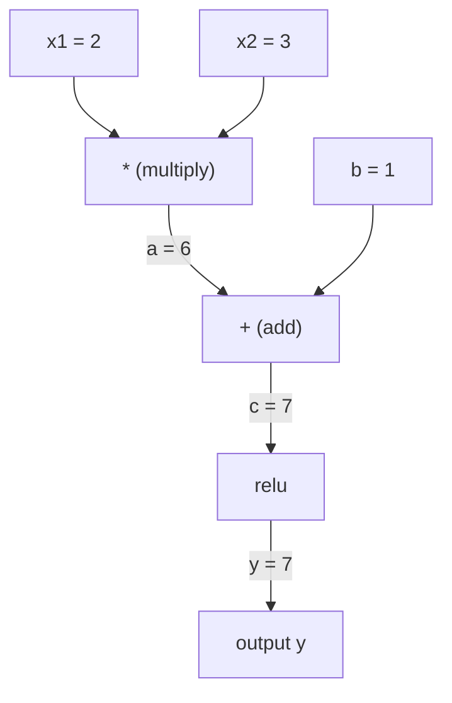
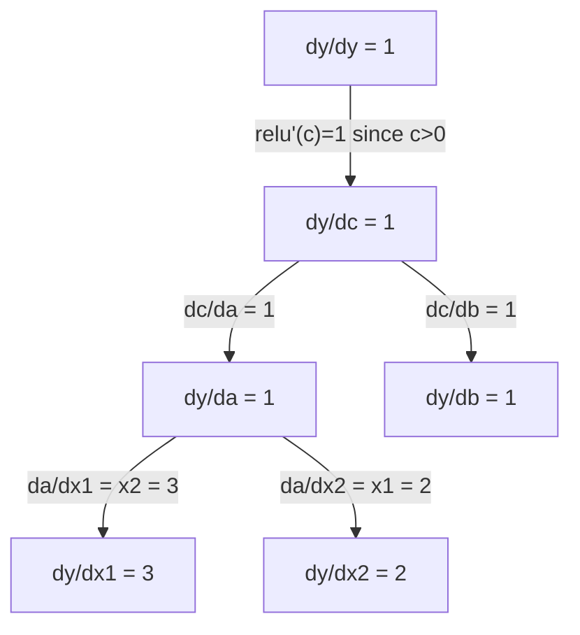

# Цепное правило и автоматическое дифференцирование

> Цепное правило — это движок каждой нейронной сети, которая учится.

**Type:** Build
**Language:** Python
**Prerequisites:** Phase 1, Lesson 04 (Derivatives & Gradients)
**Time:** ~90 minutes

## Learning Objectives

- Build a minimal autograd engine (Value class) that records operations and computes gradients via reverse-mode autodiff
- Implement forward and backward passes through a computation graph using topological sort
- Construct and train a multi-layer perceptron on XOR using only the from-scratch autograd engine
- Verify autodiff correctness using gradient checking against numerical finite differences

## The Problem

Вы можете вычислять производные простых функций. Но нейронная сеть — это не простая функция. Это сотни функций, составленных вместе: матричное умножение, добавление смещения, применение активации, снова матричное умножение, softmax, кросс-энтропийная потеря. Выход — это функция от функции от функции.

Чтобы обучить сеть, вам нужен градиент потерь относительно каждого единственного веса. Вычислять это вручную невозможно для миллионов параметров. Вычислять численно (конечные разности) — слишком медленно.

Цепное правило дает вам математику. Автоматическое дифференцирование дает вам алгоритм. Вместе они позволяют вычислять точные градиенты через произвольные композиции функций за время, пропорциональное одному прямому проходу.

Именно так работают PyTorch, TensorFlow и JAX. Вы создадите миниатюрную версию с нуля.

## The Concept

### Цепное правило

Если `y = f(g(x))`, производная `y` по `x` равна:

```
dy/dx = dy/dg * dg/dx = f'(g(x)) * g'(x)
```

Умножьте производные вдоль цепи. Каждое звено вносит свою локальную производную.

Пример: `y = sin(x^2)`

```
g(x) = x^2       g'(x) = 2x
f(g) = sin(g)     f'(g) = cos(g)

dy/dx = cos(x^2) * 2x
```

Для более глубоких композиций цепь расширяется:

```
y = f(g(h(x)))

dy/dx = f'(g(h(x))) * g'(h(x)) * h'(x)
```

Каждый слой в нейронной сети — это одно звено в этой цепи.

### Графы вычислений

Граф вычислений делает цепное правило наглядным. Каждая операция становится узлом. Данные текут вперед через граф. Градиенты текут назад.

**Прямой проход (вычисление значений):**



**Обратный проход (вычисление градиентов):**



Обратный проход применяет цепное правило в каждом узле, распространяя градиенты от выхода к входам.

### Прямой режим против обратного режима

Есть два способа применить цепное правило через граф.

**Прямой режим** начинается со входов и проталкивает производные вперед. Он вычисляет `dx/dx = 1` и распространяет через каждую операцию. Хорошо когда у вас мало входов и много выходов.

```
Forward mode: seed dx/dx = 1, propagate forward

  x = 2       (dx/dx = 1)
  a = x^2     (da/dx = 2x = 4)
  y = sin(a)  (dy/dx = cos(a) * da/dx = cos(4) * 4 = -2.615)
```

**Обратный режим** начинается с выхода и тянет градиенты назад. Он вычисляет `dy/dy = 1` и распространяет через каждую операцию в обратном порядке. Хорошо когда у вас много входов и мало выходов.

```
Reverse mode: seed dy/dy = 1, propagate backward

  y = sin(a)  (dy/dy = 1)
  a = x^2     (dy/da = cos(a) = cos(4) = -0.654)
  x = 2       (dy/dx = dy/da * da/dx = -0.654 * 4 = -2.615)
```

Нейронные сети имеют миллионы входов (весов) и один выход (потерю). Обратный режим вычисляет все градиенты за один обратный проход. Вот почему обратное распространение использует обратный режим.

| Режим | Начальное значение | Направление | Лучше всего когда |
|------|------|-----------|-----------|
| Прямой | `dx_i/dx_i = 1` | От входа к выходу | Мало входов, много выходов |
| Обратный | `dy/dy = 1` | От выхода к входу | Много входов, мало выходов (нейронные сети) |

### Двойные числа для прямого режима

Прямой режим можно элегантно реализовать с двойными числами. Двойное число имеет вид `a + b*epsilon` где `epsilon^2 = 0`.

```
Dual number: (value, derivative)

(2, 1) means: value is 2, derivative w.r.t. x is 1

Arithmetic rules:
  (a, a') + (b, b') = (a+b, a'+b')
  (a, a') * (b, b') = (a*b, a'*b + a*b')
  sin(a, a')         = (sin(a), cos(a)*a')
```

Инициализируйте входную переменную с производной 1. Производная автоматически распространяется через каждую операцию.

### Построение системы автодифференцирования

Системе автодифференцирования нужны три вещи:

1. **Оборачивание значений.** Оберните каждое число в объект, который хранит его значение и градиент.
2. **Запись графа.** Каждая операция записывает свои входы и функцию локального градиента.
3. **Обратный проход.** Топологически отсортируйте граф, затем пройдите его в обратном порядке, применяя цепное правило в каждом узле.

Это ровно то, что делает `autograd` в PyTorch. Класс `torch.Tensor` оборачивает значения, записывает операции когда `requires_grad=True`, и вычисляет градиенты когда вы вызываете `.backward()`.

### Как автодифференцирование PyTorch работает под капотом

Когда вы пишете код PyTorch:

```python
x = torch.tensor(2.0, requires_grad=True)
y = x ** 2 + 3 * x + 1
y.backward()
print(x.grad)  # 7.0 = 2*x + 3 = 2*2 + 3
```

PyTorch внутренне:

1. Создает узел `Tensor` для `x` с `requires_grad=True`
2. Каждая операция (`**`, `*`, `+`) создает новый узел и записывает функцию обратного прохода
3. `y.backward()` запускает обратный режим автодифференцирования через записанный граф
4. `grad_fn` каждого узла вычисляет локальные градиенты и передает их родительским узлам
5. Градиенты накапливаются в атрибутах `.grad` путем сложения (не замены)

Граф динамический (определение при запуске). Новый граф строится при каждом прямом проходе. Вот почему PyTorch поддерживает управление потоком (if/else, циклы) внутри моделей.

```figure
chain-rule
```

## Build It

### Step 1: The Value class

```python
class Value:
    def __init__(self, data, children=(), op=''):
        self.data = data
        self.grad = 0.0
        self._backward = lambda: None
        self._prev = set(children)
        self._op = op

    def __repr__(self):
        return f"Value(data={self.data:.4f}, grad={self.grad:.4f})"
```

Каждый `Value` хранит свои числовые данные, его градиент (первоначально ноль), функцию обратного прохода и указатели на дочерние узлы, которые его произвели.

### Step 2: Arithmetic operations with gradient tracking

```python
    def __add__(self, other):
        other = other if isinstance(other, Value) else Value(other)
        out = Value(self.data + other.data, (self, other), '+')
        def _backward():
            self.grad += out.grad
            other.grad += out.grad
        out._backward = _backward
        return out

    def __mul__(self, other):
        other = other if isinstance(other, Value) else Value(other)
        out = Value(self.data * other.data, (self, other), '*')
        def _backward():
            self.grad += other.data * out.grad
            other.grad += self.data * out.grad
        out._backward = _backward
        return out

    def relu(self):
        out = Value(max(0, self.data), (self,), 'relu')
        def _backward():
            self.grad += (1.0 if out.data > 0 else 0.0) * out.grad
        out._backward = _backward
        return out
```

Каждая операция создает замыкание, которое знает, как вычислить локальные градиенты и умножить на восходящий градиент (`out.grad`). `+=` обрабатывает случай, когда значение используется в нескольких операциях.

### Step 3: The backward pass

```python
    def backward(self):
        topo = []
        visited = set()
        def build_topo(v):
            if v not in visited:
                visited.add(v)
                for child in v._prev:
                    build_topo(child)
                topo.append(v)
        build_topo(self)

        self.grad = 1.0
        for v in reversed(topo):
            v._backward()
```

Топологическая сортировка гарантирует, что градиент каждого узла полностью вычислен перед тем, как он распространяется на его дочерние элементы. Начальный градиент равен 1.0 (dy/dy = 1).

### Step 4: More operations for a complete engine

Базовый класс Value обрабатывает сложение, умножение и relu. Реальная система автодифференцирования нуждается в большем. Вот операции, которые вам нужны для построения нейронных сетей:

```python
    def __neg__(self):
        return self * -1

    def __sub__(self, other):
        return self + (-other)

    def __radd__(self, other):
        return self + other

    def __rmul__(self, other):
        return self * other

    def __rsub__(self, other):
        return other + (-self)

    def __pow__(self, n):
        out = Value(self.data ** n, (self,), f'**{n}')
        def _backward():
            self.grad += n * (self.data ** (n - 1)) * out.grad
        out._backward = _backward
        return out

    def __truediv__(self, other):
        return self * (other ** -1) if isinstance(other, Value) else self * (Value(other) ** -1)

    def exp(self):
        import math
        e = math.exp(self.data)
        out = Value(e, (self,), 'exp')
        def _backward():
            self.grad += e * out.grad
        out._backward = _backward
        return out

    def log(self):
        import math
        out = Value(math.log(self.data), (self,), 'log')
        def _backward():
            self.grad += (1.0 / self.data) * out.grad
        out._backward = _backward
        return out

    def tanh(self):
        import math
        t = math.tanh(self.data)
        out = Value(t, (self,), 'tanh')
        def _backward():
            self.grad += (1 - t ** 2) * out.grad
        out._backward = _backward
        return out
```

**Почему каждая операция важна:**

| Операция | Правило обратного прохода | Используется в |
|-----------|--------------|---------|
| `__sub__` | Переиспользует add + neg | Вычисление потери (pred - target) |
| `__pow__` | n * x^(n-1) | Полиномиальные активации, MSE (error^2) |
| `__truediv__` | Переиспользует mul + pow(-1) | Нормализация, масштабирование скорости обучения |
| `exp` | exp(x) * upstream | Softmax, логарифмическая вероятность |
| `log` | (1/x) * upstream | Кросс-энтропийная потеря, логарифмические вероятности |
| `tanh` | (1 - tanh^2) * upstream | Классическая функция активации |

Хитрость в том, что `__sub__` и `__truediv__` определены в терминах существующих операций. Они получают правильные градиенты бесплатно, потому что цепное правило композирует через базовые операции add/mul/pow.

### Step 5: Mini MLP from scratch

С полным классом Value вы можете построить нейронную сеть. Никакого PyTorch. Никакого NumPy. Просто Values и цепное правило.

```python
import random

class Neuron:
    def __init__(self, n_inputs):
        self.w = [Value(random.uniform(-1, 1)) for _ in range(n_inputs)]
        self.b = Value(0.0)

    def __call__(self, x):
        act = sum((wi * xi for wi, xi in zip(self.w, x)), self.b)
        return act.tanh()

    def parameters(self):
        return self.w + [self.b]

class Layer:
    def __init__(self, n_inputs, n_outputs):
        self.neurons = [Neuron(n_inputs) for _ in range(n_outputs)]

    def __call__(self, x):
        return [n(x) for n in self.neurons]

    def parameters(self):
        return [p for n in self.neurons for p in n.parameters()]

class MLP:
    def __init__(self, sizes):
        self.layers = [Layer(sizes[i], sizes[i+1]) for i in range(len(sizes)-1)]

    def __call__(self, x):
        for layer in self.layers:
            x = layer(x)
        return x[0] if len(x) == 1 else x

    def parameters(self):
        return [p for layer in self.layers for p in layer.parameters()]
```

`Neuron` вычисляет `tanh(w1*x1 + w2*x2 + ... + b)`. `Layer` — это список нейронов. `MLP` складывает слои вместе. Каждый вес — это `Value`, поэтому вызов `loss.backward()` распространяет градиенты на каждый параметр.

**Обучение на XOR:**

```python
random.seed(42)
model = MLP([2, 4, 1])  # 2 inputs, 4 hidden neurons, 1 output

xs = [[0, 0], [0, 1], [1, 0], [1, 1]]
ys = [-1, 1, 1, -1]  # XOR pattern (using -1/1 for tanh)

for step in range(100):
    preds = [model(x) for x in xs]
    loss = sum((p - y) ** 2 for p, y in zip(preds, ys))

    for p in model.parameters():
        p.grad = 0.0
    loss.backward()

    lr = 0.05
    for p in model.parameters():
        p.data -= lr * p.grad

    if step % 20 == 0:
        print(f"step {step:3d}  loss = {loss.data:.4f}")

print("\nPredictions after training:")
for x, y in zip(xs, ys):
    print(f"  input={x}  target={y:2d}  pred={model(x).data:6.3f}")
```

Это micrograd. Полный цикл обучения нейронной сети на чистом Python с автоматическим дифференцированием. Каждый коммерческий фреймворк глубокого обучения делает то же самое в массовом масштабе.

### Step 6: Gradient checking

Откуда вы знаете, что ваше автодифференцирование правильно? Сравните его с численными производными. Это проверка градиентов.

```python
def gradient_check(build_expr, x_val, h=1e-7):
    x = Value(x_val)
    y = build_expr(x)
    y.backward()
    autodiff_grad = x.grad

    y_plus = build_expr(Value(x_val + h)).data
    y_minus = build_expr(Value(x_val - h)).data
    numerical_grad = (y_plus - y_minus) / (2 * h)

    diff = abs(autodiff_grad - numerical_grad)
    return autodiff_grad, numerical_grad, diff
```

Протестируйте это на сложном выражении:

```python
def expr(x):
    return (x ** 3 + x * 2 + 1).tanh()

ad, num, diff = gradient_check(expr, 0.5)
print(f"Autodiff:  {ad:.8f}")
print(f"Numerical: {num:.8f}")
print(f"Difference: {diff:.2e}")
# Difference should be < 1e-5
```

Проверка градиентов необходима при реализации новых операций. Если ваш обратный проход имеет ошибку, численная проверка ее поймает. Каждая серьезная реализация глубокого обучения запускает проверки градиентов во время разработки.

**Когда использовать проверку градиентов:**

| Ситуация | Проверять градиенты? |
|-----------|-------------------|
| Добавление новой операции в ваше автодифференцирование | Да, всегда |
| Отладка цикла обучения, который не сходится | Да, сначала проверьте градиенты |
| Производственное обучение | Нет, слишком медленно (2 прямых прохода на параметр) |
| Модульные тесты для кода автодифференцирования | Да, автоматизируйте это |

### Step 7: Verify against manual calculation

```python
x1 = Value(2.0)
x2 = Value(3.0)
a = x1 * x2          # a = 6.0
b = a + Value(1.0)    # b = 7.0
y = b.relu()          # y = 7.0

y.backward()

print(f"y = {y.data}")          # 7.0
print(f"dy/dx1 = {x1.grad}")   # 3.0 (= x2)
print(f"dy/dx2 = {x2.grad}")   # 2.0 (= x1)
```

Ручная проверка: `y = relu(x1*x2 + 1)`. Поскольку `x1*x2 + 1 = 7 > 0`, relu — тождество.
`dy/dx1 = x2 = 3`. `dy/dx2 = x1 = 2`. Движок совпадает.

## Use It

### Verify against PyTorch

```python
import torch

x1 = torch.tensor(2.0, requires_grad=True)
x2 = torch.tensor(3.0, requires_grad=True)
a = x1 * x2
b = a + 1.0
y = torch.relu(b)
y.backward()

print(f"PyTorch dy/dx1 = {x1.grad.item()}")  # 3.0
print(f"PyTorch dy/dx2 = {x2.grad.item()}")  # 2.0
```

Те же градиенты. Ваш движок вычисляет тот же результат, что и PyTorch, потому что математика одинакова: обратный режим автодифференцирования через цепное правило.

### A more complex expression

```python
a = Value(2.0)
b = Value(-3.0)
c = Value(10.0)
f = (a * b + c).relu()  # relu(2*(-3) + 10) = relu(4) = 4

f.backward()
print(f"df/da = {a.grad}")  # -3.0 (= b)
print(f"df/db = {b.grad}")  #  2.0 (= a)
print(f"df/dc = {c.grad}")  #  1.0
```

## Ship It

Этот урок производит:
- `outputs/skill-autodiff.md` -- навык построения и отладки систем автодифференцирования
- `code/autodiff.py` -- минимальный движок автодифференцирования, который вы можете расширить

Класс Value, построенный здесь, является основанием для цикла обучения нейронной сети в Phase 3.

## Exercises

1. Добавьте `__pow__` в класс Value, чтобы вы могли вычислить `x ** n`. Проверьте, что `d/dx(x^3)` при `x=2` равно `12.0`.

2. Добавьте `tanh` как функцию активации. Проверьте, что `tanh'(0) = 1` и `tanh'(2) = 0.0707` (приблизительно).

3. Постройте граф вычислений для одного нейрона: `y = relu(w1*x1 + w2*x2 + b)`. Вычислите все пять градиентов и проверьте против PyTorch.

4. Реализуйте прямой режим автодифференцирования, используя двойные числа. Создайте класс `Dual` и проверьте, что он дает те же производные, что и ваш обратный режим движка.

## Key Terms

| Термин | Что люди говорят | Что это на самом деле означает |
|------|----------------|----------------------|
| Chain rule | "Умножьте производные" | Производная составленных функций равна произведению локальной производной каждой функции, оцененной в правильной точке |
| Computational graph | "Диаграмма сети" | Направленный ациклический граф, где узлы — это операции, а ребра переносят значения (вперед) или градиенты (назад) |
| Forward mode | "Проталкивайте производные вперед" | Автодифференцирование, которое распространяет производные от входов к выходам. Один проход на входную переменную. |
| Reverse mode | "Обратное распространение" | Автодифференцирование, которое распространяет градиенты от выходов к входам. Один проход на выходную переменную. |
| Autograd | "Автоматические градиенты" | Система, которая записывает операции на значениях, строит граф и вычисляет точные градиенты через цепное правило |
| Dual numbers | "Значение плюс производная" | Числа вида a + b*epsilon (epsilon^2 = 0), которые переносят информацию производной через арифметику |
| Topological sort | "Порядок зависимостей" | Упорядочение узлов графа так, чтобы каждый узел шел после всех его зависимостей. Требуется для правильного распространения градиентов. |
| Gradient accumulation | "Складывайте, не заменяйте" | Когда значение входит в несколько операций, его градиент — это сумма всех входящих градиентных вкладов |
| Dynamic graph | "Определение при запуске" | Граф вычислений, перестраиваемый при каждом прямом проходе, позволяя управление потоком Python внутри моделей (стиль PyTorch) |
| Gradient checking | "Численная проверка" | Сравнение градиентов автодифференцирования с численными градиентами конечных разностей для проверки корректности. Необходимо для отладки. |
| MLP | "Многослойный перцептрон" | Нейронная сеть с одним или несколькими скрытыми слоями нейронов. Каждый нейрон вычисляет взвешенную сумму плюс смещение, затем применяет функцию активации. |
| Neuron | "Взвешенная сумма + активация" | Базовая единица: output = activation(w1*x1 + w2*x2 + ... + b). Веса и смещение — обучаемые параметры. |

## Further Reading

- [3Blue1Brown: Backpropagation calculus](https://www.youtube.com/watch?v=tIeHLnjs5U8) -- визуальное объяснение цепного правила в нейронных сетях
- [PyTorch Autograd mechanics](https://pytorch.org/docs/stable/notes/autograd.html) -- как работает реальная система
- [Baydin et al., Automatic Differentiation in Machine Learning: a Survey](https://arxiv.org/abs/1502.05767) -- исчерпывающая ссылка