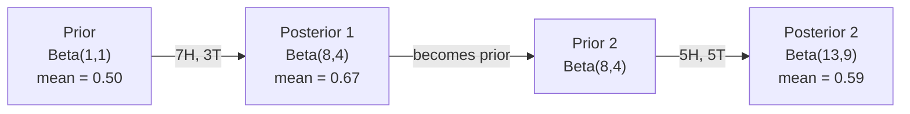

# Теорема Байеса

> Вероятность — это то, что вы ожидаете. Теорема Байеса — это то, что вы узнаёте.

**Type:** Build
**Language:** Python
**Prerequisites:** Phase 1, Lesson 06 (Probability Fundamentals)
**Time:** ~75 minutes

## Learning Objectives

- Применить теорему Байеса для вычисления апостериорных вероятностей из априорных вероятностей, правдоподобия и свидетельства
- Построить классификатор Naive Bayes с нуля со сглаживанием Лапласа и вычислениями в логарифмическом пространстве
- Сравнить оценку максимального правдоподобия (MLE) и оценку максимума апостериорной вероятности (MAP) и объяснить, как MAP соответствует регуляризации L2
- Реализовать последовательное байесовское обновление, используя сопряжённые априорные распределения бета-биномиального типа для A/B-тестирования

## The Problem

Медицинский тест точен на 99%. Вы дали положительный результат. Какова вероятность того, что вы действительно больны?

Большинство людей говорят 99%. На самом деле ответ зависит от того, насколько редко встречается заболевание. Если болезнь есть у 1 из 10 000 человек, положительный результат даёт вам только около 1% вероятности быть больным. Остальные 99% положительных результатов — ложные тревоги от здоровых людей.

Это не трюк. Это теорема Байеса. Каждый фильтр спама, каждая медицинская диагностика, каждая модель машинного обучения, которая количественно оценивает неопределённость, использует именно такое рассуждение. Вы начинаете с убеждения. Вы видите свидетельство. Вы обновляете.

Если вы строите системы ML без понимания этого, вы неправильно интерпретируете выходные данные модели, устанавливаете плохие пороги и отправляете чрезмерно уверенные предсказания.

## The Concept

### От совместной вероятности к Байесу

Вы уже знаете из Lesson 06, что условная вероятность — это:

```
P(A|B) = P(A and B) / P(B)
```

И симметрично:

```
P(B|A) = P(A and B) / P(A)
```

Оба выражения имеют одинаковый числитель: P(A и B). Приравняйте их и переставьте:

```
P(A and B) = P(A|B) * P(B) = P(B|A) * P(A)

Therefore:

P(A|B) = P(B|A) * P(A) / P(B)
```

Это теорема Байеса. Четыре величины, одно уравнение.

### Четыре части

| Часть | Название | Что это означает |
|------|----------|------------------|
| P(A\|B) | Апостериор | Ваше обновлённое убеждение о A после наблюдения свидетельства B |
| P(B\|A) | Правдоподобие | Насколько вероятно свидетельство B, если A верно |
| P(A) | Априор | Ваше убеждение о A до наблюдения каких-либо свидетельств |
| P(B) | Свидетельство | Общая вероятность наблюдения B при всех возможностях |

Член свидетельства P(B) действует как нормализатор. Вы можете разложить его, используя закон полной вероятности:

```
P(B) = P(B|A) * P(A) + P(B|not A) * P(not A)
```

### Пример медицинского теста

Заболевание поражает 1 из 10 000 человек. Тест точен на 99% (выявляет 99% больных людей, даёт ложноположительный результат в 1% случаев).

```
P(sick)          = 0.0001     (prior: disease is rare)
P(positive|sick) = 0.99       (likelihood: test catches it)
P(positive|healthy) = 0.01    (false positive rate)

P(positive) = P(positive|sick) * P(sick) + P(positive|healthy) * P(healthy)
            = 0.99 * 0.0001 + 0.01 * 0.9999
            = 0.000099 + 0.009999
            = 0.010098

P(sick|positive) = P(positive|sick) * P(sick) / P(positive)
                 = 0.99 * 0.0001 / 0.010098
                 = 0.0098
                 = 0.98%
```

Меньше 1%. Априор доминирует. Когда состояние редко, даже точные тесты дают в основном ложноположительные результаты. Поэтому врачи назначают подтверждающие тесты.

### Пример фильтра спама

Вы получаете письмо, содержащее слово «лотерея». Это спам?

```
P(spam)                = 0.3      (30% of email is spam)
P("lottery"|spam)      = 0.05     (5% of spam emails contain "lottery")
P("lottery"|not spam)  = 0.001    (0.1% of legitimate emails contain "lottery")

P("lottery") = 0.05 * 0.3 + 0.001 * 0.7
             = 0.015 + 0.0007
             = 0.0157

P(spam|"lottery") = 0.05 * 0.3 / 0.0157
                  = 0.955
                  = 95.5%
```

Одно слово смещает вероятность с 30% на 95,5%. Реальный фильтр спама применяет Байес одновременно к сотням слов.

### Naive Bayes: допущение независимости

Naive Bayes расширяет это на несколько признаков, предполагая, что все признаки условно независимы при заданном классе:

```
P(class | feature_1, feature_2, ..., feature_n)
  = P(class) * P(feature_1|class) * P(feature_2|class) * ... * P(feature_n|class)
    / P(feature_1, feature_2, ..., feature_n)
```

«Naive» (наивная) часть — это допущение независимости. В тексте появления слов не являются независимыми («Нью» и «Йорк» коррелируют). Но допущение работает удивительно хорошо на практике, потому что классификатор должен только ранжировать классы, а не производить откалиброванные вероятности.

Так как знаменатель одинаков для всех классов, вы можете пропустить его и просто сравнить числители:

```
score(class) = P(class) * product of P(feature_i | class)
```

Выберите класс с наивысшей оценкой.

### Оценка максимального правдоподобия (MLE)

Как получить P(признак|класс) из данных обучения? Подсчитайте.

```
P("free"|spam) = (number of spam emails containing "free") / (total spam emails)
```

Это MLE: выберите значения параметров, которые делают наблюдаемые данные наиболее вероятными. Вы максимизируете функцию правдоподобия, которая для дискретных подсчётов сводится к относительной частоте.

Проблема: если слово никогда не встречается в спаме во время обучения, MLE даёт ему вероятность ноль. Одно невидимое слово уничтожает весь продукт. Исправьте это со сглаживанием Лапласа:

```
P(word|class) = (count(word, class) + 1) / (total_words_in_class + vocabulary_size)
```

Добавление 1 к каждому подсчёту гарантирует, что ни одна вероятность никогда не будет нулевой.

### Максимум апостериорной вероятности (MAP)

MLE спрашивает: какие параметры максимизируют P(данные|параметры)?

MAP спрашивает: какие параметры максимизируют P(параметры|данные)?

По теореме Байеса:

```
P(parameters|data) proportional to P(data|parameters) * P(parameters)
```

MAP добавляет априор над самими параметрами. Если вы верите, что параметры должны быть малыми, вы кодируете это как априор, который штрафует большие значения. Это идентично регуляризации L2 в ML. Штраф «ridge» в гребневой регрессии — это буквально гауссов априор на весах.

| Оценка | Оптимизирует | ML эквивалент |
|--------|-----------|---------------|
| MLE | P(данные\|параметры) | Обучение без регуляризации |
| MAP | P(данные\|параметры) * P(параметры) | Регуляризация L2 / L1 |

### Байесовский vs частотный: практическая разница

Частотники рассматривают параметры как фиксированные неизвестные. Они спрашивают: «Если бы я повторил этот эксперимент много раз, что бы произошло?»

Байесианцы рассматривают параметры как распределения. Они спрашивают: «Учитывая то, что я наблюдал, что я верю о параметрах?»

Для построения систем ML практическая разница:

| Аспект | Частотный | Байесовский |
|--------|-----------|-----------|
| Выход | Точечная оценка | Распределение по значениям |
| Неопределённость | Доверительные интервалы (о процедуре) | Достоверные интервалы (о параметре) |
| Малые данные | Может переобучиться | Априор действует как регуляризация |
| Вычисление | Обычно быстрее | Часто требует выборки (MCMC) |

Большинство производственного ML является частотным (SGD, точечные оценки). Байесовские методы сияют, когда вам нужна откалиброванная неопределённость (медицинские решения, критичные по безопасности системы) или когда данных мало (few-shot обучение, холодный старт).

### Почему байесовское мышление важно для ML

Связь глубже, чем аналогия:

**Априоры — это регуляризация.** Гауссов априор на весах — это регуляризация L2. Лапласов априор — это L1. Каждый раз, когда вы добавляете члена регуляризации, вы делаете байесовское утверждение о том, какие значения параметров вы ожидаете.

**Апостериоры — это неопределённость.** Одна предсказанная вероятность не говорит вам ничего о том, насколько уверена модель в этой оценке. Байесовские методы дают вам распределение: «Я думаю, что P(спам) находится между 0,8 и 0,95».

**Байесовские обновления — это онлайн-обучение.** Апостериор сегодня становится априором завтра. Когда ваша модель видит новые данные, она инкрементально обновляет свои убеждения вместо переобучения с нуля.

**Сравнение моделей — это байесовский подход.** Байесовский информационный критерий (BIC), предельное правдоподобие и факторы Байеса все используют байесовское рассуждение для выбора между моделями без переобучения.

```figure
bayes-update
```

## Build It

### Step 1: Функция теоремы Байеса

```python
def bayes(prior, likelihood, false_positive_rate):
    evidence = likelihood * prior + false_positive_rate * (1 - prior)
    posterior = likelihood * prior / evidence
    return posterior

result = bayes(prior=0.0001, likelihood=0.99, false_positive_rate=0.01)
print(f"P(sick|positive) = {result:.4f}")
```

### Step 2: Классификатор Naive Bayes

```python
import math
from collections import defaultdict

class NaiveBayes:
    def __init__(self, smoothing=1.0):
        self.smoothing = smoothing
        self.class_counts = defaultdict(int)
        self.word_counts = defaultdict(lambda: defaultdict(int))
        self.class_word_totals = defaultdict(int)
        self.vocab = set()

    def train(self, documents, labels):
        for doc, label in zip(documents, labels):
            self.class_counts[label] += 1
            words = doc.lower().split()
            for word in words:
                self.word_counts[label][word] += 1
                self.class_word_totals[label] += 1
                self.vocab.add(word)

    def predict(self, document):
        words = document.lower().split()
        total_docs = sum(self.class_counts.values())
        vocab_size = len(self.vocab)
        best_class = None
        best_score = float("-inf")
        for cls in self.class_counts:
            score = math.log(self.class_counts[cls] / total_docs)
            for word in words:
                count = self.word_counts[cls].get(word, 0)
                total = self.class_word_totals[cls]
                score += math.log((count + self.smoothing) / (total + self.smoothing * vocab_size))
            if score > best_score:
                best_score = score
                best_class = cls
        return best_class
```

Логарифмические вероятности предотвращают потерю значимости. Умножение многих малых вероятностей производит числа, слишком малые для представления в виде чисел с плавающей точкой. Суммирование логарифмических вероятностей численно стабильно и математически эквивалентно.

### Step 3: Обучение на данных спама

```python
train_docs = [
    "win free money now",
    "free lottery ticket winner",
    "claim your prize today free",
    "urgent offer free cash",
    "congratulations you won free",
    "meeting tomorrow at noon",
    "project update attached",
    "can we schedule a call",
    "quarterly report review",
    "lunch on thursday sounds good",
    "team standup notes attached",
    "please review the pull request",
]

train_labels = [
    "spam", "spam", "spam", "spam", "spam",
    "ham", "ham", "ham", "ham", "ham", "ham", "ham",
]

classifier = NaiveBayes()
classifier.train(train_docs, train_labels)

test_messages = [
    "free money waiting for you",
    "meeting rescheduled to friday",
    "you won a free prize",
    "please review the attached report",
]

for msg in test_messages:
    print(f"  '{msg}' -> {classifier.predict(msg)}")
```

### Step 4: Проверка изученных вероятностей

```python
def show_top_words(classifier, cls, n=5):
    vocab_size = len(classifier.vocab)
    total = classifier.class_word_totals[cls]
    probs = {}
    for word in classifier.vocab:
        count = classifier.word_counts[cls].get(word, 0)
        probs[word] = (count + classifier.smoothing) / (total + classifier.smoothing * vocab_size)
    sorted_words = sorted(probs.items(), key=lambda x: x[1], reverse=True)
    for word, prob in sorted_words[:n]:
        print(f"    {word}: {prob:.4f}")

print("\nTop spam words:")
show_top_words(classifier, "spam")
print("\nTop ham words:")
show_top_words(classifier, "ham")
```

## Use It

Scikit-learn поставляет готовые к производству реализации naive Bayes:

```python
from sklearn.feature_extraction.text import CountVectorizer
from sklearn.naive_bayes import MultinomialNB
from sklearn.metrics import classification_report

vectorizer = CountVectorizer()
X_train = vectorizer.fit_transform(train_docs)
clf = MultinomialNB()
clf.fit(X_train, train_labels)

X_test = vectorizer.transform(test_messages)
predictions = clf.predict(X_test)
for msg, pred in zip(test_messages, predictions):
    print(f"  '{msg}' -> {pred}")
```

Одинаковый алгоритм. CountVectorizer обрабатывает токенизацию и построение словаря. MultinomialNB обрабатывает сглаживание и логарифмические вероятности внутри. Ваша версия с нуля делает то же самое в 40 строках.

## Ship It

Класс NaiveBayes, построенный здесь, демонстрирует полный конвейер: токенизацию, оценку вероятности со сглаживанием Лапласа, предсказание в логарифмическом пространстве. Код в `code/bayes.py` работает от начала до конца без зависимостей, помимо стандартной библиотеки Python.

### Сопряжённые априорные распределения

Когда априор и апостериор принадлежат к одному семейству распределений, априор называется «сопряжённым». Это делает байесовское обновление алгебраически чистым — вы получаете апостериор в закрытой форме без численного интегрирования.

| Правдоподобие | Сопряжённый априор | Апостериор | Пример |
|-----------|----------------|-----------|---------|
| Бернулли | Beta(a, b) | Beta(a + успехи, b + неудачи) | Оценка смещения монеты |
| Нормальное (известная дисперсия) | Normal(mu_0, sigma_0) | Normal(взвешенное среднее, меньшая дисперсия) | Калибровка датчика |
| Пуассон | Gamma(a, b) | Gamma(a + сумма подсчётов, b + n) | Моделирование интенсивности прибытия |
| Многомерное распределение | Dirichlet(alpha) | Dirichlet(alpha + подсчёты) | Моделирование тем, языковые модели |

Почему это имеет значение: без сопряжённых априоров вам нужна выборка Монте-Карло или вариационный вывод для аппроксимации апостериора. С сопряжёнными априорами вы просто обновляете два числа.

Бета-распределение — это наиболее частый сопряжённый априор на практике. Beta(a, b) представляет ваше убеждение о параметре вероятности. Среднее — это a/(a+b). Чем больше a+b, тем более сконцентрировано (уверенно) распределение.

Частные случаи бета-априора:
- Beta(1, 1) = равномерное. У вас нет мнения о параметре.
- Beta(10, 10) = пик на 0,5. Вы сильно верите, что параметр близок к 0,5.
- Beta(1, 10) = скошено к 0. Вы верите, что параметр мал.

Правило обновления мёртвенно просто:

```
Prior:     Beta(a, b)
Data:      s successes, f failures
Posterior: Beta(a + s, b + f)
```

Никаких интегралов. Никакой выборки. Просто сложение.

### Последовательное байесовское обновление

Байесовский вывод естественно последователен. Апостериор сегодня становится априором завтра. Вот как реальные системы учатся инкрементально без переобработки всех исторических данных.

Конкретный пример: оценка того, справедлива ли монета.

**День 1: Никаких данных.**
Начните с Beta(1, 1) — равномерным априором. У вас нет мнения.
- Среднее априора: 0,5
- Априор плоский по всему [0, 1]

**День 2: Наблюдаем 7 орлов, 3 решки.**
Апостериор = Beta(1 + 7, 1 + 3) = Beta(8, 4)
- Среднее апостериора: 8/12 = 0,667
- Свидетельство предполагает, что монета смещена в сторону орлов

**День 3: Наблюдаем 5 ещё орлов, 5 ещё решек.**
Используйте вчерашний апостериор как сегодняшний априор.
Апостериор = Beta(8 + 5, 4 + 5) = Beta(13, 9)
- Среднее апостериора: 13/22 = 0,591
- Сбалансированные новые данные потянули оценку обратно к 0,5



Порядок наблюдений не имеет значения. Beta(1,1), обновлённая со всеми 12 орлами и 8 решками сразу, даёт Beta(13, 9) — тот же результат. Последовательное обновление и пакетное обновление математически эквивалентны. Но последовательное обновление позволяет принимать решения на каждом шаге без хранения сырых данных.

Это основание онлайн-обучения в производственных системах ML. Выборка Томпсона для бандитов, инкрементальные системы рекомендаций и потоковые детекторы аномалий все используют этот паттерн.

### Связь с A/B-тестированием

A/B-тестирование — это байесовский вывод в маскировке.

Установка: вы тестируете два цвета кнопки. Вариант A (синий) и вариант B (зелёный). Вы хотите узнать, какой получает больше кликов.

Байесовский A/B-тест:

1. **Априор.** Начните с Beta(1, 1) для обоих вариантов. Без предварительного предпочтения.
2. **Данные.** Вариант A: 50 кликов из 1000 просмотров. Вариант B: 65 кликов из 1000 просмотров.
3. **Апостериоры.**
   - A: Beta(1 + 50, 1 + 950) = Beta(51, 951). Среднее = 0,051
   - B: Beta(1 + 65, 1 + 935) = Beta(66, 936). Среднее = 0,066
4. **Решение.** Вычислить P(B > A) — вероятность того, что истинный коэффициент конверсии B выше, чем у A.

Вычисление P(B > A) аналитически сложно. Но Монте-Карло делает это тривиальным:

```
1. Draw 100,000 samples from Beta(51, 951)  -> samples_A
2. Draw 100,000 samples from Beta(66, 936)  -> samples_B
3. P(B > A) = fraction of samples where B > A
```

Если P(B > A) > 0,95, вы отправляете вариант B. Если он находится между 0,05 и 0,95, вы продолжаете собирать данные. Если P(B > A) < 0,05, вы отправляете вариант A.

Преимущества перед частотным A/B-тестированием:
- Вы получаете прямое заявление вероятности: «есть 97% вероятность, что B лучше»
- Никакой путаницы p-значения. Никакого «неудачно отклонить нулевую гипотезу» уклончивого ответа.
- Вы можете проверить результаты в любое время без увеличения ложноположительных показателей (никаких проблем «подглядывания»)
- Вы можете включить предварительные знания (например, предыдущие тесты предполагают, что коэффициенты конверсии обычно 3-8%)

| Аспект | Частотный A/B | Байесовский A/B |
|--------|----------------|--------------|
| Выход | p-значение | P(B > A) |
| Интерпретация | «Насколько удивительны эти данные, если A=B?» | «Насколько вероятно, что B лучше, чем A?» |
| Ранняя остановка | Увеличивает ложные срабатывания | Безопасна в любой момент (при правильно выбранном априоре и правильно указанной модели) |
| Предварительные знания | Не используются | Кодируются как бета-априор |
| Правило решения | p < 0,05 | P(B > A) > порог |

## Exercises

1. **Multiple tests.** Пациент дважды дал положительный результат на независимых тестах (оба точны на 99%, распространённость заболевания 1 из 10 000). Что такое P(болен) после обоих тестов? Используйте апостериор первого теста как априор для второго.

2. **Smoothing impact.** Запустите классификатор спама со значениями сглаживания 0,01, 0,1, 1,0 и 10,0. Как меняются вероятности главных слов? Что происходит со smoothing=0 и словом, которое появляется только в ветчине?

3. **Add features.** Расширьте класс NaiveBayes, чтобы также использовать длину сообщения (короткое/длинное) как признак рядом с подсчётами слов. Оцените P(короткое|спам) и P(короткое|ветчина) из данных обучения и сложите их в оценку предсказания.

4. **MAP by hand.** Учитывая наблюдаемые данные (7 орлов в 10 бросаниях монеты), вычислите оценку MAP смещения, используя бета-априор Beta(2,2). Сравните это с оценкой MLE (7/10).

## Key Terms

| Термин | Что люди говорят | Что это действительно означает |
|------|----------------|----------------------|
| Prior | «Моё начальное предположение» | P(гипотеза) до наблюдения свидетельства. В ML: член регуляризации. |
| Likelihood | «Насколько хорошо данные подходят» | P(свидетельство\|гипотеза). Насколько вероятны наблюдаемые данные при конкретной гипотезе. |
| Posterior | «Моё обновлённое убеждение» | P(гипотеза\|свидетельство). Априор, умноженный на правдоподобие, затем нормализованный. |
| Evidence | «Нормализующая константа» | P(данные) по всем гипотезам. Гарантирует, что апостериор суммируется до 1. |
| Naive Bayes | «Тот простой классификатор текста» | Классификатор, предполагающий, что признаки независимы при заданном классе. Работает хорошо несмотря на ложное допущение. |
| Laplace smoothing | «Сглаживание add-one» | Добавление малого подсчёта к каждому признаку для предотвращения нулевых вероятностей от невидимых данных. |
| MLE | «Просто используйте частоты» | Выберите параметры, которые максимизируют P(данные\|параметры). Никакого априора. Может переобучиться с малыми данными. |
| MAP | «MLE с априором» | Выберите параметры, которые максимизируют P(данные\|параметры) * P(параметры). Эквивалентно регуляризованному MLE. |
| Log-probability | «Работайте в логарифмическом пространстве» | Использование log(P) вместо P, чтобы избежать потери значимости при умножении многих малых чисел. |
| False positive | «Неправильная тревога» | Тест говорит положительно, но истинное состояние отрицательно. Приводит к ошибке основного показателя. |

## Further Reading

- [3Blue1Brown: Bayes' theorem](https://www.youtube.com/watch?v=HZGCoVF3YvM) - визуальное объяснение с примером медицинского теста
- [Stanford CS229: Generative Learning Algorithms](https://cs229.stanford.edu/main_notes.pdf) - naive Bayes и его связь с дискриминативными моделями
- [Think Bayes](https://greenteapress.com/wp/think-bayes/) - бесплатная книга, байесовская статистика с кодом Python
- [scikit-learn Naive Bayes](https://scikit-learn.org/stable/modules/naive_bayes.html) - производственные реализации и когда использовать каждый вариант