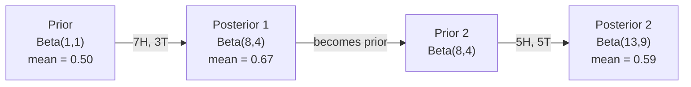

# Теорема Байеса

> Вероятность — о том, что вы ожидаете. Теорема Байеса — о том, что вы узнаёте.

**Type:** Build
**Language:** Python
**Prerequisites:** Phase 1, Lesson 06 (Probability Fundamentals)
**Time:** ~75 минут

## Цели обучения

- Применять теорему Байеса для вычисления апостериорных вероятностей по априорным вероятностям, правдоподобию и свидетельству
- Построить с нуля текстовый классификатор Naive Bayes со сглаживанием Лапласа и вычислениями в логарифмическом пространстве
- Сравнить оценки MLE и MAP и объяснить, как MAP соответствует L2-регуляризации
- Реализовать последовательное байесовское обновление с использованием сопряжённых априорных распределений Beta-Binomial для A/B-тестирования

## Проблема

Медицинский тест точен на 99%. У вас положительный результат. Каковы шансы, что вы действительно больны?

Большинство людей говорят 99%. Реальный ответ зависит от того, насколько редка болезнь. Если ею болеет 1 из 10 000 человек, положительный результат даёт вам лишь около 1% шанса быть больным. Остальные 99% положительных результатов — это ложные тревоги у здоровых людей.

Это не хитрый вопрос. Это теорема Байеса. Каждый спам-фильтр, каждая медицинская диагностика, каждая модель машинного обучения, количественно оценивающая неопределённость, использует именно это рассуждение. Вы начинаете с некоторого убеждения. Видите свидетельство. Обновляете убеждение.

Если вы строите ML-системы, не понимая этого, вы будете неверно интерпретировать выходные данные модели, задавать неправильные пороги и выпускать самоуверенные предсказания.

## Концепция

### От совместной вероятности к Байесу

Из Lesson 06 вы уже знаете, что условная вероятность выглядит так:

```
P(A|B) = P(A and B) / P(B)
```

И симметрично:

```
P(B|A) = P(A and B) / P(A)
```

Оба выражения имеют один и тот же числитель: P(A и B). Приравняйте их и преобразуйте:

```
P(A and B) = P(A|B) * P(B) = P(B|A) * P(A)

Therefore:

P(A|B) = P(B|A) * P(A) / P(B)
```

Это теорема Байеса. Четыре величины, одно уравнение.

### Четыре составляющие

| Часть | Название | Что это означает |
|------|------|---------------|
| P(A\|B) | Апостериорная вероятность | Ваше обновлённое убеждение об A после наблюдения свидетельства B |
| P(B\|A) | Правдоподобие | Насколько вероятно свидетельство B, если A истинно |
| P(A) | Априорная вероятность | Ваше убеждение об A до наблюдения каких-либо свидетельств |
| P(B) | Свидетельство | Полная вероятность наблюдения B при всех возможных вариантах |

Член свидетельства P(B) выступает в роли нормализатора. Его можно раскрыть с помощью формулы полной вероятности:

```
P(B) = P(B|A) * P(A) + P(B|not A) * P(not A)
```

### Пример с медицинским тестом

Болезнью страдает 1 из 10 000 человек. Тест точен на 99% (обнаруживает 99% больных, даёт ложноположительный результат в 1% случаев).

```
P(sick)          = 0.0001     (prior: disease is rare)
P(positive|sick) = 0.99       (likelihood: test catches it)
P(positive|healthy) = 0.01    (false positive rate)

P(positive) = P(positive|sick) * P(sick) + P(positive|healthy) * P(healthy)
            = 0.99 * 0.0001 + 0.01 * 0.9999
            = 0.000099 + 0.009999
            = 0.010098

P(sick|positive) = P(positive|sick) * P(sick) / P(positive)
                 = 0.99 * 0.0001 / 0.010098
                 = 0.0098
                 = 0.98%
```

Менее 1%. Доминирует априорная вероятность. Когда состояние редкое, даже точные тесты в основном дают ложноположительные результаты. Поэтому врачи назначают подтверждающие тесты.

### Пример со спам-фильтром

Вы получаете письмо со словом "lottery". Это спам?

```
P(spam)                = 0.3      (30% of email is spam)
P("lottery"|spam)      = 0.05     (5% of spam emails contain "lottery")
P("lottery"|not spam)  = 0.001    (0.1% of legitimate emails contain "lottery")

P("lottery") = 0.05 * 0.3 + 0.001 * 0.7
             = 0.015 + 0.0007
             = 0.0157

P(spam|"lottery") = 0.05 * 0.3 / 0.0157
                  = 0.955
                  = 95.5%
```

Одно слово сдвигает вероятность с 30% до 95,5%. Реальный спам-фильтр применяет Байеса одновременно к сотням слов.

### Naive Bayes: предположение о независимости

Naive Bayes расширяет это на множество признаков, предполагая, что все признаки условно независимы при заданном классе:

```
P(class | feature_1, feature_2, ..., feature_n)
  = P(class) * P(feature_1|class) * P(feature_2|class) * ... * P(feature_n|class)
    / P(feature_1, feature_2, ..., feature_n)
```

"Наивная" часть — это предположение о независимости. В тексте появления слов не являются независимыми ("New" и "York" коррелируют). Но предположение работает на удивление хорошо на практике, потому что классификатору нужно лишь ранжировать классы, а не выдавать калиброванные вероятности.

Поскольку знаменатель одинаков для всех классов, его можно пропустить и просто сравнивать числители:

```
score(class) = P(class) * product of P(feature_i | class)
```

Выбирайте класс с наивысшей оценкой.

### Оценка максимального правдоподобия (MLE)

Как получить P(признак|класс) из обучающих данных? Подсчётом.

```
P("free"|spam) = (number of spam emails containing "free") / (total spam emails)
```

Это MLE: выбрать значения параметров, которые делают наблюдаемые данные максимально вероятными. Вы максимизируете функцию правдоподобия, которая для дискретных подсчётов сводится к относительной частоте.

Проблема: если слово ни разу не встречалось в спаме во время обучения, MLE даёт ему нулевую вероятность. Одно невиданное слово убивает всё произведение. Исправьте это сглаживанием Лапласа:

```
P(word|class) = (count(word, class) + 1) / (total_words_in_class + vocabulary_size)
```

Прибавление 1 к каждому подсчёту гарантирует, что ни одна вероятность никогда не будет нулевой.

### Максимум апостериорной вероятности (MAP)

MLE спрашивает: какие параметры максимизируют P(данные|параметры)?

MAP спрашивает: какие параметры максимизируют P(параметры|данные)?

По теореме Байеса:

```
P(parameters|data) proportional to P(data|parameters) * P(parameters)
```

MAP добавляет априорное распределение для самих параметров. Если вы считаете, что параметры должны быть малыми, вы кодируете это как априорное распределение, которое штрафует большие значения. Это идентично L2-регуляризации в ML. Штраф "ridge" в ridge-регрессии — это буквально гауссовское априорное распределение для весов.

| Оценка | Оптимизирует | Эквивалент в ML |
|------------|-----------|---------------|
| MLE | P(данные\|параметры) | Обучение без регуляризации |
| MAP | P(данные\|параметры) * P(параметры) | L2 / L1-регуляризация |

### Байесовский vs частотный подход: практическая разница

Частотники рассматривают параметры как фиксированные неизвестные величины. Они спрашивают: "Если бы я повторил этот эксперимент много раз, что бы произошло?"

Байесианцы рассматривают параметры как распределения. Они спрашивают: "Учитывая то, что я наблюдал, что я верю о параметрах?"

Для построения ML-систем практическая разница такова:

| Аспект | Частотный | Байесовский |
|--------|-------------|----------|
| Результат | Точечная оценка | Распределение значений |
| Неопределённость | Доверительные интервалы (о процедуре) | Достоверные интервалы (о параметре) |
| Малые данные | Может переобучаться | Априорное распределение действует как регуляризация |
| Вычисления | Обычно быстрее | Часто требует сэмплирования (MCMC) |

Большая часть production ML — частотная (SGD, точечные оценки). Байесовские методы раскрываются там, где нужна калиброванная неопределённость (медицинские решения, критически важные для безопасности системы) или когда данных мало (few-shot learning, холодный старт).

### Почему байесовское мышление важно для ML

Связь глубже, чем просто аналогия:

**Априорные распределения — это регуляризация.** Гауссовское априорное распределение для весов — это L2-регуляризация. Распределение Лапласа — это L1. Каждый раз, добавляя член регуляризации, вы делаете байесовское утверждение о том, какие значения параметров вы ожидаете.

**Апостериорные распределения — это неопределённость.** Единственная предсказанная вероятность ничего не говорит о том, насколько модель уверена в этой оценке. Байесовские методы дают вам распределение: "Я думаю, что P(spam) находится между 0,8 и 0,95."

**Байесовские обновления — это онлайн-обучение.** Сегодняшнее апостериорное распределение становится завтрашним априорным. Когда ваша модель видит новые данные, она обновляет свои убеждения постепенно, вместо того чтобы переобучаться с нуля.

**Сравнение моделей — это тоже байесовский подход.** Байесовский информационный критерий (BIC), предельное правдоподобие и байесовские факторы — всё это использует байесовское рассуждение для выбора между моделями без переобучения.

```figure
bayes-update
```

## Построение

### Шаг 1: Функция теоремы Байеса

```python
def bayes(prior, likelihood, false_positive_rate):
    evidence = likelihood * prior + false_positive_rate * (1 - prior)
    posterior = likelihood * prior / evidence
    return posterior

result = bayes(prior=0.0001, likelihood=0.99, false_positive_rate=0.01)
print(f"P(sick|positive) = {result:.4f}")
```

### Шаг 2: Классификатор Naive Bayes

```python
import math
from collections import defaultdict

class NaiveBayes:
    def __init__(self, smoothing=1.0):
        self.smoothing = smoothing
        self.class_counts = defaultdict(int)
        self.word_counts = defaultdict(lambda: defaultdict(int))
        self.class_word_totals = defaultdict(int)
        self.vocab = set()

    def train(self, documents, labels):
        for doc, label in zip(documents, labels):
            self.class_counts[label] += 1
            words = doc.lower().split()
            for word in words:
                self.word_counts[label][word] += 1
                self.class_word_totals[label] += 1
                self.vocab.add(word)

    def predict(self, document):
        words = document.lower().split()
        total_docs = sum(self.class_counts.values())
        vocab_size = len(self.vocab)
        best_class = None
        best_score = float("-inf")
        for cls in self.class_counts:
            score = math.log(self.class_counts[cls] / total_docs)
            for word in words:
                count = self.word_counts[cls].get(word, 0)
                total = self.class_word_totals[cls]
                score += math.log((count + self.smoothing) / (total + self.smoothing * vocab_size))
            if score > best_score:
                best_score = score
                best_class = cls
        return best_class
```

Логарифмические вероятности предотвращают потерю точности (underflow). Умножение многих малых вероятностей даёт числа, слишком мелкие для представления с плавающей точкой. Суммирование логарифмов вероятностей численно устойчиво и математически эквивалентно.

### Шаг 3: Обучение на данных о спаме

```python
train_docs = [
    "win free money now",
    "free lottery ticket winner",
    "claim your prize today free",
    "urgent offer free cash",
    "congratulations you won free",
    "meeting tomorrow at noon",
    "project update attached",
    "can we schedule a call",
    "quarterly report review",
    "lunch on thursday sounds good",
    "team standup notes attached",
    "please review the pull request",
]

train_labels = [
    "spam", "spam", "spam", "spam", "spam",
    "ham", "ham", "ham", "ham", "ham", "ham", "ham",
]

classifier = NaiveBayes()
classifier.train(train_docs, train_labels)

test_messages = [
    "free money waiting for you",
    "meeting rescheduled to friday",
    "you won a free prize",
    "please review the attached report",
]

for msg in test_messages:
    print(f"  '{msg}' -> {classifier.predict(msg)}")
```

### Шаг 4: Изучение полученных вероятностей

```python
def show_top_words(classifier, cls, n=5):
    vocab_size = len(classifier.vocab)
    total = classifier.class_word_totals[cls]
    probs = {}
    for word in classifier.vocab:
        count = classifier.word_counts[cls].get(word, 0)
        probs[word] = (count + classifier.smoothing) / (total + classifier.smoothing * vocab_size)
    sorted_words = sorted(probs.items(), key=lambda x: x[1], reverse=True)
    for word, prob in sorted_words[:n]:
        print(f"    {word}: {prob:.4f}")

print("\nTop spam words:")
show_top_words(classifier, "spam")
print("\nTop ham words:")
show_top_words(classifier, "ham")
```

## Применение

Scikit-learn предоставляет готовые к использованию реализации naive Bayes:

```python
from sklearn.feature_extraction.text import CountVectorizer
from sklearn.naive_bayes import MultinomialNB
from sklearn.metrics import classification_report

vectorizer = CountVectorizer()
X_train = vectorizer.fit_transform(train_docs)
clf = MultinomialNB()
clf.fit(X_train, train_labels)

X_test = vectorizer.transform(test_messages)
predictions = clf.predict(X_test)
for msg, pred in zip(test_messages, predictions):
    print(f"  '{msg}' -> {pred}")
```

Тот же алгоритм. CountVectorizer выполняет токенизацию и построение словаря. MultinomialNB внутренне обрабатывает сглаживание и логарифмические вероятности. Ваша версия, написанная с нуля, делает то же самое в 40 строках.

## Отправка в production

Класс NaiveBayes, построенный здесь, демонстрирует полный конвейер: токенизацию, оценку вероятностей со сглаживанием Лапласа, предсказание в логарифмическом пространстве. Код в `code/bayes.py` выполняется от начала до конца без зависимостей, кроме стандартной библиотеки Python.

### Сопряжённые априорные распределения

Когда априорное и апостериорное распределения принадлежат одному семейству распределений, априорное распределение называется "сопряжённым". Это делает байесовское обновление алгебраически чистым — вы получаете апостериорное распределение в замкнутой форме без численного интегрирования.

| Правдоподобие | Сопряжённое априорное распределение | Апостериорное распределение | Пример |
|-----------|----------------|-----------|---------|
| Bernoulli | Beta(a, b) | Beta(a + успехи, b + неудачи) | Оценка смещённости монеты |
| Normal (известная дисперсия) | Normal(mu_0, sigma_0) | Normal(взвешенное среднее, меньшая дисперсия) | Калибровка сенсора |
| Poisson | Gamma(a, b) | Gamma(a + сумма подсчётов, b + n) | Моделирование частоты поступлений |
| Multinomial | Dirichlet(alpha) | Dirichlet(alpha + подсчёты) | Тематическое моделирование, языковые модели |

Почему это важно: без сопряжённых априорных распределений вам нужны сэмплирование методом Монте-Карло или вариационный вывод для приближения апостериорного распределения. С сопряжёнными априорными распределениями вы просто обновляете два числа.

Бета-распределение — самое распространённое сопряжённое априорное распределение на практике. Beta(a, b) представляет ваше убеждение о параметре вероятности. Среднее значение равно a/(a+b). Чем больше a+b, тем более концентрированным (уверенным) является распределение.

Частные случаи бета-априорного распределения:
- Beta(1, 1) = равномерное. У вас нет мнения о параметре.
- Beta(10, 10) = пик в точке 0,5. Вы сильно уверены, что параметр близок к 0,5.
- Beta(1, 10) = смещено к 0. Вы считаете, что параметр мал.

Правило обновления предельно простое:

```
Prior:     Beta(a, b)
Data:      s successes, f failures
Posterior: Beta(a + s, b + f)
```

Никаких интегралов. Никакого сэмплирования. Просто сложение.

### Последовательное байесовское обновление

Байесовский вывод по своей природе последователен. Сегодняшнее апостериорное распределение становится завтрашним априорным. Именно так реальные системы обучаются постепенно, не обрабатывая заново все исторические данные.

Конкретный пример: оценка честности монеты.

**День 1: Данных ещё нет.**
Начните с Beta(1, 1) — равномерного априорного распределения. У вас нет мнения.
- Среднее априорного распределения: 0,5
- Априорное распределение плоское на [0, 1]

**День 2: Наблюдаются 7 орлов, 3 решки.**
Апостериорное распределение = Beta(1 + 7, 1 + 3) = Beta(8, 4)
- Среднее апостериорного распределения: 8/12 = 0,667
- Данные указывают на то, что монета смещена в сторону орла

**День 3: Наблюдаются ещё 5 орлов, 5 решек.**
Используйте вчерашнее апостериорное распределение как сегодняшнее априорное.
Апостериорное распределение = Beta(8 + 5, 4 + 5) = Beta(13, 9)
- Среднее апостериорного распределения: 13/22 = 0,591
- Сбалансированные новые данные вернули оценку ближе к 0,5



Порядок наблюдений не имеет значения. Beta(1,1), обновлённое сразу всеми 12 орлами и 8 решками, даёт Beta(13, 9) — тот же результат. Последовательное и пакетное обновление математически эквивалентны. Но последовательное обновление позволяет принимать решения на каждом шаге, не храня исходные данные.

Это основа онлайн-обучения в production ML-системах. Thompson sampling для бандитов, инкрементальные рекомендательные системы и потоковые детекторы аномалий — все они используют этот паттерн.

### Связь с A/B-тестированием

A/B-тестирование — это байесовский вывод в замаскированном виде.

Постановка задачи: вы тестируете два цвета кнопки. Вариант A (синий) и вариант B (зелёный). Вы хотите узнать, какой из них получает больше кликов.

Байесовский A/B-тест:

1. **Априорное распределение.** Начните с Beta(1, 1) для обоих вариантов. Нет предпочтений заранее.
2. **Данные.** Вариант A: 50 кликов из 1000 показов. Вариант B: 65 кликов из 1000 показов.
3. **Апостериорные распределения.**
   - A: Beta(1 + 50, 1 + 950) = Beta(51, 951). Среднее = 0,051
   - B: Beta(1 + 65, 1 + 935) = Beta(66, 936). Среднее = 0,066
4. **Решение.** Вычислите P(B > A) — вероятность того, что истинный коэффициент конверсии B выше, чем у A.

Вычислить P(B > A) аналитически сложно. Но Монте-Карло делает это тривиальным:

```
1. Draw 100,000 samples from Beta(51, 951)  -> samples_A
2. Draw 100,000 samples from Beta(66, 936)  -> samples_B
3. P(B > A) = fraction of samples where B > A
```

Если P(B > A) > 0,95, вы выпускаете вариант B. Если значение между 0,05 и 0,95, вы продолжаете собирать данные. Если P(B > A) < 0,05, вы выпускаете вариант A.

Преимущества перед частотным A/B-тестированием:
- Вы получаете прямое утверждение о вероятности: "есть 97% шанс, что B лучше"
- Нет путаницы с p-значениями. Нет оговорок типа "не удалось отвергнуть нулевую гипотезу".
- Вы можете проверять результаты в любой момент, не завышая частоту ложных срабатываний (нет "проблемы подглядывания")
- Вы можете учитывать априорные знания (например, предыдущие тесты показывают, что коэффициенты конверсии обычно составляют 3-8%)

| Аспект | Частотный A/B | Байесовский A/B |
|--------|----------------|--------------|
| Результат | p-значение | P(B > A) |
| Интерпретация | "Насколько удивительны эти данные, если A=B?" | "Насколько вероятно, что B лучше A?" |
| Ранняя остановка | Завышает ложные срабатывания | Безопасна в любой момент (при хорошо подобранном априорном распределении и корректно заданной модели) |
| Априорные знания | Не используются | Кодируются как Beta-априорное распределение |
| Правило принятия решения | p < 0,05 | P(B > A) > порог |

## Упражнения

1. **Множественные тесты.** Пациент дважды получает положительный результат на независимых тестах (оба точны на 99%, распространённость болезни 1 из 10 000). Какова P(болен) после обоих тестов? Используйте апостериорное распределение после первого теста как априорное для второго.

2. **Влияние сглаживания.** Запустите классификатор спама со значениями сглаживания 0,01, 0,1, 1,0 и 10,0. Как изменяются вероятности самых частых слов? Что происходит при smoothing=0 и слове, которое встречается только в ham?

3. **Добавьте признаки.** Расширьте класс NaiveBayes, чтобы также использовать длину сообщения (короткое/длинное) как признак наряду со счётчиками слов. Оцените P(короткое|spam) и P(короткое|ham) из обучающих данных и включите это в оценку предсказания.

4. **MAP вручную.** Дано наблюдаемые данные (7 орлов из 10 подбрасываний монеты), вычислите MAP-оценку смещённости, используя Beta(2,2) в качестве априорного распределения. Сравните её с MLE-оценкой (7/10).

## Ключевые термины

| Термин | Что обычно говорят | Что это означает на самом деле |
|------|----------------|----------------------|
| Prior (априорное распределение) | "Моё первоначальное предположение" | P(гипотеза) до наблюдения свидетельства. В ML: член регуляризации. |
| Likelihood (правдоподобие) | "Насколько хорошо данные соответствуют" | P(свидетельство\|гипотеза). Насколько вероятны наблюдаемые данные при конкретной гипотезе. |
| Posterior (апостериорное распределение) | "Моё обновлённое убеждение" | P(гипотеза\|свидетельство). Априорное распределение, умноженное на правдоподобие, затем нормализованное. |
| Evidence (свидетельство) | "Нормализующая константа" | P(данные) по всем гипотезам. Гарантирует, что апостериорное распределение в сумме даёт 1. |
| Naive Bayes | "Этот простой текстовый классификатор" | Классификатор, который предполагает независимость признаков при заданном классе. Работает хорошо, несмотря на ложное предположение. |
| Laplace smoothing (сглаживание Лапласа) | "Add-one сглаживание" | Добавление небольшого счётчика к каждому признаку для предотвращения нулевых вероятностей от невиданных данных. |
| MLE | "Просто используй частоты" | Выбор параметров, максимизирующих P(данные\|параметры). Без априорного распределения. Может переобучаться на малых данных. |
| MAP | "MLE с априорным распределением" | Выбор параметров, максимизирующих P(данные\|параметры) * P(параметры). Эквивалентно регуляризованному MLE. |
| Log-probability (логарифмическая вероятность) | "Работай в логарифмическом пространстве" | Использование log(P) вместо P, чтобы избежать потери точности с плавающей точкой при перемножении многих малых чисел. |
| False positive (ложноположительный результат) | "Ложная тревога" | Тест говорит "положительно", но истинное состояние — отрицательное. Лежит в основе ошибки базовой ставки. |

## Дополнительное чтение

- [3Blue1Brown: теорема Байеса](https://www.youtube.com/watch?v=HZGCoVF3YvM) — наглядное объяснение на примере медицинского теста
- [Stanford CS229: Generative Learning Algorithms](https://cs229.stanford.edu/main_notes.pdf) — naive Bayes и его связь с дискриминативными моделями
- [Think Bayes](https://greenteapress.com/wp/think-bayes/) — бесплатная книга, байесовская статистика с кодом на Python
- [scikit-learn Naive Bayes](https://scikit-learn.org/stable/modules/naive_bayes.html) — production-реализации и когда использовать каждый вариант