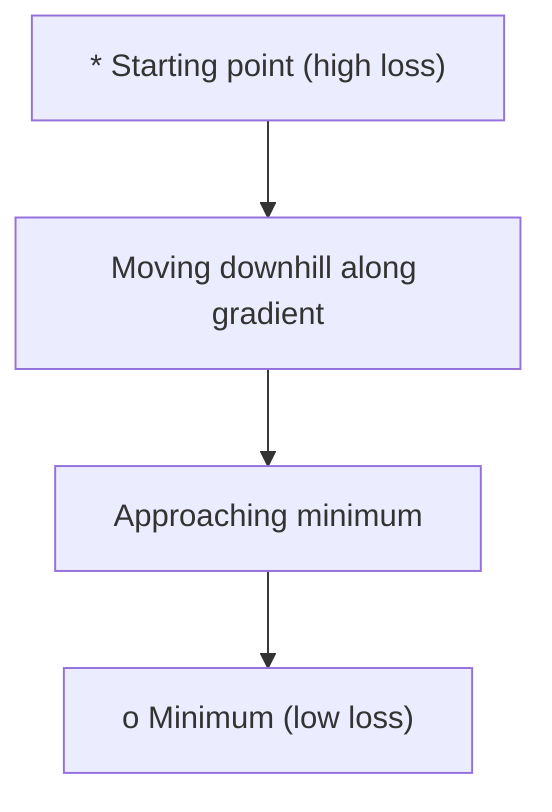
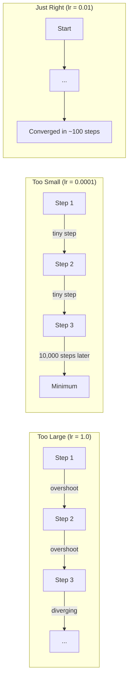
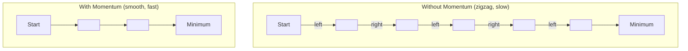
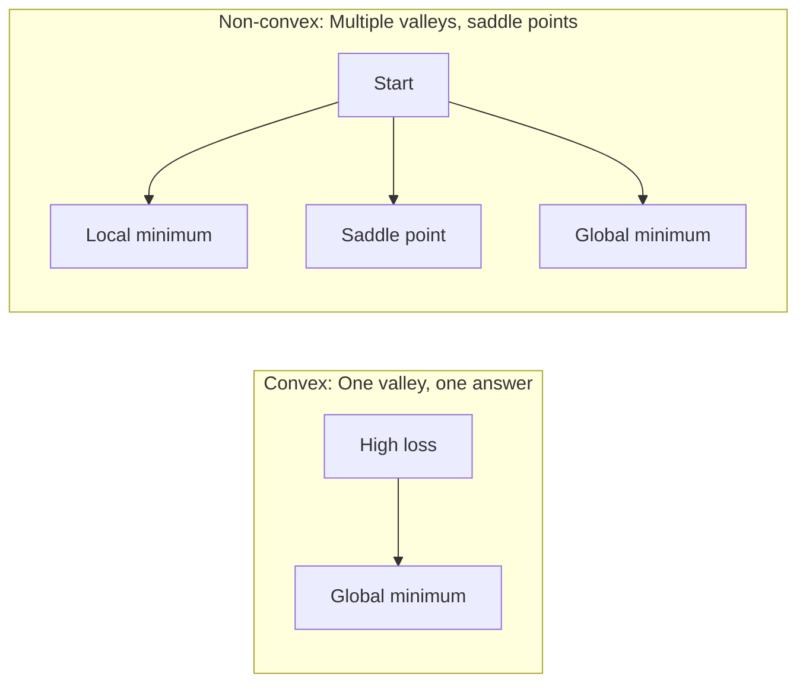
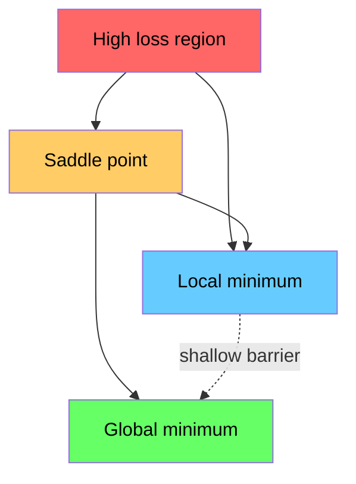

# Оптимизация

> Обучение нейронной сети — это не что иное, как поиск дна долины.

**Type:** Build
**Language:** Python
**Prerequisites:** Phase 1, Lessons 04-05 (Производные, Градиенты)
**Time:** ~75 минут

## Цели обучения

- Реализовать с нуля обычный градиентный спуск, SGD с моментом и Adam
- Сравнить сходимость оптимизаторов на функции Розенброка и объяснить, почему Adam адаптирует скорость обучения для каждого веса
- Отличать выпуклые ландшафты потерь от невыпуклых и объяснить роль седловых точек в высокой размерности
- Настроить расписания скорости обучения (ступенчатое затухание, косинусный отжиг, разогрев) для стабильности обучения

## Проблема

У вас есть функция потерь. Она показывает, насколько ошибается ваша модель. У вас есть градиенты. Они показывают, в каком направлении потери увеличиваются. Теперь вам нужна стратегия движения вниз.

Наивный подход прост: двигайтесь в направлении, противоположном градиенту. Масштабируйте шаг числом, называемым скоростью обучения. Повторяйте. Это градиентный спуск, и он работает. Но у слова «работает» есть оговорки. Слишком большая скорость обучения — и вы полностью проскакиваете долину, мечась между стенками. Слишком маленькая — и вы ползёте к ответу тысячи лишних шагов. Попадёте в седловую точку — и движение прекратится, хотя минимум ещё не найден.

Каждый оптимизатор в глубоком обучении — это ответ на один и тот же вопрос: как добраться до дна долины быстрее и надёжнее?

## Концепция

### Что означает оптимизация

Оптимизация — это поиск входных значений, минимизирующих (или максимизирующих) функцию. В машинном обучении такая функция — это потери. Входные значения — это веса модели. Обучение — это оптимизация.

```
minimize L(w) where:
  L = loss function
  w = model weights (could be millions of parameters)
```

### Градиентный спуск (обычный)

Простейший оптимизатор. Вычислите градиент потерь по каждому весу. Сдвиньте каждый вес в направлении, противоположном его градиенту. Масштабируйте шаг скоростью обучения.

```
w = w - lr * gradient
```

Это весь алгоритм. Одна строка.



### Скорость обучения: самый важный гиперпараметр

Скорость обучения определяет размер шага. От неё зависит всё в сходимости.



Формулы для правильной скорости обучения не существует. Вы находите её экспериментально. Типичные стартовые значения: 0.001 для Adam, 0.01 для SGD с моментом.

### SGD, пакетный и мини-пакетный градиентный спуск

Обычный градиентный спуск вычисляет градиент по всему набору данных перед тем, как сделать один шаг. Это называется пакетным градиентным спуском (batch gradient descent). Он стабилен, но медленен.

Стохастический градиентный спуск (SGD) вычисляет градиент на одном случайном примере и сразу делает шаг. Он шумный, но быстрый.

Мини-пакетный градиентный спуск — компромисс. Вычислите градиент по небольшому пакету (32, 64, 128, 256 примеров), затем сделайте шаг. Именно это используют на практике.

| Вариант | Размер пакета | Качество градиента | Скорость одного шага | Шум |
|---------|-----------|-----------------|---------------|-------|
| Пакетный GD | Весь набор данных | Точный | Медленно | Нет |
| SGD | 1 пример | Очень шумный | Быстро | Высокий |
| Мини-пакетный | 32-256 | Хорошая оценка | Сбалансировано | Умеренный |

Шум в SGD и мини-пакетном варианте — это не баг. Он помогает выбираться из неглубоких локальных минимумов и седловых точек.

### Момент: мяч, катящийся вниз по склону

Обычный градиентный спуск учитывает только текущий градиент. Если градиент зигзагообразно меняется (что типично для узких долин), прогресс медленный. Момент решает эту проблему, накапливая прошлые градиенты в виде члена скорости (velocity).

```
v = beta * v + gradient
w = w - lr * v
```

Аналогия: мяч, катящийся вниз по склону. Он не останавливается и не начинает заново на каждой кочке. Он набирает скорость в последовательных направлениях и гасит колебания.



`beta` (обычно 0.9) определяет, сколько истории сохранять. Чем выше beta, тем сильнее момент, тем более гладкими становятся траектории, но тем медленнее реакция на изменение направления.

### Adam: адаптивные скорости обучения

Разным весам нужны разные скорости обучения. Вес, который редко получает большие градиенты, должен делать более крупные шаги, когда это наконец происходит. Вес, который постоянно получает огромные градиенты, должен делать более мелкие шаги.

Adam (Adaptive Moment Estimation) отслеживает две величины для каждого веса:

1. Первый момент (m): скользящее среднее градиентов (как в методе момента)
2. Второй момент (v): скользящее среднее квадратов градиентов (величина градиента)

```
m = beta1 * m + (1 - beta1) * gradient
v = beta2 * v + (1 - beta2) * gradient^2

m_hat = m / (1 - beta1^t)    bias correction
v_hat = v / (1 - beta2^t)    bias correction

w = w - lr * m_hat / (sqrt(v_hat) + epsilon)
```

Деление на `sqrt(v_hat)` — это ключевая идея. Веса с большими градиентами делятся на большое число (маленький эффективный шаг). Веса с маленькими градиентами делятся на маленькое число (большой эффективный шаг). Каждый вес получает собственную адаптивную скорость обучения.

Гиперпараметры по умолчанию: `lr=0.001, beta1=0.9, beta2=0.999, epsilon=1e-8`. Эти значения по умолчанию хорошо работают для большинства задач.

### Расписания скорости обучения

Фиксированная скорость обучения — это компромисс. В начале обучения нужны большие шаги для быстрого прогресса. В конце обучения нужны маленькие шаги для тонкой настройки вблизи минимума.

Распространённые расписания:

| Расписание | Формула | Случай применения |
|----------|---------|------|
| Ступенчатое затухание | lr = lr * factor каждые N эпох | Просто, ручное управление |
| Экспоненциальное затухание | lr = lr_0 * decay^t | Плавное уменьшение |
| Косинусный отжиг | lr = lr_min + 0.5 * (lr_max - lr_min) * (1 + cos(pi * t / T)) | Transformer-ы, современное обучение |
| Разогрев + затухание | Линейный подъём, затем затухание | Большие модели, предотвращает раннюю нестабильность |

### Выпуклые и невыпуклые функции

Выпуклая функция имеет один минимум. Градиентный спуск всегда его находит. Квадратичная функция вроде `f(x) = x^2` выпукла.

Функции потерь нейронных сетей невыпуклые. У них множество локальных минимумов, седловых точек и плоских областей.



На практике локальные минимумы в высокоразмерных нейронных сетях редко представляют проблему. Большинство локальных минимумов имеют значения потерь, близкие к глобальному минимуму. Настоящим препятствием являются седловые точки (плоские в одних направлениях, изогнутые в других). Момент и шум из мини-пакетов помогают из них выбираться.

### Визуализация ландшафта потерь

Потери — это функция всех весов. Для модели с 1 миллионом весов ландшафт потерь живёт в пространстве размерности 1 000 001. Мы визуализируем его, выбирая два случайных направления в пространстве весов и строя график потерь вдоль этих направлений, получая 2D-поверхность.



Резкие минимумы плохо обобщаются. Плоские минимумы обобщаются хорошо. Это одна из причин, почему SGD с моментом часто превосходит Adam по итоговой точности на тесте: его шум не даёт «осесть» в резком минимуме.

```figure
gradient-descent
```

## Реализация

### Шаг 1: Определите тестовую функцию

Функция Розенброка — классический тест для оптимизации. Её минимум находится в точке (1, 1) внутри узкой изогнутой долины, которую легко найти, но трудно отследить.

```
f(x, y) = (1 - x)^2 + 100 * (y - x^2)^2
```

```python
def rosenbrock(params):
    x, y = params
    return (1 - x) ** 2 + 100 * (y - x ** 2) ** 2

def rosenbrock_gradient(params):
    x, y = params
    df_dx = -2 * (1 - x) + 200 * (y - x ** 2) * (-2 * x)
    df_dy = 200 * (y - x ** 2)
    return [df_dx, df_dy]
```

### Шаг 2: Обычный градиентный спуск

```python
class GradientDescent:
    def __init__(self, lr=0.001):
        self.lr = lr

    def step(self, params, grads):
        return [p - self.lr * g for p, g in zip(params, grads)]
```

### Шаг 3: SGD с моментом

```python
class SGDMomentum:
    def __init__(self, lr=0.001, momentum=0.9):
        self.lr = lr
        self.momentum = momentum
        self.velocity = None

    def step(self, params, grads):
        if self.velocity is None:
            self.velocity = [0.0] * len(params)
        self.velocity = [
            self.momentum * v + g
            for v, g in zip(self.velocity, grads)
        ]
        return [p - self.lr * v for p, v in zip(params, self.velocity)]
```

### Шаг 4: Adam

```python
class Adam:
    def __init__(self, lr=0.001, beta1=0.9, beta2=0.999, epsilon=1e-8):
        self.lr = lr
        self.beta1 = beta1
        self.beta2 = beta2
        self.epsilon = epsilon
        self.m = None
        self.v = None
        self.t = 0

    def step(self, params, grads):
        if self.m is None:
            self.m = [0.0] * len(params)
            self.v = [0.0] * len(params)

        self.t += 1

        self.m = [
            self.beta1 * m + (1 - self.beta1) * g
            for m, g in zip(self.m, grads)
        ]
        self.v = [
            self.beta2 * v + (1 - self.beta2) * g ** 2
            for v, g in zip(self.v, grads)
        ]

        m_hat = [m / (1 - self.beta1 ** self.t) for m in self.m]
        v_hat = [v / (1 - self.beta2 ** self.t) for v in self.v]

        return [
            p - self.lr * mh / (vh ** 0.5 + self.epsilon)
            for p, mh, vh in zip(params, m_hat, v_hat)
        ]
```

### Шаг 5: Запустите и сравните

```python
def optimize(optimizer, func, grad_func, start, steps=5000):
    params = list(start)
    history = [params[:]]
    for _ in range(steps):
        grads = grad_func(params)
        params = optimizer.step(params, grads)
        history.append(params[:])
    return history

start = [-1.0, 1.0]

gd_history = optimize(GradientDescent(lr=0.0005), rosenbrock, rosenbrock_gradient, start)
sgd_history = optimize(SGDMomentum(lr=0.0001, momentum=0.9), rosenbrock, rosenbrock_gradient, start)
adam_history = optimize(Adam(lr=0.01), rosenbrock, rosenbrock_gradient, start)

for name, history in [("GD", gd_history), ("SGD+M", sgd_history), ("Adam", adam_history)]:
    final = history[-1]
    loss = rosenbrock(final)
    print(f"{name:6s} -> x={final[0]:.6f}, y={final[1]:.6f}, loss={loss:.8f}")
```

Ожидаемый результат: Adam сходится быстрее всех. SGD с моментом следует более гладкой траектории. Обычный GD медленно продвигается вдоль узкой долины.

## Применение

На практике используйте оптимизаторы PyTorch или JAX. Они обрабатывают группы параметров, затухание весов (weight decay), обрезку градиентов (gradient clipping) и ускорение на GPU.

```python
import torch

model = torch.nn.Linear(784, 10)

sgd = torch.optim.SGD(model.parameters(), lr=0.01, momentum=0.9)
adam = torch.optim.Adam(model.parameters(), lr=0.001)
adamw = torch.optim.AdamW(model.parameters(), lr=0.001, weight_decay=0.01)

scheduler = torch.optim.lr_scheduler.CosineAnnealingLR(adam, T_max=100)
```

Практические правила:

- Начинайте с Adam (lr=0.001). Он работает для большинства задач без настройки.
- Переключайтесь на SGD с моментом (lr=0.01, momentum=0.9), когда нужна лучшая итоговая точность и есть время на дополнительную настройку.
- Используйте AdamW (Adam с раздельным затуханием весов) для transformer-ов.
- Всегда используйте расписание скорости обучения для запусков обучения длиннее нескольких эпох.
- Если обучение нестабильно, уменьшите скорость обучения. Если обучение слишком медленное, увеличьте её.

## Итог

Этот урок формирует промпт для выбора подходящего оптимизатора. См. `outputs/prompt-optimizer-guide.md`.

Классы оптимизаторов, построенные здесь, появятся снова в Phase 3, когда мы будем обучать нейронную сеть с нуля.

## Упражнения

1. **Перебор скорости обучения.** Запустите обычный градиентный спуск на функции Розенброка со скоростями обучения [0.0001, 0.0005, 0.001, 0.005, 0.01]. Постройте график или выведите итоговые потери после 5000 шагов для каждой из них. Найдите наибольшую скорость обучения, при которой сходимость ещё сохраняется.

2. **Сравнение моментов.** Запустите SGD со значениями момента [0.0, 0.5, 0.9, 0.99] на функции Розенброка. Отслеживайте потери на каждом шаге. Какое значение момента сходится быстрее всего? Какое даёт перелёт (overshoot)?

3. **Выход из седловой точки.** Определите функцию `f(x, y) = x^2 - y^2` (седловая точка в начале координат). Начните с точки (0.01, 0.01). Сравните поведение обычного GD, SGD с моментом и Adam. Какой из них выходит из седловой точки?

4. **Реализуйте затухание скорости обучения.** Добавьте расписание экспоненциального затухания в класс GradientDescent: `lr = lr_0 * 0.999^step`. Сравните сходимость с затуханием и без на функции Розенброка.

## Ключевые термины

| Термин | Что обычно говорят | Что это на самом деле означает |
|------|----------------|----------------------|
| Градиентный спуск | «Идти вниз по склону» | Обновление весов путём вычитания градиента, масштабированного скоростью обучения. Самый базовый оптимизатор. |
| Скорость обучения | «Размер шага» | Скаляр, определяющий, насколько далеко сдвигает веса каждое обновление. Слишком большая вызывает расхождение. Слишком маленькая тратит вычисления впустую. |
| Момент | «Продолжать катиться» | Накопление прошлых градиентов в вектор скорости (velocity). Гасит колебания и ускоряет движение в последовательных направлениях. |
| SGD | «Случайная выборка» | Стохастический градиентный спуск. Вычисление градиента на случайном подмножестве вместо всего набора данных. На практике почти всегда означает мини-пакетный SGD. |
| Мини-пакет | «Кусок данных» | Небольшое подмножество обучающих данных (32-256 примеров), используемое для оценки градиента. Балансирует скорость и точность градиента. |
| Adam | «Оптимизатор по умолчанию» | Adaptive Moment Estimation. Отслеживает скользящие средние градиентов и квадратов градиентов по каждому весу, давая каждому весу собственную скорость обучения. |
| Коррекция смещения | «Исправить холодный старт» | Первый и второй моменты Adam изначально инициализируются нулями. Коррекция смещения делит на (1 - beta^t), чтобы компенсировать это на ранних шагах. |
| Расписание скорости обучения | «Менять lr со временем» | Функция, корректирующая скорость обучения в ходе обучения. Большие шаги в начале, маленькие — в конце. |
| Выпуклая функция | «Одна долина» | Функция, в которой любой локальный минимум является глобальным. Градиентный спуск всегда его находит. Функции потерь нейронных сетей не выпуклы. |
| Седловая точка | «Плоско, но не минимум» | Точка, где градиент равен нулю, но она является минимумом в одних направлениях и максимумом в других. Часто встречается в высоких размерностях. |
| Ландшафт потерь | «Рельеф» | Функция потерь, построенная в пространстве весов. Визуализируется срезом вдоль двух случайных направлений. |
| Сходимость | «Добраться до цели» | Оптимизатор достиг точки, в которой дальнейшие шаги не приводят к существенному уменьшению потерь. |

## Дополнительное чтение

- [Sebastian Ruder: An overview of gradient descent optimization algorithms](https://ruder.io/optimizing-gradient-descent/) - исчерпывающий обзор всех основных оптимизаторов
- [Why Momentum Really Works (Distill)](https://distill.pub/2017/momentum/) - интерактивная визуализация динамики момента
- [Adam: A Method for Stochastic Optimization (Kingma & Ba, 2014)](https://arxiv.org/abs/1412.6980) - оригинальная статья об Adam, понятная и короткая
- [Visualizing the Loss Landscape of Neural Nets (Li et al., 2018)](https://arxiv.org/abs/1712.09913) - статья, показавшая разницу между резкими и плоскими минимумами