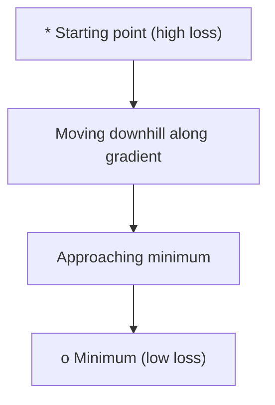
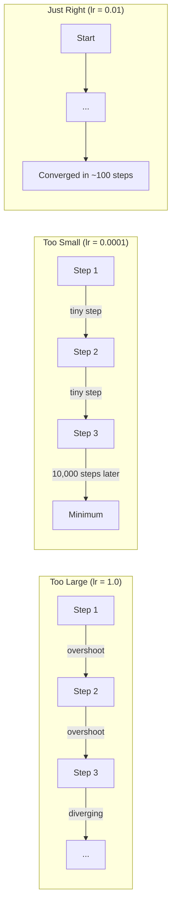
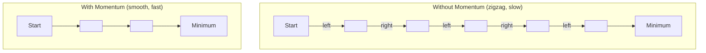
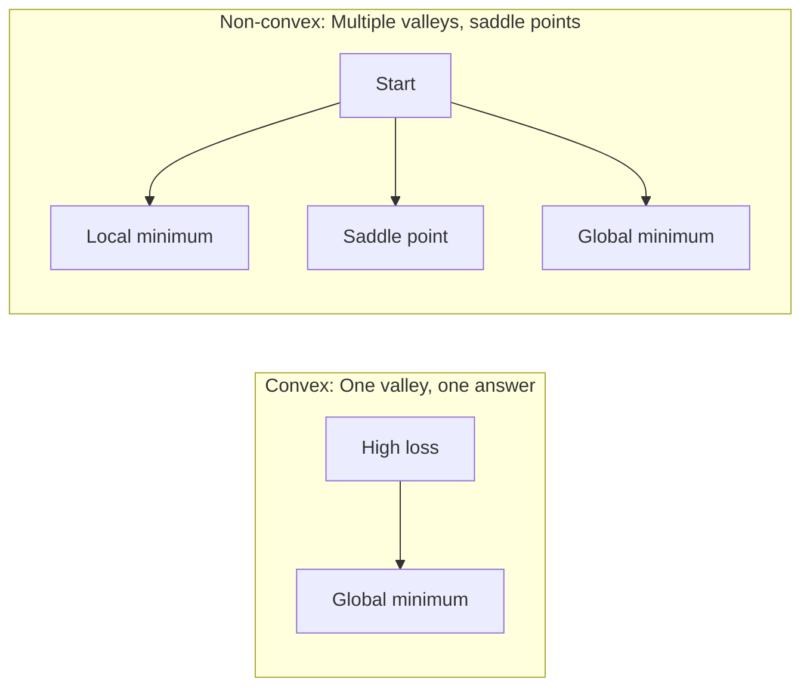
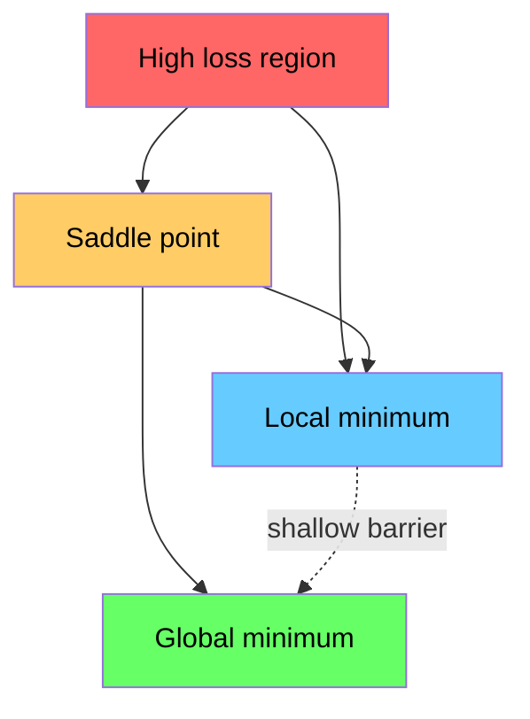

# Оптимизация

> Обучение нейронной сети — это просто поиск дна долины.

**Type:** Build
**Language:** Python
**Prerequisites:** Phase 1, Lessons 04-05 (Derivatives, Gradients)
**Time:** ~75 minutes

## Learning Objectives

- Реализовать обычный градиентный спуск, SGD с импульсом и Adam с нуля
- Сравнить сходимость оптимизаторов на функции Розенброка и объяснить, почему Adam адаптирует темп обучения для каждого веса
- Различать выпуклые и невыпуклые ландшафты потерь и объяснить роль седловых точек в высоких размерностях
- Настроить расписания темпа обучения (step decay, cosine annealing, warmup) для стабильности обучения

## The Problem

У вас есть функция потерь. Она показывает, насколько неправильна ваша модель. У вас есть градиенты. Они показывают, в каком направлении потери увеличиваются. Теперь вам нужна стратегия спуска вниз.

Наивный подход прост: двигайтесь в направлении, противоположном градиенту. Масштабируйте шаг некоторым числом, называемым темпом обучения. Повторяйте. Это градиентный спуск, и он работает. Но "работает" имеет оговорки. Слишком большой темп обучения — и вы выйдете из долины, отскакивая между стенами. Слишком малый — и вы будете ползти к ответу тысячи ненужных шагов. Попадите на седловую точку — и вы остановитесь, хотя не нашли минимум.

Каждый оптимизатор в глубоком обучении — это ответ на один и тот же вопрос: как попасть на дно долины быстрее и надёжнее?

## The Concept

### Что означает оптимизация

Оптимизация — это поиск значений входных переменных, которые минимизируют (или максимизируют) функцию. В машинном обучении функция — это потеря. Входные переменные — это веса модели. Обучение — это оптимизация.

```
minimize L(w) where:
  L = loss function
  w = model weights (could be millions of parameters)
```

### Градиентный спуск (обычный)

Самый простой оптимизатор. Вычислите градиент потерь по каждому весу. Переместите каждый вес в направлении, противоположном его градиенту. Масштабируйте шаг по темпу обучения.

```
w = w - lr * gradient
```

Это весь алгоритм. Одна строка.



### Темп обучения: самый важный гиперпараметр

Темп обучения управляет размером шага. Он определяет всё сходимости.



Нет формулы для правильного темпа обучения. Вы находите его экспериментом. Общие начальные точки: 0.001 для Adam, 0.01 для SGD с импульсом.

### SGD против batch против mini-batch

Обычный градиентный спуск вычисляет градиент по всему набору данных перед тем, как сделать один шаг. Это называется пакетный градиентный спуск. Он стабилен, но медленен.

Стохастический градиентный спуск (SGD) вычисляет градиент на одной случайной выборке и немедленно делает шаг. Он шумный, но быстрый.

Мини-пакетный градиентный спуск находит компромисс. Вычислите градиент на небольшом пакете (32, 64, 128, 256 выборок), затем сделайте шаг. Это то, что на самом деле используют все.

| Вариант | Размер пакета | Качество градиента | Скорость за шаг | Шум |
|---------|-----------|-----------------|---------------|-------|
| Batch GD | Весь набор данных | Точный | Медленно | Нет |
| SGD | 1 выборка | Очень шумный | Быстро | Высокий |
| Mini-batch | 32-256 | Хорошая оценка | Сбалансированно | Средний |

Шум в SGD и mini-batch — это не ошибка. Это помогает избежать поверхностных локальных минимумов и седловых точек.

### Импульс: шар, катящийся вниз по склону

Обычный градиентный спуск смотрит только на текущий градиент. Если градиент зигзагообразный (обычное дело в узких долинах), прогресс медленен. Импульс это исправляет, накапливая прошлые градиенты в вектор скорости.

```
v = beta * v + gradient
w = w - lr * v
```

Аналогия: шар, катящийся вниз по склону. Он не останавливается и не перезагружается на каждой неровности. Он набирает скорость в последовательных направлениях и гасит колебания.



`beta` (обычно 0.9) управляет тем, сколько истории сохранять. Больший beta означает больше импульса, более плавные пути, но более медленный отклик на изменения направления.

### Adam: адаптивные темпы обучения

Разные веса нуждаются в разных темпах обучения. Вес, который редко получает большие градиенты, должен делать большие шаги, когда он это делает. Вес, который постоянно получает огромные градиенты, должен делать меньшие шаги.

Adam (Adaptive Moment Estimation) отслеживает две вещи для каждого веса:

1. Первый момент (m): текущее среднее значение градиентов (как импульс)
2. Второй момент (v): текущее среднее значение квадратов градиентов (величина градиента)

```
m = beta1 * m + (1 - beta1) * gradient
v = beta2 * v + (1 - beta2) * gradient^2

m_hat = m / (1 - beta1^t)    bias correction
v_hat = v / (1 - beta2^t)    bias correction

w = w - lr * m_hat / (sqrt(v_hat) + epsilon)
```

Деление на `sqrt(v_hat)` — ключевое проникновение. Веса с большими градиентами делятся на большое число (маленький эффективный шаг). Веса с маленькими градиентами делятся на маленькое число (большой эффективный шаг). Каждый вес получает свой адаптивный темп обучения.

Гиперпараметры по умолчанию: `lr=0.001, beta1=0.9, beta2=0.999, epsilon=1e-8`. Эти значения по умолчанию хорошо работают для большинства задач.

### Расписания темпа обучения

Фиксированный темп обучения — это компромисс. В начале обучения вы хотите больших шагов для быстрого прогресса. В конце обучения вы хотите маленьких шагов для точной настройки рядом с минимумом.

Общие расписания:

| Расписание | Формула | Случай использования |
|----------|---------|----------|
| Step decay | lr = lr * factor каждые N эпох | Простое, ручное управление |
| Exponential decay | lr = lr_0 * decay^t | Плавное снижение |
| Cosine annealing | lr = lr_min + 0.5 * (lr_max - lr_min) * (1 + cos(pi * t / T)) | Transformers, современное обучение |
| Warmup + decay | Линейное увеличение, затем спад | Большие модели, предотвращает раннюю нестабильность |

### Выпуклые против невыпуклых

Выпуклая функция имеет один минимум. Градиентный спуск всегда его находит. Квадратичная функция вроде `f(x) = x^2` выпуклая.

Функции потерь нейронной сети невыпуклые. Они имеют много локальных минимумов, седловых точек и плоских регионов.



На практике локальные минимумы в высокомерных нейронных сетях редко являются проблемой. Большинство локальных минимумов имеют значения потерь, близкие к глобальному минимуму. Седловые точки (плоские в некоторых направлениях, изогнутые в других) — это настоящее препятствие. Импульс и шум от мини-пакетов помогают избежать их.

### Визуализация ландшафта потерь

Потеря — это функция всех весов. Для модели с 1 миллионом весов ландшафт потерь живёт в пространстве размерности 1,000,001. Мы визуализируем его, выбирая два случайных направления в пространстве весов и строя график потери вдоль этих направлений, создавая 2D поверхность.



Острые минимумы плохо обобщаются. Плоские минимумы хорошо обобщаются. Это одна из причин, почему SGD с импульсом часто превосходит Adam по итоговой точности теста: его шум предотвращает оседание в острые минимумы.

```figure
gradient-descent
```

## Build It

### Step 1: Определите тестовую функцию

Функция Розенброка — это классический эталон оптимизации. Её минимум находится в точке (1, 1) внутри узкой изогнутой долины, которую легко найти, но трудно следовать.

```
f(x, y) = (1 - x)^2 + 100 * (y - x^2)^2
```

```python
def rosenbrock(params):
    x, y = params
    return (1 - x) ** 2 + 100 * (y - x ** 2) ** 2

def rosenbrock_gradient(params):
    x, y = params
    df_dx = -2 * (1 - x) + 200 * (y - x ** 2) * (-2 * x)
    df_dy = 200 * (y - x ** 2)
    return [df_dx, df_dy]
```

### Step 2: Обычный градиентный спуск

```python
class GradientDescent:
    def __init__(self, lr=0.001):
        self.lr = lr

    def step(self, params, grads):
        return [p - self.lr * g for p, g in zip(params, grads)]
```

### Step 3: SGD с импульсом

```python
class SGDMomentum:
    def __init__(self, lr=0.001, momentum=0.9):
        self.lr = lr
        self.momentum = momentum
        self.velocity = None

    def step(self, params, grads):
        if self.velocity is None:
            self.velocity = [0.0] * len(params)
        self.velocity = [
            self.momentum * v + g
            for v, g in zip(self.velocity, grads)
        ]
        return [p - self.lr * v for p, v in zip(params, self.velocity)]
```

### Step 4: Adam

```python
class Adam:
    def __init__(self, lr=0.001, beta1=0.9, beta2=0.999, epsilon=1e-8):
        self.lr = lr
        self.beta1 = beta1
        self.beta2 = beta2
        self.epsilon = epsilon
        self.m = None
        self.v = None
        self.t = 0

    def step(self, params, grads):
        if self.m is None:
            self.m = [0.0] * len(params)
            self.v = [0.0] * len(params)

        self.t += 1

        self.m = [
            self.beta1 * m + (1 - self.beta1) * g
            for m, g in zip(self.m, grads)
        ]
        self.v = [
            self.beta2 * v + (1 - self.beta2) * g ** 2
            for v, g in zip(self.v, grads)
        ]

        m_hat = [m / (1 - self.beta1 ** self.t) for m in self.m]
        v_hat = [v / (1 - self.beta2 ** self.t) for v in self.v]

        return [
            p - self.lr * mh / (vh ** 0.5 + self.epsilon)
            for p, mh, vh in zip(params, m_hat, v_hat)
        ]
```

### Step 5: Запустите и сравните

```python
def optimize(optimizer, func, grad_func, start, steps=5000):
    params = list(start)
    history = [params[:]]
    for _ in range(steps):
        grads = grad_func(params)
        params = optimizer.step(params, grads)
        history.append(params[:])
    return history

start = [-1.0, 1.0]

gd_history = optimize(GradientDescent(lr=0.0005), rosenbrock, rosenbrock_gradient, start)
sgd_history = optimize(SGDMomentum(lr=0.0001, momentum=0.9), rosenbrock, rosenbrock_gradient, start)
adam_history = optimize(Adam(lr=0.01), rosenbrock, rosenbrock_gradient, start)

for name, history in [("GD", gd_history), ("SGD+M", sgd_history), ("Adam", adam_history)]:
    final = history[-1]
    loss = rosenbrock(final)
    print(f"{name:6s} -> x={final[0]:.6f}, y={final[1]:.6f}, loss={loss:.8f}")
```

Ожидаемый результат: Adam сходится быстрее всех. SGD с импульсом следует более плавным путём. Обычный GD делает медленный прогресс вдоль узкой долины.

## Use It

На практике используйте оптимизаторы PyTorch или JAX. Они обрабатывают группы параметров, распад весов, отсечение градиентов и ускорение GPU.

```python
import torch

model = torch.nn.Linear(784, 10)

sgd = torch.optim.SGD(model.parameters(), lr=0.01, momentum=0.9)
adam = torch.optim.Adam(model.parameters(), lr=0.001)
adamw = torch.optim.AdamW(model.parameters(), lr=0.001, weight_decay=0.01)

scheduler = torch.optim.lr_scheduler.CosineAnnealingLR(adam, T_max=100)
```

Практические правила:

- Начните с Adam (lr=0.001). Он работает для большинства задач без настройки.
- Переключитесь на SGD с импульсом (lr=0.01, momentum=0.9), когда вам нужна лучшая итоговая точность и вы можете позволить себе больше настройки.
- Используйте AdamW (Adam с развязанным распадом весов) для трансформеров.
- Всегда используйте расписание темпа обучения для обучающих прогонов длиннее нескольких эпох.
- Если обучение нестабильно, уменьшите темп обучения. Если обучение слишком медленно, увеличьте его.

## Ship It

Этот урок создаёт подсказку для выбора правильного оптимизатора. См. `outputs/prompt-optimizer-guide.md`.

Классы оптимизаторов, построенные здесь, появятся снова на Phase 3, когда мы обучаем нейронную сеть с нуля.

## Exercises

1. **Learning rate sweep.** Запустите обычный градиентный спуск на функции Розенброка с темпами обучения [0.0001, 0.0005, 0.001, 0.005, 0.01]. Постройте график или выведите итоговую потерю после 5000 шагов для каждой. Найдите наибольший темп обучения, который всё ещё сходится.

2. **Momentum comparison.** Запустите SGD с импульсом значения [0.0, 0.5, 0.9, 0.99] на функции Розенброка. Отслеживайте потерю на каждом шаге. Какое значение импульса сходится быстрее всего? Какое перелетает?

3. **Saddle point escape.** Определите функцию `f(x, y) = x^2 - y^2` (седловая точка в начале координат). Начните с (0.01, 0.01). Сравните поведение обычного GD, SGD с импульсом и Adam. Какой избегает седловой точки?

4. **Implement learning rate decay.** Добавьте расписание экспоненциального спада в класс GradientDescent: `lr = lr_0 * 0.999^step`. Сравните сходимость с распадом и без него на функции Розенброка.

## Key Terms

| Термин | Что говорят люди | Что это означает на самом деле |
|------|----------------|----------------------|
| Gradient descent | "Идите вниз" | Обновляйте веса, вычитая градиент, масштабированный темпом обучения. Самый базовый оптимизатор. |
| Learning rate | "Размер шага" | Скаляр, управляющий тем, как далеко каждое обновление перемещает веса. Слишком большой вызывает расхождение. Слишком малый тратит вычисления впустую. |
| Momentum | "Продолжайте катиться" | Накапливайте прошлые градиенты в вектор скорости. Гасит колебания и ускоряет движение в последовательных направлениях. |
| SGD | "Случайное выборка" | Стохастический градиентный спуск. Вычислите градиент на случайном подмножестве вместо полного набора данных. На практике почти всегда означает мини-пакетный SGD. |
| Mini-batch | "Кусок данных" | Небольшое подмножество обучающих данных (32-256 выборок), используемое для оценки градиента. Балансирует скорость и точность градиента. |
| Adam | "Оптимизатор по умолчанию" | Adaptive Moment Estimation. Отслеживает текущие среднее значения градиентов и квадратов градиентов для каждого веса, давая каждому весу свой темп обучения. |
| Bias correction | "Исправить холодный старт" | Первый и второй моменты Adam инициализируются нулём. Коррекция смещения делится на (1 - beta^t) для компенсации на ранних этапах. |
| Learning rate schedule | "Измените lr со временем" | Функция, которая изменяет темп обучения во время обучения. Большие шаги в начале, маленькие в конце. |
| Convex function | "Одна долина" | Функция, где любой локальный минимум является глобальным минимумом. Градиентный спуск всегда его находит. Потери нейронной сети не выпуклые. |
| Saddle point | "Плоская, но не минимум" | Точка, где градиент равен нулю, но она является минимумом в одних направлениях и максимумом в других. Частая в высоких размерностях. |
| Loss landscape | "Местность" | Функция потерь, нанесённая на пространство весов. Визуализируется путём срезания вдоль двух случайных направлений. |
| Convergence | "Приход туда" | Оптимизатор достиг точки, где дальнейшие шаги не уменьшают потерю значительно. |

## Further Reading

- [Sebastian Ruder: An overview of gradient descent optimization algorithms](https://ruder.io/optimizing-gradient-descent/) - comprehensive survey of all major optimizers
- [Why Momentum Really Works (Distill)](https://distill.pub/2017/momentum/) - interactive visualization of momentum dynamics
- [Adam: A Method for Stochastic Optimization (Kingma & Ba, 2014)](https://arxiv.org/abs/1412.6980) - the original Adam paper, readable and short
- [Visualizing the Loss Landscape of Neural Nets (Li et al., 2018)](https://arxiv.org/abs/1712.09913) - the paper that showed sharp vs flat minima