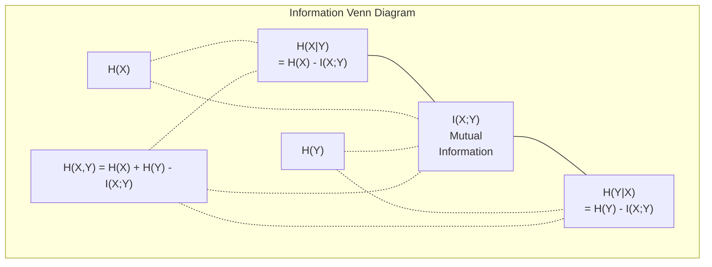

# Теория информации

> Теория информации измеряет удивление. Функции потерь построены на ней.

**Type:** Learn
**Language:** Python
**Prerequisites:** Phase 1, Lesson 06 (Probability)
**Time:** ~60 минут

## Цели обучения

- Вычислить энтропию, кросс-энтропию и KL-дивергенцию с нуля и объяснить их взаимосвязь
- Вывести, почему минимизация кросс-энтропийной функции потерь эквивалентна максимизации логарифмического правдоподобия
- Вычислить взаимную информацию между признаками и целевой переменной, чтобы ранжировать важность признаков
- Объяснить перплексию как эффективный размер словаря, из которого выбирает языковая модель

## Проблема

Вы вызываете `CrossEntropyLoss()` в каждой модели классификации, которую обучаете. Вы видите «перплексию» в каждой статье о языковых моделях. Вы читаете о KL-дивергенции в VAE, дистилляции и RLHF. Это не разрозненные понятия. Все это одна и та же идея в разных обличьях.

Теория информации дает вам язык для рассуждений о неопределенности, сжатии и предсказании. Клод Шеннон изобрел ее в 1948 году для решения задач связи. Оказывается, обучение нейронной сети — это тоже задача связи: модель пытается передать правильную метку через зашумленный канал обученных весов.

Этот урок строит каждую формулу с нуля, чтобы вы видели, откуда они берутся и почему работают.

## Концепция

### Информационное содержание (удивление)

Когда происходит что-то маловероятное, это несет больше информации. Монета выпала орлом? Не удивительно. Выигрыш в лотерею? Очень удивительно.

Информационное содержание события с вероятностью p равно:

```
I(x) = -log(p(x))
```

Использование логарифма по основанию 2 дает биты. Использование натурального логарифма дает наты. Та же идея, разные единицы.

```
Event              Probability    Surprise (bits)
Fair coin heads    0.5            1.0
Rolling a 6        0.167          2.58
1-in-1000 event    0.001          9.97
Certain event      1.0            0.0
```

Достоверные события несут нулевую информацию. Вы уже знали, что они произойдут.

### Энтропия (среднее удивление)

Энтропия — это ожидаемое удивление по всем возможным исходам распределения.

```
H(P) = -sum( p(x) * log(p(x)) )  for all x
```

Честная монета обладает максимальной энтропией для бинарной переменной: 1 бит. Смещенная монета (99% орлов) имеет низкую энтропию: 0,08 бита. Вы уже знаете, что произойдет, поэтому каждый бросок почти ничего вам не сообщает.

```
Fair coin:    H = -(0.5 * log2(0.5) + 0.5 * log2(0.5)) = 1.0 bit
Biased coin:  H = -(0.99 * log2(0.99) + 0.01 * log2(0.01)) = 0.08 bits
```

Энтропия измеряет неустранимую неопределенность распределения. Сжать ниже нее невозможно.

### Кросс-энтропия (функция потерь, которую вы используете каждый день)

Кросс-энтропия измеряет среднее удивление при использовании распределения Q для кодирования событий, которые на самом деле поступают из распределения P.

```
H(P, Q) = -sum( p(x) * log(q(x)) )  for all x
```

P — истинное распределение (метки). Q — предсказания вашей модели. Если Q идеально совпадает с P, кросс-энтропия равна энтропии. Любое несоответствие делает ее больше.

В классификации P — это one-hot вектор (истинный класс имеет вероятность 1, все остальное — 0). Это упрощает кросс-энтропию до:

```
H(P, Q) = -log(q(true_class))
```

Это и есть вся формула кросс-энтропийной функции потерь для классификации. Максимизируйте предсказанную вероятность правильного класса.

### KL-дивергенция (расстояние между распределениями)

KL-дивергенция измеряет, сколько дополнительного удивления вы получаете от использования Q вместо P.

```
D_KL(P || Q) = sum( p(x) * log(p(x) / q(x)) )  for all x
             = H(P, Q) - H(P)
```

Кросс-энтропия равна энтропии плюс KL-дивергенция. Поскольку энтропия истинного распределения постоянна во время обучения, минимизация кросс-энтропии — то же самое, что минимизация KL-дивергенции. Вы подталкиваете распределение вашей модели к истинному распределению.

KL-дивергенция несимметрична: D_KL(P || Q) != D_KL(Q || P). Это не истинная метрика расстояния.

### Взаимная информация

Взаимная информация измеряет, сколько знание одной переменной сообщает вам о другой.

```
I(X; Y) = H(X) - H(X|Y)
        = H(X) + H(Y) - H(X, Y)
```

Если X и Y независимы, взаимная информация равна нулю. Знание одной переменной ничего не говорит о другой. Если они идеально коррелированы, взаимная информация равна энтропии любой из переменных.

При отборе признаков высокая взаимная информация между признаком и целевой переменной означает, что признак полезен. Низкая взаимная информация означает, что это шум.

### Условная энтропия

H(Y|X) измеряет, сколько неопределенности остается относительно Y после того, как вы наблюдаете X.

```
H(Y|X) = H(X,Y) - H(X)
```

Два крайних случая:
- Если X полностью определяет Y, то H(Y|X) = 0. Знание X устраняет всю неопределенность относительно Y. Пример: X = температура в Цельсиях, Y = температура в Фаренгейтах.
- Если X ничего не говорит вам о Y, то H(Y|X) = H(Y). Знание X вообще не уменьшает вашу неопределенность. Пример: X = подбрасывание монеты, Y = завтрашняя погода.

Условная энтропия всегда неотрицательна и никогда не превышает H(Y):

```
0 <= H(Y|X) <= H(Y)
```

В машинном обучении условная энтропия встречается в деревьях решений. На каждом разбиении алгоритм выбирает признак X, минимизирующий H(Y|X) — признак, который устраняет больше всего неопределенности относительно метки Y.

### Совместная энтропия

H(X,Y) — это энтропия совместного распределения X и Y вместе.

```
H(X,Y) = -sum sum p(x,y) * log(p(x,y))   for all x, y
```

Ключевое свойство:

```
H(X,Y) <= H(X) + H(Y)
```

Равенство выполняется, когда X и Y независимы. Если они разделяют информацию, совместная энтропия меньше суммы индивидуальных энтропий. «Недостающая» энтропия — это в точности взаимная информация.



Взаимосвязи:
- H(X,Y) = H(X) + H(Y|X) = H(Y) + H(X|Y)
- I(X;Y) = H(X) - H(X|Y) = H(Y) - H(Y|X)
- H(X,Y) = H(X) + H(Y) - I(X;Y)

### Взаимная информация (углубленное изучение)

Взаимная информация I(X;Y) количественно определяет, насколько знание одной переменной снижает неопределенность относительно другой.

```
I(X;Y) = H(X) - H(X|Y)
       = H(Y) - H(Y|X)
       = H(X) + H(Y) - H(X,Y)
       = sum sum p(x,y) * log(p(x,y) / (p(x) * p(y)))
```

Свойства:
- I(X;Y) >= 0 всегда. Вы никогда не теряете информацию, наблюдая что-либо.
- I(X;Y) = 0 тогда и только тогда, когда X и Y независимы.
- I(X;Y) = I(Y;X). Она симметрична, в отличие от KL-дивергенции.
- I(X;X) = H(X). Переменная разделяет всю свою информацию сама с собой.

**Взаимная информация для отбора признаков.** В машинном обучении вам нужны признаки, информативные относительно целевой переменной. Взаимная информация дает принципиальный способ ранжировать признаки:

1. Для каждого признака X_i вычислите I(X_i; Y), где Y — целевая переменная.
2. Ранжируйте признаки по значению MI.
3. Оставьте топ-k признаков.

Это работает для любой связи между признаком и целевой переменной — линейной, нелинейной, монотонной или нет. Корреляция улавливает только линейные связи. MI улавливает все.

| Метод | Обнаруживает | Вычислительная стоимость | Обрабатывает категориальные данные? |
|--------|---------|-------------------|---------------------|
| Корреляция Пирсона | Линейные связи | O(n) | Нет |
| Корреляция Спирмена | Монотонные связи | O(n log n) | Нет |
| Взаимная информация | Любую статистическую зависимость | O(n log n) с биннингом | Да |

### Сглаживание меток и кросс-энтропия

Стандартная классификация использует жесткие таргеты: [0, 0, 1, 0]. Истинный класс получает вероятность 1, все остальное — 0. Сглаживание меток заменяет их мягкими таргетами:

```
soft_target = (1 - epsilon) * hard_target + epsilon / num_classes
```

При epsilon = 0.1 и 4 классах:
- Жесткий таргет:  [0, 0, 1, 0]
- Мягкий таргет:  [0.025, 0.025, 0.925, 0.025]

С точки зрения теории информации, сглаживание меток увеличивает энтропию целевого распределения. Жесткие one-hot таргеты имеют энтропию 0 — неопределенности нет. Мягкие таргеты имеют положительную энтропию.

Почему это помогает:
- Предотвращает доведение логитов модели до экстремальных значений (для идеального совпадения с one-hot таргетом под кросс-энтропией потребовались бы бесконечные логиты)
- Выступает в роли регуляризации: модель не может быть уверена на 100%
- Улучшает калибровку: предсказанные вероятности лучше отражают истинную неопределенность
- Сокращает разрыв между поведением при обучении и при инференсе

Кросс-энтропийная функция потерь со сглаживанием меток принимает вид:

```
L = (1 - epsilon) * CE(hard_target, prediction) + epsilon * H_uniform(prediction)
```

Второе слагаемое штрафует предсказания, далекие от равномерного распределения — прямая регуляризация уверенности.

### Почему кросс-энтропия — ЭТО функция потерь для классификации

Три точки зрения, один и тот же вывод.

**Взгляд с позиции теории информации.** Кросс-энтропия измеряет, сколько бит вы тратите впустую, используя распределение вашей модели вместо истинного распределения. Ее минимизация делает вашу модель наиболее эффективным кодировщиком реальности.

**Взгляд с позиции максимального правдоподобия.** Для N обучающих примеров с истинными классами y_i:

```
Likelihood     = product( q(y_i) )
Log-likelihood = sum( log(q(y_i)) )
Negative log-likelihood = -sum( log(q(y_i)) )
```

Последняя строка — это кросс-энтропийная функция потерь. Минимизация кросс-энтропии = максимизация правдоподобия обучающих данных при вашей модели.

**Взгляд с позиции градиента.** Градиент кросс-энтропии по отношению к логитам — это просто (предсказанное - истинное). Чистый, стабильный и быстрый в вычислении. Именно поэтому она идеально сочетается с softmax.

### Биты против натов

Единственное различие — основание логарифма.

```
log base 2   -> bits      (information theory tradition)
log base e   -> nats      (machine learning convention)
log base 10  -> hartleys  (rarely used)
```

1 нат = 1/ln(2) бита = 1,4427 бита. PyTorch и TensorFlow по умолчанию используют натуральный логарифм (наты).

### Перплексия

Перплексия — это экспонента кросс-энтропии. Она показывает эффективное число равновероятных вариантов, между которыми модель не определилась.

```
Perplexity = 2^H(P,Q)   (if using bits)
Perplexity = e^H(P,Q)   (if using nats)
```

Языковая модель с перплексией 50, в среднем, настолько же запутана, как если бы ей пришлось выбирать равномерно из 50 возможных следующих токенов. Чем ниже, тем лучше.

GPT-2 достигла перплексии ~30 на распространенных бенчмарках. Современные модели показывают однозначные числа для хорошо представленных областей.

```figure
entropy-kl
```

## Реализация

### Шаг 1: Информационное содержание и энтропия

```python
import math

def information_content(p, base=2):
    if p <= 0 or p > 1:
        return float('inf') if p <= 0 else 0.0
    return -math.log(p) / math.log(base)

def entropy(probs, base=2):
    return sum(
        p * information_content(p, base)
        for p in probs if p > 0
    )

fair_coin = [0.5, 0.5]
biased_coin = [0.99, 0.01]
fair_die = [1/6] * 6

print(f"Fair coin entropy:   {entropy(fair_coin):.4f} bits")
print(f"Biased coin entropy: {entropy(biased_coin):.4f} bits")
print(f"Fair die entropy:    {entropy(fair_die):.4f} bits")
```

### Шаг 2: Кросс-энтропия и KL-дивергенция

```python
def cross_entropy(p, q, base=2):
    total = 0.0
    for pi, qi in zip(p, q):
        if pi > 0:
            if qi <= 0:
                return float('inf')
            total += pi * (-math.log(qi) / math.log(base))
    return total

def kl_divergence(p, q, base=2):
    return cross_entropy(p, q, base) - entropy(p, base)

true_dist = [0.7, 0.2, 0.1]
good_model = [0.6, 0.25, 0.15]
bad_model = [0.1, 0.1, 0.8]

print(f"Entropy of true dist:     {entropy(true_dist):.4f} bits")
print(f"CE (good model):          {cross_entropy(true_dist, good_model):.4f} bits")
print(f"CE (bad model):           {cross_entropy(true_dist, bad_model):.4f} bits")
print(f"KL divergence (good):     {kl_divergence(true_dist, good_model):.4f} bits")
print(f"KL divergence (bad):      {kl_divergence(true_dist, bad_model):.4f} bits")
```

### Шаг 3: Кросс-энтропия как функция потерь классификации

```python
def softmax(logits):
    max_logit = max(logits)
    exps = [math.exp(z - max_logit) for z in logits]
    total = sum(exps)
    return [e / total for e in exps]

def cross_entropy_loss(true_class, logits):
    probs = softmax(logits)
    return -math.log(probs[true_class])

logits = [2.0, 1.0, 0.1]
true_class = 0

probs = softmax(logits)
loss = cross_entropy_loss(true_class, logits)

print(f"Logits:      {logits}")
print(f"Softmax:     {[f'{p:.4f}' for p in probs]}")
print(f"True class:  {true_class}")
print(f"Loss:        {loss:.4f} nats")
print(f"Perplexity:  {math.exp(loss):.2f}")
```

### Шаг 4: Кросс-энтропия равна отрицательному логарифмическому правдоподобию

```python
import random

random.seed(42)

n_samples = 1000
n_classes = 3
true_labels = [random.randint(0, n_classes - 1) for _ in range(n_samples)]
model_logits = [[random.gauss(0, 1) for _ in range(n_classes)] for _ in range(n_samples)]

ce_loss = sum(
    cross_entropy_loss(label, logits)
    for label, logits in zip(true_labels, model_logits)
) / n_samples

nll = -sum(
    math.log(softmax(logits)[label])
    for label, logits in zip(true_labels, model_logits)
) / n_samples

print(f"Cross-entropy loss:      {ce_loss:.6f}")
print(f"Negative log-likelihood: {nll:.6f}")
print(f"Difference:              {abs(ce_loss - nll):.2e}")
```

### Шаг 5: Взаимная информация

```python
def mutual_information(joint_probs, base=2):
    rows = len(joint_probs)
    cols = len(joint_probs[0])

    margin_x = [sum(joint_probs[i][j] for j in range(cols)) for i in range(rows)]
    margin_y = [sum(joint_probs[i][j] for i in range(rows)) for j in range(cols)]

    mi = 0.0
    for i in range(rows):
        for j in range(cols):
            pxy = joint_probs[i][j]
            if pxy > 0:
                mi += pxy * math.log(pxy / (margin_x[i] * margin_y[j])) / math.log(base)
    return mi

independent = [[0.25, 0.25], [0.25, 0.25]]
dependent = [[0.45, 0.05], [0.05, 0.45]]

print(f"MI (independent): {mutual_information(independent):.4f} bits")
print(f"MI (dependent):   {mutual_information(dependent):.4f} bits")
```

## Применение

Те же концепции с использованием NumPy, так, как вы будете использовать их на практике:

```python
import numpy as np

def np_entropy(p):
    p = np.asarray(p, dtype=float)
    mask = p > 0
    result = np.zeros_like(p)
    result[mask] = p[mask] * np.log(p[mask])
    return -result.sum()

def np_cross_entropy(p, q):
    p, q = np.asarray(p, dtype=float), np.asarray(q, dtype=float)
    mask = p > 0
    return -(p[mask] * np.log(q[mask])).sum()

def np_kl_divergence(p, q):
    return np_cross_entropy(p, q) - np_entropy(p)

true = np.array([0.7, 0.2, 0.1])
pred = np.array([0.6, 0.25, 0.15])
print(f"Entropy:    {np_entropy(true):.4f} nats")
print(f"Cross-ent:  {np_cross_entropy(true, pred):.4f} nats")
print(f"KL div:     {np_kl_divergence(true, pred):.4f} nats")
```

Вы построили с нуля то, что `torch.nn.CrossEntropyLoss()` делает внутри себя. Теперь вы знаете, почему функция потерь уменьшается во время обучения: предсказанное распределение вашей модели приближается к истинному распределению, измеряемому в натах потраченной впустую информации.

## Упражнения

1. Вычислите энтропию английского алфавита, предполагая равномерное распределение (26 букв). Затем оцените ее, используя реальные частоты букв. Какая энтропия выше и почему?

2. Модель выдает логиты [5.0, 2.0, 0.5] для примера с истинным классом 1. Вычислите кросс-энтропийную функцию потерь вручную, затем проверьте с помощью вашей функции `cross_entropy_loss`. Какие логиты дали бы нулевую потерю?

3. Покажите, что KL-дивергенция несимметрична. Возьмите два распределения P и Q и вычислите D_KL(P || Q) и D_KL(Q || P). Объясните, почему они отличаются.

4. Постройте функцию, вычисляющую перплексию для последовательности предсказаний токенов. По заданному списку пар (индекс_истинного_токена, предсказанные_логиты) верните перплексию последовательности.

## Ключевые термины

| Термин | Что говорят люди | Что это на самом деле означает |
|------|----------------|----------------------|
| Информационное содержание | «Удивление» | Число битов (или натов), необходимое для кодирования события: -log(p) |
| Энтропия | «Случайность» | Среднее удивление по всем исходам распределения. Измеряет неустранимую неопределенность. |
| Кросс-энтропия | «Функция потерь» | Среднее удивление при использовании распределения модели Q для кодирования событий из истинного распределения P. |
| KL-дивергенция | «Расстояние между распределениями» | Дополнительные биты, потраченные впустую из-за использования Q вместо P. Равна кросс-энтропии минус энтропия. Несимметрична. |
| Взаимная информация | «Насколько связаны X и Y» | Уменьшение неопределенности относительно X при знании Y. Ноль означает независимость. |
| Softmax | «Превратить логиты в вероятности» | Возвести в степень и нормализовать. Отображает любой вектор вещественных чисел в корректное распределение вероятностей. |
| Перплексия | «Насколько модель запутана» | Экспонента кросс-энтропии. Эффективный размер словаря, из которого модель выбирает на каждом шаге. |
| Биты | «Единица Шеннона» | Информация, измеренная с логарифмом по основанию 2. Один бит разрешает один честный бросок монеты. |
| Наты | «Единица ML» | Информация, измеренная с натуральным логарифмом. По умолчанию используется в PyTorch и TensorFlow. |
| Отрицательное логарифмическое правдоподобие | «Потери NLL» | Идентично кросс-энтропийной функции потерь для one-hot меток. Ее минимизация максимизирует вероятность правильных предсказаний. |

## Дополнительное чтение

- [Шеннон 1948: Математическая теория связи](https://people.math.harvard.edu/~ctm/home/text/others/shannon/entropy/entropy.pdf) - оригинальная статья, все еще читаемая
- [Визуальная теория информации (Крис Ола)](https://colah.github.io/posts/2015-09-Visual-Information/) - лучшее визуальное объяснение энтропии и KL-дивергенции
- [Документация PyTorch CrossEntropyLoss](https://pytorch.org/docs/stable/generated/torch.nn.CrossEntropyLoss.html) - как фреймворк реализует то, что вы только что построили