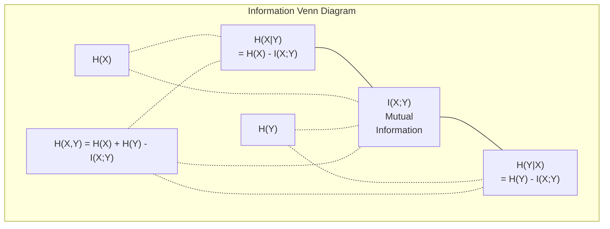

# Теория информации

> Теория информации измеряет неожиданность. Функции потерь построены на ней.

**Type:** Learn
**Language:** Python
**Prerequisites:** Phase 1, Lesson 06 (Probability)
**Time:** ~60 minutes

## Learning Objectives

- Compute entropy, cross-entropy, and KL divergence from scratch and explain their relationship
- Derive why minimizing cross-entropy loss is equivalent to maximizing log-likelihood
- Calculate mutual information between features and a target to rank feature importance
- Explain perplexity as the effective vocabulary size a language model chooses from

## The Problem

You call `CrossEntropyLoss()` в каждой классификационной модели, которую вы тренируете. Вы видите "perplexity" в каждой статье о языковых моделях. Вы читаете о KL divergence в VAE, дистилляции и RLHF. Это не разрозненные концепции. Это одна и та же идея в разных обличьях.

Теория информации дает вам язык для рассуждений об неопределённости, сжатии и предсказании. Клод Шеннон изобрел её в 1948 году для решения задач коммуникации. Оказывается, обучение нейронной сети — это задача коммуникации: модель пытается передать правильную метку через зашумлённый канал обученных весов.

Этот урок строит каждую формулу с нуля, чтобы вы увидели, откуда они берутся и почему работают.

## The Concept

### Information Content (Surprise)

Когда происходит что-то маловероятное, это несет больше информации. Монета выпала орлом? Не удивительно. Выигрыш лотереи? Очень удивительно.

Информационное содержание события с вероятностью p:

```
I(x) = -log(p(x))
```

Использование логарифма по основанию 2 дает вам биты. Использование натурального логарифма дает вам наты. Одна и та же идея, разные единицы.

```
Event              Probability    Surprise (bits)
Fair coin heads    0.5            1.0
Rolling a 6        0.167          2.58
1-in-1000 event    0.001          9.97
Certain event      1.0            0.0
```

Достоверные события несут нулевую информацию. Вы уже знали, что они произойдут.

### Entropy (Average Surprise)

Энтропия — это ожидаемая неожиданность по всем возможным исходам распределения.

```
H(P) = -sum( p(x) * log(p(x)) )  for all x
```

Справедливая монета имеет максимальную энтропию для бинарной переменной: 1 бит. Смещённая монета (99% орлов) имеет низкую энтропию: 0.08 бита. Вы уже знаете, что произойдет, поэтому каждый бросок почти ничего вам не скажет.

```
Fair coin:    H = -(0.5 * log2(0.5) + 0.5 * log2(0.5)) = 1.0 bit
Biased coin:  H = -(0.99 * log2(0.99) + 0.01 * log2(0.01)) = 0.08 bits
```

Энтропия измеряет неснижаемую неопределённость в распределении. Вы не можете сжать информацию ниже этого значения.

### Cross-Entropy (The Loss Function You Use Every Day)

Кросс-энтропия измеряет среднюю неожиданность, когда вы используете распределение Q для кодирования событий, которые на самом деле поступают из распределения P.

```
H(P, Q) = -sum( p(x) * log(q(x)) )  for all x
```

P — это истинное распределение (метки). Q — это предсказания вашей модели. Если Q совпадает с P идеально, кросс-энтропия равна энтропии. Любое несовпадение делает её больше.

В классификации P — это one-hot вектор (истинный класс имеет вероятность 1, всё остальное 0). Это упрощает кросс-энтропию до:

```
H(P, Q) = -log(q(true_class))
```

Это вся формула функции потерь кросс-энтропии для классификации. Максимизируйте предсказанную вероятность правильного класса.

### KL Divergence (Distance Between Distributions)

KL divergence измеряет, насколько больше неожиданности вы получите, используя Q вместо P.

```
D_KL(P || Q) = sum( p(x) * log(p(x) / q(x)) )  for all x
             = H(P, Q) - H(P)
```

Кросс-энтропия — это энтропия плюс KL divergence. Так как энтропия истинного распределения постоянна во время обучения, минимизация кросс-энтропии эквивалентна минимизации KL divergence. Вы толкаете распределение вашей модели к истинному распределению.

KL divergence не симметричен: D_KL(P || Q) != D_KL(Q || P). Это не настоящая метрика расстояния.

### Mutual Information

Взаимная информация измеряет, насколько знание одной переменной говорит вам о другой.

```
I(X; Y) = H(X) - H(X|Y)
        = H(X) + H(Y) - H(X, Y)
```

Если X и Y независимы, взаимная информация равна нулю. Знание одной ничего вам не говорит о другой. Если они идеально коррелируют, взаимная информация равна энтропии любой переменной.

При выборе признаков высокая взаимная информация между признаком и целью означает, что признак полезен. Низкая взаимная информация означает, что это шум.

### Conditional Entropy

H(Y|X) измеряет, сколько неопределённости остаётся о Y после того, как вы наблюдаете X.

```
H(Y|X) = H(X,Y) - H(X)
```

Два крайних случая:
- Если X полностью определяет Y, то H(Y|X) = 0. Знание X устраняет всю неопределённость о Y. Пример: X = температура в Цельсиях, Y = температура в Фаренгейтах.
- Если X ничего не говорит вам о Y, то H(Y|X) = H(Y). Знание X не уменьшает вашу неопределённость вообще. Пример: X = результат бросания монеты, Y = погода завтра.

Условная энтропия всегда неотрицательна и никогда не превышает H(Y):

```
0 <= H(Y|X) <= H(Y)
```

В машинном обучении условная энтропия появляется в решающих деревьях. На каждом разделении алгоритм выбирает признак X, который минимизирует H(Y|X) — признак, который устраняет наибольшую неопределённость о метке Y.

### Joint Entropy

H(X,Y) — это энтропия совместного распределения X и Y вместе.

```
H(X,Y) = -sum sum p(x,y) * log(p(x,y))   for all x, y
```

Ключевое свойство:

```
H(X,Y) <= H(X) + H(Y)
```

Равенство выполняется, когда X и Y независимы. Если они разделяют информацию, совместная энтропия меньше суммы отдельных энтропий. "Недостающая" энтропия — это именно взаимная информация.



Взаимосвязи:
- H(X,Y) = H(X) + H(Y|X) = H(Y) + H(X|Y)
- I(X;Y) = H(X) - H(X|Y) = H(Y) - H(Y|X)
- H(X,Y) = H(X) + H(Y) - I(X;Y)

### Mutual Information (Deep Dive)

Взаимная информация I(X;Y) количественно определяет, насколько знание одной переменной уменьшает неопределённость о другой.

```
I(X;Y) = H(X) - H(X|Y)
       = H(Y) - H(Y|X)
       = H(X) + H(Y) - H(X,Y)
       = sum sum p(x,y) * log(p(x,y) / (p(x) * p(y)))
```

Свойства:
- I(X;Y) >= 0 всегда. Вы никогда не теряете информацию, наблюдая что-то.
- I(X;Y) = 0 тогда и только тогда, когда X и Y независимы.
- I(X;Y) = I(Y;X). Она симметрична, в отличие от KL divergence.
- I(X;X) = H(X). Переменная разделяет всю свою информацию с собой.

**Взаимная информация для выбора признаков.** В ML вы хотите признаки, которые информативны о цели. Взаимная информация дает вам систематический способ ранжировать признаки:

1. Для каждого признака X_i вычислите I(X_i; Y), где Y — целевая переменная.
2. Ранжируйте признаки по баллу MI.
3. Сохраните топ k признаков.

Это работает для любых отношений между признаком и целью — линейных, нелинейных, монотонных или нет. Корреляция ловит только линейные отношения. MI ловит всё.

| Метод | Обнаруживает | Вычислительная сложность | Работает с категориальными? |
|-------|--------------|-------------------------|--------------------------|
| Корреляция Пирсона | Линейные отношения | O(n) | Нет |
| Корреляция Спирмена | Монотонные отношения | O(n log n) | Нет |
| Взаимная информация | Любую статистическую зависимость | O(n log n) с дискретизацией | Да |

### Label Smoothing and Cross-Entropy

Стандартная классификация использует жёсткие метки: [0, 0, 1, 0]. Истинный класс получает вероятность 1, всё остальное 0. Сглаживание метак заменяет их мягкими метками:

```
soft_target = (1 - epsilon) * hard_target + epsilon / num_classes
```

С epsilon = 0.1 и 4 классами:
- Жёсткая метка:  [0, 0, 1, 0]
- Мягкая метка:  [0.025, 0.025, 0.925, 0.025]

С точки зрения теории информации, сглаживание меток увеличивает энтропию целевого распределения. Жёсткие one-hot метки имеют энтропию 0 — нет неопределённости. Мягкие метки имеют положительную энтропию.

Почему это помогает:
- Предотвращает вождение модели логитов в экстремальные значения (бесконечные логиты потребовались бы для идеального совпадения с one-hot меткой под кросс-энтропией)
- Действует как регуляризация: модель не может быть на 100% уверена
- Улучшает калибровку: предсказанные вероятности лучше отражают истинную неопределённость
- Уменьшает разрыв между поведением на обучении и на inference

Функция потерь кросс-энтропии со сглаживанием меток становится:

```
L = (1 - epsilon) * CE(hard_target, prediction) + epsilon * H_uniform(prediction)
```

Второй член штрафует предсказания, далёкие от равномерного — прямая регуляризация по уверенности.

### Why Cross-Entropy Is THE Classification Loss

Три перспективы, один вывод.

**Точка зрения теории информации.** Кросс-энтропия измеряет, сколько битов вы теряете, используя распределение вашей модели вместо истинного. Минимизация её делает вашу модель самым эффективным кодировщиком реальности.

**Точка зрения максимального правдоподобия.** Для N обучающих образцов с истинными классами y_i:

```
Likelihood     = product( q(y_i) )
Log-likelihood = sum( log(q(y_i)) )
Negative log-likelihood = -sum( log(q(y_i)) )
```

Та последняя строка — это функция потерь кросс-энтропии. Минимизация кросс-энтропии = максимизация вероятности обучающих данных под вашей моделью.

**Точка зрения градиента.** Градиент кросс-энтропии по отношению к логитам просто (predicted - true). Чистый, стабильный и быстро вычисляемый. Поэтому он идеально сочетается с softmax.

### Bits vs Nats

Единственная разница — основание логарифма.

```
log base 2   -> bits      (information theory tradition)
log base e   -> nats      (machine learning convention)
log base 10  -> hartleys  (rarely used)
```

1 нат = 1/ln(2) битов = 1.4427 битов. PyTorch и TensorFlow по умолчанию используют натуральный логарифм (наты).

### Perplexity

Perplexity — это экспонента кросс-энтропии. Она говорит вам эффективное количество одинаково вероятных выборов, в которых модель неуверена.

```
Perplexity = 2^H(P,Q)   (if using bits)
Perplexity = e^H(P,Q)   (if using nats)
```

Языковая модель с perplexity 50 в среднем так же растеряна, как если бы ей пришлось выбирать равномерно из 50 возможных следующих токенов. Ниже лучше.

GPT-2 достигла perplexity ~30 на стандартных тестах. Современные модели имеют однозначные значения для хорошо представленных доменов.

```figure
entropy-kl
```

## Build It

### Step 1: Information content and entropy

```python
import math

def information_content(p, base=2):
    if p <= 0 or p > 1:
        return float('inf') if p <= 0 else 0.0
    return -math.log(p) / math.log(base)

def entropy(probs, base=2):
    return sum(
        p * information_content(p, base)
        for p in probs if p > 0
    )

fair_coin = [0.5, 0.5]
biased_coin = [0.99, 0.01]
fair_die = [1/6] * 6

print(f"Fair coin entropy:   {entropy(fair_coin):.4f} bits")
print(f"Biased coin entropy: {entropy(biased_coin):.4f} bits")
print(f"Fair die entropy:    {entropy(fair_die):.4f} bits")
```

### Step 2: Cross-entropy and KL divergence

```python
def cross_entropy(p, q, base=2):
    total = 0.0
    for pi, qi in zip(p, q):
        if pi > 0:
            if qi <= 0:
                return float('inf')
            total += pi * (-math.log(qi) / math.log(base))
    return total

def kl_divergence(p, q, base=2):
    return cross_entropy(p, q, base) - entropy(p, base)

true_dist = [0.7, 0.2, 0.1]
good_model = [0.6, 0.25, 0.15]
bad_model = [0.1, 0.1, 0.8]

print(f"Entropy of true dist:     {entropy(true_dist):.4f} bits")
print(f"CE (good model):          {cross_entropy(true_dist, good_model):.4f} bits")
print(f"CE (bad model):           {cross_entropy(true_dist, bad_model):.4f} bits")
print(f"KL divergence (good):     {kl_divergence(true_dist, good_model):.4f} bits")
print(f"KL divergence (bad):      {kl_divergence(true_dist, bad_model):.4f} bits")
```

### Step 3: Cross-entropy as classification loss

```python
def softmax(logits):
    max_logit = max(logits)
    exps = [math.exp(z - max_logit) for z in logits]
    total = sum(exps)
    return [e / total for e in exps]

def cross_entropy_loss(true_class, logits):
    probs = softmax(logits)
    return -math.log(probs[true_class])

logits = [2.0, 1.0, 0.1]
true_class = 0

probs = softmax(logits)
loss = cross_entropy_loss(true_class, logits)

print(f"Logits:      {logits}")
print(f"Softmax:     {[f'{p:.4f}' for p in probs]}")
print(f"True class:  {true_class}")
print(f"Loss:        {loss:.4f} nats")
print(f"Perplexity:  {math.exp(loss):.2f}")
```

### Step 4: Cross-entropy equals negative log-likelihood

```python
import random

random.seed(42)

n_samples = 1000
n_classes = 3
true_labels = [random.randint(0, n_classes - 1) for _ in range(n_samples)]
model_logits = [[random.gauss(0, 1) for _ in range(n_classes)] for _ in range(n_samples)]

ce_loss = sum(
    cross_entropy_loss(label, logits)
    for label, logits in zip(true_labels, model_logits)
) / n_samples

nll = -sum(
    math.log(softmax(logits)[label])
    for label, logits in zip(true_labels, model_logits)
) / n_samples

print(f"Cross-entropy loss:      {ce_loss:.6f}")
print(f"Negative log-likelihood: {nll:.6f}")
print(f"Difference:              {abs(ce_loss - nll):.2e}")
```

### Step 5: Mutual information

```python
def mutual_information(joint_probs, base=2):
    rows = len(joint_probs)
    cols = len(joint_probs[0])

    margin_x = [sum(joint_probs[i][j] for j in range(cols)) for i in range(rows)]
    margin_y = [sum(joint_probs[i][j] for i in range(rows)) for j in range(cols)]

    mi = 0.0
    for i in range(rows):
        for j in range(cols):
            pxy = joint_probs[i][j]
            if pxy > 0:
                mi += pxy * math.log(pxy / (margin_x[i] * margin_y[j])) / math.log(base)
    return mi

independent = [[0.25, 0.25], [0.25, 0.25]]
dependent = [[0.45, 0.05], [0.05, 0.45]]

print(f"MI (independent): {mutual_information(independent):.4f} bits")
print(f"MI (dependent):   {mutual_information(dependent):.4f} bits")
```

## Use It

Те же концепции, используя NumPy, так, как вы будете их использовать на практике:

```python
import numpy as np

def np_entropy(p):
    p = np.asarray(p, dtype=float)
    mask = p > 0
    result = np.zeros_like(p)
    result[mask] = p[mask] * np.log(p[mask])
    return -result.sum()

def np_cross_entropy(p, q):
    p, q = np.asarray(p, dtype=float), np.asarray(q, dtype=float)
    mask = p > 0
    return -(p[mask] * np.log(q[mask])).sum()

def np_kl_divergence(p, q):
    return np_cross_entropy(p, q) - np_entropy(p)

true = np.array([0.7, 0.2, 0.1])
pred = np.array([0.6, 0.25, 0.15])
print(f"Entropy:    {np_entropy(true):.4f} nats")
print(f"Cross-ent:  {np_cross_entropy(true, pred):.4f} nats")
print(f"KL div:     {np_kl_divergence(true, pred):.4f} nats")
```

Вы построили с нуля то, что `torch.nn.CrossEntropyLoss()` делает внутренне. Теперь вы знаете, почему потери уменьшаются во время обучения: предсказанное распределение вашей модели становится ближе к истинному распределению, измеренному в натах потраченной информации.

## Exercises

1. Вычислите энтропию английского алфавита, предполагая равномерное распределение (26 букв). Затем оцените её, используя фактические частоты букв. Что выше и почему?

2. Модель выдает логиты [5.0, 2.0, 0.5] для образца с истинным классом 1. Вычислите потери кросс-энтропии вручную, затем проверьте с вашей функцией `cross_entropy_loss`. Какие логиты дали бы нулевые потери?

3. Покажите, что KL divergence не симметричен. Выберите две распределения P и Q и вычислите D_KL(P || Q) и D_KL(Q || P). Объясните, почему они отличаются.

4. Создайте функцию, которая вычисляет perplexity для последовательности предсказаний токенов. При наличии списка пар (индекс_истинного_токена, логиты_предсказания) верните perplexity последовательности.

## Key Terms

| Термин | Как люди это говорят | Что это на самом деле значит |
|--------|---------------------|--------------------------|
| Information content | "Неожиданность" | Количество битов (или натов), необходимых для кодирования события: -log(p) |
| Entropy | "Случайность" | Средняя неожиданность по всем исходам распределения. Измеряет неснижаемую неопределённость. |
| Cross-entropy | "Функция потерь" | Средняя неожиданность при использовании распределения модели Q для кодирования событий из истинного распределения P. |
| KL divergence | "Расстояние между распределениями" | Дополнительные биты, потраченные на использование Q вместо P. Равно кросс-энтропии минус энтропия. Не симметричен. |
| Mutual information | "Насколько связаны X и Y" | Уменьшение неопределённости о X из знания Y. Ноль означает независимость. |
| Softmax | "Превратить логиты в вероятности" | Возвести в степень и нормализовать. Отображает любой вещественный вектор в действительное распределение вероятностей. |
| Perplexity | "Насколько модель растеряна" | Экспонента кросс-энтропии. Эффективный размер словаря, из которого модель выбирает на каждом шаге. |
| Bits | "Единица Шеннона" | Информация, измеренная с логарифмом по основанию 2. Один бит разрешает один справедливый бросок монеты. |
| Nats | "Единица ML" | Информация, измеренная с натуральным логарифмом. Используется PyTorch и TensorFlow по умолчанию. |
| Negative log-likelihood | "Потери NLL" | Идентичны потерям кросс-энтропии для one-hot меток. Минимизация их максимизирует вероятность правильных предсказаний. |

## Further Reading

- [Shannon 1948: A Mathematical Theory of Communication](https://people.math.harvard.edu/~ctm/home/text/others/shannon/entropy/entropy.pdf) - оригинальная статья, всё ещё читаема
- [Visual Information Theory (Chris Olah)](https://colah.github.io/posts/2015-09-Visual-Information/) - лучшее визуальное объяснение энтропии и KL divergence
- [PyTorch CrossEntropyLoss docs](https://pytorch.org/docs/stable/generated/torch.nn.CrossEntropyLoss.html) - как фреймворк реализует то, что вы только что построили