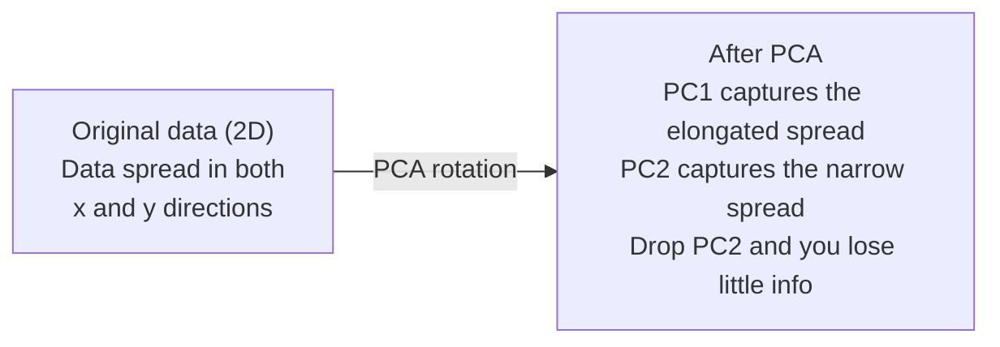

# Снижение размерности

> Высокомерные данные имеют структуру. Вы находите её, глядя с правильного угла.

**Type:** Build
**Language:** Python
**Prerequisites:** Phase 1, Lessons 01 (Linear Algebra Intuition), 02 (Vectors, Matrices & Operations), 03 (Eigenvalues & Eigenvectors), 06 (Probability & Distributions)
**Time:** ~90 minutes

## Learning Objectives

- Реализовать PCA с нуля: центрировать данные, вычислить ковариационную матрицу, провести разложение по собственным значениям и спроецировать данные
- Использовать долю объяснённой дисперсии и метод локтя для выбора числа главных компонент
- Сравнить PCA, t-SNE и UMAP для визуализации цифр MNIST в 2D и объяснить их компромиссы
- Применить ядерный PCA с RBF-ядром для разделения нелинейных структур данных, которые стандартный PCA не может обработать

## The Problem

У вас есть набор данных с 784 признаками на каждый образец. Может быть, это значения пикселей рукописных цифр. Может быть, это уровни экспрессии генов. Может быть, это сигналы поведения пользователя. Вы не можете визуализировать 784 измерения. Вы не можете их отобразить. Вы даже не можете о них думать.

Но большинство этих 784 признаков являются избыточными. Реальная информация живёт на гораздо меньшей поверхности. Рукописная цифра «7» не требует 784 независимых чисел для описания. Ей нужно несколько: угол штриха, длина поперечной линии, насколько она наклонена. Остальное — шум.

Снижение размерности находит эту меньшую поверхность. Оно берёт ваши 784-мерные данные и сжимает их до 2, 10 или 50 измерений, сохраняя при этом структуру, которая имеет значение.

## The Concept

### Проклятие размерности

Высокомерные пространства неинтуитивны. По мере роста числа измерений возникают три проблемы.

**Расстояние теряет смысл.** В высоких измерениях расстояние между любыми двумя случайными точками сходится к одному и тому же значению. Если каждая точка примерно на одном расстоянии от всех остальных точек, поиск ближайших соседей перестаёт работать.

```
Dimension    Avg distance ratio (max/min between random points)
2            ~5.0
10           ~1.8
100          ~1.2
1000         ~1.02
```

**Объём концентрируется в углах.** Единичный гиперкуб в d измерениях имеет 2^d углов. В 100 измерениях почти весь объём находится в углах, далеко от центра. Точки данных распределяются по краям, и ваши модели голодают из-за недостатка данных в центре.

**Вам нужно экспоненциально больше данных.** Для сохранения той же плотности выборок в пространстве переход с 2D на 20D означает, что вам нужно в 10^18 раз больше данных. У вас никогда не будет достаточно. Снижение размерности возвращает плотность данных к чему-то управляемому.

### PCA: найдите направления, которые имеют значение

Анализ главных компонент (Principal Component Analysis, PCA) находит оси, вдоль которых ваши данные варьируются больше всего. Он поворачивает вашу систему координат так, что первая ось захватывает наибольшую дисперсию, вторая — следующую по величине, и так далее.

Алгоритм:

```
1. Center the data        (subtract the mean from each feature)
2. Compute covariance     (how features move together)
3. Eigendecomposition     (find the principal directions)
4. Sort by eigenvalue     (biggest variance first)
5. Project               (keep top k eigenvectors, drop the rest)
```

Почему разложение по собственным значениям? Ковариационная матрица симметрична и положительно полуопределена. Её собственные векторы — это ортогональные направления в пространстве признаков. Собственные значения показывают, сколько дисперсии захватывает каждое направление. Собственный вектор с наибольшим собственным значением указывает на направление максимальной дисперсии.



- **До PCA:** облако данных распределено диагонально по осям x и y
- **После PCA:** система координат повёрнута так, что PC1 совпадает с направлением максимальной дисперсии (вытянутое распределение), а PC2 совпадает с направлением минимальной дисперсии (узкое распределение)
- **Снижение размерности:** отбрасывание PC2 проецирует данные на PC1, теряя очень мало информации

### Доля объяснённой дисперсии

Каждая главная компонента захватывает долю общей дисперсии. Доля объяснённой дисперсии показывает, сколько это составляет.

```
Component    Eigenvalue    Explained ratio    Cumulative
PC1          4.73          0.473              0.473
PC2          2.51          0.251              0.724
PC3          1.12          0.112              0.836
PC4          0.89          0.089              0.925
...
```

Когда кумулятивная объяснённая дисперсия достигает 0,95, вы знаете, что столько компонент захватывают 95% информации. Всё после этого — в основном шум.

### Выбор числа компонент

Три стратегии:

1. **Порог.** Сохраняйте достаточно компонент, чтобы объяснить 90-95% дисперсии.
2. **Метод локтя.** Постройте график объяснённой дисперсии на компоненту. Ищите резкое снижение.
3. **Производительность нижестоящей задачи.** Используйте PCA как предварительную обработку. Переберите k и измерьте точность вашей модели. Лучший k — это место, где точность выходит на плато.

### t-SNE: сохраняйте соседства

t-Distributed Stochastic Neighbor Embedding (t-SNE) спроектирована для визуализации. Она отображает высокомерные данные в 2D (или 3D), сохраняя при этом, какие точки находятся рядом друг с другом.

Интуиция: в исходном пространстве вычислите распределение вероятности над парами точек на основе их расстояний. Близкие точки получают высокую вероятность. Далёкие точки получают низкую вероятность. Затем найдите 2D расположение, где выполняется то же распределение вероятности. Точки, которые были соседями в 784 измерениях, остаются соседями в 2D.

Ключевые свойства t-SNE:
- Нелинейная. Она может развернуть сложные многообразия, которые PCA не может.
- Стохастическая. Разные запуски дают разные расположения.
- Параметр перплексии контролирует, сколько соседей учитывать (типичный диапазон: 5-50).
- Расстояния между кластерами в выводе не имеют смысла. Только сами кластеры имеют смысл.
- Медленная на больших наборах данных. O(n^2) по умолчанию.

### UMAP: быстрее, лучше глобальная структура

Uniform Manifold Approximation and Projection (UMAP) работает аналогично t-SNE, но с двумя преимуществами:
- Быстрее. Она использует приблизительные графы ближайших соседей вместо вычисления всех попарных расстояний.
- Лучшая глобальная структура. Относительные позиции кластеров в выводе имеют тенденцию быть более значимыми, чем в t-SNE.

UMAP строит взвешенный граф в высокомерном пространстве (представление «нечёткой топологии») и затем находит низкомерное расположение, которое сохраняет этот граф как можно лучше.

Ключевые параметры:
- `n_neighbors`: сколько соседей определяют локальную структуру (аналогично перплексии). Более высокие значения сохраняют больше глобальной структуры.
- `min_dist`: насколько плотно точки упаковываются в выводе. Более низкие значения создают более плотные кластеры.

### Когда использовать какой метод

| Метод | Сценарий использования | Сохраняет | Скорость |
|--------|-----------|-----------|-------|
| PCA | Предварительная обработка перед обучением | Глобальная дисперсия | Быстро (точно), работает на миллионах образцов |
| PCA | Быстрая разведочная визуализация | Линейная структура | Быстро |
| t-SNE | Визуализация 2D для публикации | Локальные соседства | Медленно (< 10k образцов идеально) |
| UMAP | Визуализация 2D в масштабе | Локальная + некоторая глобальная структура | Среднее (работает на миллионах) |
| PCA | Снижение признаков для моделей | Признаки, ранжированные по дисперсии | Быстро |
| t-SNE / UMAP | Понимание структуры кластеров | Разделение кластеров | Среднее до медленного |

Практическое правило: используйте PCA для предварительной обработки и сжатия данных. Используйте t-SNE или UMAP, когда вам нужно визуализировать структуру в 2D.

### Ядерный PCA

Стандартный PCA находит линейные подпространства. Он поворачивает вашу систему координат и отбрасывает оси. Но что, если данные лежат на нелинейном многообразии? Круг в 2D не может быть разделён ни одной линией. Стандартный PCA не поможет.

Ядерный PCA применяет PCA в высокомерном пространстве признаков, индуцированном функцией ядра, без явного вычисления координат в этом пространстве. Это трюк ядра — та же идея, что и за SVM.

Алгоритм:
1. Вычислите матрицу ядра K, где K_ij = k(x_i, x_j)
2. Центрируйте матрицу ядра в пространстве признаков
3. Проведите разложение по собственным значениям центрированной матрицы ядра
4. Верхние собственные векторы (масштабированные на 1/sqrt(собственное значение)) — это проекции

Распространённые функции ядер:

| Ядро | Формула | Хорошо для |
|--------|---------|----------|
| RBF (Гауссовское) | exp(-gamma * \|\|x - y\|\|^2) | Большинство нелинейных данных, гладкие многообразия |
| Полиномиальное | (x . y + c)^d | Полиномиальные отношения |
| Сигмоидное | tanh(alpha * x . y + c) | Отображения, похожие на нейронные сети |

Когда использовать ядерный PCA вместо стандартного PCA:

| Критерий | Стандартный PCA | Ядерный PCA |
|-----------|-------------|------------|
| Структура данных | Линейное подпространство | Нелинейное многообразие |
| Скорость | O(min(n^2 d, d^2 n)) | O(n^2 d + n^3) |
| Интерпретируемость | Компоненты — линейные комбинации признаков | Компоненты лишены прямой интерпретации признаков |
| Масштабируемость | Работает на миллионах образцов | Матрица ядра n x n, ограничена памятью |
| Восстановление | Прямое обратное преобразование | Требует приближения прообраза |

Классический пример: концентрические окружности в 2D. Два кольца точек, одно внутри другого. Стандартный PCA проецирует оба на одну линию — бесполезно для классификации. Ядерный PCA с RBF-ядром отображает внутреннее кольцо и внешнее кольцо в разные области, делая их линейно разделимыми.

### Ошибка восстановления

Насколько хорошо ваше снижение размерности? Вы сжали 784 измерения до 50. Что вы потеряли?

Измерьте ошибку восстановления:
1. Спроецируйте данные на k измерений: X_reduced = X @ W_k
2. Восстановите: X_hat = X_reduced @ W_k^T
3. Вычислите MSE: mean((X - X_hat)^2)

Для PCA ошибка восстановления имеет чистое отношение к объяснённой дисперсии:

```
Reconstruction error = sum of eigenvalues NOT included
Total variance = sum of ALL eigenvalues
Fraction lost = (sum of dropped eigenvalues) / (sum of all eigenvalues)
```

Доля объяснённой дисперсии для каждой компоненты составляет:

```
explained_ratio_k = eigenvalue_k / sum(all eigenvalues)
```

Построение графика кумулятивной объяснённой дисперсии по отношению к числу компонент даёт вам кривую «локтя». Правильное число компонент — это место, где:
- Кривая выравнивается (убывающая отдача)
- Кумулятивная дисперсия пересекает ваш порог (обычно 0,90 или 0,95)
- Производительность нижестоящей задачи выходит на плато

Ошибка восстановления полезна не только для выбора k. Вы можете использовать её для обнаружения аномалий: образцы с высокой ошибкой восстановления — это выбросы, которые не соответствуют изученному подпространству. Это основа обнаружения аномалий на основе PCA в производственных системах.

```figure
pca-axes
```

## Build It

### Step 1: PCA с нуля

```python
import numpy as np

class PCA:
    def __init__(self, n_components):
        self.n_components = n_components
        self.components = None
        self.mean = None
        self.eigenvalues = None
        self.explained_variance_ratio_ = None

    def fit(self, X):
        self.mean = np.mean(X, axis=0)
        X_centered = X - self.mean

        cov_matrix = np.cov(X_centered, rowvar=False)

        eigenvalues, eigenvectors = np.linalg.eigh(cov_matrix)

        sorted_idx = np.argsort(eigenvalues)[::-1]
        eigenvalues = eigenvalues[sorted_idx]
        eigenvectors = eigenvectors[:, sorted_idx]

        self.components = eigenvectors[:, :self.n_components].T
        self.eigenvalues = eigenvalues[:self.n_components]
        total_var = np.sum(eigenvalues)
        self.explained_variance_ratio_ = self.eigenvalues / total_var

        return self

    def transform(self, X):
        X_centered = X - self.mean
        return X_centered @ self.components.T

    def fit_transform(self, X):
        self.fit(X)
        return self.transform(X)
```

### Step 2: Тестирование на синтетических данных

```python
np.random.seed(42)
n_samples = 500

t = np.random.uniform(0, 2 * np.pi, n_samples)
x1 = 3 * np.cos(t) + np.random.normal(0, 0.2, n_samples)
x2 = 3 * np.sin(t) + np.random.normal(0, 0.2, n_samples)
x3 = 0.5 * x1 + 0.3 * x2 + np.random.normal(0, 0.1, n_samples)

X_synthetic = np.column_stack([x1, x2, x3])

pca = PCA(n_components=2)
X_reduced = pca.fit_transform(X_synthetic)

print(f"Original shape: {X_synthetic.shape}")
print(f"Reduced shape:  {X_reduced.shape}")
print(f"Explained variance ratios: {pca.explained_variance_ratio_}")
print(f"Total variance captured: {sum(pca.explained_variance_ratio_):.4f}")
```

### Step 3: Цифры MNIST в 2D

```python
from sklearn.datasets import fetch_openml

mnist = fetch_openml("mnist_784", version=1, as_frame=False, parser="auto")
X_mnist = mnist.data[:5000].astype(float)
y_mnist = mnist.target[:5000].astype(int)

pca_mnist = PCA(n_components=50)
X_pca50 = pca_mnist.fit_transform(X_mnist)
print(f"50 components capture {sum(pca_mnist.explained_variance_ratio_):.2%} of variance")

pca_2d = PCA(n_components=2)
X_pca2d = pca_2d.fit_transform(X_mnist)
print(f"2 components capture {sum(pca_2d.explained_variance_ratio_):.2%} of variance")
```

### Step 4: Сравнение со sklearn

```python
from sklearn.decomposition import PCA as SklearnPCA
from sklearn.manifold import TSNE

sklearn_pca = SklearnPCA(n_components=2)
X_sklearn_pca = sklearn_pca.fit_transform(X_mnist)

print(f"\nOur PCA explained variance:     {pca_2d.explained_variance_ratio_}")
print(f"Sklearn PCA explained variance: {sklearn_pca.explained_variance_ratio_}")

diff = np.abs(np.abs(X_pca2d) - np.abs(X_sklearn_pca))
print(f"Max absolute difference: {diff.max():.10f}")

tsne = TSNE(n_components=2, perplexity=30, random_state=42)
X_tsne = tsne.fit_transform(X_mnist)
print(f"\nt-SNE output shape: {X_tsne.shape}")
```

### Step 5: Сравнение с UMAP

```python
try:
    from umap import UMAP

    reducer = UMAP(n_components=2, n_neighbors=15, min_dist=0.1, random_state=42)
    X_umap = reducer.fit_transform(X_mnist)
    print(f"UMAP output shape: {X_umap.shape}")
except ImportError:
    print("Install umap-learn: pip install umap-learn")
```

## Use It

PCA как предварительная обработка перед классификатором:

```python
from sklearn.decomposition import PCA as SklearnPCA
from sklearn.linear_model import LogisticRegression
from sklearn.model_selection import train_test_split
from sklearn.metrics import accuracy_score

X_train, X_test, y_train, y_test = train_test_split(
    X_mnist, y_mnist, test_size=0.2, random_state=42
)

results = {}
for k in [10, 30, 50, 100, 200]:
    pca_k = SklearnPCA(n_components=k)
    X_tr = pca_k.fit_transform(X_train)
    X_te = pca_k.transform(X_test)

    clf = LogisticRegression(max_iter=1000, random_state=42)
    clf.fit(X_tr, y_train)
    acc = accuracy_score(y_test, clf.predict(X_te))
    var_captured = sum(pca_k.explained_variance_ratio_)
    results[k] = (acc, var_captured)
    print(f"k={k:>3d}  accuracy={acc:.4f}  variance={var_captured:.4f}")
```

Производительность выходит на плато задолго до 784 измерений. Это плато — ваша рабочая точка.

## Ship It

Этот урок производит:
- `outputs/skill-dimensionality-reduction.md` - навык выбора правильной техники снижения размерности для данной задачи

## Exercises

1. Модифицируйте класс PCA для поддержки `inverse_transform`. Восстановите цифры MNIST из 10, 50 и 200 компонент. Выведите ошибку восстановления (среднеквадратичное отличие от оригинала) для каждого.

2. Запустите t-SNE на одном и том же подмножестве MNIST с значениями перплексии 5, 30 и 100. Опишите, как меняется результат. Почему перплексия влияет на плотность кластеров?

3. Возьмите набор данных с 50 признаками, где только 5 информативны (создайте один с `sklearn.datasets.make_classification`). Применяйте PCA и проверьте, корректно ли кривая объяснённой дисперсии определяет, что данные фактически 5-мерны.

## Key Terms

| Термин | Что говорят люди | Что это на самом деле означает |
|------|----------------|----------------------|
| Проклятие размерности | «Слишком много признаков» | Расстояния, объёмы и плотность данных ведут себя контринтуитивно по мере роста измерений. Модели нуждаются в экспоненциально большем количестве данных для компенсации. |
| PCA | «Снизить размерность» | Повернуть вашу систему координат так, чтобы оси совпадали с направлениями максимальной дисперсии, затем отбросить оси с низкой дисперсией. |
| Главная компонента | «Важное направление» | Собственный вектор ковариационной матрицы. Направление в пространстве признаков, вдоль которого данные варьируются больше всего. |
| Доля объяснённой дисперсии | «Сколько информации в этой компоненте» | Доля общей дисперсии, захватываемая одной главной компонентой. Суммируйте верхние k долей, чтобы увидеть, сколько k компонент сохраняют. |
| Ковариационная матрица | «Как коррелируют признаки» | Симметричная матрица, где элемент (i,j) измеряет, как признак i и признак j движутся вместе. Диагональные элементы — это отдельные дисперсии. |
| t-SNE | «Тот график кластеров» | Нелинейный метод, который отображает высокомерные данные в 2D, сохраняя вероятности попарного соседства. Хорош для визуализации, не для предварительной обработки. |
| UMAP | «Более быстрая t-SNE» | Нелинейный метод, основанный на анализе топологических данных. Сохраняет как локальную, так и некоторую глобальную структуру. Лучше масштабируется, чем t-SNE. |
| Перплексия | «Ручка t-SNE» | Контролирует эффективное число соседей, которых каждая точка учитывает. Низкая перплексия сосредоточена на очень локальной структуре. Высокая перплексия захватывает более широкие закономерности. |
| Многообразие | «Поверхность, на которой живут данные» | Низкомерная поверхность, вложенная в высокомерное пространство. Лист бумаги, мятый в 3D, — это 2D многообразие. |

## Further Reading

- [A Tutorial on Principal Component Analysis](https://arxiv.org/abs/1404.1100) (Shlens) - чёткий вывод PCA с нуля
- [How to Use t-SNE Effectively](https://distill.pub/2016/misread-tsne/) (Wattenberg et al.) - интерактивное руководство по подводным камням и выбору параметров t-SNE
- [UMAP documentation](https://umap-learn.readthedocs.io/) - теория и практическое руководство от авторов UMAP