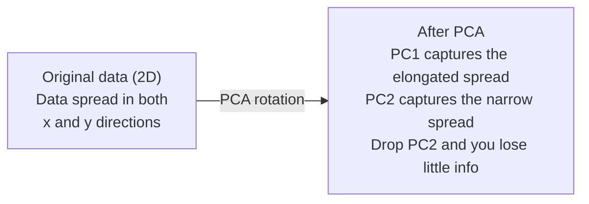

# Снижение размерности

> У высокоразмерных данных есть структура. Вы находите её, если смотрите под правильным углом.

**Type:** Build
**Language:** Python
**Prerequisites:** Phase 1, Lessons 01 (Linear Algebra Intuition), 02 (Vectors, Matrices & Operations), 03 (Eigenvalues & Eigenvectors), 06 (Probability & Distributions)
**Time:** ~90 минут

## Цели обучения

- Реализовать PCA с нуля: центрировать данные, вычислить ковариационную матрицу, выполнить собственное разложение и спроецировать данные
- Использовать долю объяснённой дисперсии и метод локтя для выбора числа главных компонент
- Сравнить PCA, t-SNE и UMAP для визуализации цифр MNIST в 2D и объяснить их компромиссы
- Применить kernel PCA с RBF-ядром для разделения нелинейных структур данных, с которыми не справляется стандартный PCA

## Проблема

У вас есть датасет с 784 признаками на каждый образец. Возможно, это значения пикселей рукописных цифр. Возможно — уровни экспрессии генов. Возможно — сигналы поведения пользователей. Вы не можете визуализировать 784 измерения. Вы не можете их построить на графике. Вы даже не можете о них мыслить.

Но большинство этих 784 признаков избыточны. Реальная информация живёт на гораздо меньшей поверхности. Рукописной "7" не нужны 784 независимых числа для описания. Ей нужно несколько: угол штриха, длина перекладины, насколько она наклонена. Остальное — шум.

Снижение размерности находит эту меньшую поверхность. Оно берёт ваши 784-мерные данные и сжимает их до 2, 10 или 50 измерений, сохраняя при этом важную структуру.

## Концепция

### Проклятие размерности

Высокоразмерные пространства неинтуитивны. По мере роста размерности ломаются три вещи.

**Расстояние теряет смысл.** В высоких размерностях расстояние между любыми двумя случайными точками сходится к одному и тому же значению. Если каждая точка находится примерно на одинаковом расстоянии от всех остальных, поиск ближайших соседей перестаёт работать.

```
Dimension    Avg distance ratio (max/min between random points)
2            ~5.0
10           ~1.8
100          ~1.2
1000         ~1.02
```

**Объём концентрируется в углах.** Единичный гиперкуб в d измерениях имеет 2^d углов. В 100 измерениях почти весь объём находится в углах, далеко от центра. Точки данных рассеиваются к краям, и вашим моделям не хватает данных во внутренней части.

**Нужно экспоненциально больше данных.** Чтобы поддерживать ту же плотность выборок в пространстве, переход от 2D к 20D означает, что вам нужно в 10^18 раз больше данных. Их у вас никогда не хватит. Снижение размерности возвращает плотность данных к чему-то рабочему.

### PCA: найти важные направления

Principal Component Analysis (PCA) находит оси, вдоль которых ваши данные варьируются больше всего. Он поворачивает вашу систему координат так, что первая ось захватывает наибольшую дисперсию, вторая — следующую по величине, и так далее.

Алгоритм:

```
1. Center the data        (subtract the mean from each feature)
2. Compute covariance     (how features move together)
3. Eigendecomposition     (find the principal directions)
4. Sort by eigenvalue     (biggest variance first)
5. Project               (keep top k eigenvectors, drop the rest)
```

Почему собственное разложение? Ковариационная матрица симметрична и положительно полуопределена. Её собственные векторы — ортогональные направления в пространстве признаков. Собственные значения показывают, сколько дисперсии захватывает каждое направление. Собственный вектор с наибольшим собственным значением указывает вдоль направления максимальной дисперсии.



- **До PCA:** облако данных рассеяно по диагонали вдоль осей x и y
- **После PCA:** система координат повёрнута так, что PC1 совпадает с направлением максимальной дисперсии (вытянутый разброс), а PC2 — с направлением минимальной дисперсии (узкий разброс)
- **Снижение размерности:** отбрасывание PC2 проецирует данные на PC1, теряя очень мало информации

### Доля объяснённой дисперсии

Каждая главная компонента захватывает долю общей дисперсии. Доля объяснённой дисперсии показывает, сколько именно.

```
Component    Eigenvalue    Explained ratio    Cumulative
PC1          4.73          0.473              0.473
PC2          2.51          0.251              0.724
PC3          1.12          0.112              0.836
PC4          0.89          0.089              0.925
...
```

Когда кумулятивная объяснённая дисперсия достигает 0,95, вы знаете, что столько-то компонент захватывают 95% информации. Всё, что после этого, — в основном шум.

### Выбор числа компонент

Три стратегии:

1. **Порог.** Оставить достаточно компонент, чтобы объяснить 90–95% дисперсии.
2. **Метод локтя.** Построить график объяснённой дисперсии по компонентам. Искать резкий обрыв.
3. **Производительность на последующей задаче.** Использовать PCA как предобработку. Перебрать значения k и измерить точность вашей модели. Лучшее k — там, где точность выходит на плато.

### t-SNE: сохранение окрестностей

t-Distributed Stochastic Neighbor Embedding (t-SNE) предназначен для визуализации. Он отображает высокоразмерные данные в 2D (или 3D), сохраняя, какие точки находятся рядом друг с другом.

Интуиция: в исходном пространстве вычисляется распределение вероятностей по парам точек на основе расстояний между ними. Близкие точки получают высокую вероятность. Далёкие точки — низкую. Затем находится 2D-расположение, при котором сохраняется то же распределение вероятностей. Точки, которые были соседями в 784 измерениях, остаются соседями в 2D.

Ключевые свойства t-SNE:
- Нелинейность. Он может разворачивать сложные многообразия, с которыми не справляется PCA.
- Стохастичность. Разные запуски дают разные раскладки.
- Параметр perplexity контролирует, сколько соседей учитывается (типичный диапазон: 5–50).
- Расстояния между кластерами в выходных данных не имеют смысла. Значение имеют только сами кластеры.
- Медленный на больших датасетах. По умолчанию O(n^2).

### UMAP: быстрее, лучше глобальная структура

Uniform Manifold Approximation and Projection (UMAP) работает похоже на t-SNE, но с двумя преимуществами:
- Быстрее. Он использует графы приближённых ближайших соседей вместо вычисления всех попарных расстояний.
- Лучшая глобальная структура. Относительные позиции кластеров в выходных данных обычно более осмысленны, чем в t-SNE.

UMAP строит взвешенный граф в высокоразмерном пространстве ("нечёткое топологическое представление"), а затем находит низкоразмерную раскладку, которая как можно лучше сохраняет этот граф.

Ключевые параметры:
- `n_neighbors`: сколько соседей определяют локальную структуру (аналог perplexity). Более высокие значения сохраняют больше глобальной структуры.
- `min_dist`: насколько плотно точки упаковываются на выходе. Более низкие значения создают более плотные кластеры.

### Когда что использовать

| Метод | Сценарий использования | Сохраняет | Скорость |
|--------|----------|-----------|-------|
| PCA | Предобработка перед обучением | Глобальную дисперсию | Быстрая (точная), работает на миллионах образцов |
| PCA | Быстрая исследовательская визуализация | Линейную структуру | Быстрая |
| t-SNE | 2D-графики публикационного качества | Локальные окрестности | Медленная (< 10 тыс. образцов — идеально) |
| UMAP | 2D-визуализация в большом масштабе | Локальную + частично глобальную структуру | Средняя (справляется с миллионами) |
| PCA | Снижение числа признаков для моделей | Признаки, ранжированные по дисперсии | Быстрая |
| t-SNE / UMAP | Понимание структуры кластеров | Разделение кластеров | От средней до медленной |

Правило: используйте PCA для предобработки и сжатия данных. Используйте t-SNE или UMAP, когда нужно визуализировать структуру в 2D.

### Kernel PCA

Стандартный PCA находит линейные подпространства. Он поворачивает вашу систему координат и отбрасывает оси. Но что, если данные лежат на нелинейном многообразии? Окружность в 2D нельзя разделить никакой прямой. Стандартный PCA здесь не поможет.

Kernel PCA применяет PCA в высокоразмерном пространстве признаков, порождённом функцией ядра, без явного вычисления координат в этом пространстве. Это ядровой трюк (kernel trick) — та же идея, что лежит в основе SVM.

Алгоритм:
1. Вычислить матрицу ядра K, где K_ij = k(x_i, x_j)
2. Центрировать матрицу ядра в пространстве признаков
3. Выполнить собственное разложение центрированной матрицы ядра
4. Верхние собственные векторы (масштабированные на 1/sqrt(собственное значение)) являются проекциями

Распространённые функции ядра:

| Ядро | Формула | Хорошо подходит для |
|--------|---------|----------|
| RBF (гауссово) | exp(-gamma * \|\|x - y\|\|^2) | Большинства нелинейных данных, гладких многообразий |
| Полиномиальное | (x . y + c)^d | Полиномиальных зависимостей |
| Сигмоидное | tanh(alpha * x . y + c) | Отображений в духе нейронных сетей |

Когда использовать kernel PCA, а когда стандартный PCA:

| Критерий | Стандартный PCA | Kernel PCA |
|-----------|-------------|------------|
| Структура данных | Линейное подпространство | Нелинейное многообразие |
| Скорость | O(min(n^2 d, d^2 n)) | O(n^2 d + n^3) |
| Интерпретируемость | Компоненты — линейные комбинации признаков | Компоненты не имеют прямой интерпретации в терминах признаков |
| Масштабируемость | Работает на миллионах образцов | Матрица ядра имеет размер n x n, ограничена по памяти |
| Реконструкция | Прямое обратное преобразование | Требует приближения прообраза (pre-image) |

Классический пример: концентрические окружности в 2D. Два кольца точек, одно внутри другого. Стандартный PCA проецирует оба кольца на одну и ту же прямую — бесполезно для классификации. Kernel PCA с RBF-ядром отображает внутреннюю и внешнюю окружности в разные области, делая их линейно разделимыми.

### Ошибка реконструкции

Насколько хорошо ваше снижение размерности? Вы сжали 784 измерения до 50. Что вы потеряли?

Измерение ошибки реконструкции:
1. Спроецировать данные на k измерений: X_reduced = X @ W_k
2. Реконструировать: X_hat = X_reduced @ W_k^T
3. Вычислить MSE: mean((X - X_hat)^2)

Для PCA ошибка реконструкции имеет чёткую связь с объяснённой дисперсией:

```
Reconstruction error = sum of eigenvalues NOT included
Total variance = sum of ALL eigenvalues
Fraction lost = (sum of dropped eigenvalues) / (sum of all eigenvalues)
```

Доля объяснённой дисперсии для каждой компоненты:

```
explained_ratio_k = eigenvalue_k / sum(all eigenvalues)
```

Построение графика кумулятивной объяснённой дисперсии в зависимости от числа компонент даёт кривую "локтя". Правильное число компонент — там, где:
- Кривая выполаживается (убывающая отдача)
- Кумулятивная дисперсия пересекает ваш порог (обычно 0,90 или 0,95)
- Производительность на последующей задаче выходит на плато

Ошибка реконструкции полезна не только для выбора k. Её можно использовать для обнаружения аномалий: образцы с высокой ошибкой реконструкции — это выбросы, не вписывающиеся в выученное подпространство. Это основа PCA-подхода к обнаружению аномалий в промышленных системах.

```figure
pca-axes
```

## Реализация

### Шаг 1: PCA с нуля

```python
import numpy as np

class PCA:
    def __init__(self, n_components):
        self.n_components = n_components
        self.components = None
        self.mean = None
        self.eigenvalues = None
        self.explained_variance_ratio_ = None

    def fit(self, X):
        self.mean = np.mean(X, axis=0)
        X_centered = X - self.mean

        cov_matrix = np.cov(X_centered, rowvar=False)

        eigenvalues, eigenvectors = np.linalg.eigh(cov_matrix)

        sorted_idx = np.argsort(eigenvalues)[::-1]
        eigenvalues = eigenvalues[sorted_idx]
        eigenvectors = eigenvectors[:, sorted_idx]

        self.components = eigenvectors[:, :self.n_components].T
        self.eigenvalues = eigenvalues[:self.n_components]
        total_var = np.sum(eigenvalues)
        self.explained_variance_ratio_ = self.eigenvalues / total_var

        return self

    def transform(self, X):
        X_centered = X - self.mean
        return X_centered @ self.components.T

    def fit_transform(self, X):
        self.fit(X)
        return self.transform(X)
```

### Шаг 2: Тест на синтетических данных

```python
np.random.seed(42)
n_samples = 500

t = np.random.uniform(0, 2 * np.pi, n_samples)
x1 = 3 * np.cos(t) + np.random.normal(0, 0.2, n_samples)
x2 = 3 * np.sin(t) + np.random.normal(0, 0.2, n_samples)
x3 = 0.5 * x1 + 0.3 * x2 + np.random.normal(0, 0.1, n_samples)

X_synthetic = np.column_stack([x1, x2, x3])

pca = PCA(n_components=2)
X_reduced = pca.fit_transform(X_synthetic)

print(f"Original shape: {X_synthetic.shape}")
print(f"Reduced shape:  {X_reduced.shape}")
print(f"Explained variance ratios: {pca.explained_variance_ratio_}")
print(f"Total variance captured: {sum(pca.explained_variance_ratio_):.4f}")
```

### Шаг 3: Цифры MNIST в 2D

```python
from sklearn.datasets import fetch_openml

mnist = fetch_openml("mnist_784", version=1, as_frame=False, parser="auto")
X_mnist = mnist.data[:5000].astype(float)
y_mnist = mnist.target[:5000].astype(int)

pca_mnist = PCA(n_components=50)
X_pca50 = pca_mnist.fit_transform(X_mnist)
print(f"50 components capture {sum(pca_mnist.explained_variance_ratio_):.2%} of variance")

pca_2d = PCA(n_components=2)
X_pca2d = pca_2d.fit_transform(X_mnist)
print(f"2 components capture {sum(pca_2d.explained_variance_ratio_):.2%} of variance")
```

### Шаг 4: Сравнение с sklearn

```python
from sklearn.decomposition import PCA as SklearnPCA
from sklearn.manifold import TSNE

sklearn_pca = SklearnPCA(n_components=2)
X_sklearn_pca = sklearn_pca.fit_transform(X_mnist)

print(f"\nOur PCA explained variance:     {pca_2d.explained_variance_ratio_}")
print(f"Sklearn PCA explained variance: {sklearn_pca.explained_variance_ratio_}")

diff = np.abs(np.abs(X_pca2d) - np.abs(X_sklearn_pca))
print(f"Max absolute difference: {diff.max():.10f}")

tsne = TSNE(n_components=2, perplexity=30, random_state=42)
X_tsne = tsne.fit_transform(X_mnist)
print(f"\nt-SNE output shape: {X_tsne.shape}")
```

### Шаг 5: Сравнение с UMAP

```python
try:
    from umap import UMAP

    reducer = UMAP(n_components=2, n_neighbors=15, min_dist=0.1, random_state=42)
    X_umap = reducer.fit_transform(X_mnist)
    print(f"UMAP output shape: {X_umap.shape}")
except ImportError:
    print("Install umap-learn: pip install umap-learn")
```

## Применение

PCA как предобработка перед классификатором:

```python
from sklearn.decomposition import PCA as SklearnPCA
from sklearn.linear_model import LogisticRegression
from sklearn.model_selection import train_test_split
from sklearn.metrics import accuracy_score

X_train, X_test, y_train, y_test = train_test_split(
    X_mnist, y_mnist, test_size=0.2, random_state=42
)

results = {}
for k in [10, 30, 50, 100, 200]:
    pca_k = SklearnPCA(n_components=k)
    X_tr = pca_k.fit_transform(X_train)
    X_te = pca_k.transform(X_test)

    clf = LogisticRegression(max_iter=1000, random_state=42)
    clf.fit(X_tr, y_train)
    acc = accuracy_score(y_test, clf.predict(X_te))
    var_captured = sum(pca_k.explained_variance_ratio_)
    results[k] = (acc, var_captured)
    print(f"k={k:>3d}  accuracy={acc:.4f}  variance={var_captured:.4f}")
```

Производительность выходит на плато задолго до 784 измерений. Это плато — ваша рабочая точка.

## Результат

Этот урок даёт:
- `outputs/skill-dimensionality-reduction.md` — навык выбора подходящей техники снижения размерности для конкретной задачи

## Упражнения

1. Измените класс PCA так, чтобы он поддерживал `inverse_transform`. Реконструируйте цифры MNIST из 10, 50 и 200 компонент. Выведите ошибку реконструкции (среднеквадратичное отклонение от оригинала) для каждого случая.

2. Запустите t-SNE на том же подмножестве MNIST со значениями perplexity 5, 30 и 100. Опишите, как меняется результат. Почему perplexity влияет на плотность кластеров?

3. Возьмите датасет с 50 признаками, из которых информативны только 5 (сгенерируйте его с помощью `sklearn.datasets.make_classification`). Примените PCA и проверьте, правильно ли кривая объяснённой дисперсии определяет, что данные по сути пятимерны.

## Ключевые термины

| Термин | Что говорят люди | Что это на самом деле означает |
|------|----------------|----------------------|
| Проклятие размерности | "Слишком много признаков" | Расстояния, объёмы и плотность данных ведут себя контринтуитивно по мере роста размерности. Моделям требуется экспоненциально больше данных, чтобы это компенсировать. |
| PCA | "Снижение размерности" | Поворот системы координат так, чтобы оси совпадали с направлениями максимальной дисперсии, с последующим отбрасыванием осей с низкой дисперсией. |
| Главная компонента | "Важное направление" | Собственный вектор ковариационной матрицы. Направление в пространстве признаков, вдоль которого данные варьируются больше всего. |
| Доля объяснённой дисперсии | "Сколько информации несёт эта компонента" | Доля общей дисперсии, захватываемая одной главной компонентой. Сумма верхних k долей показывает, сколько информации сохраняют k компонент. |
| Ковариационная матрица | "Как коррелируют признаки" | Симметричная матрица, где элемент (i,j) измеряет, насколько совместно изменяются признаки i и j. Диагональные элементы — индивидуальные дисперсии. |
| t-SNE | "Тот самый график с кластерами" | Нелинейный метод, отображающий высокоразмерные данные в 2D за счёт сохранения попарных вероятностей соседства. Хорош для визуализации, но не для предобработки. |
| UMAP | "Более быстрый t-SNE" | Нелинейный метод, основанный на топологическом анализе данных. Сохраняет как локальную, так и частично глобальную структуру. Масштабируется лучше, чем t-SNE. |
| Perplexity | "Ручка настройки t-SNE" | Контролирует эффективное число соседей, учитываемых для каждой точки. Низкое значение perplexity фокусируется на очень локальной структуре. Высокое — захватывает более широкие паттерны. |
| Многообразие (manifold) | "Поверхность, на которой живут данные" | Низкоразмерная поверхность, вложенная в пространство более высокой размерности. Лист бумаги, смятый в 3D, — это 2D-многообразие. |

## Дополнительное чтение

- [A Tutorial on Principal Component Analysis](https://arxiv.org/abs/1404.1100) (Shlens) — ясный вывод PCA с нуля
- [How to Use t-SNE Effectively](https://distill.pub/2016/misread-tsne/) (Wattenberg et al.) — интерактивное руководство по подводным камням и выбору параметров t-SNE
- [UMAP documentation](https://umap-learn.readthedocs.io/) — теория и практические рекомендации от авторов UMAP