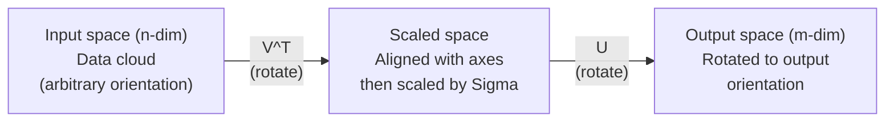
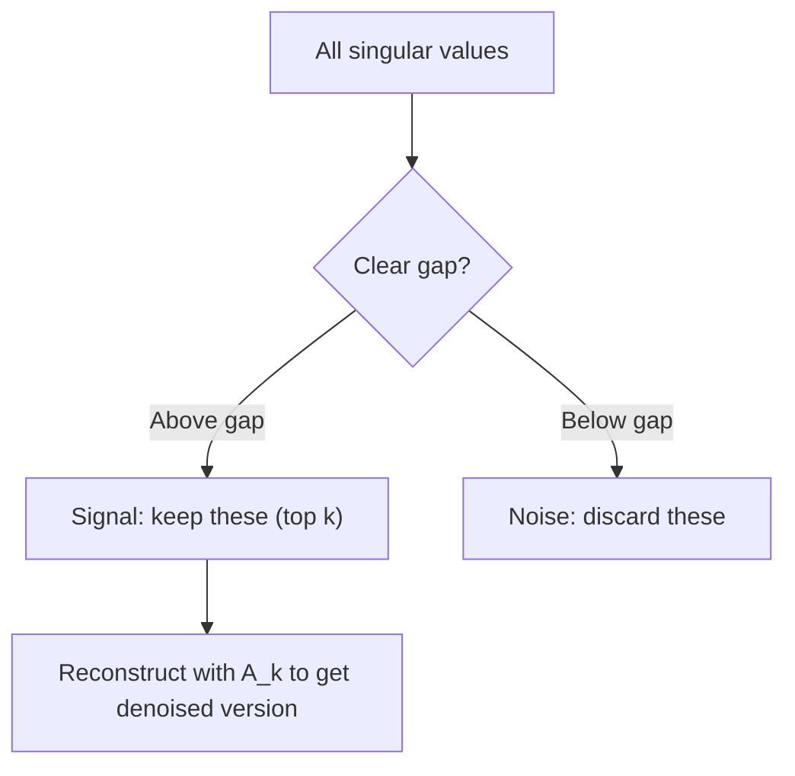

# Singular Value Decomposition

> SVD — это швейцарский армейский нож линейной алгебры. У каждой матрицы есть она. Каждому специалисту по данным нужна она.

**Type:** Build
**Languages:** Python, Julia
**Prerequisites:** Phase 1, Lessons 01 (Linear Algebra Intuition), 02 (Vectors & Matrices Operations), 03 (Matrix Transformations)
**Time:** ~120 minutes

## Learning Objectives

- Реализовать SVD через степенную итерацию и объяснить геометрический смысл U, Sigma и V^T
- Применить усечённое SVD для сжатия изображений и измерить отношение сжатия к ошибке восстановления
- Вычислить псевдообратную матрицу Мура-Пенроуза через SVD для решения переопределённых систем наименьших квадратов
- Связать SVD с PCA, системами рекомендаций (скрытые факторы) и анализом скрытой семантики в обработке текста

## The Problem

У вас есть матрица размером 1000x2000. Возможно, это матрица оценок фильмов пользователями. Возможно, это таблица частот документ-термин. Возможно, это значения пикселей изображения. Вам нужно её сжать, избавить от шума, найти скрытую структуру или решить систему наименьших квадратов. Собственное разложение работает только на квадратных матрицах. И то оно требует, чтобы матрица имела полный набор линейно независимых собственных векторов.

SVD работает на любой матрице. Любой формы. Любого ранга. Без условий. Он разлагает матрицу на три множителя, которые раскрывают геометрию того, что матрица делает с пространством. Это наиболее общее и полезное разложение во всей линейной алгебре.

## The Concept

### What SVD does geometrically

Каждая матрица, независимо от формы, выполняет три операции в последовательности: поворот, масштабирование, поворот. SVD делает это разложение явным.

```
A = U * Sigma * V^T

      m x n     m x m    m x n    n x n
     (any)    (rotate)  (scale)  (rotate)
```

Для любой матрицы A SVD раскладывает её на:
- V^T поворачивает векторы во входном пространстве (n-мерном)
- Sigma масштабирует вдоль каждой оси (растягивает или сжимает)
- U поворачивает результат в выходное пространство (m-мерное)



Подумайте об этом так. Вы даёте SVD матрицу. Он говорит вам: «Эта матрица берёт сферу входных данных, сначала поворачивает её на V^T, потом растягивает в эллипсоид на Sigma, затем поворачивает эллипсоид на U.» Сингулярные значения — это длины осей эллипсоида.

### The full decomposition

Для матрицы A размером m x n:

```
A = U * Sigma * V^T

where:
  U     is m x m, orthogonal (U^T U = I)
  Sigma is m x n, diagonal (singular values on the diagonal)
  V     is n x n, orthogonal (V^T V = I)

The singular values sigma_1 >= sigma_2 >= ... >= sigma_r > 0
where r = rank(A)
```

Столбцы U называются левыми сингулярными векторами. Столбцы V называются правыми сингулярными векторами. Диагональные элементы Sigma называются сингулярными значениями. Они всегда неотрицательны и по соглашению упорядочены в убывающем порядке.

### Left singular vectors, singular values, right singular vectors

Каждый компонент SVD имеет отличный геометрический смысл.

**Правые сингулярные векторы (столбцы V):** Это ортонормированный базис входного пространства (R^n). Они — это направления во входном пространстве, которые матрица отображает на ортогональные направления в выходном пространстве. Думайте о них как о естественной системе координат для области определения.

**Сингулярные значения (диагональ Sigma):** Это коэффициенты масштабирования. i-е сингулярное значение говорит вам, насколько матрица растягивает векторы вдоль i-го правого сингулярного вектора. Нулевое сингулярное значение означает, что матрица полностью сокращает это направление.

**Левые сингулярные векторы (столбцы U):** Это ортонормированный базис выходного пространства (R^m). i-й левый сингулярный вектор — это направление в выходном пространстве, куда попадает i-й правый сингулярный вектор (после масштабирования).

Связь между ними:

```
A * v_i = sigma_i * u_i

The matrix A takes the i-th right singular vector v_i,
scales it by sigma_i, and maps it to the i-th left singular vector u_i.
```

Это даёт вам координату за координатой картину того, что делает любая матрица.

### Outer product form

SVD можно записать как сумму матриц ранга 1:

```
A = sigma_1 * u_1 * v_1^T + sigma_2 * u_2 * v_2^T + ... + sigma_r * u_r * v_r^T

Each term sigma_i * u_i * v_i^T is a rank-1 matrix (an outer product).
The full matrix is the sum of r such matrices, where r is the rank.
```

Эта форма — основа низкорангового приближения. Каждое слагаемое добавляет один уровень структуры. Первое слагаемое захватывает одну наиболее важную структуру. Второе — следующую наиболее важную. И так далее. Усечение этой суммы даёт вам лучшее возможное приближение при любом заданном ранге.

```
Rank-1 approx:    A_1 = sigma_1 * u_1 * v_1^T
                  (captures the dominant pattern)

Rank-2 approx:    A_2 = sigma_1 * u_1 * v_1^T + sigma_2 * u_2 * v_2^T
                  (captures the two most important patterns)

Rank-k approx:    A_k = sum of top k terms
                  (optimal by the Eckart-Young theorem)
```

### Relationship to eigendecomposition

SVD и собственное разложение глубоко связаны. Сингулярные значения и векторы A берутся прямо из собственных значений и собственных векторов A^T A и A A^T.

```
A^T A = V * Sigma^T * U^T * U * Sigma * V^T
      = V * Sigma^T * Sigma * V^T
      = V * D * V^T

where D = Sigma^T * Sigma is a diagonal matrix with sigma_i^2 on the diagonal.

So:
- The right singular vectors (V) are eigenvectors of A^T A
- The singular values squared (sigma_i^2) are eigenvalues of A^T A

Similarly:
A A^T = U * Sigma * V^T * V * Sigma^T * U^T
      = U * Sigma * Sigma^T * U^T

So:
- The left singular vectors (U) are eigenvectors of A A^T
- The eigenvalues of A A^T are also sigma_i^2
```

Эта связь говорит вам три вещи:
1. Сингулярные значения всегда действительны и неотрицательны (они — квадратные корни из собственных значений положительной полуопределённой матрицы).
2. Вы могли бы вычислить SVD через собственное разложение A^T A, но это возводит в квадрат число обусловленности и теряет численную точность. Специализированные алгоритмы SVD этого избегают.
3. Когда A является квадратной симметричной положительной полуопределённой матрицей, SVD и собственное разложение — это одно и то же.

### Truncated SVD: low-rank approximation

Теорема Эккарта-Янга-Мирского утверждает, что лучшее приближение ранга k к A (как в норме Фробениуса, так и в спектральной норме) получается сохранением только top k сингулярных значений и их соответствующих векторов:

```
A_k = U_k * Sigma_k * V_k^T

where:
  U_k     is m x k  (first k columns of U)
  Sigma_k is k x k  (top-left k x k block of Sigma)
  V_k     is n x k  (first k columns of V)

Approximation error = sigma_{k+1}  (in spectral norm)
                    = sqrt(sigma_{k+1}^2 + ... + sigma_r^2)  (in Frobenius norm)
```

Это не просто «хорошее» приближение. Это доказуемо лучшее возможное приближение ранга k. Никакая другая матрица ранга k не ближе к A.

| Компонент | Относительная величина | Сохранён в приближении ранга 3? |
|-----------|-------------------|------------------------|
| sigma_1 | Наибольший | Да |
| sigma_2 | Большой | Да |
| sigma_3 | Средне-большой | Да |
| sigma_4 | Средний | Нет (ошибка) |
| sigma_5 | Средне-малый | Нет (ошибка) |
| sigma_6 | Малый | Нет (ошибка) |
| sigma_7 | Очень малый | Нет (ошибка) |
| sigma_8 | Крошечный | Нет (ошибка) |

Сохраняем top 3: A_3 захватывает три наибольших сингулярных значения. Ошибка = оставшиеся значения (sigma_4 через sigma_8).

Если сингулярные значения убывают быстро, малое k захватывает большую часть матрицы. Если они убывают медленно, матрица не имеет низкорангувой структуры.

### Image compression with SVD

Полутоновое изображение — это матрица интенсивностей пикселей. Изображение размером 800x600 имеет 480 000 значений. SVD позволяет аппроксимировать его намного меньшим числом.

```
Original image: 800 x 600 = 480,000 values

SVD with rank k:
  U_k:      800 x k values
  Sigma_k:  k values
  V_k:      600 x k values
  Total:    k * (800 + 600 + 1) = k * 1401 values

  k=10:   14,010 values   (2.9% of original)
  k=50:   70,050 values  (14.6% of original)
  k=100: 140,100 values  (29.2% of original)

  The compression ratio improves as k gets smaller,
  but visual quality degrades.
```

Ключевое наблюдение: естественные изображения имеют быстро убывающие сингулярные значения. Первые несколько сингулярных значений захватывают общую структуру (формы, градиенты). Более поздние захватывают мелкие детали и шум. Усечение на ранге 50 часто выдаёт изображение, которое выглядит почти идентично исходному, при этом использует на 85% меньше хранилища.

### SVD for recommendation systems

Netflix Prize сделал это известным. У вас есть матрица оценок фильмов пользователями, где большинство элементов отсутствуют.

```
             Movie1  Movie2  Movie3  Movie4  Movie5
  User1      [  5      ?       3       ?       1  ]
  User2      [  ?      4       ?       2       ?  ]
  User3      [  3      ?       5       ?       ?  ]
  User4      [  ?      ?       ?       4       3  ]

  ? = unknown rating
```

Идея: эта матрица оценок имеет низкий ранг. У пользователей нет полностью независимых вкусов. Есть несколько скрытых факторов (экшн vs драма, старый vs новый, интеллектуальный vs чувственный), которые объясняют большинство предпочтений.

SVD на (заполненной) матрице оценок раскладывает её на:
- U: профили пользователей в пространстве скрытых факторов
- Sigma: важность каждого скрытого фактора
- V^T: профили фильмов в пространстве скрытых факторов

Предсказанная оценка пользователем фильма — это скалярное произведение профиля пользователя с профилем фильма (взвешенное сингулярными значениями). Низкоранговое приближение заполняет отсутствующие элементы.

На практике вы используете варианты вроде инкрементального SVD Саймона Фанка или ALS (чередующихся наименьших квадратов), которые напрямую обрабатывают отсутствующие данные. Но основная идея одна и та же: разложение на скрытые факторы через SVD.

### SVD in NLP: Latent Semantic Analysis

Анализ скрытой семантики (Latent Semantic Analysis, LSA), также называемый индексированием скрытой семантики (Latent Semantic Indexing, LSI), применяет SVD к матрице термин-документ.

```
             Doc1   Doc2   Doc3   Doc4
  "cat"      [  3      0      1      0  ]
  "dog"      [  2      0      0      1  ]
  "fish"     [  0      4      1      0  ]
  "pet"      [  1      1      1      1  ]
  "ocean"    [  0      3      0      0  ]

After SVD with rank k=2:

  Each document becomes a point in 2D "concept space."
  Each term becomes a point in the same 2D space.
  Documents about similar topics cluster together.
  Terms with similar meanings cluster together.

  "cat" and "dog" end up near each other (land pets).
  "fish" and "ocean" end up near each other (water concepts).
  Doc1 and Doc3 cluster if they share similar topics.
```

LSA был одним из первых успешных методов для захвата семантического сходства из сырого текста. Он работает, потому что синонимичные термины имеют тенденцию появляться в похожих документах, поэтому SVD группирует их в одни и те же скрытые размерности. Современные словесные встраивания (Word2Vec, GloVe) можно рассматривать как потомки этой идеи.

### SVD for noise reduction

Шумные данные имеют сигнал, сосредоточенный в top сингулярных значениях, и шум, разбросанный по всем сингулярным значениям. Усечение удаляет шумовой фон.

**Сингулярные значения чистого сигнала:**

| Компонент | Величина | Тип |
|-----------|-----------|------|
| sigma_1 | Очень большой | Сигнал |
| sigma_2 | Большой | Сигнал |
| sigma_3 | Средний | Сигнал |
| sigma_4 | Близко к нулю | Пренебрежимо |
| sigma_5 | Близко к нулю | Пренебрежимо |

**Сингулярные значения шумного сигнала (шум добавляется ко всем):**

| Компонент | Величина | Тип |
|-----------|-----------|------|
| sigma_1 | Очень большой | Сигнал |
| sigma_2 | Большой | Сигнал |
| sigma_3 | Средний | Сигнал |
| sigma_4 | Малый | Шум |
| sigma_5 | Малый | Шум |
| sigma_6 | Малый | Шум |
| sigma_7 | Малый | Шум |



Это используется в обработке сигналов, научных измерениях и очистке данных. Каждый раз, когда у вас есть матрица, повреждённая аддитивным шумом, усечённое SVD — это принципиальный способ разделить сигнал и шум.

### Pseudoinverse via SVD

Псевдообратная матрица Мура-Пенроуза A+ обобщает инверсию матриц на неквадратные и сингулярные матрицы. SVD делает её вычисление тривиальным.

```
If A = U * Sigma * V^T, then:

A+ = V * Sigma+ * U^T

where Sigma+ is formed by:
  1. Transpose Sigma (swap rows and columns)
  2. Replace each non-zero diagonal entry sigma_i with 1/sigma_i
  3. Leave zeros as zeros

For A (m x n):      A+ is (n x m)
For Sigma (m x n):  Sigma+ is (n x m)
```

Псевдообратная решает задачи наименьших квадратов. Если Ax = b не имеет точного решения (переопределённая система), то x = A+ b — решение наименьших квадратов (минимизирует ||Ax - b||).

```
Overdetermined system (more equations than unknowns):

  [1  1]         [3]
  [2  1] x   =   [5]       No exact solution exists.
  [3  1]         [6]

  x_ls = A+ b = V * Sigma+ * U^T * b

  This gives the x that minimizes the sum of squared residuals.
  Same result as the normal equations (A^T A)^(-1) A^T b,
  but numerically more stable.
```

### Numerical stability advantages

Вычисление собственного разложения A^T A возводит в квадрат сингулярные значения (собственные значения A^T A — это sigma_i^2). Это возводит в квадрат число обусловленности, усиливая численные ошибки.

```
Example:
  A has singular values [1000, 1, 0.001]
  Condition number of A: 1000 / 0.001 = 10^6

  A^T A has eigenvalues [10^6, 1, 10^{-6}]
  Condition number of A^T A: 10^6 / 10^{-6} = 10^{12}

  Computing SVD directly: works with condition number 10^6
  Computing via A^T A:     works with condition number 10^{12}
                           (6 extra digits of precision lost)
```

Современные алгоритмы SVD (биде­agonalization Голуба-Кахана) работают напрямую на A, никогда не формируя A^T A. Поэтому вы должны всегда предпочитать `np.linalg.svd(A)` вместо `np.linalg.eig(A.T @ A)`.

### Connection to PCA

PCA — ЭТО SVD на центрированных данных. Это не аналогия. Это буквально тот же вычисление.

```
Given data matrix X (n_samples x n_features), centered (mean subtracted):

Covariance matrix: C = (1/(n-1)) * X^T X

PCA finds eigenvectors of C. But:

  X = U * Sigma * V^T    (SVD of X)

  X^T X = V * Sigma^2 * V^T

  C = (1/(n-1)) * V * Sigma^2 * V^T

So the principal components are exactly the right singular vectors V.
The explained variance for each component is sigma_i^2 / (n-1).

In sklearn, PCA is implemented using SVD, not eigendecomposition.
It is faster and more numerically stable.
```

Это означает, что всё, что вы узнали о снижении размерности в Уроке 10 — это SVD под капотом. PCA — наиболее распространённое применение SVD в машинном обучении.

```figure
svd-rank-reconstruction
```

## Build It

### Step 1: SVD from scratch using power iteration

Идея: чтобы найти наибольшее сингулярное значение и его векторы, используйте степенную итерацию на A^T A (или A A^T). Затем дефлируйте матрицу и повторите для следующего сингулярного значения.

```python
import numpy as np

def power_iteration(M, num_iters=100):
    n = M.shape[1]
    v = np.random.randn(n)
    v = v / np.linalg.norm(v)

    for _ in range(num_iters):
        Mv = M @ v
        v = Mv / np.linalg.norm(Mv)

    eigenvalue = v @ M @ v
    return eigenvalue, v

def svd_from_scratch(A, k=None):
    m, n = A.shape
    if k is None:
        k = min(m, n)

    sigmas = []
    us = []
    vs = []

    A_residual = A.copy().astype(float)

    for _ in range(k):
        AtA = A_residual.T @ A_residual
        eigenvalue, v = power_iteration(AtA, num_iters=200)

        if eigenvalue < 1e-10:
            break

        sigma = np.sqrt(eigenvalue)
        u = A_residual @ v / sigma

        sigmas.append(sigma)
        us.append(u)
        vs.append(v)

        A_residual = A_residual - sigma * np.outer(u, v)

    U = np.column_stack(us) if us else np.empty((m, 0))
    S = np.array(sigmas)
    V = np.column_stack(vs) if vs else np.empty((n, 0))

    return U, S, V
```

### Step 2: Test and compare with NumPy

```python
np.random.seed(42)
A = np.random.randn(5, 4)

U_ours, S_ours, V_ours = svd_from_scratch(A)
U_np, S_np, Vt_np = np.linalg.svd(A, full_matrices=False)

print("Our singular values:", np.round(S_ours, 4))
print("NumPy singular values:", np.round(S_np, 4))

A_reconstructed = U_ours @ np.diag(S_ours) @ V_ours.T
print(f"Reconstruction error: {np.linalg.norm(A - A_reconstructed):.8f}")
```

### Step 3: Image compression demo

```python
def compress_image_svd(image_matrix, k):
    U, S, Vt = np.linalg.svd(image_matrix, full_matrices=False)
    compressed = U[:, :k] @ np.diag(S[:k]) @ Vt[:k, :]
    return compressed

image = np.random.seed(42)
rows, cols = 200, 300
image = np.random.randn(rows, cols)

for k in [1, 5, 10, 20, 50]:
    compressed = compress_image_svd(image, k)
    error = np.linalg.norm(image - compressed) / np.linalg.norm(image)
    original_size = rows * cols
    compressed_size = k * (rows + cols + 1)
    ratio = compressed_size / original_size
    print(f"k={k:>3d}  error={error:.4f}  storage={ratio:.1%}")
```

### Step 4: Noise reduction

```python
np.random.seed(42)
clean = np.outer(np.sin(np.linspace(0, 4*np.pi, 100)),
                 np.cos(np.linspace(0, 2*np.pi, 80)))
noise = 0.3 * np.random.randn(100, 80)
noisy = clean + noise

U, S, Vt = np.linalg.svd(noisy, full_matrices=False)
denoised = U[:, :5] @ np.diag(S[:5]) @ Vt[:5, :]

print(f"Noisy error:    {np.linalg.norm(noisy - clean):.4f}")
print(f"Denoised error: {np.linalg.norm(denoised - clean):.4f}")
print(f"Improvement:    {(1 - np.linalg.norm(denoised - clean) / np.linalg.norm(noisy - clean)):.1%}")
```

### Step 5: Pseudoinverse

```python
A = np.array([[1, 1], [2, 1], [3, 1]], dtype=float)
b = np.array([3, 5, 6], dtype=float)

U, S, Vt = np.linalg.svd(A, full_matrices=False)
S_inv = np.diag(1.0 / S)
A_pinv = Vt.T @ S_inv @ U.T

x_svd = A_pinv @ b
x_lstsq = np.linalg.lstsq(A, b, rcond=None)[0]
x_pinv = np.linalg.pinv(A) @ b

print(f"SVD pseudoinverse solution:  {x_svd}")
print(f"np.linalg.lstsq solution:   {x_lstsq}")
print(f"np.linalg.pinv solution:    {x_pinv}")
```

## Use It

Полные рабочие примеры находятся в `code/svd.py`. Запустите его, чтобы увидеть SVD, применённый к сжатию изображений, системам рекомендаций, анализу скрытой семантики и снижению шума.

```bash
python svd.py
```

Версия Julia в `code/svd.jl` демонстрирует те же концепции, используя встроенную функцию `svd()` Julia и пакет `LinearAlgebra`.

```bash
julia svd.jl
```

## Ship It

Этот урок производит:
- `outputs/skill-svd.md` — навык для знания когда и как применять SVD в реальных проектах

## Exercises

1. Реализуйте полный SVD с нуля без использования степенной итерации. Вместо этого вычислите собственное разложение A^T A для получения V и сингулярных значений, затем вычислите U = A V Sigma^{-1}. Сравните численную точность с вашей версией степенной итерации и с NumPy.

2. Загрузите реальное полутоновое изображение (или переведите одно в полутон). Сожмите его на рангах 1, 5, 10, 25, 50, 100. Для каждого ранга вычислите отношение сжатия и относительную ошибку. Найдите ранг, при котором изображение становится визуально приемлемым.

3. Постройте крошечную систему рекомендаций. Создайте матрицу оценок фильмов 10x8 пользователями с некоторыми известными элементами. Заполните отсутствующие элементы средним значением по строкам. Вычислите SVD и восстановите приближение ранга 3. Используйте восстановленную матрицу для предсказания отсутствующих оценок. Убедитесь, что предсказания разумны.

4. Создайте матрицу документ-термин 100x50 с 3 синтетическими темами. Каждая тема имеет 5 связанных терминов. Добавьте шум. Применяйте SVD и убедитесь, что top 3 сингулярных значения намного больше остальных. Спроецируйте документы в 3D пространство скрытых факторов и проверьте, что документы из одной темы кластеризуются вместе.

5. Генерируйте чистую низкоранговую матрицу (ранг 3, размер 50x40) и добавьте гауссовский шум на разных уровнях (sigma = 0.1, 0.5, 1.0, 2.0). Для каждого уровня шума найдите оптимальный ранг усечения, перебирая k от 1 до 40 и измеряя ошибку восстановления против чистой матрицы. Постройте график того, как оптимальное k меняется с уровнем шума.

## Key Terms

| Термин | Что люди говорят | Что это на самом деле значит |
|------|----------------|----------------------|
| SVD | «Разложить любую матрицу» | Разложить A на U Sigma V^T, где U и V ортогональны и Sigma диагональна с неотрицательными элементами. Работает для любой матрицы любой формы. |
| Сингулярное значение | «Как важен этот компонент» | i-й диагональный элемент Sigma. Измеряет, насколько матрица растягивает вдоль i-го главного направления. Всегда неотрицательно, упорядочено в убывающем порядке. |
| Левый сингулярный вектор | «Направление выхода» | Столбец U. Направление в выходном пространстве, куда i-й правый сингулярный вектор отображается (после масштабирования на sigma_i). |
| Правый сингулярный вектор | «Направление входа» | Столбец V. Направление во входном пространстве, которое матрица отображает на i-й левый сингулярный вектор (после масштабирования на sigma_i). |
| Усечённое SVD | «Низкоранговое приближение» | Сохранить только top k сингулярных значений и их векторы. Производит доказуемо лучшее приближение ранга k к исходной матрице (теорема Эккарта-Янга). |
| Ранг | «Истинная размерность» | Количество ненулевых сингулярных значений. Говорит вам, сколько независимых направлений матрица фактически использует. |
| Псевдообратная | «Обобщённая обратная» | V Sigma+ U^T. Инвертирует ненулевые сингулярные значения, оставляет нули как нули. Решает задачи наименьших квадратов для неквадратных или сингулярных матриц. |
| Число обусловленности | «Насколько чувствительно к ошибкам» | sigma_max / sigma_min. Большое число обусловленности означает, что малые изменения входных данных вызывают большие изменения выходных данных. SVD раскрывает это напрямую. |
| Скрытый фактор | «Скрытая переменная» | Размерность в низкоранговом пространстве, обнаруженная SVD. В рекомендациях скрытый фактор может соответствовать предпочтению жанра. В NLP — теме. |
| Норма Фробениуса | «Полный размер матрицы» | Квадратный корень из суммы квадратов элементов. Равняется квадратному корню из суммы квадратов сингулярных значений. Используется для измерения ошибки приближения. |
| Теорема Эккарта-Янга | «SVD даёт лучшее сжатие» | Для любого целевого ранга k усечённое SVD минимизирует ошибку приближения среди всех возможных матриц ранга k. |
| Степенная итерация | «Найти самый большой собственный вектор» | Повторно умножать случайный вектор на матрицу и нормировать. Сходится к собственному вектору с наибольшим собственным значением. Строительный блок многих алгоритмов SVD. |

## Further Reading

- [Gilbert Strang: Linear Algebra and Its Applications, Chapter 7](https://math.mit.edu/~gs/linearalgebra/) — тщательное изложение SVD с приложениями
- [3Blue1Brown: But what is the SVD?](https://www.youtube.com/watch?v=vSczTbgc8Rc) — геометрическая интуиция для SVD
- [We Recommend a Singular Value Decomposition](https://www.ams.org/publicoutreach/feature-column/fcarc-svd) — доступный обзор от Американского математического общества
- [Netflix Prize and Matrix Factorization](https://sifter.org/~simon/journal/20061211.html) — оригинальный блог-пост Саймона Фанка о SVD для рекомендаций
- [Latent Semantic Analysis](https://en.wikipedia.org/wiki/Latent_semantic_analysis) — оригинальное применение SVD в обработке текста
- [Numerical Linear Algebra by Trefethen and Bau](https://people.maths.ox.ac.uk/trefethen/text.html) — золотой стандарт для понимания алгоритмов SVD и их численных свойств