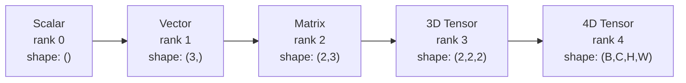
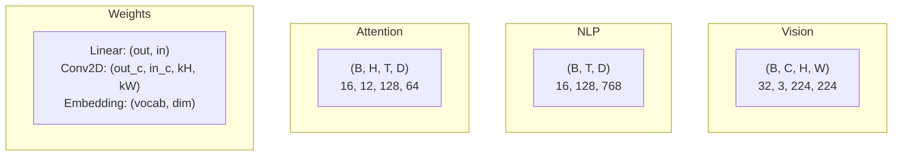
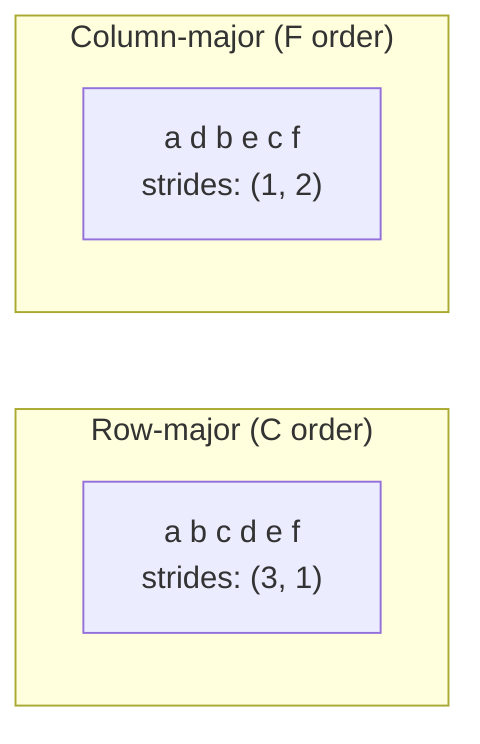
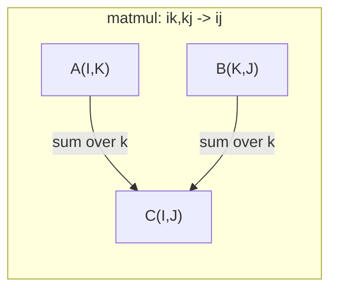

# Tensor Operations

> Tensоры — общий язык между данными и глубоким обучением. Каждое изображение, каждое предложение, каждый градиент проходит через них.

**Type:** Build
**Language:** Python
**Prerequisites:** Phase 1, Lessons 01 (Linear Algebra Intuition), 02 (Vectors, Matrices & Operations)
**Time:** ~90 minutes

## Learning Objectives

- Implement a tensor class with shape, strides, reshape, transpose, and element-wise operations from scratch
- Apply broadcasting rules to operate on tensors of different shapes without copying data
- Write einsum expressions for dot products, matrix multiplications, outer products, and batched operations
- Trace the exact tensor shapes through every step of multi-head attention

## The Problem

Вы создаёте трансформер. Forward pass выглядит чистым. Вы запускаете его и получаете: `RuntimeError: mat1 and mat2 shapes cannot be multiplied (32x768 and 512x768)`. Вы смотрите на формы. Вы пробуете транспонирование. Теперь это говорит `Expected 4D input (got 3D input)`. Вы добавляете unsqueeze. Что-то ещё ломается.

Ошибки формы — самые распространённые баги в коде глубокого обучения. Они не сложны концептуально — каждая операция имеет контракт формы — но они быстро размножаются. Трансформер имеет десятки reshape, transpose и broadcast, связанных вместе. Одна неправильная ось и ошибка каскадирует. Хуже того, некоторые ошибки формы вообще не выбрасывают ошибок. Они молча производят мусор, выполняя broadcast по неправильному измерению или суммируя по неправильной оси.

Матрицы работают с попарными отношениями между двумя наборами вещей. Реальные данные не помещаются в два измерения. Батч из 32 RGB-изображений размером 224x224 — это 4D тензор: `(32, 3, 224, 224)`. Self-attention с 12 головками — это тоже 4D: `(batch, heads, seq_len, head_dim)`. Вам нужна структура данных, которая обобщается на любое число измерений, с операциями, которые чистым образом композируются над всеми ними. Эта структура — тензор. Овладейте его операциями, и ошибки формы станут тривиально отладочными.

## The Concept

### What a tensor is

Тензор — это многомерный массив чисел с единообразным типом данных. Количество измерений — **rank** (или **order**). Каждое измерение — это **axis**. **Shape** — это кортеж, перечисляющий размер вдоль каждой оси.



Всего элементов = произведение всех размеров. Shape `(2, 3, 4)` содержит `2 * 3 * 4 = 24` элементов.

### Tensor shapes in deep learning

Различные типы данных отображаются в определённые формы тензоров по соглашению.



PyTorch использует NCHW (channels-first). TensorFlow по умолчанию использует NHWC (channels-last). Несоответствующие макеты вызывают тихие замедления или ошибки.

### How memory layout works

2D массив в памяти — это 1D последовательность байтов. **Strides** говорят вам, сколько элементов пропустить, чтобы переместиться на один шаг вдоль каждой оси.



Транспонирование не перемещает данные. Оно меняет strides, делая тензор **non-contiguous** — элементы строки больше не соседствуют в памяти.

### Broadcasting rules

Broadcasting позволяет вам работать с тензорами разных форм без копирования данных. Выравняйте формы справа. Два измерения совместимы, когда они равны или одно равно 1. Меньше измерений получает padding с 1s слева.

```
Tensor A:     (8, 1, 6, 1)
Tensor B:        (7, 1, 5)
Padded B:     (1, 7, 1, 5)
Result:       (8, 7, 6, 5)
```

### Einsum: the universal tensor operation

Einstein summation маркирует каждую ось буквой. Оси на входе, но не на выходе суммируются. Оси в обоих сохраняются.



Ключевые паттерны: `i,i->` (dot product), `i,j->ij` (outer product), `ii->` (trace), `ij->ji` (transpose), `bij,bjk->bik` (batch matmul), `bhtd,bhsd->bhts` (attention scores).

```figure
tensor-broadcast
```

## Build It

Код находится в `code/tensors.py`. Каждый шаг ссылается на реализацию там.

### Step 1: Tensor storage and strides

Тензор хранит плоский список чисел плюс метаданные формы. Strides говорят логике индексации, как отобразить многомерные индексы в плоские позиции.

```python
class Tensor:
    def __init__(self, data, shape=None):
        if isinstance(data, (list, tuple)):
            self._data, self._shape = self._flatten_nested(data)
        elif isinstance(data, np.ndarray):
            self._data = data.flatten().tolist()
            self._shape = tuple(data.shape)
        else:
            self._data = [data]
            self._shape = ()

        if shape is not None:
            total = reduce(lambda a, b: a * b, shape, 1)
            if total != len(self._data):
                raise ValueError(
                    f"Cannot reshape {len(self._data)} elements into shape {shape}"
                )
            self._shape = tuple(shape)

        self._strides = self._compute_strides(self._shape)

    @staticmethod
    def _compute_strides(shape):
        if len(shape) == 0:
            return ()
        strides = [1] * len(shape)
        for i in range(len(shape) - 2, -1, -1):
            strides[i] = strides[i + 1] * shape[i + 1]
        return tuple(strides)
```

Для shape `(3, 4)`, strides — это `(4, 1)` — пропустить 4 элемента, чтобы продвинуться на одну строку, пропустить 1 элемент, чтобы продвинуться на один столбец.

### Step 2: Reshape, squeeze, unsqueeze

Reshape изменяет форму без изменения порядка элементов. Общее число элементов должно остаться прежним. Используйте `-1` для одного измерения, чтобы вывести его размер.

```python
t = Tensor(list(range(12)), shape=(2, 6))
r = t.reshape((3, 4))
r = t.reshape((-1, 3))
```

Squeeze удаляет оси размера 1. Unsqueeze вставляет одну. Unsqueezing критичен для broadcasting — вектор смещения `(D,)`, добавленный к батчу `(B, T, D)`, нуждается в unsqueezing в `(1, 1, D)`.

```python
t = Tensor(list(range(6)), shape=(1, 3, 1, 2))
s = t.squeeze()
v = Tensor([1, 2, 3])
u = v.unsqueeze(0)
```

### Step 3: Transpose and permute

Transpose меняет две оси. Permute переупорядочивает все оси. Так вы конвертируете между NCHW и NHWC.

```python
mat = Tensor(list(range(6)), shape=(2, 3))
tr = mat.transpose(0, 1)

t4d = Tensor(list(range(24)), shape=(1, 2, 3, 4))
perm = t4d.permute((0, 2, 3, 1))
```

После transpose или permute тензор non-contiguous в памяти. В PyTorch, `view` не работает на non-contiguous тензорах — используйте `reshape` или вызовите `.contiguous()` сначала.

### Step 4: Element-wise operations and reductions

Element-wise операции (add, multiply, subtract) применяются независимо к каждому элементу и сохраняют форму. Reductions (sum, mean, max) коллапсируют одну или больше осей.

```python
a = Tensor([[1, 2], [3, 4]])
b = Tensor([[10, 20], [30, 40]])
c = a + b
d = a * 2
s = a.sum(axis=0)
```

Global average pooling в CNN: `(B, C, H, W).mean(axis=[2, 3])` производит `(B, C)`. Sequence mean pooling в NLP: `(B, T, D).mean(axis=1)` производит `(B, D)`.

### Step 5: Broadcasting with NumPy

Функция `demo_broadcasting_numpy()` в `tensors.py` показывает основные паттерны.

```python
activations = np.random.randn(4, 3)
bias = np.array([0.1, 0.2, 0.3])
result = activations + bias

images = np.random.randn(2, 3, 4, 4)
scale = np.array([0.5, 1.0, 1.5]).reshape(1, 3, 1, 1)
result = images * scale

a = np.array([1, 2, 3]).reshape(-1, 1)
b = np.array([10, 20, 30, 40]).reshape(1, -1)
outer = a * b
```

Попарное расстояние через broadcasting: переформатировать `(M, 2)` в `(M, 1, 2)` и `(N, 2)` в `(1, N, 2)`, вычесть, возвести в квадрат, суммировать по последней оси, извлечь квадратный корень. Результат: `(M, N)`.

### Step 6: Einsum operations

Функции `demo_einsum()` и `demo_einsum_gallery()` проходят через каждый общий паттерн.

```python
a = np.array([1.0, 2.0, 3.0])
b = np.array([4.0, 5.0, 6.0])
dot = np.einsum("i,i->", a, b)

A = np.array([[1, 2], [3, 4], [5, 6]], dtype=float)
B = np.array([[7, 8, 9], [10, 11, 12]], dtype=float)
matmul = np.einsum("ik,kj->ij", A, B)

batch_A = np.random.randn(4, 3, 5)
batch_B = np.random.randn(4, 5, 2)
batch_mm = np.einsum("bij,bjk->bik", batch_A, batch_B)
```

Computational cost сокращения — это произведение всех размеров индекса (сохранённых и суммируемых). Для `bij,bjk->bik` с B=32, I=128, J=64, K=128: `32 * 128 * 64 * 128 = 33,554,432` multiply-adds.

### Step 7: Attention mechanism via einsum

Функция `demo_attention_einsum()` реализует multi-head attention от начала до конца.

```python
B, H, T, D = 2, 4, 8, 16
E = H * D

X = np.random.randn(B, T, E)
W_q = np.random.randn(E, E) * 0.02

Q = np.einsum("bte,ek->btk", X, W_q)
Q = Q.reshape(B, T, H, D).transpose(0, 2, 1, 3)

scores = np.einsum("bhtd,bhsd->bhts", Q, K) / np.sqrt(D)
weights = softmax(scores, axis=-1)
attn_output = np.einsum("bhts,bhsd->bhtd", weights, V)

concat = attn_output.transpose(0, 2, 1, 3).reshape(B, T, E)
output = np.einsum("bte,ek->btk", concat, W_o)
```

Каждый шаг — это tensor operation: projection (matmul через einsum), head splitting (reshape + transpose), attention scores (batch matmul через einsum), weighted sum (batch matmul через einsum), head merging (transpose + reshape), output projection (matmul через einsum).

## Use It

### Scratch vs NumPy

| Operation | Scratch (Tensor class) | NumPy |
|---|---|---|
| Create | `Tensor([[1,2],[3,4]])` | `np.array([[1,2],[3,4]])` |
| Reshape | `t.reshape((3,4))` | `a.reshape(3,4)` |
| Transpose | `t.transpose(0,1)` | `a.T` или `a.transpose(0,1)` |
| Squeeze | `t.squeeze(0)` | `np.squeeze(a, 0)` |
| Sum | `t.sum(axis=0)` | `a.sum(axis=0)` |
| Einsum | N/A | `np.einsum("ij,jk->ik", a, b)` |

### Scratch vs PyTorch

```python
import torch

t = torch.tensor([[1, 2, 3], [4, 5, 6]], dtype=torch.float32)
t.shape
t.stride()
t.is_contiguous()

t.reshape(3, 2)
t.unsqueeze(0)
t.transpose(0, 1)
t.transpose(0, 1).contiguous()

torch.einsum("ik,kj->ij", A, B)
```

PyTorch добавляет autograd, GPU support и оптимизированные BLAS kernels. Семантика формы идентична. Если вы поняли версию scratch, ошибки PyTorch shape станут читаемыми.

### Every neural network layer as a tensor operation

| Operation | Tensor Form | Einsum |
|---|---|---|
| Linear layer | `Y = X @ W.T + b` | `"bd,od->bo"` + bias |
| Attention QKV | `Q = X @ W_q` | `"btd,dh->bth"` |
| Attention scores | `Q @ K.T / sqrt(d)` | `"bhtd,bhsd->bhts"` |
| Attention output | `softmax(scores) @ V` | `"bhts,bhsd->bhtd"` |
| Batch norm | `(X - mu) / sigma * gamma` | element-wise + broadcast |
| Softmax | `exp(x) / sum(exp(x))` | element-wise + reduction |

## Ship It

Этот урок производит два переиспользуемых промпта:

1. **`outputs/prompt-tensor-shapes.md`** — систематический промпт для отладки tensor shape несоответствий. Включает таблицы решений для каждой общей операции (matmul, broadcast, cat, Linear, Conv2d, BatchNorm, softmax) и таблицу поиска исправлений.

2. **`outputs/prompt-tensor-debugger.md`** — пошаговый промпт отладки, который вы вставляете в любого AI ассистента, когда ошибка формы вас блокирует. Подайте ей сообщение об ошибке и ваши tensor shapes, получите точное исправление.

## Exercises

1. **Easy -- Reshape round-trip.** Возьмите тензор формы `(2, 3, 4)`. Переформатируйте его в `(6, 4)`, затем в `(24,)`, затем обратно в `(2, 3, 4)`. Проверьте, что порядок элементов сохранён на каждом шаге, распечатав плоские данные.

2. **Medium -- Implement broadcasting.** Расширьте класс `Tensor` методом `broadcast_to(shape)`, который расширяет измерения размера 1, чтобы соответствовать целевой форме. Затем модифицируйте `_elementwise_op`, чтобы автоматически выполнять broadcast перед операцией. Протестируйте с формами `(3, 1)` и `(1, 4)`, производящими `(3, 4)`.

3. **Hard -- Build einsum from scratch.** Реализуйте базовую функцию `einsum(subscripts, *tensors)`, которая обрабатывает по крайней мере: dot product (`i,i->`), matrix multiply (`ij,jk->ik`), outer product (`i,j->ij`) и transpose (`ij->ji`). Разберите строку subscript, идентифицируйте сокращённые индексы и пройдите циклом по всем комбинациям индексов. Сравните ваши результаты с `np.einsum`.

4. **Hard -- Attention shape tracker.** Напишите функцию, которая принимает `batch_size`, `seq_len`, `embed_dim` и `num_heads` в качестве входов и выводит точную форму на каждом шаге multi-head attention: input, Q/K/V projection, head split, attention scores, softmax weights, weighted sum, head merge, output projection. Проверьте против вывода `demo_attention_einsum()`.

## Key Terms

| Term | What people say | What it actually means |
|---|---|---|
| Tensor | "Матрица, но больше измерений" | Многомерный массив с единообразным типом и определённой формой, strides и операциями |
| Rank | "Число измерений" | Число осей. Матрица имеет rank 2, не rank равный её матричному рангу |
| Shape | "Размер тензора" | Кортеж, перечисляющий размер вдоль каждой оси. `(2, 3)` означает 2 строки, 3 столбца |
| Stride | "Как память расположена" | Число элементов для пропуска, чтобы продвинуться на одну позицию вдоль каждой оси |
| Broadcasting | "Это просто работает, когда формы отличаются" | Строгий набор правил: выравнять справа, измерения должны быть равны или одно должно быть 1 |
| Contiguous | "Тензор нормальный" | Элементы, хранящиеся последовательно в памяти без пробелов или переупорядочивания из логического расположения |
| Einsum | "Причудливый способ написания matmul" | Общая нотация, которая выражает любое tensor contraction, outer product, trace или transpose в одной строке |
| View | "То же самое, что reshape" | Тензор, совместно использующий тот же буфер памяти, но с разными метаданными shape/stride. Не работает на non-contiguous данных |
| Contraction | "Суммирование по индексу" | Общая операция, где общий индекс между тензорами умножается и суммируется, производя результат меньшего ранга |
| NCHW / NHWC | "PyTorch против TensorFlow формата" | Соглашения о расположении памяти для image тензоров. NCHW ставит каналы перед пространственными dims, NHWC ставит их после |

## Further Reading

- [NumPy Broadcasting](https://numpy.org/doc/stable/user/basics.broadcasting.html) — канонические правила с визуальными примерами
- [PyTorch Tensor Views](https://pytorch.org/docs/stable/tensor_view.html) — когда views работают и когда они копируют
- [einops](https://github.com/arogozhnikov/einops) — библиотека, которая делает tensor reshaping читаемым и безопасным
- [The Illustrated Transformer](https://jalammar.github.io/illustrated-transformer/) — визуализирует tensor shapes, текущие через attention
- [Einstein Summation in NumPy](https://numpy.org/doc/stable/reference/generated/numpy.einsum.html) — полная einsum документация с примерами