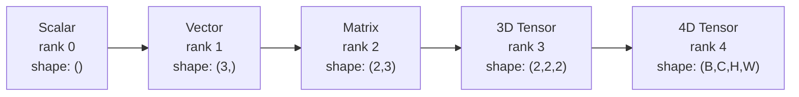
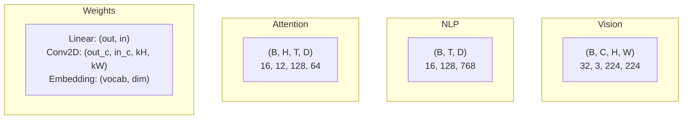
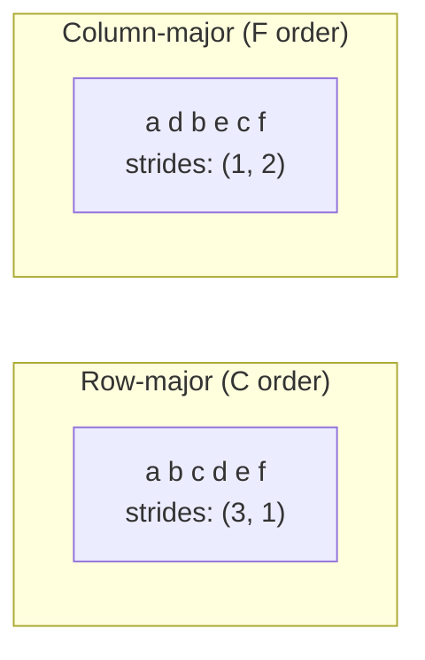
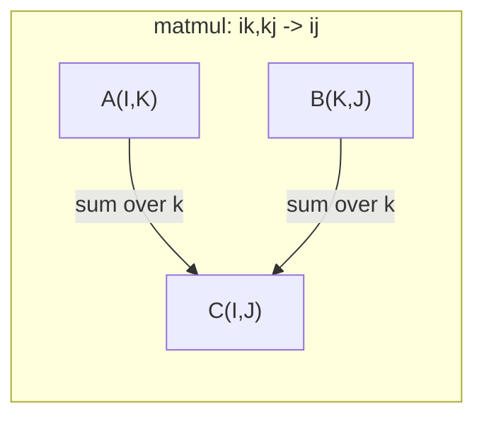

# Операции с тензорами

> Тензоры — это общий язык между данными и глубоким обучением. Каждое изображение, каждое предложение, каждый градиент проходит через них.

**Type:** Build
**Language:** Python
**Prerequisites:** Phase 1, Lessons 01 (Linear Algebra Intuition), 02 (Vectors, Matrices & Operations)
**Time:** ~90 минут

## Цели обучения

- Реализовать класс тензора с shape, strides, reshape, transpose и поэлементными операциями с нуля
- Применять правила broadcasting для работы с тензорами разных форм без копирования данных
- Писать einsum-выражения для скалярных произведений, умножения матриц, внешних произведений и пакетных операций
- Проследить точные формы тензоров на каждом шаге multi-head attention

## Проблема

Вы строите трансформер. Прямой проход выглядит чистым. Вы его запускаете и получаете: `RuntimeError: mat1 and mat2 shapes cannot be multiplied (32x768 and 512x768)`. Вы вглядываетесь в формы. Пробуете транспонирование. Теперь выдаёт: `Expected 4D input (got 3D input)`. Добавляете unsqueeze. Что-то другое ломается.

Ошибки форм — самый распространённый баг в коде глубокого обучения. Концептуально они несложны — у каждой операции есть контракт формы, — но быстро множатся. В трансформере десятки reshape, transpose и broadcast, связанных в цепочку. Одна неверная ось — и ошибка каскадирует. Хуже того, некоторые ошибки форм вообще не выбрасывают исключений. Они молча производят мусор, выполняя broadcast по неправильному измерению или суммируя по неправильной оси.

Матрицы обрабатывают парные отношения между двумя множествами объектов. Реальные данные не укладываются в два измерения. Батч из 32 RGB-изображений размером 224x224 — это 4D-тензор: `(32, 3, 224, 224)`. Self-attention с 12 головами тоже 4D: `(batch, heads, seq_len, head_dim)`. Вам нужна структура данных, обобщающаяся на любое количество измерений, с операциями, которые чисто композируются по всем из них. Эта структура — тензор. Освойте его операции, и ошибки форм станут тривиально отлаживаемыми.

## Концепция

### Что такое тензор

Тензор — это многомерный массив чисел с единым типом данных. Количество измерений называется **рангом** (или **порядком**). Каждое измерение — это **ось**. **Форма** (shape) — это кортеж, перечисляющий размер по каждой оси.



Общее число элементов = произведение всех размеров. Форма `(2, 3, 4)` содержит `2 * 3 * 4 = 24` элементов.

### Формы тензоров в глубоком обучении

Разные типы данных по соглашению соответствуют определённым формам тензоров.



PyTorch использует NCHW (channels-first). TensorFlow по умолчанию использует NHWC (channels-last). Несовпадение раскладок приводит к незаметному замедлению или ошибкам.

### Как устроена раскладка в памяти

2D-массив в памяти — это 1D-последовательность байтов. **Strides** (шаги) показывают, сколько элементов нужно пропустить, чтобы сдвинуться на один шаг вдоль каждой оси.



Transpose не перемещает данные. Он меняет местами strides, делая тензор **неконтигуозным (non-contiguous)** — элементы одной строки больше не находятся рядом в памяти.

### Правила broadcasting

Broadcasting позволяет оперировать тензорами разных форм без копирования данных. Формы выравниваются справа. Два измерения совместимы, если они равны или одно из них равно 1. Недостающие измерения дополняются единицами слева.

```
Tensor A:     (8, 1, 6, 1)
Tensor B:        (7, 1, 5)
Padded B:     (1, 7, 1, 5)
Result:       (8, 7, 6, 5)
```

### Einsum: универсальная операция с тензорами

Einstein summation помечает каждую ось буквой. Оси, присутствующие во входных данных, но отсутствующие в выходе, суммируются. Оси, присутствующие и там, и там, сохраняются.



Ключевые паттерны: `i,i->` (скалярное произведение), `i,j->ij` (внешнее произведение), `ii->` (след, trace), `ij->ji` (транспонирование), `bij,bjk->bik` (пакетное умножение матриц), `bhtd,bhsd->bhts` (attention scores).

```figure
tensor-broadcast
```

## Постройте это

Код находится в `code/tensors.py`. Каждый шаг ссылается на реализацию там.

### Шаг 1: Хранение тензора и strides

Тензор хранит плоский список чисел плюс метаданные формы. Strides сообщают логике индексации, как отображать многомерные индексы в плоские позиции.

```python
class Tensor:
    def __init__(self, data, shape=None):
        if isinstance(data, (list, tuple)):
            self._data, self._shape = self._flatten_nested(data)
        elif isinstance(data, np.ndarray):
            self._data = data.flatten().tolist()
            self._shape = tuple(data.shape)
        else:
            self._data = [data]
            self._shape = ()

        if shape is not None:
            total = reduce(lambda a, b: a * b, shape, 1)
            if total != len(self._data):
                raise ValueError(
                    f"Cannot reshape {len(self._data)} elements into shape {shape}"
                )
            self._shape = tuple(shape)

        self._strides = self._compute_strides(self._shape)

    @staticmethod
    def _compute_strides(shape):
        if len(shape) == 0:
            return ()
        strides = [1] * len(shape)
        for i in range(len(shape) - 2, -1, -1):
            strides[i] = strides[i + 1] * shape[i + 1]
        return tuple(strides)
```

Для формы `(3, 4)` strides равны `(4, 1)` — пропустить 4 элемента, чтобы продвинуться на одну строку, пропустить 1 элемент, чтобы продвинуться на один столбец.

### Шаг 2: Reshape, squeeze, unsqueeze

Reshape меняет форму, не меняя порядок элементов. Общее число элементов должно остаться прежним. Используйте `-1` для одного измерения, чтобы его размер выводился автоматически.

```python
t = Tensor(list(range(12)), shape=(2, 6))
r = t.reshape((3, 4))
r = t.reshape((-1, 3))
```

Squeeze убирает оси размера 1. Unsqueeze добавляет такую ось. Unsqueeze критически важен для broadcasting — вектор смещения (bias) `(D,)`, добавляемый к батчу `(B, T, D)`, нуждается в unsqueeze до `(1, 1, D)`.

```python
t = Tensor(list(range(6)), shape=(1, 3, 1, 2))
s = t.squeeze()
v = Tensor([1, 2, 3])
u = v.unsqueeze(0)
```

### Шаг 3: Transpose и permute

Transpose меняет местами две оси. Permute переставляет все оси. Именно так вы конвертируете между NCHW и NHWC.

```python
mat = Tensor(list(range(6)), shape=(2, 3))
tr = mat.transpose(0, 1)

t4d = Tensor(list(range(24)), shape=(1, 2, 3, 4))
perm = t4d.permute((0, 2, 3, 1))
```

После transpose или permute тензор становится неконтигуозным в памяти. В PyTorch `view` не работает на неконтигуозных тензорах — используйте `reshape` или сначала вызовите `.contiguous()`.

### Шаг 4: Поэлементные операции и редукции

Поэлементные операции (сложение, умножение, вычитание) применяются независимо к каждому элементу и сохраняют форму. Редукции (sum, mean, max) схлопывают одну или несколько осей.

```python
a = Tensor([[1, 2], [3, 4]])
b = Tensor([[10, 20], [30, 40]])
c = a + b
d = a * 2
s = a.sum(axis=0)
```

Global average pooling в CNN: `(B, C, H, W).mean(axis=[2, 3])` даёт `(B, C)`. Sequence mean pooling в NLP: `(B, T, D).mean(axis=1)` даёт `(B, D)`.

### Шаг 5: Broadcasting с NumPy

Функция `demo_broadcasting_numpy()` в `tensors.py` показывает основные паттерны.

```python
activations = np.random.randn(4, 3)
bias = np.array([0.1, 0.2, 0.3])
result = activations + bias

images = np.random.randn(2, 3, 4, 4)
scale = np.array([0.5, 1.0, 1.5]).reshape(1, 3, 1, 1)
result = images * scale

a = np.array([1, 2, 3]).reshape(-1, 1)
b = np.array([10, 20, 30, 40]).reshape(1, -1)
outer = a * b
```

Попарное расстояние через broadcasting: измените форму `(M, 2)` на `(M, 1, 2)` и `(N, 2)` на `(1, N, 2)`, вычтите, возведите в квадрат, просуммируйте по последней оси, извлеките квадратный корень. Результат: `(M, N)`.

### Шаг 6: Операции einsum

Функции `demo_einsum()` и `demo_einsum_gallery()` проходят через каждый распространённый паттерн.

```python
a = np.array([1.0, 2.0, 3.0])
b = np.array([4.0, 5.0, 6.0])
dot = np.einsum("i,i->", a, b)

A = np.array([[1, 2], [3, 4], [5, 6]], dtype=float)
B = np.array([[7, 8, 9], [10, 11, 12]], dtype=float)
matmul = np.einsum("ik,kj->ij", A, B)

batch_A = np.random.randn(4, 3, 5)
batch_B = np.random.randn(4, 5, 2)
batch_mm = np.einsum("bij,bjk->bik", batch_A, batch_B)
```

Вычислительная стоимость свёртки (contraction) — произведение размеров всех индексов (сохраняемых и суммируемых). Для `bij,bjk->bik` с B=32, I=128, J=64, K=128: `32 * 128 * 64 * 128 = 33,554,432` операций умножения-сложения.

### Шаг 7: Механизм attention через einsum

Функция `demo_attention_einsum()` реализует multi-head attention от начала до конца.

```python
B, H, T, D = 2, 4, 8, 16
E = H * D

X = np.random.randn(B, T, E)
W_q = np.random.randn(E, E) * 0.02

Q = np.einsum("bte,ek->btk", X, W_q)
Q = Q.reshape(B, T, H, D).transpose(0, 2, 1, 3)

scores = np.einsum("bhtd,bhsd->bhts", Q, K) / np.sqrt(D)
weights = softmax(scores, axis=-1)
attn_output = np.einsum("bhts,bhsd->bhtd", weights, V)

concat = attn_output.transpose(0, 2, 1, 3).reshape(B, T, E)
output = np.einsum("bte,ek->btk", concat, W_o)
```

Каждый шаг — это тензорная операция: проекция (matmul через einsum), разбиение на головы (reshape + transpose), attention scores (пакетное умножение матриц через einsum), взвешенная сумма (пакетное умножение матриц через einsum), объединение голов (transpose + reshape), выходная проекция (matmul через einsum).

## Используйте это

### С нуля vs NumPy

| Операция | С нуля (класс Tensor) | NumPy |
|---|---|---|
| Создание | `Tensor([[1,2],[3,4]])` | `np.array([[1,2],[3,4]])` |
| Reshape | `t.reshape((3,4))` | `a.reshape(3,4)` |
| Transpose | `t.transpose(0,1)` | `a.T` или `a.transpose(0,1)` |
| Squeeze | `t.squeeze(0)` | `np.squeeze(a, 0)` |
| Sum | `t.sum(axis=0)` | `a.sum(axis=0)` |
| Einsum | N/A | `np.einsum("ij,jk->ik", a, b)` |

### С нуля vs PyTorch

```python
import torch

t = torch.tensor([[1, 2, 3], [4, 5, 6]], dtype=torch.float32)
t.shape
t.stride()
t.is_contiguous()

t.reshape(3, 2)
t.unsqueeze(0)
t.transpose(0, 1)
t.transpose(0, 1).contiguous()

torch.einsum("ik,kj->ij", A, B)
```

PyTorch добавляет autograd, поддержку GPU и оптимизированные BLAS-ядра. Семантика форм идентична. Если вы понимаете версию с нуля, ошибки форм в PyTorch становятся читаемыми.

### Каждый слой нейросети как тензорная операция

| Операция | Тензорная форма | Einsum |
|---|---|---|
| Linear-слой | `Y = X @ W.T + b` | `"bd,od->bo"` + bias |
| Attention QKV | `Q = X @ W_q` | `"btd,dh->bth"` |
| Attention scores | `Q @ K.T / sqrt(d)` | `"bhtd,bhsd->bhts"` |
| Attention output | `softmax(scores) @ V` | `"bhts,bhsd->bhtd"` |
| Batch norm | `(X - mu) / sigma * gamma` | поэлементно + broadcast |
| Softmax | `exp(x) / sum(exp(x))` | поэлементно + редукция |

## Отправьте это в работу

Этот урок производит два переиспользуемых промпта:

1. **`outputs/prompt-tensor-shapes.md`** — систематический промпт для отладки несовпадений форм тензоров. Включает таблицы решений для каждой распространённой операции (matmul, broadcast, cat, Linear, Conv2d, BatchNorm, softmax) и таблицу поиска исправлений.

2. **`outputs/prompt-tensor-debugger.md`** — пошаговый промпт для отладки, который вы вставляете в любой AI-ассистент, когда ошибка формы блокирует вас. Передайте ему сообщение об ошибке и формы ваших тензоров, получите точное исправление.

## Упражнения

1. **Лёгкое — цикл reshape.** Возьмите тензор формы `(2, 3, 4)`. Измените его форму на `(6, 4)`, затем на `(24,)`, затем обратно на `(2, 3, 4)`. Проверьте, что порядок элементов сохраняется на каждом шаге, выведя плоские данные.

2. **Среднее — реализуйте broadcasting.** Расширьте класс `Tensor` методом `broadcast_to(shape)`, который расширяет измерения размера 1 до соответствия целевой форме. Затем модифицируйте `_elementwise_op`, чтобы автоматически применять broadcasting перед операцией. Протестируйте с формами `(3, 1)` и `(1, 4)`, дающими `(3, 4)`.

3. **Сложное — постройте einsum с нуля.** Реализуйте базовую функцию `einsum(subscripts, *tensors)`, обрабатывающую как минимум: скалярное произведение (`i,i->`), умножение матриц (`ij,jk->ik`), внешнее произведение (`i,j->ij`) и транспонирование (`ij->ji`). Разберите строку индексов, определите суммируемые индексы и пройдитесь циклом по всем комбинациям индексов. Сравните свои результаты с `np.einsum`.

4. **Сложное — трекер форм attention.** Напишите функцию, принимающую `batch_size`, `seq_len`, `embed_dim` и `num_heads` в качестве входных данных, которая выводит точную форму на каждом шаге multi-head attention: вход, проекция Q/K/V, разбиение на головы, attention scores, softmax-веса, взвешенная сумма, объединение голов, выходная проекция. Сверьте с выводом `demo_attention_einsum()`.

## Ключевые термины

| Термин | Что говорят люди | Что это на самом деле означает |
|---|---|---|
| Тензор (Tensor) | «Матрица, но с бо́льшим числом измерений» | Многомерный массив с единым типом, определённой формой, strides и операциями |
| Ранг (Rank) | «Количество измерений» | Число осей. Матрица имеет ранг 2, а не ранг, равный её матричному рангу |
| Форма (Shape) | «Размер тензора» | Кортеж, перечисляющий размер по каждой оси. `(2, 3)` означает 2 строки, 3 столбца |
| Шаг (Stride) | «Как устроена память» | Количество элементов, которые нужно пропустить, чтобы продвинуться на одну позицию вдоль каждой оси |
| Broadcasting | «Просто работает, когда формы различаются» | Строгий набор правил: выравнивание справа, измерения должны быть равны или одно должно быть равно 1 |
| Контигуозность (Contiguous) | «Тензор нормальный» | Элементы хранятся последовательно в памяти без пропусков или переупорядочивания относительно логической раскладки |
| Einsum | «Причудливый способ записать matmul» | Общая нотация, выражающая любую свёртку тензоров, внешнее произведение, след или транспонирование в одну строку |
| View | «То же, что reshape» | Тензор, разделяющий тот же буфер памяти, но с другими метаданными формы/strides. Не работает на неконтигуозных данных |
| Свёртка (Contraction) | «Суммирование по индексу» | Общая операция, при которой общий индекс между тензорами перемножается и суммируется, давая результат меньшего ранга |
| NCHW / NHWC | «Формат PyTorch против TensorFlow» | Соглашения о раскладке памяти для тензоров изображений. NCHW ставит каналы перед пространственными измерениями, NHWC — после |

## Дополнительное чтение

- [NumPy Broadcasting](https://numpy.org/doc/stable/user/basics.broadcasting.html) — канонические правила с визуальными примерами
- [PyTorch Tensor Views](https://pytorch.org/docs/stable/tensor_view.html) — когда views работают, а когда копируют
- [einops](https://github.com/arogozhnikov/einops) — библиотека, делающая reshape тензоров читаемым и безопасным
- [The Illustrated Transformer](https://jalammar.github.io/illustrated-transformer/) — визуализирует формы тензоров, проходящие через attention
- [Einstein Summation in NumPy](https://numpy.org/doc/stable/reference/generated/numpy.einsum.html) — полная документация по einsum с примерами