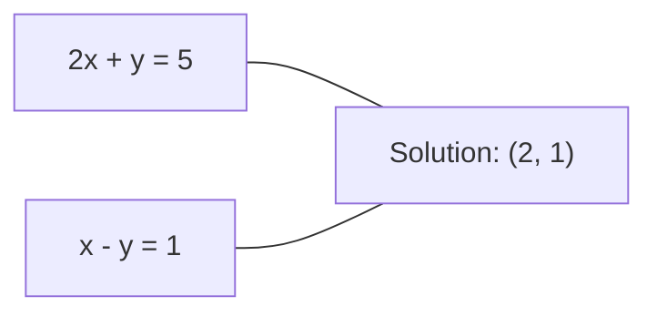
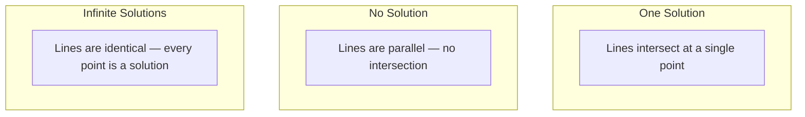

# Линейные системы

> Решение Ax = b — древнейшая задача математики, которая всё ещё управляет вашей нейронной сетью.

**Type:** Build
**Language:** Python
**Prerequisites:** Phase 1, Lessons 01 (Linear Algebra Intuition), 02 (Vectors & Matrices), 03 (Matrix Transformations)
**Time:** ~120 minutes

## Learning Objectives

- Решать Ax = b, используя метод Гаусса с частичным выбором ведущего элемента и обратную подстановку
- Факторизовать матрицы с помощью разложений LU, QR и Холецкого и объяснить, когда каждое из них уместно
- Вывести нормальные уравнения для метода наименьших квадратов и связать их с линейной регрессией и регуляризацией по норме (ridge regression)
- Диагностировать плохо обусловленные системы с помощью числа обусловленности и применять регуляризацию для их стабилизации

## The Problem

Каждый раз, когда вы обучаете линейную регрессию, вы решаете линейную систему. Каждый раз, когда вы вычисляете наилучшее приближение в смысле наименьших квадратов, вы решаете линейную систему. Каждый раз, когда слой нейронной сети вычисляет `y = Wx + b`, он вычисляет одну часть линейной системы. Когда вы добавляете регуляризацию, вы модифицируете систему. Когда вы используете гауссовские процессы, вы факторизуете матрицу. Когда вы инвертируете матрицу ковариаций для расстояния Махаланобиса, вы решаете линейную систему.

Уравнение Ax = b встречается везде. A — матрица известных коэффициентов. b — вектор известных выходных значений. x — вектор неизвестных, которые вы хотите найти. В линейной регрессии A — матрица данных, b — вектор целевых переменных, x — вектор весов. Вся модель сводится к следующему: найти x такой, что Ax максимально близко к b.

На этом уроке мы реализуем с нуля все основные методы для решения этого уравнения. Вы поймёте, почему одни методы быстрые, а другие устойчивые, почему одни работают только для квадратных систем, а другие справляются с переопределёнными системами, и почему число обусловленности матрицы определяет, имеет ли вообще смысл ваш ответ.

## The Concept

### Геометрический смысл Ax = b

Система линейных уравнений имеет геометрическую интерпретацию. Каждое уравнение определяет гиперплоскость. Решение — это точка (или множество точек), в которых пересекаются все гиперплоскости.

```
2x + y = 5          Two lines in 2D.
x - y  = 1          They intersect at x=2, y=1.
```



Возможны три сценария:



В матричной форме "одно решение" означает, что A обратима. "Нет решения" означает, что система несовместна. "Бесконечно много решений" означает, что A имеет нетривиальное ядро. Большинство задач машинного обучения попадают в категорию "нет точного решения", потому что у вас больше уравнений (точек данных) чем неизвестных (параметров). Вот где используется метод наименьших квадратов.

### Картина по столбцам против картины по строкам

Есть два способа прочитать Ax = b.

**Картина по строкам.** Каждая строка A определяет одно уравнение. Каждое уравнение — это гиперплоскость. Решение — точка, где они все пересекаются.

**Картина по столбцам.** Каждый столбец A — это вектор. Вопрос становится следующим: какая линейная комбинация столбцов A даёт b?

```
A = | 2  1 |    b = | 5 |
    | 1 -1 |        | 1 |

Row picture: solve 2x + y = 5 and x - y = 1 simultaneously.

Column picture: find x1, x2 such that:
  x1 * [2, 1] + x2 * [1, -1] = [5, 1]
  2 * [2, 1] + 1 * [1, -1] = [4+1, 2-1] = [5, 1]   check.
```

Картина по столбцам более фундаментальна. Если b лежит в столбцовом пространстве A, система имеет решение. Если нет, вы находите ближайшую точку в столбцовом пространстве. Эта ближайшая точка — решение по методу наименьших квадратов.

### Метод Гаусса

Метод Гаусса преобразует Ax = b в верхнетреугольную систему Ux = c, которую вы решаете с помощью обратной подстановки. Это наиболее прямой метод.

Алгоритм:

```
1. For each column k (the pivot column):
   a. Find the largest entry in column k at or below row k (partial pivoting).
   b. Swap that row with row k.
   c. For each row i below k:
      - Compute multiplier m = A[i][k] / A[k][k]
      - Subtract m times row k from row i.
2. Back substitute: solve from the last equation upward.
```

Пример:

```
Original:
| 2  1  1 | 8 |       R2 = R2 - (2)R1     | 2  1   1 |  8 |
| 4  3  3 |20 |  -->  R3 = R3 - (1)R1 --> | 0  1   1 |  4 |
| 2  3  1 |12 |                            | 0  2   0 |  4 |

                       R3 = R3 - (2)R2     | 2  1   1 |  8 |
                                       --> | 0  1   1 |  4 |
                                           | 0  0  -2 | -4 |

Back substitute:
  -2 * x3 = -4    -->  x3 = 2
  x2 + 2  = 4     -->  x2 = 2
  2*x1 + 2 + 2 = 8 --> x1 = 2
```

Метод Гаусса требует O(n^3) операций. Для системы 1000x1000 это примерно миллиард операций с плавающей точкой. Быстро, но вы можете сделать это эффективнее, если нужно решить несколько систем с одной и той же матрицей A.

### Частичный выбор ведущего элемента: почему это важно

Без выбора ведущего элемента метод Гаусса может дать сбой или неверный результат. Если ведущий элемент равен нулю, вы делите на ноль. Если он мал, вы усиливаете ошибки округления.

```
Bad pivot:                       With partial pivoting:
| 0.001  1 | 1.001 |            Swap rows first:
| 1      1 | 2     |            | 1      1 | 2     |
                                 | 0.001  1 | 1.001 |
m = 1/0.001 = 1000              m = 0.001/1 = 0.001
R2 = R2 - 1000*R1               R2 = R2 - 0.001*R1
| 0.001  1     | 1.001   |      | 1      1     | 2     |
| 0     -999   | -999.0  |      | 0      0.999 | 0.999 |

x2 = 1.000 (correct)            x2 = 1.000 (correct)
x1 = (1.001 - 1)/0.001          x1 = (2 - 1)/1 = 1.000 (correct)
   = 0.001/0.001 = 1.000        Stable because the multiplier is small.
```

В арифметике с плавающей точкой ограниченной точности версия без выбора ведущего элемента может потерять значащие цифры. Частичный выбор ведущего элемента всегда выбирает наибольший доступный ведущий элемент, чтобы минимизировать усиление ошибок.

### LU-разложение

LU-разложение факторизует A в нижнетреугольную матрицу L и верхнетреугольную матрицу U: A = LU. Матрица L хранит множители из метода Гаусса. Матрица U — результат исключения.

```
A = L @ U

| 2  1  1 |   | 1  0  0 |   | 2  1   1 |
| 4  3  3 | = | 2  1  0 | @ | 0  1   1 |
| 2  3  1 |   | 1  2  1 |   | 0  0  -2 |
```

Почему факторизовать вместо простого исключения? Потому что как только у вас есть L и U, решение Ax = b для любого нового b стоит только O(n^2):

```
Ax = b
LUx = b
Let y = Ux:
  Ly = b    (forward substitution, O(n^2))
  Ux = y    (back substitution, O(n^2))
```

Стоимость O(n^3) оплачивается один раз при факторизации. Каждое последующее решение стоит O(n^2). Если вам нужно решить 1000 систем с одной и той же A, но разными векторами b, LU сохраняет множитель 1000/3 от общей работы.

С частичным выбором ведущего элемента вы получаете PA = LU, где P — матрица перестановки, записывающая перестановки строк.

### QR-разложение

QR-разложение факторизует A в ортогональную матрицу Q и верхнетреугольную матрицу R: A = QR.

Ортогональная матрица обладает свойством Q^T Q = I. Её столбцы — ортонормальные векторы. Умножение на Q сохраняет длины и углы.

```
A = Q @ R

Q has orthonormal columns: Q^T Q = I
R is upper triangular

To solve Ax = b:
  QRx = b
  Rx = Q^T b    (just multiply by Q^T, no inversion needed)
  Back substitute to get x.
```

QR численно более устойчиво, чем LU, для решения задач наименьших квадратов. Процесс Грама–Шмидта строит Q столбец за столбцом:

```
Given columns a1, a2, ... of A:

q1 = a1 / ||a1||

q2 = a2 - (a2 . q1) * q1        (subtract projection onto q1)
q2 = q2 / ||q2||                (normalize)

q3 = a3 - (a3 . q1) * q1 - (a3 . q2) * q2
q3 = q3 / ||q3||

R[i][j] = qi . aj    for i <= j
```

На каждом шаге удаляется компонента вдоль всех предыдущих q-векторов, остаётся только новое ортогональное направление.

### Разложение Холецкого

Когда A симметрична (A = A^T) и положительно определена (все собственные значения положительны), вы можете факторизовать её как A = L L^T, где L нижнетреугольна. Это разложение Холецкого.

```
A = L @ L^T

| 4  2 |   | 2  0 |   | 2  1 |
| 2  5 | = | 1  2 | @ | 0  2 |

L[i][i] = sqrt(A[i][i] - sum(L[i][k]^2 for k < i))
L[i][j] = (A[i][j] - sum(L[i][k]*L[j][k] for k < j)) / L[j][j]    for i > j
```

Разложение Холецкого в два раза быстрее LU и требует в два раза меньше памяти. Оно работает только для симметричных положительно определённых матриц, но они встречаются постоянно:

- Матрицы ковариации симметричны положительно полуопределены (положительно определены с регуляризацией).
- Матрица ядра в гауссовских процессах симметрична положительно определена.
- Гессиан выпуклой функции в минимуме симметричен положительно определён.
- A^T A всегда симметрична положительно полуопределена.

В гауссовских процессах вы факторизуете матрицу ядра K разложением Холецкого, затем решаете K alpha = y, чтобы получить прогнозируемое среднее. Фактор Холецкого также даёт вам логарифм определителя для маргинального правдоподобия: log det(K) = 2 * sum(log(diag(L))).

### Наименьшие квадраты: когда Ax = b не имеет точного решения

Если A имеет размер m x n с m > n (больше уравнений чем неизвестных), система переопределена. Точного решения нет. Вместо этого вы минимизируете сумму квадратов ошибок:

```
minimize ||Ax - b||^2

This is the sum of squared residuals:
  sum((A[i,:] @ x - b[i])^2 for i in range(m))
```

Минимизатор удовлетворяет нормальным уравнениям:

```
A^T A x = A^T b
```

Вывод: разложите ||Ax - b||^2 = (Ax - b)^T (Ax - b) = x^T A^T A x - 2 x^T A^T b + b^T b. Возьмите градиент по x, приравняйте к нулю: 2 A^T A x - 2 A^T b = 0.

```
Original system (overdetermined, 4 equations, 2 unknowns):
| 1  1 |         | 3 |
| 1  2 | x     = | 5 |       No exact x satisfies all 4 equations.
| 1  3 |         | 6 |
| 1  4 |         | 8 |

Normal equations:
A^T A = | 4  10 |    A^T b = | 22 |
        | 10 30 |            | 63 |

Solve: x = [1.5, 1.7]

This is linear regression. x[0] is the intercept, x[1] is the slope.
```

### Нормальные уравнения = линейная регрессия

Связь точна. В линейной регрессии матрица данных X имеет одну строку на выборку и один столбец на признак. Вектор целевых переменных y имеет одну запись на выборку. Вектор весов w удовлетворяет:

```
X^T X w = X^T y
w = (X^T X)^(-1) X^T y
```

Это закрытое решение линейной регрессии. Каждый вызов `sklearn.linear_model.LinearRegression.fit()` вычисляет это (или эквивалент через QR или SVD).

Добавьте слагаемое регуляризации lambda * I в матрицу и вы получите ridge регрессию:

```
(X^T X + lambda * I) w = X^T y
w = (X^T X + lambda * I)^(-1) X^T y
```

Регуляризация делает матрицу лучше обусловленной (легче инвертировать точно) и предотвращает переобучение, сжимая веса к нулю. Матрица X^T X + lambda * I всегда симметрична положительно определена, когда lambda > 0, поэтому вы можете использовать разложение Холецкого для её решения.

### Псевдообратная матрица (Мура–Пенроуза)

Псевдообратная матрица A+ обобщает матричную инверсию на неквадратные и вырожденные матрицы. Для любой матрицы A:

```
x = A+ b

where A+ = V Sigma+ U^T    (computed via SVD)
```

Sigma+ формируется путём взятия обратных значений каждого ненулевого сингулярного значения и транспонирования результата. Если A = U Sigma V^T, то A+ = V Sigma+ U^T.

```
A = U Sigma V^T        (SVD)

Sigma = | 5  0 |       Sigma+ = | 1/5  0  0 |
        | 0  2 |                | 0  1/2  0 |
        | 0  0 |

A+ = V Sigma+ U^T
```

Псевдообратная матрица даёт решение наименьших квадратов минимальной нормы. Если система имеет:
- Одно решение: A+ b даёт его.
- Нет решения: A+ b даёт решение наименьших квадратов.
- Бесконечно много решений: A+ b даёт то с наименьшей ||x||.

`np.linalg.lstsq` и `np.linalg.pinv` NumPy используют SVD внутренне.

### Число обусловленности

Число обусловленности измеряет, насколько чувствительно решение к малым изменениям входных данных. Для матрицы A число обусловленности:

```
kappa(A) = ||A|| * ||A^(-1)|| = sigma_max / sigma_min
```

где sigma_max и sigma_min — наибольшее и наименьшее сингулярные значения.

```
Well-conditioned (kappa ~ 1):        Ill-conditioned (kappa ~ 10^15):
Small change in b -->                Small change in b -->
small change in x                    huge change in x

| 2  0 |   kappa = 2/1 = 2          | 1   1          |   kappa ~ 10^15
| 0  1 |   safe to solve            | 1   1+10^(-15) |   solution is garbage
```

Практические рекомендации:
- kappa < 100: безопасно, решение точно.
- kappa ~ 10^k: вы теряете примерно k цифр точности из вашей арифметики с плавающей точкой.
- kappa ~ 10^16 (для float64): решение бессмысленно. Матрица практически вырождена.

В машинном обучении плохая обусловленность происходит, когда признаки почти коллинеарны. Регуляризация (добавление lambda * I) улучшает число обусловленности с sigma_max / sigma_min до (sigma_max + lambda) / (sigma_min + lambda).

### Итерационные методы: сопряжённый градиент

Для очень больших разреженных систем (миллионы неизвестных) прямые методы вроде LU или Холецкого слишком дорогостоящие. Итерационные методы аппроксимируют решение, улучшая предположение за много итераций.

Сопряжённый градиент (CG) решает Ax = b, когда A симметрична положительно определена. Он находит точное решение не более чем за n итераций (в точной арифметике), но обычно сходится намного быстрее, если собственные значения A сгруппированы.

```
Algorithm sketch:
  x0 = initial guess (often zero)
  r0 = b - A x0           (residual)
  p0 = r0                 (search direction)

  For k = 0, 1, 2, ...:
    alpha = (rk . rk) / (pk . A pk)
    x_{k+1} = xk + alpha * pk
    r_{k+1} = rk - alpha * A pk
    beta = (r_{k+1} . r_{k+1}) / (rk . rk)
    p_{k+1} = r_{k+1} + beta * pk
    if ||r_{k+1}|| < tolerance: stop
```

CG используется в:
- Крупномасштабной оптимизации (метод Newton-CG)
- Решении дискретизаций PDE
- Методах ядра, где матрица ядра слишком велика для факторизации
- Предобусловливании для других итерационных решателей

Скорость сходимости зависит от числа обусловленности. Лучше обусловленные системы сходятся быстрее, что ещё одна причина, почему регуляризация помогает.

### Полная картина: какой метод когда

| Метод | Требования | Стоимость | Применение |
|-------|-----------|----------|-----------|
| Метод Гаусса | Квадратная, невырожденная A | O(n^3) | Разовое решение квадратной системы |
| LU-разложение | Квадратная, невырожденная A | O(n^3) факторизация + O(n^2) решение | Множественные решения с одной и той же A |
| QR-разложение | Любая A (m >= n) | O(mn^2) | Наименьшие квадраты, численная стабильность |
| Холецкого | Симметричная положительно определённая A | O(n^3/3) | Матрицы ковариации, гауссовские процессы, ridge регрессия |
| Нормальные уравнения | Переопределённая (m > n) | O(mn^2 + n^3) | Линейная регрессия (малое n) |
| SVD / псевдообратная | Любая A | O(mn^2) | Вырожденные системы, решения минимальной нормы |
| Сопряжённый градиент | Симметричная положительно определённая, разреженная A | O(n * k * nnz) | Большие разреженные системы, k = итерации |

### Связь с машинным обучением

Каждый метод в этом уроке встречается в производственном машинном обучении:

**Линейная регрессия.** Закрытое решение решает нормальные уравнения X^T X w = X^T y. Это выполняется через разложение Холецкого (если n мало) или QR (если важна численная стабильность) или SVD (если матрица может быть вырожденной).

**Ridge регрессия.** Добавляет lambda * I к X^T X. Регуляризованная система (X^T X + lambda * I) w = X^T y всегда разрешима через разложение Холецкого, потому что X^T X + lambda * I симметрична положительно определена при lambda > 0.

**Гауссовские процессы.** Прогнозируемое среднее требует решения K alpha = y, где K — матрица ядра. Разложение Холецкого матрицы K — стандартный подход. Логарифм маргинального правдоподобия использует log det(K) = 2 sum(log(diag(L))).

**Инициализация нейронной сети.** Ортогональная инициализация использует QR-разложение для создания матриц весов, столбцы которых ортонормальны. Это предотвращает коллапс сигнала в глубоких сетях.

**Предобусловливание.** Крупномасштабные оптимизаторы используют неполное разложение Холецкого или неполное LU как предобусловливатели для решателей сопряжённого градиента.

**Инженерия признаков.** Число обусловленности X^T X говорит вам, коллинеарны ли ваши признаки. Если kappa велико, удалите признаки или добавьте регуляризацию.

```figure
linear-system-conditioning
```

## Build It

### Step 1: Метод Гаусса с частичным выбором ведущего элемента

```python
import numpy as np

def gaussian_elimination(A, b):
    n = len(b)
    Ab = np.hstack([A.astype(float), b.reshape(-1, 1).astype(float)])

    for k in range(n):
        max_row = k + np.argmax(np.abs(Ab[k:, k]))
        Ab[[k, max_row]] = Ab[[max_row, k]]

        if abs(Ab[k, k]) < 1e-12:
            raise ValueError(f"Matrix is singular or nearly singular at pivot {k}")

        for i in range(k + 1, n):
            m = Ab[i, k] / Ab[k, k]
            Ab[i, k:] -= m * Ab[k, k:]

    x = np.zeros(n)
    for i in range(n - 1, -1, -1):
        x[i] = (Ab[i, -1] - Ab[i, i+1:n] @ x[i+1:n]) / Ab[i, i]

    return x
```

### Step 2: LU-разложение

```python
def lu_decompose(A):
    n = A.shape[0]
    L = np.eye(n)
    U = A.astype(float).copy()
    P = np.eye(n)

    for k in range(n):
        max_row = k + np.argmax(np.abs(U[k:, k]))
        if max_row != k:
            U[[k, max_row]] = U[[max_row, k]]
            P[[k, max_row]] = P[[max_row, k]]
            if k > 0:
                L[[k, max_row], :k] = L[[max_row, k], :k]

        for i in range(k + 1, n):
            L[i, k] = U[i, k] / U[k, k]
            U[i, k:] -= L[i, k] * U[k, k:]

    return P, L, U

def lu_solve(P, L, U, b):
    n = len(b)
    Pb = P @ b.astype(float)

    y = np.zeros(n)
    for i in range(n):
        y[i] = Pb[i] - L[i, :i] @ y[:i]

    x = np.zeros(n)
    for i in range(n - 1, -1, -1):
        x[i] = (y[i] - U[i, i+1:] @ x[i+1:]) / U[i, i]

    return x
```

### Step 3: Разложение Холецкого

```python
def cholesky(A):
    n = A.shape[0]
    L = np.zeros_like(A, dtype=float)

    for i in range(n):
        for j in range(i + 1):
            s = A[i, j] - L[i, :j] @ L[j, :j]
            if i == j:
                if s <= 0:
                    raise ValueError("Matrix is not positive definite")
                L[i, j] = np.sqrt(s)
            else:
                L[i, j] = s / L[j, j]

    return L
```

### Step 4: Наименьшие квадраты через нормальные уравнения

```python
def least_squares_normal(A, b):
    AtA = A.T @ A
    Atb = A.T @ b
    return gaussian_elimination(AtA, Atb)

def ridge_regression(A, b, lam):
    n = A.shape[1]
    AtA = A.T @ A + lam * np.eye(n)
    Atb = A.T @ b
    L = cholesky(AtA)
    y = np.zeros(n)
    for i in range(n):
        y[i] = (Atb[i] - L[i, :i] @ y[:i]) / L[i, i]
    x = np.zeros(n)
    for i in range(n - 1, -1, -1):
        x[i] = (y[i] - L.T[i, i+1:] @ x[i+1:]) / L.T[i, i]
    return x
```

### Step 5: Число обусловленности

```python
def condition_number(A):
    U, S, Vt = np.linalg.svd(A)
    return S[0] / S[-1]
```

## Use It

Объединение всех частей для линейной регрессии и ridge регрессии на реальных данных:

```python
np.random.seed(42)
X_raw = np.random.randn(100, 3)
w_true = np.array([2.0, -1.0, 0.5])
y = X_raw @ w_true + np.random.randn(100) * 0.1

X = np.column_stack([np.ones(100), X_raw])

w_ols = least_squares_normal(X, y)
print(f"OLS weights (ours):    {w_ols}")

w_np = np.linalg.lstsq(X, y, rcond=None)[0]
print(f"OLS weights (numpy):   {w_np}")
print(f"Max difference: {np.max(np.abs(w_ols - w_np)):.2e}")

w_ridge = ridge_regression(X, y, lam=1.0)
print(f"Ridge weights (ours):  {w_ridge}")

from sklearn.linear_model import Ridge
ridge_sk = Ridge(alpha=1.0, fit_intercept=False)
ridge_sk.fit(X, y)
print(f"Ridge weights (sklearn): {ridge_sk.coef_}")
```

## Ship It

Этот урок создаёт:
- `code/linear_systems.py` содержащий реализации с нуля метода Гаусса, LU-разложения, разложения Холецкого, наименьших квадратов и ridge регрессии
- Рабочую демонстрацию того, что нормальные уравнения и LinearRegression sklearn дают одни и те же веса

## Exercises

1. Решите систему `[[1,2,3],[4,5,6],[7,8,10]] x = [6, 15, 27]`, используя ваш метод Гаусса, ваш решатель LU и `np.linalg.solve`. Убедитесь, что все три дают одинаковый ответ в пределах допуска машинной точности.

2. Сгенерируйте случайную матрицу X размером 50x5 и целевые переменные y = X @ w_true + noise. Решите для w, используя нормальные уравнения, QR (через `np.linalg.qr`), SVD (через `np.linalg.svd`) и `np.linalg.lstsq`. Сравните все четыре решения. Измерьте число обусловленности X^T X и объясните, как оно влияет на то, какому методу вы доверяете.

3. Создайте почти вырожденную матрицу, сделав два столбца почти идентичными (например, столбец 2 = столбец 1 + 1e-10 * noise). Вычислите её число обусловленности. Решите Ax = b с регуляризацией и без неё (добавьте 0.01 * I). Сравните решения и невязки. Объясните, почему регуляризация помогает.

4. Реализуйте алгоритм сопряжённого градиента для случайной симметричной положительно определённой матрицы 100x100. Подсчитайте, сколько итераций требуется для сходимости к допуску 1e-8. Сравните с теоретическим максимумом n итераций.

5. Отмерьте время вашего решателя Холецкого против вашего решателя LU против `np.linalg.solve` на симметричных положительно определённых матрицах размером 10, 50, 200, 500. Постройте график результатов. Убедитесь, что разложение Холецкого примерно в 2 раза быстрее LU.

## Key Terms

| Термин | Что говорят люди | Что это на самом деле значит |
|--------|-----------------|---------------------------|
| Линейная система | "Решить для x" | Набор линейных уравнений Ax = b. Найти x означает найти вход, который производит выход b под преобразованием A. |
| Метод Гаусса | "Привести по строкам" | Систематически обнулить записи ниже диагонали, используя элементарные операции над строками, получив верхнетреугольную систему, разрешимую обратной подстановкой. O(n^3). |
| Частичный выбор ведущего элемента | "Поменять строки для стабильности" | Перед исключением в столбце k поменяйте местами строку с наибольшим абсолютным значением в этом столбце на позицию ведущего элемента. Предотвращает деление на малые числа. |
| LU-разложение | "Факторизовать на треугольники" | Записать A = LU, где L нижнетреугольна (хранит множители) и U верхнетреугольна (исключённая матрица). Амортизирует стоимость O(n^3) над несколькими решениями. |
| QR-разложение | "Ортогональная факторизация" | Записать A = QR, где Q имеет ортонормальные столбцы и R верхнетреугольна. Более стабильно чем LU для наименьших квадратов. |
| Разложение Холецкого | "Квадратный корень матрицы" | Для симметричной положительно определённой A записать A = LL^T. Половина стоимости LU. Используется для матриц ковариации, матриц ядра и ridge регрессии. |
| Наименьшие квадраты | "Наилучшее приближение, когда точное невозможно" | Минимизировать сумму квадратов невязок ||Ax - b||^2, когда система переопределена (больше уравнений чем неизвестных). |
| Нормальные уравнения | "Ярлык через исчисление" | A^T A x = A^T b. Приравнивание градиента ||Ax - b||^2 к нулю. Это ЕСТь закрытое решение линейной регрессии. |
| Псевдообратная матрица | "Инверсия для неквадратных матриц" | A+ = V Sigma+ U^T через SVD. Даёт решение наименьших квадратов минимальной нормы для любой матрицы, квадратной или прямоугольной, невырожденной или вырожденной. |
| Число обусловленности | "Насколько доверять этому ответу" | kappa = sigma_max / sigma_min. Измеряет чувствительность к возмущениям входа. Потеря примерно log10(kappa) цифр точности. |
| Ridge регрессия | "Регуляризованные наименьшие квадраты" | Решить (X^T X + lambda I) w = X^T y. Добавление lambda I улучшает обусловленность и сжимает веса к нулю. Предотвращает переобучение. |
| Сопряжённый градиент | "Итерационный Ax=b для больших матриц" | Итерационный решатель для симметричных положительно определённых систем. Сходится не более чем за n шагов. Практичен для больших разреженных систем, где факторизация слишком дорогостоящая. |
| Переопределённая система | "Больше данных чем параметров" | m > n в системе m-на-n. Точного решения не существует. Наименьшие квадраты находят лучшее приближение. Это каждая задача регрессии. |
| Обратная подстановка | "Решить снизу вверх" | Дана верхнетреугольная система, решить последнее уравнение первым, затем подставлять обратно. O(n^2). |
| Прямая подстановка | "Решить сверху вниз" | Дана нижнетреугольная система, решить первое уравнение первым, затем подставлять вперёд. O(n^2). Используется на этапе L LU-решений. |

## Further Reading

- [MIT 18.06: Linear Algebra](https://ocw.mit.edu/courses/18-06-linear-algebra-spring-2010/) (Gilbert Strang) -- определяющий курс по линейным системам и матричным факторизациям
- [Numerical Linear Algebra](https://people.maths.ox.ac.uk/trefethen/text.html) (Trefethen & Bau) -- стандартный справочник для понимания численной стабильности, обусловленности и того, почему алгоритмы дают сбой
- [Matrix Computations](https://www.press.jhu.edu/books/title/10678/matrix-computations) (Golub & Van Loan) -- энциклопедический справочник по всем алгоритмам работы с матрицами
- [3Blue1Brown: Inverse Matrices](https://www.3blue1brown.com/lessons/inverse-matrices) -- визуальная интуиция того, что означает решение Ax = b геометрически