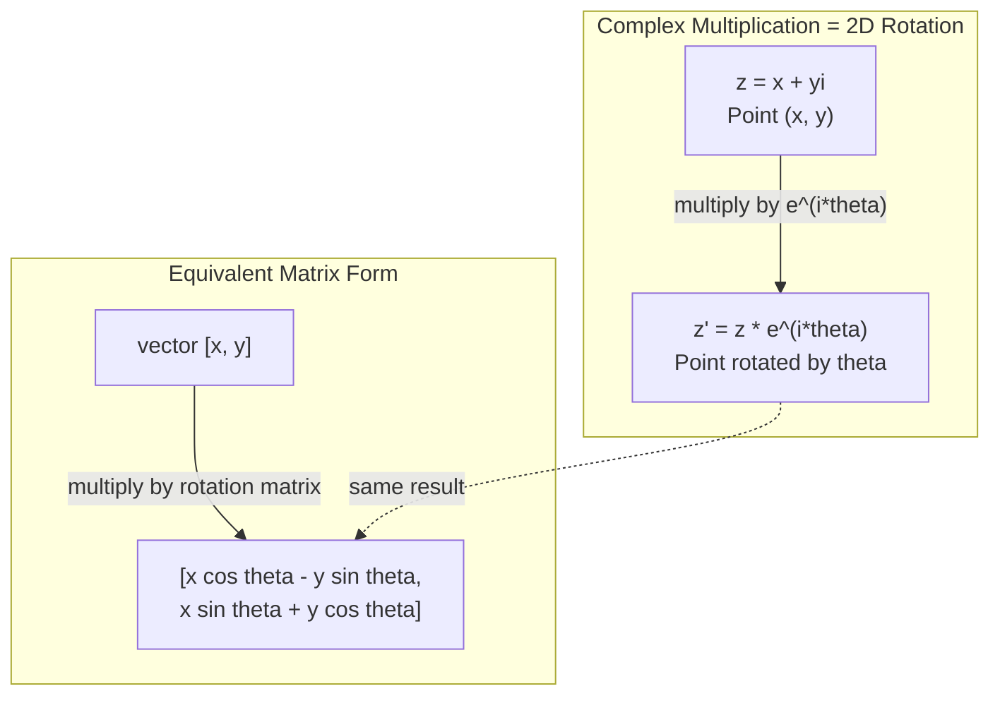
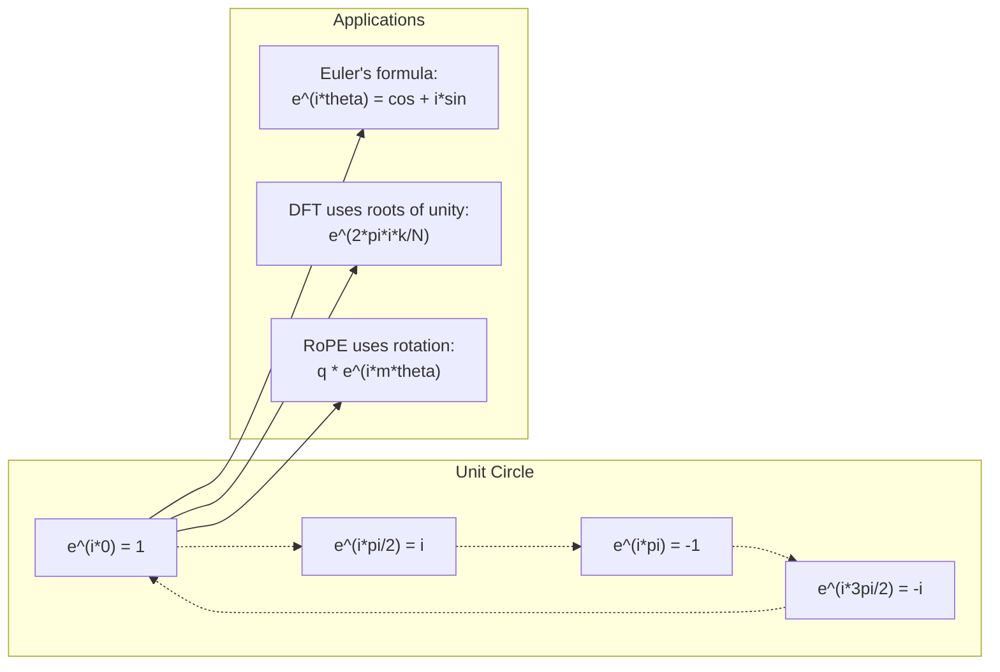

# Комплексные числа для AI

> Корень квадратный из -1 — это не воображение. Это ключ к поворотам, частотам и половине обработки сигналов.

**Type:** Learn
**Language:** Python
**Prerequisites:** Phase 1, Lessons 01-04 (linear algebra, calculus)
**Time:** ~60 minutes

## Learning Objectives

- Perform complex arithmetic (add, multiply, divide, conjugate) in both rectangular and polar form
- Apply Euler's formula to convert between complex exponentials and trigonometric functions
- Implement the Discrete Fourier Transform using complex roots of unity
- Explain how complex rotations underlie RoPE and sinusoidal positional encodings in transformers

## The Problem

Вы открываете статью про преобразование Фурье и везде видите `i`. Вы смотрите на позиционные кодировки в трансформерах и видите `sin` и `cos` на разных частотах — действительную и мнимую части комплексных экспонент. Вы читаете про квантовые вычисления и обнаруживаете, что всё выражено в комплексных векторных пространствах.

Комплексные числа выглядят абстрактными. Система чисел, построенная на квадратном корне из -1, кажется математическим трюком. Но это не трюк. Это естественный язык поворотов и колебаний. Каждый раз, когда что-то вращается, вибрирует или колеблется, комплексные числа — это правильный инструмент.

Без понимания комплексных чисел вы не можете понять дискретное преобразование Фурье. Вы не можете понять FFT. Вы не можете понять, как работает RoPE (Rotary Position Embedding) в современных языковых моделях. Вы не можете понять, почему синусоидальные позиционные кодировки в оригинальной статье про Transformer используют именно эти частоты.

Этот урок строит комплексную арифметику с нуля, связывает её с геометрией и показывает вам, где именно комплексные числа появляются в машинном обучении.

## The Concept

### What is a complex number?

Комплексное число состоит из двух частей: действительной части и мнимой части.

```
z = a + bi

where:
  a is the real part
  b is the imaginary part
  i is the imaginary unit, defined by i^2 = -1
```

Вот и всё. Вы расширяете числовую линию в плоскость. Действительные числа сидят на одной оси. Мнимые числа сидят на другой. Каждое комплексное число — это точка в этой плоскости.

### Complex arithmetic

**Сложение.** Сложите действительные части вместе, сложите мнимые части вместе.

```
(a + bi) + (c + di) = (a + c) + (b + d)i

Example: (3 + 2i) + (1 + 4i) = 4 + 6i
```

**Умножение.** Используйте распределительный закон и помните, что i^2 = -1.

```
(a + bi)(c + di) = ac + adi + bci + bdi^2
                 = ac + adi + bci - bd
                 = (ac - bd) + (ad + bc)i

Example: (3 + 2i)(1 + 4i) = 3 + 12i + 2i + 8i^2
                            = 3 + 14i - 8
                            = -5 + 14i
```

**Сопряжённое.** Измените знак мнимой части.

```
conjugate of (a + bi) = a - bi
```

Произведение комплексного числа и его сопряжённого всегда действительно:

```
(a + bi)(a - bi) = a^2 + b^2
```

**Деление.** Умножьте числитель и знаменатель на сопряжённое значение знаменателя.

```
(a + bi) / (c + di) = (a + bi)(c - di) / (c^2 + d^2)
```

Это исключает мнимую часть из знаменателя, давая вам чистое комплексное число.

### The complex plane

Комплексная плоскость отображает каждое комплексное число в точку 2D. Горизонтальная ось — это действительная ось, вертикальная ось — это мнимая ось.

```
z = 3 + 2i  corresponds to the point (3, 2)
z = -1 + 0i corresponds to the point (-1, 0) on the real axis
z = 0 + 4i  corresponds to the point (0, 4) on the imaginary axis
```

Комплексное число одновременно является точкой и вектором из начала координат. Эта двойственная интерпретация — вот что делает комплексные числа полезными для геометрии.

### Polar form

Любую точку на плоскости можно описать её расстоянием от начала координат и углом от положительной действительной оси.

```
z = r * (cos(theta) + i*sin(theta))

where:
  r = |z| = sqrt(a^2 + b^2)     (magnitude, or modulus)
  theta = atan2(b, a)             (phase, or argument)
```

Прямоугольная форма (a + bi) хороша для сложения. Полярная форма (r, theta) хороша для умножения.

**Умножение в полярной форме.** Умножьте величины, сложите углы.

```
z1 = r1 * e^(i*theta1)
z2 = r2 * e^(i*theta2)

z1 * z2 = (r1 * r2) * e^(i*(theta1 + theta2))
```

Вот почему комплексные числа идеальны для поворотов. Умножение на комплексное число с величиной 1 — это чистый поворот.

### Euler's formula

Мост между комплексными экспонентами и тригонометрией:

```
e^(i*theta) = cos(theta) + i*sin(theta)
```

Это самая важная формула в этом уроке. Когда theta = pi:

```
e^(i*pi) = cos(pi) + i*sin(pi) = -1 + 0i = -1

Therefore: e^(i*pi) + 1 = 0
```

Пять фундаментальных констант (e, i, pi, 1, 0) связаны в одном уравнении.

### Why Euler's formula matters for ML

Формула Эйлера говорит, что `e^(i*theta)` прочерчивает единичный круг при изменении theta. При theta = 0 вы находитесь в (1, 0). При theta = pi/2 вы находитесь в (0, 1). При theta = pi вы находитесь в (-1, 0). При theta = 3*pi/2 вы находитесь в (0, -1). Полный оборот — это theta = 2*pi.

Это означает, что комплексные экспоненты — это поворoты. И повороты везде в обработке сигналов и ML.

### Connection to 2D rotations

Умножение комплексного числа (x + yi) на e^(i*theta) поворачивает точку (x, y) на угол theta вокруг начала координат.

```
Rotation via complex multiplication:
  (x + yi) * (cos(theta) + i*sin(theta))
  = (x*cos(theta) - y*sin(theta)) + (x*sin(theta) + y*cos(theta))i

Rotation via matrix multiplication:
  [cos(theta)  -sin(theta)] [x]   [x*cos(theta) - y*sin(theta)]
  [sin(theta)   cos(theta)] [y] = [x*sin(theta) + y*cos(theta)]
```

Они производят идентичные результаты. Комплексное умножение — это 2D поворот. Матрица поворота — это просто комплексное умножение, записанное в матричной нотации.



### Phasors and rotating signals

Комплексная экспонента e^(i*omega*t) — это точка, вращающаяся вокруг единичного круга с угловой частотой omega. По мере увеличения t точка прочерчивает круг.

Действительная часть этой вращающейся точки — это cos(omega*t). Мнимая часть — это sin(omega*t). Синусоидальный сигнал — это тень вращающегося комплексного числа.

```
e^(i*omega*t) = cos(omega*t) + i*sin(omega*t)

Real part:      cos(omega*t)    -- a cosine wave
Imaginary part: sin(omega*t)    -- a sine wave
```

Это фазорное представление. Вместо отслеживания волнистой синусоиды вы отслеживаете гладко вращающуюся стрелку. Сдвиги фазы становятся смещениями угла. Изменения амплитуды становятся изменениями величины. Сложение сигналов становится сложением векторов.

### Roots of unity

N-й корни единицы — это N точек, равномерно распределённых на единичном круге:

```
w_k = e^(2*pi*i*k/N)    for k = 0, 1, 2, ..., N-1
```

Для N = 4 корни: 1, i, -1, -i (четыре стороны света).
Для N = 8 вы получаете четыре стороны света плюс четыре диагонали.

Корни единицы — это основание дискретного преобразования Фурье. DFT разлагает сигнал на компоненты в этих N равномерно распределённых частотах.

### Connection to the DFT

Дискретное преобразование Фурье сигнала x[0], x[1], ..., x[N-1]:

```
X[k] = sum_{n=0}^{N-1} x[n] * e^(-2*pi*i*k*n/N)
```

Каждый X[k] измеряет, насколько сигнал коррелирует с k-м корнем единицы — комплексной синусоидой на частоте k. DFT разбивает сигнал на N вращающихся фазоров и говорит вам амплитуду и фазу каждого.

### Why i is not imaginary

Слово "мнимый" — это исторический несчастный случай. Декарт использовал его пренебрежительно. Но i ничуть не более мнимая, чем отрицательные числа, когда люди впервые их отвергали. Отрицательные числа отвечают на "что вы вычитаете из 3, чтобы получить 5?" Мнимая единица отвечает на "что вы возводите в квадрат, чтобы получить -1?"

Более полезно: i — это оператор поворота на 90 градусов. Умножьте действительное число на i один раз, вы поворачиваетесь на 90 градусов к мнимой оси. Умножьте на i снова (i^2), вы поворачиваетесь ещё на 90 градусов — теперь вы указываете в отрицательном действительном направлении. Вот почему i^2 = -1. Это не таинственно. Это полу-оборот, построенный из двух четвертных оборотов.

Вот почему комплексные числа везде в инженерии. Всё, что вращается — электромагнитные волны, квантовые состояния, колебания сигналов, позиционные кодировки — естественно описывается комплексными числами.

### Complex exponentials vs trigonometric functions

До формулы Эйлера инженеры писали сигналы как A*cos(omega*t + phi) — амплитуда A, частота omega, фаза phi. Это работает, но делает арифметику болезненной. Сложение двух косинусов с разными фазами требует тригонометрических тождеств.

С комплексными экспонентами тот же сигнал — это A*e^(i*(omega*t + phi)). Сложение двух сигналов — это просто сложение двух комплексных чисел. Умножение (модуляция) — это просто умножение величин и сложение углов. Сдвиги фазы становятся добавлениями углов. Сдвиги частоты становятся умножениями на фазоры.

Вся область обработки сигналов переключилась на комплексную экспоненциальную нотацию, потому что математика чище. "Действительный сигнал" — это всегда просто действительная часть комплексного представления. Мнимая часть переносится как ведение записей, делая всю алгебру естественно корректной.

### Connection to transformers

**Синусоидальные позиционные кодировки** (оригинальная статья про Transformer):

```
PE(pos, 2i) = sin(pos / 10000^(2i/d))
PE(pos, 2i+1) = cos(pos / 10000^(2i/d))
```

Пары син и кос — это действительная и мнимая части комплексных экспонент на разных частотах. Каждая частота обеспечивает разное "разрешение" для кодирования позиции. Низкие частоты меняются медленно (грубая позиция). Высокие частоты меняются быстро (мелкая позиция). Вместе они дают каждой позиции уникальный частотный отпечаток.

**RoPE (Rotary Position Embedding)** идёт дальше. Он явно умножает векторы запроса и ключа на матрицы комплексных поворотов. Относительная позиция между двумя токенами становится углом поворота. Внимание вычисляется с использованием этих повёрнутых векторов, делая модель чувствительной к относительной позиции через комплексное умножение.

| Operation | Algebraic Form | Geometric Meaning |
|-----------|---------------|-------------------|
| Addition | (a+c) + (b+d)i | Vector addition in the plane |
| Multiplication | (ac-bd) + (ad+bc)i | Rotate and scale |
| Conjugate | a - bi | Reflect over real axis |
| Magnitude | sqrt(a^2 + b^2) | Distance from origin |
| Phase | atan2(b, a) | Angle from positive real axis |
| Division | multiply by conjugate | Reverse rotation and rescale |
| Power | r^n * e^(i*n*theta) | Rotate n times, scale by r^n |



```figure
roots-of-unity
```

## Build It

### Step 1: Complex class

Постройте класс Complex number, поддерживающий арифметику, величину, фазу и преобразование между прямоугольной и полярной формами.

```python
import math

class Complex:
    def __init__(self, real, imag=0.0):
        self.real = real
        self.imag = imag

    def __add__(self, other):
        return Complex(self.real + other.real, self.imag + other.imag)

    def __mul__(self, other):
        r = self.real * other.real - self.imag * other.imag
        i = self.real * other.imag + self.imag * other.real
        return Complex(r, i)

    def __truediv__(self, other):
        denom = other.real ** 2 + other.imag ** 2
        r = (self.real * other.real + self.imag * other.imag) / denom
        i = (self.imag * other.real - self.real * other.imag) / denom
        return Complex(r, i)

    def magnitude(self):
        return math.sqrt(self.real ** 2 + self.imag ** 2)

    def phase(self):
        return math.atan2(self.imag, self.real)

    def conjugate(self):
        return Complex(self.real, -self.imag)
```

### Step 2: Polar conversion and Euler's formula

```python
def to_polar(z):
    return z.magnitude(), z.phase()

def from_polar(r, theta):
    return Complex(r * math.cos(theta), r * math.sin(theta))

def euler(theta):
    return Complex(math.cos(theta), math.sin(theta))
```

Проверьте: `euler(theta).magnitude()` должно быть всегда 1.0. `euler(0)` должно дать (1, 0). `euler(pi)` должно дать (-1, 0).

### Step 3: Rotation

Поворот точки (x, y) на угол theta — это одно комплексное умножение:

```python
point = Complex(3, 4)
rotated = point * euler(math.pi / 4)
```

Величина остаётся такой же. Меняется только угол.

### Step 4: DFT from complex arithmetic

```python
def dft(signal):
    N = len(signal)
    result = []
    for k in range(N):
        total = Complex(0, 0)
        for n in range(N):
            angle = -2 * math.pi * k * n / N
            total = total + Complex(signal[n], 0) * euler(angle)
        result.append(total)
    return result
```

Это DFT O(N^2). Каждый выход X[k] — это сумма образцов сигнала, умноженных на корни единицы.

### Step 5: Inverse DFT

Обратное DFT восстанавливает исходный сигнал из его спектра. Единственные изменения от прямого DFT: переверните знак в показателе степени и разделите на N.

```python
def idft(spectrum):
    N = len(spectrum)
    result = []
    for n in range(N):
        total = Complex(0, 0)
        for k in range(N):
            angle = 2 * math.pi * k * n / N
            total = total + spectrum[k] * euler(angle)
        result.append(Complex(total.real / N, total.imag / N))
    return result
```

Это даёт вам совершенную реконструкцию. Примените DFT, затем IDFT, и вы получите исходный сигнал с точностью до машинного нуля. Информация не теряется.

### Step 6: Roots of unity

```python
def roots_of_unity(N):
    return [euler(2 * math.pi * k / N) for k in range(N)]
```

Проверьте два свойства:
- Каждый корень имеет величину ровно 1.
- Сумма всех N корней равна нулю (они компенсируют друг друга по симметрии).

Эти свойства — вот что делает DFT обратимым. Корни единицы образуют ортогональный базис для частотной области.

## Use It

В Python есть встроенная поддержка комплексных чисел. Литерал `j` представляет мнимую единицу.

```python
z = 3 + 2j
w = 1 + 4j

print(z + w)
print(z * w)
print(abs(z))

import cmath
print(cmath.phase(z))
print(cmath.exp(1j * cmath.pi))
```

Для массивов numpy обрабатывает комплексные числа естественно:

```python
import numpy as np

z = np.array([1+2j, 3+4j, 5+6j])
print(np.abs(z))
print(np.angle(z))
print(np.conj(z))
print(np.real(z))
print(np.imag(z))

signal = np.sin(2 * np.pi * 5 * np.linspace(0, 1, 128))
spectrum = np.fft.fft(signal)
freqs = np.fft.fftfreq(128, d=1/128)
```

## Ship It

Запустите `code/complex_numbers.py`, чтобы генерировать `outputs/skill-complex-arithmetic.md`.

## Exercises

1. **Комплексная арифметика вручную.** Вычислите (2 + 3i) * (4 - i) и проверьте с кодом. Затем вычислите (5 + 2i) / (1 - 3i). Нарисуйте оба результата на комплексной плоскости и проверьте, что умножение повернуло и масштабировало первое число.

2. **Последовательность поворотов.** Начните с точки (1, 0). Умножайте на e^(i*pi/6) двенадцать раз. Проверьте, что вы вернулись к (1, 0) после 12 умножений. Выведите координаты на каждом шаге и подтвердите, что они прочерчивают правильный 12-угольник.

3. **DFT известного сигнала.** Создайте сигнал, который является суммой sin(2*pi*3*t) и 0.5*sin(2*pi*7*t), выбранный в 32 точках. Запустите ваш DFT. Проверьте, что спектр величины имеет пики на частотах 3 и 7, с пиком на 7 в половину высоты пика на 3.

4. **Визуализация корней единицы.** Вычислите 8-е корни единицы. Проверьте, что они суммируются в ноль. Проверьте, что умножение любого корня на примитивный корень e^(2*pi*i/8) даёт следующий корень.

5. **Эквивалентность матрицы поворота.** Для 10 случайных углов и 10 случайных точек проверьте, что комплексное умножение даёт тот же результат, что и умножение матрица-вектор с матрицей поворота 2x2. Выведите максимальную численную разницу.

## Key Terms

| Term | What it means |
|------|---------------|
| Complex number | Число a + bi, где a — действительная часть, b — мнимая часть, и i^2 = -1 |
| Imaginary unit | Число i, определённое как i^2 = -1. Не мнимое в философском смысле — это оператор поворота |
| Complex plane | 2D плоскость, где ось x — действительная и ось y — мнимая. Также называется плоскость Аргана |
| Magnitude (modulus) | Расстояние от начала координат: sqrt(a^2 + b^2). Записывается как \|z\| |
| Phase (argument) | Угол от положительной действительной оси: atan2(b, a). Записывается как arg(z) |
| Conjugate | Зеркальное изображение через действительную ось: сопряжённое a + bi — это a - bi |
| Polar form | Выражение z как r * e^(i*theta) вместо a + bi. Упрощает умножение |
| Euler's formula | e^(i*theta) = cos(theta) + i*sin(theta). Связывает экспоненты с тригонометрией |
| Phasor | Вращающееся комплексное число e^(i*omega*t), представляющее синусоидальный сигнал |
| Roots of unity | N комплексных чисел e^(2*pi*i*k/N) для k = 0 до N-1. N равномерно распределённых точек на единичном круге |
| DFT | Дискретное преобразование Фурье. Разлагает сигнал на комплексные синусоидальные компоненты, используя корни единицы |
| RoPE | Rotary Position Embedding. Использует комплексное умножение для кодирования относительной позиции в трансформер-внимании |

## Further Reading

- [Visual Introduction to Euler's Formula](https://betterexplained.com/articles/intuitive-understanding-of-eulers-formula/) - builds geometric intuition without heavy notation
- [Su et al.: RoFormer (2021)](https://arxiv.org/abs/2104.09864) - the paper introducing Rotary Position Embedding using complex rotations
- [Vaswani et al.: Attention Is All You Need (2017)](https://arxiv.org/abs/1706.03762) - the original Transformer paper with sinusoidal positional encodings
- [3Blue1Brown: Euler's formula with introductory group theory](https://www.youtube.com/watch?v=mvmuCPvRoWQ) - visual explanation of why e^(i*pi) = -1
- [Needham: Visual Complex Analysis](https://global.oup.com/academic/product/visual-complex-analysis-9780198534464) - the best visual treatment of complex numbers, full of geometric insight
- [Strang: Introduction to Linear Algebra, Ch. 10](https://math.mit.edu/~gs/linearalgebra/) - complex numbers in the context of linear algebra and eigenvalues