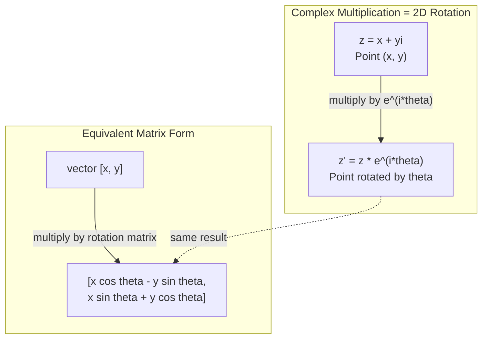
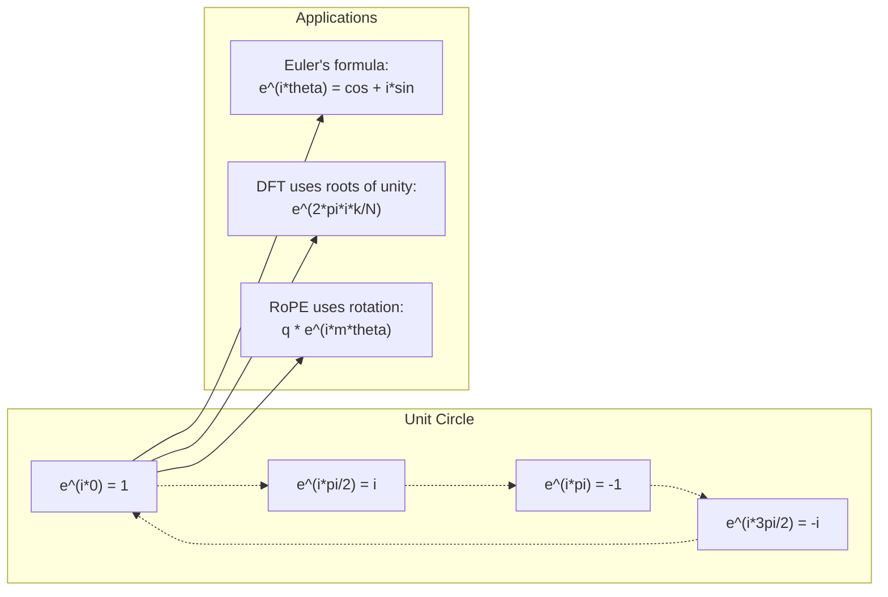

# Комплексные числа для ИИ

> Квадратный корень из -1 не мнимый. Это ключ к вращениям, частотам и половине теории обработки сигналов.

**Type:** Learn
**Language:** Python
**Prerequisites:** Фаза 1, Уроки 01-04 (линейная алгебра, матанализ)
**Time:** ~60 минут

## Учебные цели

- Выполнять арифметические операции с комплексными числами (сложение, умножение, деление, сопряжение) как в прямоугольной, так и в полярной форме
- Применять формулу Эйлера для перехода между комплексными экспонентами и тригонометрическими функциями
- Реализовать дискретное преобразование Фурье с использованием комплексных корней из единицы
- Объяснить, как комплексные вращения лежат в основе RoPE и синусоидальных позиционных кодировок в трансформерах

## Проблема

Вы открываете статью о преобразованиях Фурье, и там повсюду `i`. Вы смотрите на позиционные кодировки трансформеров и видите `sin` и `cos` на разных частотах -- действительную и мнимую части комплексных экспонент. Вы читаете о квантовых вычислениях и обнаруживаете, что всё выражено в комплексных векторных пространствах.

Комплексные числа кажутся абстракцией. Числовая система, построенная на квадратном корне из -1, ощущается как математический трюк. Но это не трюк. Это естественный язык вращений и колебаний. Каждый раз, когда что-то вращается, вибрирует или колеблется, комплексные числа оказываются правильным инструментом.

Без понимания комплексных чисел вы не сможете понять дискретное преобразование Фурье. Вы не сможете понять FFT. Вы не сможете понять, как работает RoPE (Rotary Position Embedding) в современных языковых моделях. Вы не сможете понять, почему синусоидальные позиционные кодировки в оригинальной статье о Transformer используют именно такие частоты.

Этот урок строит арифметику комплексных чисел с нуля, связывает её с геометрией и показывает, где именно комплексные числа встречаются в машинном обучении.

## Концепция

### Что такое комплексное число?

Комплексное число состоит из двух частей: действительной и мнимой.

```
z = a + bi

where:
  a is the real part
  b is the imaginary part
  i is the imaginary unit, defined by i^2 = -1
```

Вот и всё. Вы расширяете числовую прямую до плоскости. Действительные числа лежат на одной оси. Мнимые числа -- на другой. Каждое комплексное число -- это точка на этой плоскости.

### Арифметика комплексных чисел

**Сложение.** Сложите действительные части между собой, сложите мнимые части между собой.

```
(a + bi) + (c + di) = (a + c) + (b + d)i

Example: (3 + 2i) + (1 + 4i) = 4 + 6i
```

**Умножение.** Используйте распределительный закон и помните, что i^2 = -1.

```
(a + bi)(c + di) = ac + adi + bci + bdi^2
                 = ac + adi + bci - bd
                 = (ac - bd) + (ad + bc)i

Example: (3 + 2i)(1 + 4i) = 3 + 12i + 2i + 8i^2
                            = 3 + 14i - 8
                            = -5 + 14i
```

**Сопряжение.** Измените знак мнимой части на противоположный.

```
conjugate of (a + bi) = a - bi
```

Произведение комплексного числа на его сопряжённое всегда действительно:

```
(a + bi)(a - bi) = a^2 + b^2
```

**Деление.** Умножьте числитель и знаменатель на сопряжённое знаменателя.

```
(a + bi) / (c + di) = (a + bi)(c - di) / (c^2 + d^2)
```

Это устраняет мнимую часть из знаменателя, давая вам чистое комплексное число.

### Комплексная плоскость

Комплексная плоскость сопоставляет каждому комплексному числу точку на плоскости 2D. Горизонтальная ось -- действительная, вертикальная -- мнимая.

```
z = 3 + 2i  corresponds to the point (3, 2)
z = -1 + 0i corresponds to the point (-1, 0) on the real axis
z = 0 + 4i  corresponds to the point (0, 4) on the imaginary axis
```

Комплексное число одновременно является и точкой, и вектором из начала координат. Именно эта двойственная интерпретация делает комплексные числа полезными для геометрии.

### Полярная форма

Любую точку на плоскости можно описать расстоянием от начала координат и углом относительно положительной действительной оси.

```
z = r * (cos(theta) + i*sin(theta))

where:
  r = |z| = sqrt(a^2 + b^2)     (magnitude, or modulus)
  theta = atan2(b, a)             (phase, or argument)
```

Прямоугольная форма (a + bi) удобна для сложения. Полярная форма (r, theta) удобна для умножения.

**Умножение в полярной форме.** Умножьте модули, сложите углы.

```
z1 = r1 * e^(i*theta1)
z2 = r2 * e^(i*theta2)

z1 * z2 = (r1 * r2) * e^(i*(theta1 + theta2))
```

Именно поэтому комплексные числа идеально подходят для вращений. Умножение на комплексное число с модулем 1 -- это чистое вращение.

### Формула Эйлера

Мост между комплексными экспонентами и тригонометрией:

```
e^(i*theta) = cos(theta) + i*sin(theta)
```

Это самая важная формула этого урока. При theta = pi:

```
e^(i*pi) = cos(pi) + i*sin(pi) = -1 + 0i = -1

Therefore: e^(i*pi) + 1 = 0
```

Пять фундаментальных констант (e, i, pi, 1, 0), связанных в одном уравнении.

### Почему формула Эйлера важна для МО

Формула Эйлера утверждает, что `e^(i*theta)` описывает единичную окружность по мере изменения theta. При theta = 0 вы находитесь в точке (1, 0). При theta = pi/2 вы в точке (0, 1). При theta = pi вы в точке (-1, 0). При theta = 3*pi/2 вы в точке (0, -1). Полный оборот -- это theta = 2*pi.

Это означает, что комплексные экспоненты ЯВЛЯЮТСЯ вращениями. А вращения повсюду в обработке сигналов и МО.

### Связь с 2D-вращениями

Умножение комплексного числа (x + yi) на e^(i*theta) поворачивает точку (x, y) на угол theta вокруг начала координат.

```
Rotation via complex multiplication:
  (x + yi) * (cos(theta) + i*sin(theta))
  = (x*cos(theta) - y*sin(theta)) + (x*sin(theta) + y*cos(theta))i

Rotation via matrix multiplication:
  [cos(theta)  -sin(theta)] [x]   [x*cos(theta) - y*sin(theta)]
  [sin(theta)   cos(theta)] [y] = [x*sin(theta) + y*cos(theta)]
```

Они дают идентичные результаты. Комплексное умножение ЕСТЬ двумерное вращение. Матрица вращения -- это просто комплексное умножение, записанное в матричной нотации.



### Фазоры и вращающиеся сигналы

Комплексная экспонента e^(i*omega*t) -- это точка, вращающаяся по единичной окружности с угловой частотой omega. По мере увеличения t точка описывает окружность.

Действительная часть этой вращающейся точки -- это cos(omega*t). Мнимая часть -- sin(omega*t). Синусоидальный сигнал -- это тень вращающегося комплексного числа.

```
e^(i*omega*t) = cos(omega*t) + i*sin(omega*t)

Real part:      cos(omega*t)    -- a cosine wave
Imaginary part: sin(omega*t)    -- a sine wave
```

Это фазорное представление. Вместо отслеживания изгибающейся синусоиды вы отслеживаете плавно вращающуюся стрелку. Фазовые сдвиги становятся смещениями угла. Изменения амплитуды становятся изменениями модуля. Сложение сигналов становится сложением векторов.

### Корни из единицы

N-е корни из единицы -- это N точек, равномерно распределённых по единичной окружности:

```
w_k = e^(2*pi*i*k/N)    for k = 0, 1, 2, ..., N-1
```

Для N = 4 корни: 1, i, -1, -i (четыре стороны света).
Для N = 8 вы получаете четыре стороны света плюс четыре диагонали.

Корни из единицы -- основа дискретного преобразования Фурье. ДПФ раскладывает сигнал на составляющие на этих N равномерно распределённых частотах.

### Связь с ДПФ

Дискретное преобразование Фурье сигнала x[0], x[1], ..., x[N-1]:

```
X[k] = sum_{n=0}^{N-1} x[n] * e^(-2*pi*i*k*n/N)
```

Каждое X[k] измеряет, насколько сигнал коррелирует с k-м корнем из единицы -- комплексной синусоидой на частоте k. ДПФ разбивает сигнал на N вращающихся фазоров и сообщает амплитуду и фазу каждого из них.

### Почему i не является мнимым

Слово "мнимый" -- историческая случайность. Декарт использовал его пренебрежительно. Но i не более "мнимое", чем отрицательные числа были в те времена, когда их впервые отвергали. Отрицательные числа отвечают на вопрос "что нужно вычесть из 3, чтобы получить 5 с минусом?" Мнимая единица отвечает на вопрос "что нужно возвести в квадрат, чтобы получить -1?"

Более полезная трактовка: i -- это оператор поворота на 90 градусов. Умножьте действительное число на i один раз -- вы повернётесь на 90 градусов к мнимой оси. Умножьте на i ещё раз (i^2) -- вы повернётесь ещё на 90 градусов -- теперь вы направлены в сторону отрицательных действительных чисел. Вот почему i^2 = -1. В этом нет никакой тайны. Это полуоборот, составленный из двух четвертьоборотов.

Именно поэтому комплексные числа повсеместны в инженерии. Всё, что вращается -- электромагнитные волны, квантовые состояния, колебания сигналов, позиционные кодировки -- естественным образом описывается комплексными числами.

### Комплексные экспоненты против тригонометрических функций

До формулы Эйлера инженеры записывали сигналы как A*cos(omega*t + phi) -- амплитуда A, частота omega, фаза phi. Это работает, но делает арифметику мучительной. Сложение двух косинусов с разными фазами требует тригонометрических тождеств.

С комплексными экспонентами тот же сигнал -- это A*e^(i*(omega*t + phi)). Сложение двух сигналов -- это просто сложение двух комплексных чисел. Умножение (модуляция) -- это просто умножение модулей и сложение углов. Фазовые сдвиги становятся сложением углов. Сдвиги частоты становятся умножениями на фазоры.

Вся область обработки сигналов перешла на нотацию комплексных экспонент, потому что математика получается чище. "Реальный сигнал" -- это всегда просто действительная часть комплексного представления. Мнимая часть переносится как вспомогательная величина, заставляя всю алгебру работать естественным образом.

### Связь с трансформерами

**Синусоидальные позиционные кодировки** (оригинальная статья о Transformer):

```
PE(pos, 2i) = sin(pos / 10000^(2i/d))
PE(pos, 2i+1) = cos(pos / 10000^(2i/d))
```

Пары sin и cos -- это действительная и мнимая части комплексных экспонент на разных частотах. Каждая частота даёт своё "разрешение" для кодирования позиции. Низкие частоты меняются медленно (грубая позиция). Высокие частоты меняются быстро (точная позиция). Вместе они дают каждой позиции уникальный частотный отпечаток.

**RoPE (Rotary Position Embedding)** развивает эту идею дальше. Он явно умножает векторы запросов и ключей на комплексные матрицы вращения. Относительная позиция между двумя токенами становится углом поворота. Attention вычисляется с использованием этих повёрнутых векторов, делая модель чувствительной к относительной позиции через комплексное умножение.

| Операция | Алгебраическая форма | Геометрический смысл |
|-----------|---------------|-------------------|
| Сложение | (a+c) + (b+d)i | Сложение векторов на плоскости |
| Умножение | (ac-bd) + (ad+bc)i | Поворот и масштабирование |
| Сопряжение | a - bi | Отражение относительно действительной оси |
| Модуль | sqrt(a^2 + b^2) | Расстояние от начала координат |
| Фаза | atan2(b, a) | Угол относительно положительной действительной оси |
| Деление | умножение на сопряжённое | Обратный поворот и перемасштабирование |
| Степень | r^n * e^(i*n*theta) | Поворот n раз, масштабирование на r^n |



```figure
roots-of-unity
```

## Реализация

### Шаг 1: Класс Complex

Постройте класс комплексных чисел, который поддерживает арифметику, модуль, фазу и преобразование между прямоугольной и полярной формами.

```python
import math

class Complex:
    def __init__(self, real, imag=0.0):
        self.real = real
        self.imag = imag

    def __add__(self, other):
        return Complex(self.real + other.real, self.imag + other.imag)

    def __mul__(self, other):
        r = self.real * other.real - self.imag * other.imag
        i = self.real * other.imag + self.imag * other.real
        return Complex(r, i)

    def __truediv__(self, other):
        denom = other.real ** 2 + other.imag ** 2
        r = (self.real * other.real + self.imag * other.imag) / denom
        i = (self.imag * other.real - self.real * other.imag) / denom
        return Complex(r, i)

    def magnitude(self):
        return math.sqrt(self.real ** 2 + self.imag ** 2)

    def phase(self):
        return math.atan2(self.imag, self.real)

    def conjugate(self):
        return Complex(self.real, -self.imag)
```

### Шаг 2: Преобразование в полярную форму и формула Эйлера

```python
def to_polar(z):
    return z.magnitude(), z.phase()

def from_polar(r, theta):
    return Complex(r * math.cos(theta), r * math.sin(theta))

def euler(theta):
    return Complex(math.cos(theta), math.sin(theta))
```

Проверка: `euler(theta).magnitude()` всегда должно быть равно 1.0. `euler(0)` должно давать (1, 0). `euler(pi)` должно давать (-1, 0).

### Шаг 3: Вращение

Поворот точки (x, y) на угол theta -- это одно комплексное умножение:

```python
point = Complex(3, 4)
rotated = point * euler(math.pi / 4)
```

Модуль остаётся прежним. Меняется только угол.

### Шаг 4: ДПФ из комплексной арифметики

```python
def dft(signal):
    N = len(signal)
    result = []
    for k in range(N):
        total = Complex(0, 0)
        for n in range(N):
            angle = -2 * math.pi * k * n / N
            total = total + Complex(signal[n], 0) * euler(angle)
        result.append(total)
    return result
```

Это ДПФ со сложностью O(N^2). Каждый выходной элемент X[k] -- это сумма отсчётов сигнала, умноженных на корни из единицы.

### Шаг 5: Обратное ДПФ

Обратное ДПФ восстанавливает исходный сигнал по его спектру. Единственные изменения относительно прямого ДПФ: смена знака в показателе степени и деление на N.

```python
def idft(spectrum):
    N = len(spectrum)
    result = []
    for n in range(N):
        total = Complex(0, 0)
        for k in range(N):
            angle = 2 * math.pi * k * n / N
            total = total + spectrum[k] * euler(angle)
        result.append(Complex(total.real / N, total.imag / N))
    return result
```

Это даёт идеальное восстановление. Примените ДПФ, затем обратное ДПФ, и вы получите исходный сигнал с точностью до машинной погрешности. Информация не теряется.

### Шаг 6: Корни из единицы

```python
def roots_of_unity(N):
    return [euler(2 * math.pi * k / N) for k in range(N)]
```

Проверьте два свойства:
- Каждый корень имеет модуль ровно 1.
- Сумма всех N корней равна нулю (они взаимно уничтожаются по симметрии).

Эти свойства и делают ДПФ обратимым. Корни из единицы образуют ортогональный базис для частотной области.

## Применение

В Python есть встроенная поддержка комплексных чисел. Литерал `j` представляет мнимую единицу.

```python
z = 3 + 2j
w = 1 + 4j

print(z + w)
print(z * w)
print(abs(z))

import cmath
print(cmath.phase(z))
print(cmath.exp(1j * cmath.pi))
```

Для массивов numpy поддерживает комплексные числа нативно:

```python
import numpy as np

z = np.array([1+2j, 3+4j, 5+6j])
print(np.abs(z))
print(np.angle(z))
print(np.conj(z))
print(np.real(z))
print(np.imag(z))

signal = np.sin(2 * np.pi * 5 * np.linspace(0, 1, 128))
spectrum = np.fft.fft(signal)
freqs = np.fft.fftfreq(128, d=1/128)
```

## Сдача работы

Запустите `code/complex_numbers.py`, чтобы сгенерировать `outputs/skill-complex-arithmetic.md`.

## Упражнения

1. **Арифметика комплексных чисел вручную.** Вычислите (2 + 3i) * (4 - i) и проверьте результат с помощью кода. Затем вычислите (5 + 2i) / (1 - 3i). Изобразите оба результата на комплексной плоскости и проверьте, что умножение повернуло и масштабировало первое число.

2. **Последовательность вращений.** Начните с точки (1, 0). Умножьте на e^(i*pi/6) двенадцать раз. Убедитесь, что вы возвращаетесь в (1, 0) после 12 умножений. Выведите координаты на каждом шаге и убедитесь, что они описывают правильный 12-угольник.

3. **ДПФ известного сигнала.** Создайте сигнал, являющийся суммой sin(2*pi*3*t) и 0.5*sin(2*pi*7*t), дискретизированный в 32 точках. Выполните своё ДПФ. Убедитесь, что спектр модулей имеет пики на частотах 3 и 7, причём пик на частоте 7 вдвое меньше по высоте пика на частоте 3.

4. **Визуализация корней из единицы.** Вычислите 8-е корни из единицы. Убедитесь, что их сумма равна нулю. Убедитесь, что умножение любого корня на примитивный корень e^(2*pi*i/8) даёт следующий корень.

5. **Эквивалентность матрицы вращения.** Для 10 случайных углов и 10 случайных точек убедитесь, что комплексное умножение даёт тот же результат, что и умножение матрицы на вектор с использованием матрицы вращения 2x2. Выведите максимальную численную разницу.

## Ключевые термины

| Термин | Что это значит |
|------|---------------|
| Комплексное число | Число a + bi, где a -- действительная часть, b -- мнимая часть, и i^2 = -1 |
| Мнимая единица | Число i, определяемое как i^2 = -1. Не мнимое в философском смысле -- это оператор вращения |
| Комплексная плоскость | Двумерная плоскость, где ось x действительна, а ось y мнима. Также называется плоскостью Аргана |
| Модуль (абсолютная величина) | Расстояние от начала координат: sqrt(a^2 + b^2). Записывается как \|z\| |
| Фаза (аргумент) | Угол относительно положительной действительной оси: atan2(b, a). Записывается как arg(z) |
| Сопряжённое число | Зеркальное отражение относительно действительной оси: сопряжённое к a + bi -- это a - bi |
| Полярная форма | Представление z как r * e^(i*theta) вместо a + bi. Упрощает умножение |
| Формула Эйлера | e^(i*theta) = cos(theta) + i*sin(theta). Связывает экспоненты с тригонометрией |
| Фазор | Вращающееся комплексное число e^(i*omega*t), представляющее синусоидальный сигнал |
| Корни из единицы | N комплексных чисел e^(2*pi*i*k/N) для k = 0, ..., N-1. N равномерно распределённых точек на единичной окружности |
| ДПФ | Дискретное преобразование Фурье. Раскладывает сигнал на комплексные синусоидальные составляющие с использованием корней из единицы |
| RoPE | Rotary Position Embedding. Использует комплексное умножение для кодирования относительной позиции во внимании (attention) трансформера |

## Дополнительное чтение

- [Visual Introduction to Euler's Formula](https://betterexplained.com/articles/intuitive-understanding-of-eulers-formula/) -- выстраивает геометрическую интуицию без тяжёлых обозначений
- [Su et al.: RoFormer (2021)](https://arxiv.org/abs/2104.09864) -- статья, вводящая Rotary Position Embedding с использованием комплексных вращений
- [Vaswani et al.: Attention Is All You Need (2017)](https://arxiv.org/abs/1706.03762) -- оригинальная статья о Transformer с синусоидальными позиционными кодировками
- [3Blue1Brown: Euler's formula with introductory group theory](https://www.youtube.com/watch?v=mvmuCPvRoWQ) -- наглядное объяснение того, почему e^(i*pi) = -1
- [Needham: Visual Complex Analysis](https://global.oup.com/academic/product/visual-complex-analysis-9780198534464) -- лучшее наглядное изложение комплексных чисел, полное геометрических идей
- [Strang: Introduction to Linear Algebra, Ch. 10](https://math.mit.edu/~gs/linearalgebra/) -- комплексные числа в контексте линейной алгебры и собственных значений