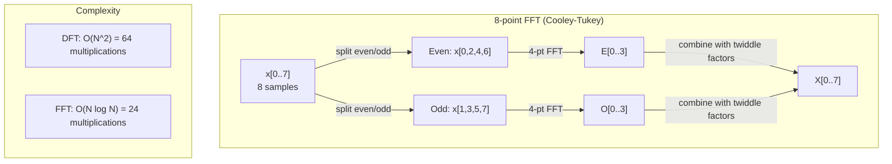
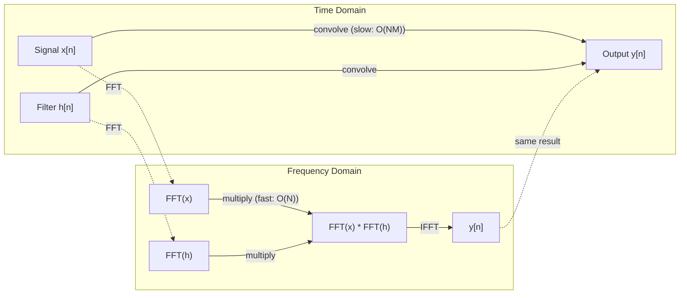

# Преобразование Фурье

> Каждый сигнал — это сумма синусоид. Преобразование Фурье говорит вам, какие именно.

**Type:** Build
**Language:** Python
**Prerequisites:** Phase 1, Lessons 01-04, 19 (complex numbers)
**Time:** ~90 minutes

## Learning Objectives

- Реализовать ДПФ с нуля и проверить его против O(N log N) быстрого преобразования Фурье Кули-Тьюки
- Интерпретировать коэффициенты частот: извлечение амплитуды, фазы и спектра мощности из сигнала
- Применить теорему свёртки для выполнения свёртки через умножение БПФ
- Связать частотное разложение Фурье с позиционным кодированием трансформеров и слоями свёртки CNN

## The Problem

Аудиозапись — это последовательность измерений давления во времени. Цена акции — это последовательность значений по дням. Изображение — это сетка интенсивностей пикселей в пространстве. Все это данные во временной области (или пространственной области). Вы видите значения, изменяющиеся по некоторому индексу.

Но многие паттерны невидимы во временной области. Является ли этот аудиосигнал чистым тоном или аккордом? Имеет ли эта цена акции еженедельный цикл? Имеет ли это изображение повторяющуюся текстуру? Эти вопросы касаются частотного содержимого, и временная область его скрывает.

Преобразование Фурье преобразует данные из временной области в частотную область. Оно разлагает сигнал на синусоиды разных частот. Каждая синусоида имеет амплитуду (насколько сильна) и фазу (откуда она начинается). Преобразование Фурье говорит вам обе.

Это важно для ML, потому что частотное мышление появляется везде. Свёрточные нейронные сети выполняют свёртку, которая является умножением в частотной области. Позиционные кодирования трансформеров используют частотное разложение для представления позиции. Модели обработки звука (распознавание речи, генерация музыки) работают со спектрограммами — частотными представлениями звука. Модели временных рядов ищут периодические паттерны. Понимание преобразования Фурье даёт вам словарь для работы со всеми этими.

## The Concept

### Определение ДПФ

Для N отсчётов x[0], x[1], ..., x[N-1] дискретное преобразование Фурье производит N коэффициентов частот X[0], X[1], ..., X[N-1]:

```
X[k] = sum_{n=0}^{N-1} x[n] * e^(-2*pi*i*k*n/N)

for k = 0, 1, ..., N-1
```

Каждое X[k] — это комплексное число. Его модуль |X[k]| показывает амплитуду частоты k. Его фазовый угол(X[k]) показывает смещение фазы этой частоты.

Ключевое понимание: `e^(-2*pi*i*k*n/N)` — это вращающийся фазор на частоте k. ДПФ вычисляет корреляцию между сигналом и каждой из N равномерно расположенных частот. Если сигнал содержит энергию на частоте k, корреляция большая. Если нет, она близка к нулю.

### Что означает каждый коэффициент

**X[0]: компонента постоянного тока.** Это сумма всех отсчётов — пропорциональна среднему. Она представляет постоянное (нулевой частоты) смещение сигнала.

```
X[0] = sum_{n=0}^{N-1} x[n] * e^0 = sum of all samples
```

**X[k] для 1 <= k <= N/2: положительные частоты.** X[k] представляет частоту k циклов на N отсчётов. Более высокое k означает более высокую частоту (более быструю осцилляцию).

**X[N/2]: частота Найквиста.** Максимальная частота, которую можно представить N отсчётами. Выше этой происходит наложение — высокие частоты маскируются под низкие.

**X[k] для N/2 < k < N: отрицательные частоты.** Для сигналов с действительными значениями X[N-k] = conj(X[k]). Отрицательные частоты являются зеркальными отображениями положительных. Вот почему полезная информация находится в первых N/2 + 1 коэффициентах.

### Обратное ДПФ

Обратное ДПФ восстанавливает исходный сигнал из его коэффициентов частот:

```
x[n] = (1/N) * sum_{k=0}^{N-1} X[k] * e^(2*pi*i*k*n/N)

for n = 0, 1, ..., N-1
```

Единственные отличия от прямого ДПФ: знак в показателе степени положительный (не отрицательный), и есть коэффициент нормализации 1/N.

Обратное ДПФ — это совершенная реконструкция. Информация не теряется. Вы можете переходить из временной области в частотную и обратно без ошибок. ДПФ — это смена базиса — оно переуказывает ту же информацию в другой координатной системе.

### БПФ: ускорение

ДПФ как определено выше имеет O(N^2): для каждого из N выходных коэффициентов вы суммируете N входных отсчётов. Для N = 1 миллион это 10^12 операций.

Быстрое преобразование Фурье (БПФ) вычисляет тот же результат за O(N log N). Для N = 1 миллион это примерно 20 миллионов операций вместо триллиона. Это делает частотный анализ практичным.

Алгоритм Кули-Тьюки (самый распространённый БПФ) работает методом разделения и властвования:

1. Разделить сигнал на выборки с чётными и нечётными индексами.
2. Вычислить ДПФ каждой половины рекурсивно.
3. Объединить два ДПФ половинного размера, используя "поворотные множители" e^(-2*pi*i*k/N).

```
X[k] = E[k] + e^(-2*pi*i*k/N) * O[k]          for k = 0, ..., N/2 - 1
X[k + N/2] = E[k] - e^(-2*pi*i*k/N) * O[k]    for k = 0, ..., N/2 - 1

where E = DFT of even-indexed samples
      O = DFT of odd-indexed samples
```

Симметрия означает, что каждый уровень рекурсии выполняет O(N) работы, и есть log2(N) уровней. Итого: O(N log N).



БПФ требует, чтобы длина сигнала была степенью 2. На практике сигналы дополняются нулями до следующей степени 2.

### Спектральный анализ

**Спектр мощности** — это |X[k]|^2 — квадрат модуля каждого коэффициента частоты. Он показывает, сколько энергии на каждой частоте.

**Спектр фаз** — это angle(X[k]) — смещение фазы каждой частоты. Для большинства задач анализа вас интересует спектр мощности и вы игнорируете фазу.

```
Power at frequency k:  P[k] = |X[k]|^2 = X[k].real^2 + X[k].imag^2
Phase at frequency k:  phi[k] = atan2(X[k].imag, X[k].real)
```

### Разрешающая способность частоты

Разрешающая способность частоты ДПФ зависит от количества отсчётов N и частоты дискретизации fs.

```
Frequency of bin k:      f_k = k * fs / N
Frequency resolution:    delta_f = fs / N
Maximum frequency:       f_max = fs / 2  (Nyquist)
```

Чтобы разрешить две близко расположенные частоты, вам нужно больше отсчётов. Чтобы зафиксировать высокие частоты, вам нужна более высокая частота дискретизации.

### Теорема свёртки

Это один из самых важных результатов в обработке сигналов и напрямую релевантен CNN.

**Свёртка во временной области равна поточечному умножению в частотной области.**

```
x * h = IFFT(FFT(x) . FFT(h))

where * is convolution and . is element-wise multiplication
```

Почему это важно:

- Прямая свёртка двух сигналов длины N и M требует O(N*M) операций.
- Свёртка на основе БПФ требует O(N log N): трансформировать оба, умножить, трансформировать обратно.
- Для больших ядер БПФ-свёртка намного быстрее.
- Это именно то, что происходит в слоях свёртки с большими рецептивными полями.

Примечание: ДПФ вычисляет циклическую свёртку (сигнал обёртывается). Для линейной свёртки (без обёртывания) дополните оба сигнала нулями до длины N + M - 1 перед вычислением.



### Окно

ДПФ предполагает, что сигнал периодичен — оно рассматривает N отсчётов как один период бесконечно повторяющегося сигнала. Если сигнал не начинается и не заканчивается с одним и тем же значением, это создаёт разрыв на границе, который показывается как ложное высокочастотное содержимое. Это называется спектральной утечкой.

Окно уменьшает утечку, сужая сигнал к нулю на обоих концах перед вычислением ДПФ.

Общие окна:

| Окно | Форма | Ширина главного лепестка | Уровень боковых лепестков | Вариант использования |
|------|-------|--------------------------|--------------------------|----------------------|
| Прямоугольное | Плоское (нет окна) | Самая узкая | Самый высокий (-13 дБ) | Когда сигнал ровно периодичен в N отсчётах |
| Hann | Поднятая косинусоида | Средняя | Низкий (-31 дБ) | Анализ спектра общего назначения |
| Hamming | Модифицированная косинусоида | Средняя | Более низкий (-42 дБ) | Обработка звука, анализ речи |
| Blackman | Тройная косинусоида | Широкая | Очень низкий (-58 дБ) | Когда подавление боковых лепестков критично |

```
Hann window:    w[n] = 0.5 * (1 - cos(2*pi*n / (N-1)))
Hamming window: w[n] = 0.54 - 0.46 * cos(2*pi*n / (N-1))
```

Применить окно, умножив его поэлементно на сигнал перед ДПФ: `X = DFT(x * w)`.

### Свойства ДПФ

| Свойство | Временная область | Частотная область |
|----------|-------------------|------------------|
| Линейность | a*x + b*y | a*X + b*Y |
| Сдвиг времени | x[n - k] | X[f] * e^(-2*pi*i*f*k/N) |
| Сдвиг частоты | x[n] * e^(2*pi*i*f0*n/N) | X[f - f0] |
| Свёртка | x * h | X * H (поточечно) |
| Умножение | x * h (поточечно) | X * H (циклическая свёртка, масштабирована на 1/N) |
| Теорема Парсеваля | sum \|x[n]\|^2 | (1/N) * sum \|X[k]\|^2 |
| Сопряжённая симметрия (действительный ввод) | x[n] действительное | X[k] = conj(X[N-k]) |

Теорема Парсеваля говорит, что полная энергия одинакова в обеих областях. Энергия сохраняется через трансформацию.

### Связь с позиционными кодированиями

Исходный трансформер использует синусоидальные позиционные кодирования:

```
PE(pos, 2i)   = sin(pos / 10000^(2i/d_model))
PE(pos, 2i+1) = cos(pos / 10000^(2i/d_model))
```

Каждая пара размерностей (2i, 2i+1) колеблется на разной частоте. Частоты расположены геометрически от высокой (размерность 0,1) к низкой (последние размерности). Это даёт каждой позиции уникальный паттерн во всех частотных диапазонах — похоже на то, как коэффициенты Фурье уникально определяют сигнал.

Ключевые свойства, которые это обеспечивает:

- **Уникальность:** Никакие две позиции не имеют одного и того же кодирования.
- **Ограниченные значения:** sin и cos всегда в [-1, 1].
- **Относительная позиция:** Кодирование позиции p+k может быть выражено как линейная функция кодирования в позиции p. Модель может научиться обращать внимание на относительные позиции.

### Связь с CNN

Слой свёртки применяет выученный фильтр (ядро) к входу, скользя его по сигналу или изображению. Математически это операция свёртки.

По теореме свёртки это эквивалентно:
1. БПФ входа
2. БПФ ядра
3. Умножить в частотной области
4. Обратное БПФ результата

Стандартные реализации CNN используют прямую свёртку (быстрее для малых 3x3 ядер). Но для больших ядер или глобальной свёртки БПФ-подходы значительно быстрее. Некоторые архитектуры (как FNet) полностью заменяют внимание БПФ, достигая конкурентной точности с O(N log N) вместо O(N^2) сложности.

### Спектрограммы и кратковременное преобразование Фурье

Единственное БПФ показывает частотное содержимое всего сигнала, но ничего не говорит о том, когда эти частоты возникают. Чирп (сигнал, чья частота растёт со временем) и аккорд (все частоты одновременно) могут иметь одинаковый спектр модуля.

Кратковременное преобразование Фурье (КПФФ) решает это, вычисляя БПФ на перекрывающихся окнах сигнала. Результат — спектрограмма: 2D представление с временем на одной оси и частотой на другой. Интенсивность в каждой точке показывает энергию на этой частоте в то время.

```
STFT procedure:
1. Choose a window size (e.g., 1024 samples)
2. Choose a hop size (e.g., 256 samples -- 75% overlap)
3. For each window position:
   a. Extract the windowed segment
   b. Apply a Hann/Hamming window
   c. Compute FFT
   d. Store the magnitude spectrum as one column of the spectrogram
```

Спектрограммы — стандартное представление входа для моделей обработки звука. Модели распознавания речи (Whisper, DeepSpeech) работают с мел-спектрограммами — спектрограммами с частотами, отображёнными на мел-шкалу, которая лучше соответствует восприятию высоты человеком.

### Наложение

Если сигнал содержит частоты выше fs/2 (частота Найквиста), дискретизация на частоте fs создаст наложенные копии. Сигнал 90 Гц, дискретизированный при 100 Гц, выглядит идентично сигналу 10 Гц. Невозможно различить их только на основании отсчётов.

```
Example:
  True signal: 90 Hz sine wave
  Sampling rate: 100 Hz
  Apparent frequency: 100 - 90 = 10 Hz

  The samples from the 90 Hz signal at 100 Hz sampling rate
  are identical to the samples from a 10 Hz signal.
  No amount of math can recover the original 90 Hz.
```

Вот почему аналого-цифровые преобразователи включают фильтры от наложения, которые удаляют частоты выше Найквиста перед дискретизацией. В ML наложение появляется при уменьшении масштаба картосхем признаков без надлежащей низкочастотной фильтрации — некоторые архитектуры решают это с анти-наложением слоёв пулинга.

### Дополнение нулями не увеличивает разрешение

Частое заблуждение: дополнение сигнала нулями перед БПФ улучшает разрешающую способность частоты. Это не так. Дополнение нулями интерполирует между существующими частотными бинами, давая вам более гладко выглядящий спектр. Но оно не может выявить частотную деталь, которая не была присутствовать в исходных отсчётах.

Истинное разрешение частоты зависит только от времени наблюдения T = N / fs. Чтобы разрешить две частоты, разделённые на delta_f, вам нужно по крайней мере T = 1 / delta_f секунд данных. Никакое количество дополнения нулями не изменяет этот фундаментальный предел.

```figure
fourier-synthesis
```

## Build It

### Step 1: ДПФ с нуля

O(N^2) ДПФ следует непосредственно из определения.

```python
import math

class Complex:
    ...

def dft(x):
    N = len(x)
    result = []
    for k in range(N):
        total = Complex(0, 0)
        for n in range(N):
            angle = -2 * math.pi * k * n / N
            w = Complex(math.cos(angle), math.sin(angle))
            xn = x[n] if isinstance(x[n], Complex) else Complex(x[n])
            total = total + xn * w
        result.append(total)
    return result
```

### Step 2: Обратное ДПФ

Та же структура, положительный показатель степени, разделить на N.

```python
def idft(X):
    N = len(X)
    result = []
    for n in range(N):
        total = Complex(0, 0)
        for k in range(N):
            angle = 2 * math.pi * k * n / N
            w = Complex(math.cos(angle), math.sin(angle))
            total = total + X[k] * w
        result.append(Complex(total.real / N, total.imag / N))
    return result
```

### Step 3: БПФ (Кули-Тьюки)

Рекурсивное БПФ требует длину, являющуюся степенью 2. Разделить на чётные и нечётные, рекурсировать, объединить с поворотными множителями.

```python
def fft(x):
    N = len(x)
    if N <= 1:
        return [x[0] if isinstance(x[0], Complex) else Complex(x[0])]
    if N % 2 != 0:
        return dft(x)

    even = fft([x[i] for i in range(0, N, 2)])
    odd = fft([x[i] for i in range(1, N, 2)])

    result = [Complex(0)] * N
    for k in range(N // 2):
        angle = -2 * math.pi * k / N
        twiddle = Complex(math.cos(angle), math.sin(angle))
        t = twiddle * odd[k]
        result[k] = even[k] + t
        result[k + N // 2] = even[k] - t
    return result
```

### Step 4: Помощники спектрального анализа

```python
def power_spectrum(X):
    return [xk.real ** 2 + xk.imag ** 2 for xk in X]

def convolve_fft(x, h):
    N = len(x) + len(h) - 1
    padded_N = 1
    while padded_N < N:
        padded_N *= 2

    x_padded = x + [0.0] * (padded_N - len(x))
    h_padded = h + [0.0] * (padded_N - len(h))

    X = fft(x_padded)
    H = fft(h_padded)

    Y = [xk * hk for xk, hk in zip(X, H)]

    y = idft(Y)
    return [y[n].real for n in range(N)]
```

## Use It

Для реальной работы используйте FFT от numpy, которая поддерживается сильно оптимизированными библиотеками C.

```python
import numpy as np

signal = np.sin(2 * np.pi * 5 * np.arange(256) / 256)
spectrum = np.fft.fft(signal)
freqs = np.fft.fftfreq(256, d=1/256)

power = np.abs(spectrum) ** 2

positive_freqs = freqs[:len(freqs)//2]
positive_power = power[:len(power)//2]
```

Для окна и более продвинутого спектрального анализа:

```python
from scipy.signal import windows, stft

window = windows.hann(256)
windowed = signal * window
spectrum = np.fft.fft(windowed)
```

Для свёртки:

```python
from scipy.signal import fftconvolve

result = fftconvolve(signal, kernel, mode='full')
```

Для спектрограмм:

```python
from scipy.signal import stft

frequencies, times, Zxx = stft(signal, fs=sample_rate, nperseg=256)
spectrogram = np.abs(Zxx) ** 2
```

Матрица спектрограммы имеет форму (n_frequencies, n_time_frames). Каждый столбец — это спектр мощности в одном временном окне. Это то, что модели обработки звука потребляют как входные данные.

## Ship It

Запустите `code/fourier.py` для генерации `outputs/prompt-spectral-analyzer.md`.

## Exercises

1. **Идентификация чистого тона.** Создайте сигнал с единственной синусоидой на неизвестной частоте (между 1 и 50 Гц), дискретизированный при 128 Гц в течение 1 секунды. Используйте ваше ДПФ для определения частоты. Проверьте, что ответ совпадает. Теперь добавьте гауссовский шум со стандартным отклонением 0.5 и повторите. Как шум влияет на спектр?

2. **Проверка БПФ vs ДПФ.** Сгенерируйте случайный сигнал длины 64. Вычислите оба ДПФ (O(N^2)) и БПФ. Убедитесь, что все коэффициенты совпадают с точностью до 1e-10. Время обе функции на сигналах длины 256, 512, 1024 и 2048. Постройте график соотношения времени ДПФ к времени БПФ.

3. **Доказательство теоремы свёртки примером.** Создайте сигнал x = [1, 2, 3, 4, 0, 0, 0, 0] и фильтр h = [1, 1, 1, 0, 0, 0, 0, 0]. Вычислите их циклическую свёртку напрямую (вложенный цикл). Затем вычислите её через БПФ (трансформировать, умножить, трансформировать обратно). Проверьте, что результаты совпадают. Теперь выполните линейную свёртку, надлежащим образом дополняя нулями.

4. **Эффекты окна.** Создайте сигнал, который является суммой двух синусоид на 10 Гц и 12 Гц (очень близко). Дискретизируйте при 128 Гц в течение 1 секунды. Вычислите спектр мощности без окна, окна Hann и окна Hamming. Какое окно делает легче различить два пика? Почему?

5. **Анализ позиционного кодирования.** Сгенерируйте синусоидальные позиционные кодирования для d_model = 128 и max_pos = 512. Для каждой пары позиций (p1, p2) вычислите точечное произведение их кодирований. Покажите, что точечное произведение зависит только от |p1 - p2|, а не от абсолютных позиций. Что происходит с точечным произведением, когда расстояние увеличивается?

## Key Terms

| Термин | Что это означает |
|--------|-----------------|
| ДПФ (Дискретное преобразование Фурье) | Преобразует N отсчётов временной области в N коэффициентов частотной области. Каждый коэффициент — корреляция с комплексной синусоидой на этой частоте |
| БПФ (Быстрое преобразование Фурье) | Алгоритм O(N log N) для вычисления ДПФ. Алгоритм Кули-Тьюки рекурсивно разделяет чётные/нечётные индексы |
| Обратное ДПФ | Восстанавливает сигнал временной области из коэффициентов частоты. Та же формула, что и ДПФ, с перевёрнутым знаком показателя степени и масштабированием 1/N |
| Частотный бин | Каждый индекс k в выходе ДПФ представляет частоту k*fs/N Гц. "Бин" — дискретный частотный слот |
| Компонента постоянного тока | X[0], коэффициент нулевой частоты. Пропорционален среднему сигнала |
| Частота Найквиста | fs/2, максимальная частота, представимая на частоте дискретизации fs. Частоты выше этого накладываются |
| Спектр мощности | \|X[k]\|^2, квадрат модуля каждого коэффициента частоты. Показывает распределение энергии по частотам |
| Спектр фаз | angle(X[k]), смещение фазы каждого компонента частоты. Часто игнорируется при анализе |
| Спектральная утечка | Ложное частотное содержимое, вызванное рассмотрением непериодического сигнала как периодического. Уменьшается оконом |
| Функция окна | Сужающаяся функция (Hann, Hamming, Blackman), применяемая перед ДПФ для уменьшения спектральной утечки |
| Поворотный множитель | Комплексная экспонента e^(-2*pi*i*k/N), используемая для объединения под-ДПФ в вычисления БПФ-бабочки |
| Теорема свёртки | Свёртка во временной области равна поточечному умножению в частотной области. Фундаментальна для обработки сигналов и CNN |
| Циклическая свёртка | Свёртка, где сигнал обёртывается. Это то, что ДПФ естественным образом вычисляет |
| Линейная свёртка | Стандартная свёртка без обёртывания. Достигается дополнением нулями перед ДПФ |
| Теорема Парсеваля | Полная энергия сохраняется через преобразование Фурье. sum \|x[n]\|^2 = (1/N) sum \|X[k]\|^2 |
| Наложение | Когда частоты выше Найквиста появляются как более низкие частоты из-за недостаточной частоты дискретизации |

## Further Reading

- [Cooley & Tukey: An Algorithm for the Machine Calculation of Complex Fourier Series (1965)](https://www.ams.org/journals/mcom/1965-19-090/S0025-5718-1965-0178586-1/) - оригинальная статья БПФ, которая изменила вычисления
- [3Blue1Brown: But what is the Fourier Transform?](https://www.youtube.com/watch?v=spUNpyF58BY) - лучшее визуальное введение в преобразования Фурье
- [Lee-Thorp et al.: FNet: Mixing Tokens with Fourier Transforms (2021)](https://arxiv.org/abs/2105.03824) - заменяет самовнимание БПФ в трансформерах
- [Smith: The Scientist and Engineer's Guide to Digital Signal Processing](http://www.dspguide.com/) - свободный онлайн-учебник, охватывающий БПФ, окна и спектральный анализ в глубину
- [Vaswani et al.: Attention Is All You Need (2017)](https://arxiv.org/abs/1706.03762) - синусоидальные позиционные кодирования, выведенные из частотного разложения Фурье
- [Radford et al.: Whisper (2022)](https://arxiv.org/abs/2212.04356) - распознавание речи с использованием мел-спектрограмм как представления входа