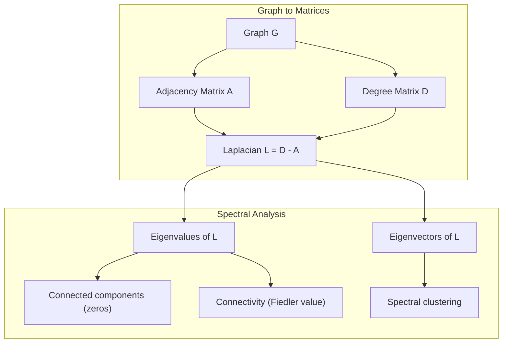
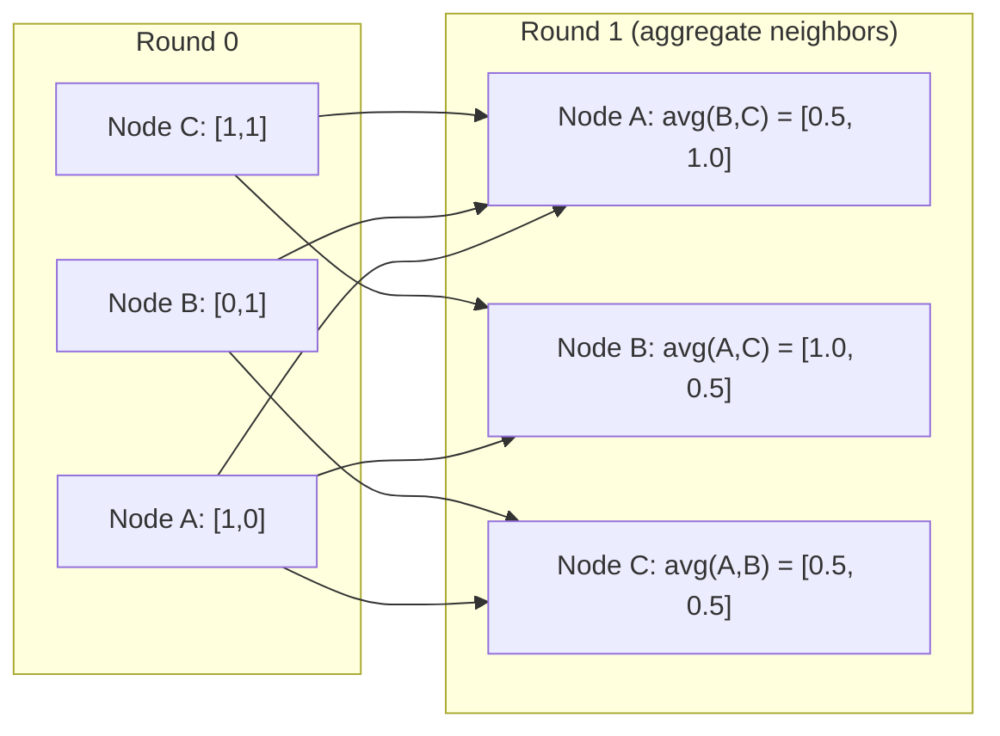

# Теория графов для машинного обучения

> Графы — это структура данных отношений. Если ваши данные имеют связи, вам нужна теория графов.

**Type:** Build
**Language:** Python
**Prerequisites:** Phase 1, Lessons 01-03 (linear algebra, matrices)
**Time:** ~90 minutes

## Learning Objectives

- Build a graph class with adjacency matrix/list representations and implement BFS and DFS traversals
- Compute the graph Laplacian and use its eigenvalues to detect connected components and cluster nodes
- Implement one round of GNN-style message passing as a normalized adjacency matrix multiplication
- Apply spectral clustering to partition a graph using the Fiedler vector

## The Problem

Социальные сети, молекулы, базы знаний, сети цитирования, карты дорог — все это графы. Традиционное ML рассматривает данные как плоские таблицы. Каждая строка независима. Каждый признак — это столбец. Но когда структура связей имеет значение, таблицы не работают.

Рассмотрим социальную сеть. Вы хотите предсказать, какой продукт купит пользователь. История покупок пользователя имеет значение. Но история покупок его друзей имеет ещё большее значение. Связи несут сигнал.

Или рассмотрим молекулу. Вы хотите предсказать, будет ли она связываться с белком. Атомы имеют значение, но действительно важно то, как атомы связаны друг с другом. Структура — это данные.

Graph Neural Networks (GNNs) — это самая быстро растущая область в глубоком обучении. Они используются в открытии лекарств, социальных рекомендациях, обнаружении мошенничества и рассуждениях в графах знаний. Каждая GNN строится на одном и том же фундаменте: базовой теории графов.

Вам нужны четыре вещи:
1. Способ представить графы как матрицы (чтобы вы могли их умножать)
2. Алгоритмы обхода для изучения структуры графа
3. Лапласиан — самая важная матрица в спектральной теории графов
4. Передача сообщений — операция, которая делает работу GNNs

## The Concept

### Graphs: Nodes and Edges

Граф G = (V, E) состоит из вершин (узлов) V и рёбер E. Каждое ребро соединяет два узла.

**Ориентированный vs неориентированный.** В неориентированном графе ребро (u, v) означает, что u соединён с v И v соединён с u. В ориентированном графе (digraph) ребро (u, v) означает, что u указывает на v, но не обязательно в обратном направлении.

**Взвешенный vs невзвешенный.** В невзвешенном графе рёбра либо существуют, либо нет. В взвешенном графе каждое ребро имеет численный вес — расстояние, стоимость, силу.

| Тип графа | Пример |
|-----------|---------|
| Неориентированный, невзвешенный | Сеть дружбы Facebook |
| Ориентированный, невзвешенный | Сеть подписок Twitter |
| Неориентированный, взвешенный | Карта дорог (расстояния) |
| Ориентированный, взвешенный | Ссылки веб-страниц (оценки PageRank) |

### The Adjacency Matrix

Матрица смежности A — это основное представление. Для графа с n узлами:

```
A[i][j] = 1    if there is an edge from node i to node j
A[i][j] = 0    otherwise
```

Для неориентированных графов A симметрична: A[i][j] = A[j][i]. Для взвешенных графов A[i][j] = вес ребра (i, j).

**Пример — треугольник:**

```
Nodes: 0, 1, 2
Edges: (0,1), (1,2), (0,2)

A = [[0, 1, 1],
     [1, 0, 1],
     [1, 1, 0]]
```

Матрица смежности — это вход для каждой GNN. Матричные операции над A соответствуют операциям на графе.

### Degree

Степень узла — это количество рёбер, подключённых к нему. Для ориентированных графов у вас есть входящая степень (рёбра, входящие) и исходящая степень (рёбра, исходящие).

Матрица степеней D диагональна:

```
D[i][i] = degree of node i
D[i][j] = 0    for i != j
```

Для примера с треугольником: D = diag(2, 2, 2), потому что каждый узел соединён с двумя другими.

Степень рассказывает о важности узла. Высокая степень = хабовый узел. Распределение степеней сети раскрывает её структуру. Социальные сети следуют степенным законам (несколько хабов, много листовых узлов). Случайные графы имеют распределённые по Пуассону степени.

### BFS and DFS

Два фундаментальных алгоритма обхода графа. Вам нужны оба.

**Поиск в ширину (BFS):** Исследуйте сначала всех соседей, затем соседей соседей. Использует очередь (FIFO).

```
BFS from node 0:
  Visit 0
  Queue: [1, 2]        (neighbors of 0)
  Visit 1
  Queue: [2, 3]        (add neighbors of 1)
  Visit 2
  Queue: [3]           (neighbors of 2 already visited)
  Visit 3
  Queue: []            (done)
```

BFS находит кратчайшие пути в невзвешенных графах. Расстояние от стартовой точки до любого узла равно уровню BFS, на котором этот узел впервые обнаружен. Вот почему BFS используется для расстояний в хопах в социальных сетях.

**Поиск в глубину (DFS):** Идите как можно глубже перед возвратом. Использует стек (LIFO) или рекурсию.

```
DFS from node 0:
  Visit 0
  Stack: [1, 2]        (neighbors of 0)
  Visit 2               (pop from stack)
  Stack: [1, 3]         (add neighbors of 2)
  Visit 3               (pop from stack)
  Stack: [1]
  Visit 1               (pop from stack)
  Stack: []             (done)
```

DFS полезен для:
- Поиска связных компонент (запустите DFS из непосещённых узлов)
- Обнаружения циклов (обратные рёбра в дереве DFS)
- Топологической сортировки (обратный порядок завершения DFS)

| Алгоритм | Структура данных | Находит | Вариант использования |
|-----------|---------------|-------|----------|
| BFS | Очередь | Кратчайшие пути | Расстояние в социальной сети, обход графа знаний |
| DFS | Стек | Компоненты, циклы | Связность, топологическая сортировка |

### The Graph Laplacian

L = D - A. Самая важная матрица в спектральной теории графов.

Для треугольника:

```
D = [[2, 0, 0],    A = [[0, 1, 1],    L = [[2, -1, -1],
     [0, 2, 0],         [1, 0, 1],         [-1, 2, -1],
     [0, 0, 2]]         [1, 1, 0]]         [-1, -1,  2]]
```

Лапласиан имеет замечательные свойства:

1. **L положительно полуопределена.** Все собственные значения >= 0.

2. **Количество нулевых собственных значений равно количеству связных компонент.** Связный граф имеет ровно одно нулевое собственное значение. Граф с 3 несвязными компонентами имеет три нулевых собственных значения.

3. **Наименьшее ненулевое собственное значение (значение Фидлера) измеряет связность.** Большое значение Фидлера означает, что граф хорошо связан. Маленькое значение Фидлера означает, что граф имеет слабую точку — узкое место.

4. **Собственный вектор значения Фидлера (вектор Фидлера) раскрывает наилучший раздел.** Узлы с положительными значениями входят в одну группу, узлы с отрицательными значениями — в другую. Это спектральная кластеризация.



### Spectral Properties

Собственные значения матрицы смежности и лапласиана раскрывают структурные свойства без обхода.

**Спектральная кластеризация** работает так:
1. Вычислите лапласиан L
2. Найдите k наименьших собственных векторов L (пропустите первый, который является вектором всех единиц для связных графов)
3. Используйте эти собственные векторы как новые координаты для каждого узла
4. Запустите k-means на этих координатах

Почему это работает? Собственные векторы L кодируют "самые гладкие" функции на графе. Узлы, которые хорошо соединены, получают похожие значения собственных векторов. Узлы, разделённые узким местом, получают разные значения. Собственные векторы естественным образом разделяют кластеры.

**Связь со случайным блужданием.** Нормализованный лапласиан связан со случайными блужданиями на графе. Стационарное распределение случайного блуждания пропорционально степени узла. Время смешивания (как быстро блуждание сходится) зависит от спектрального разрыва.

### Message Passing

Ключевая операция Graph Neural Networks. Каждый узел собирает сообщения от своих соседей, агрегирует их и обновляет своё собственное состояние.

```
h_v^(k+1) = UPDATE(h_v^(k), AGGREGATE({h_u^(k) : u in neighbors(v)}))
```

В самой простой форме AGGREGATE = среднее, и UPDATE = линейное преобразование + активация:

```
h_v^(k+1) = sigma(W * mean({h_u^(k) : u in neighbors(v)}))
```

Это умножение матриц в замаскированном виде. Если H — матрица признаков всех узлов и A — матрица смежности:

```
H^(k+1) = sigma(A_norm * H^(k) * W)
```

где A_norm — нормализованная матрица смежности (каждая строка суммируется к 1).

Один раунд передачи сообщений позволяет каждому узлу "видеть" своих прямых соседей. Два раунда позволяют ему видеть соседей соседей. K раундов дают каждому узлу информацию из его K-хопового окрестности.



### Concepts and ML Applications

| Концепция | Применение в ML |
|---------|---------------|
| Матрица смежности | Вход GNN |
| Лапласиан графа | Спектральная кластеризация, обнаружение сообществ |
| BFS/DFS | Обход графа знаний, поиск пути |
| Распределение степеней | Важность узла, конструирование признаков |
| Передача сообщений | Слои GNN (GCN, GAT, GraphSAGE) |
| Собственные значения L | Обнаружение сообществ, разбиение графа |
| Спектральная кластеризация | Неконтролируемое группирование узлов |
| PageRank | Важность узла, поиск в Интернете |

```figure
graph-degree-distribution
```

## Build It

### Step 1: Graph class from scratch

```python
class Graph:
    def __init__(self, n_nodes, directed=False):
        self.n = n_nodes
        self.directed = directed
        self.adj = {i: {} for i in range(n_nodes)}

    def add_edge(self, u, v, weight=1.0):
        self.adj[u][v] = weight
        if not self.directed:
            self.adj[v][u] = weight

    def neighbors(self, node):
        return list(self.adj[node].keys())

    def degree(self, node):
        return len(self.adj[node])

    def adjacency_matrix(self):
        import numpy as np
        A = np.zeros((self.n, self.n))
        for u in range(self.n):
            for v, w in self.adj[u].items():
                A[u][v] = w
        return A

    def degree_matrix(self):
        import numpy as np
        D = np.zeros((self.n, self.n))
        for i in range(self.n):
            D[i][i] = self.degree(i)
        return D

    def laplacian(self):
        return self.degree_matrix() - self.adjacency_matrix()
```

Список смежности (`self.adj`) эффективно хранит соседей. Преобразование матрицы смежности использует numpy, потому что все спектральные операции нуждаются в нём.

### Step 2: BFS and DFS

```python
from collections import deque

def bfs(graph, start):
    visited = set()
    order = []
    distances = {}
    queue = deque([(start, 0)])
    visited.add(start)
    while queue:
        node, dist = queue.popleft()
        order.append(node)
        distances[node] = dist
        for neighbor in graph.neighbors(node):
            if neighbor not in visited:
                visited.add(neighbor)
                queue.append((neighbor, dist + 1))
    return order, distances


def dfs(graph, start):
    visited = set()
    order = []
    stack = [start]
    while stack:
        node = stack.pop()
        if node in visited:
            continue
        visited.add(node)
        order.append(node)
        for neighbor in reversed(graph.neighbors(node)):
            if neighbor not in visited:
                stack.append(neighbor)
    return order
```

BFS использует deque (двусторонняя очередь) для O(1) popleft. DFS использует список как стек. Оба посещают каждый узел ровно один раз — O(V + E) время.

### Step 3: Connected components and Laplacian eigenvalues

```python
def connected_components(graph):
    visited = set()
    components = []
    for node in range(graph.n):
        if node not in visited:
            order, _ = bfs(graph, node)
            visited.update(order)
            components.append(order)
    return components


def laplacian_eigenvalues(graph):
    import numpy as np
    L = graph.laplacian()
    eigenvalues = np.linalg.eigvalsh(L)
    return eigenvalues
```

`eigvalsh` предназначен для симметричных матриц — лапласиан всегда симметричен для неориентированных графов. Он возвращает собственные значения в возрастающем порядке. Подсчитайте нули, чтобы найти количество связных компонент.

### Step 4: Spectral clustering

```python
def spectral_clustering(graph, k=2):
    import numpy as np
    L = graph.laplacian()
    eigenvalues, eigenvectors = np.linalg.eigh(L)
    features = eigenvectors[:, 1:k+1]

    labels = np.zeros(graph.n, dtype=int)
    for i in range(graph.n):
        if features[i, 0] >= 0:
            labels[i] = 0
        else:
            labels[i] = 1
    return labels
```

Для k=2 знак вектора Фидлера разделяет граф на два кластера. Для k>2 вы запустили бы k-means на первых k собственных векторах (исключая тривиальный вектор из всех единиц).

### Step 5: Message passing

```python
def message_passing(graph, features, weight_matrix):
    import numpy as np
    A = graph.adjacency_matrix()
    row_sums = A.sum(axis=1, keepdims=True)
    row_sums[row_sums == 0] = 1
    A_norm = A / row_sums
    aggregated = A_norm @ features
    output = aggregated @ weight_matrix
    return output
```

Это один раунд передачи сообщений GNN. Новые признаки каждого узла — это взвешенное среднее признаков его соседей, преобразованное весовой матрицей. Объедините несколько раундов для распространения информации дальше.

## Use It

С networkx и numpy те же операции — это одностроки:

```python
import networkx as nx
import numpy as np

G = nx.karate_club_graph()

A = nx.adjacency_matrix(G).toarray()
L = nx.laplacian_matrix(G).toarray()

eigenvalues = np.linalg.eigvalsh(L.astype(float))
print(f"Smallest eigenvalues: {eigenvalues[:5]}")
print(f"Connected components: {nx.number_connected_components(G)}")

communities = nx.community.greedy_modularity_communities(G)
print(f"Communities found: {len(communities)}")

pr = nx.pagerank(G)
top_nodes = sorted(pr.items(), key=lambda x: x[1], reverse=True)[:5]
print(f"Top 5 PageRank nodes: {top_nodes}")
```

networkx обрабатывает графы любого размера с оптимизированными бэкендами на C. Используйте его в производстве. Используйте вашу самодельную реализацию, чтобы понять, что она делает.

### numpy spectral analysis

```python
import numpy as np

A = np.array([
    [0, 1, 1, 0, 0],
    [1, 0, 1, 0, 0],
    [1, 1, 0, 1, 0],
    [0, 0, 1, 0, 1],
    [0, 0, 0, 1, 0]
])

D = np.diag(A.sum(axis=1))
L = D - A

eigenvalues, eigenvectors = np.linalg.eigh(L)
print(f"Eigenvalues: {np.round(eigenvalues, 4)}")
print(f"Fiedler value: {eigenvalues[1]:.4f}")
print(f"Fiedler vector: {np.round(eigenvectors[:, 1], 4)}")

fiedler = eigenvectors[:, 1]
group_a = np.where(fiedler >= 0)[0]
group_b = np.where(fiedler < 0)[0]
print(f"Cluster A: {group_a}")
print(f"Cluster B: {group_b}")
```

Вектор Фидлера выполняет тяжелую работу. Положительные записи в одном кластере, отрицательные в другом. Никакой итеративной оптимизации не требуется — просто одно разложение по собственным значениям.

## Ship It

Этот урок производит:
- `outputs/skill-graph-analysis.md` — справочник навыков для анализа данных со структурой графа

## Connections

| Концепция | Где она появляется |
|---------|------------------|
| Матрица смежности | Вход GCN, GAT, GraphSAGE |
| Лапласиан | Спектральная кластеризация, фильтры ChebNet |
| BFS | Обход графа знаний, запросы кратчайшего пути |
| Передача сообщений | Каждый слой GNN, передача нейронных сообщений |
| Спектральный разрыв | Связность графа, время смешивания случайных блужданий |
| Распределение степеней | Сети со степенным законом, конструирование признаков узла |
| Связные компоненты | Предварительная обработка, обработка несвязных графов |
| PageRank | Ранжирование важности узлов, инициализация внимания |

GNNs заслуживают особого упоминания. Операция свёртки графа в GCN (Kipf & Welling, 2017) использует матрицу смежности с добавленными самопетлями, A_hat = A + I:

```text
H^(l+1) = sigma(D_hat^(-1/2) * A_hat * D_hat^(-1/2) * H^(l) * W^(l))
```

где A_hat = A + I (смежность плюс самопетли) и D_hat — матрица степеней A_hat. Самопетли гарантируют, что каждый узел включает свои собственные признаки во время агрегирования. Это ровно передача сообщений с симметричной нормализацией. D_hat^(-1/2) * A_hat * D_hat^(-1/2) — это нормализованная матрица смежности. Лапласиан появляется потому, что эта нормализация связана с L_sym = I - D^(-1/2) * A * D^(-1/2). Понимание лапласиана означает понимание того, почему работают GCNs.

## Exercises

1. **Реализуйте PageRank с нуля.** Начните с равномерных оценок. На каждом шаге: score(v) = (1-d)/n + d * sum(score(u)/out_degree(u)) для всех u, указывающих на v. Используйте d=0.85. Запустите до сходимости (изменение < 1e-6). Протестируйте на небольшом веб-графе.

2. **Найдите сообщества, используя спектральную кластеризацию.** Создайте граф с двумя явно разделёнными кластерами (например, две клики, соединённые одним ребром). Запустите спектральную кластеризацию и убедитесь, что она находит правильный раздел. Что происходит по мере добавления большего количества рёбер между кластерами?

3. **Реализуйте алгоритм Дейкстры** для кратчайших путей во взвешенных графах. Сравните результаты с BFS на том же графе с единообразными весами.

4. **Постройте сеть передачи сообщений с двумя слоями.** Применить передачу сообщений дважды с разными весовыми матрицами. Покажите, что после 2 раундов каждый узел имеет информацию из его 2-хопового окрестности.

5. **Анализируйте граф реального мира.** Используйте граф Karate Club (34 узла, 78 рёбер). Вычислите распределение степеней, собственные значения лапласиана и спектральную кластеризацию. Сравните результат спектральной кластеризации с известным раздором грунд-труза.

## Key Terms

| Термин | Что люди говорят | Что это на самом деле означает |
|------|----------------|----------------------|
| Graph | "Узлы и рёбра" | Математическая структура G=(V,E), кодирующая попарные отношения |
| Матрица смежности | "Таблица соединений" | n x n матрица, где A[i][j] = 1, если узлы i и j соединены |
| Degree | "Насколько соединён узел" | Количество рёбер, касающихся узла |
| Лапласиан | "D минус A" | L = D - A, матрица, чьи собственные значения раскрывают структуру графа |
| Значение Фидлера | "Алгебраическая связность" | Наименьшее ненулевое собственное значение L, измеряющее, насколько хорошо соединён граф |
| BFS | "Поиск уровень за уровнем" | Обход, который посещает всех соседей перед углублением, находит кратчайшие пути |
| DFS | "Сначала в глубину" | Обход, который следует по одному пути до конца перед возвратом |
| Передача сообщений | "Узлы говорят с соседями" | Каждый узел агрегирует информацию от своих соседей, ядро GNNs |
| Спектральная кластеризация | "Кластеризация по собственным векторам" | Разбиение графа с использованием собственных векторов его лапласиана |
| Связная компонента | "Отдельный кусок" | Максимальный подграф, где каждый узел может достичь каждого другого узла |

## Further Reading

- **Kipf & Welling (2017)** -- "Semi-Supervised Classification with Graph Convolutional Networks." Статья, которая запустила современные GNNs. Показывает, что спектральные свёртки графа упрощаются до передачи сообщений.
- **Spielman (2012)** -- "Spectral Graph Theory" lecture notes. Определяющее введение в лапласианы, спектральные разрывы и разбиение графа.
- **Hamilton (2020)** -- "Graph Representation Learning." Книга, охватывающая GNNs от основ к приложениям.
- **Bronstein et al. (2021)** -- "Geometric Deep Learning: Grids, Groups, Graphs, Geodesics, and Gauges." Объединяющая структурная статья.
- **Veličković et al. (2018)** -- "Graph Attention Networks." Расширяет передачу сообщений механизмами внимания.