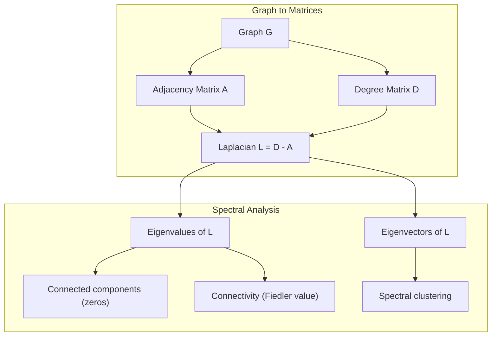
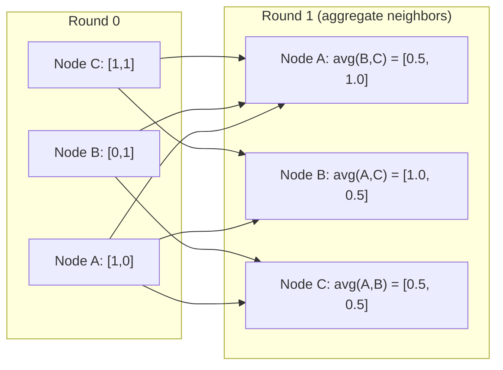

# Теория графов для машинного обучения

> Графы — это структура данных для отношений. Если в ваших данных есть связи, вам нужна теория графов.

**Type:** Build
**Language:** Python
**Prerequisites:** Phase 1, уроки 01-03 (линейная алгебра, матрицы)
**Time:** ~90 минут

## Цели обучения

- Построить класс графа с представлениями через матрицу/список смежности и реализовать обходы BFS и DFS
- Вычислить лапласиан графа и использовать его собственные значения для обнаружения связных компонент и кластеризации узлов
- Реализовать один раунд передачи сообщений в стиле GNN как умножение на нормализованную матрицу смежности
- Применить спектральную кластеризацию для разбиения графа с помощью вектора Фидлера

## Проблема

Социальные сети, молекулы, базы знаний, сети цитирования, карты дорог — всё это графы. Традиционное ML рассматривает данные как плоские таблицы. Каждая строка независима. Каждый признак — столбец. Но когда важна структура связей, таблицы не справляются.

Рассмотрим социальную сеть. Вы хотите предсказать, какой товар купит пользователь. История покупок пользователя имеет значение. Но история покупок его друзей имеет ещё большее значение. Связи несут сигнал.

Или рассмотрим молекулу. Вы хотите предсказать, свяжется ли она с белком. Атомы важны, но на самом деле важнее то, как атомы связаны друг с другом. Структура и есть данные.

Графовые нейронные сети (GNN) — самая быстрорастущая область глубокого обучения. Они лежат в основе поиска лекарств, рекомендаций в соцсетях, обнаружения мошенничества и рассуждений на графах знаний. Каждая GNN строится на одном и том же фундаменте: базовой теории графов.

Вам нужны четыре вещи:
1. Способ представления графов в виде матриц (чтобы их можно было перемножать)
2. Алгоритмы обхода для исследования структуры графа
3. Лапласиан — важнейшая матрица в спектральной теории графов
4. Передача сообщений — операция, благодаря которой работают GNN

## Концепция

### Графы: узлы и рёбра

Граф G = (V, E) состоит из вершин (узлов) V и рёбер E. Каждое ребро соединяет два узла.

**Направленные и ненаправленные.** В ненаправленном графе ребро (u, v) означает, что u соединён с v И v соединён с u. В направленном графе (орграфе) ребро (u, v) означает, что u указывает на v, но не обязательно наоборот.

**Взвешенные и невзвешенные.** В невзвешенном графе рёбра либо существуют, либо нет. Во взвешенном графе у каждого ребра есть числовой вес — расстояние, стоимость, сила.

| Тип графа | Пример |
|-----------|---------|
| Ненаправленный, невзвешенный | Сеть дружбы в Facebook |
| Направленный, невзвешенный | Сеть подписок в Twitter |
| Ненаправленный, взвешенный | Карта дорог (расстояния) |
| Направленный, взвешенный | Ссылки веб-страниц (оценки PageRank) |

### Матрица смежности

Матрица смежности A — это базовое представление. Для графа с n узлами:

```
A[i][j] = 1    if there is an edge from node i to node j
A[i][j] = 0    otherwise
```

Для ненаправленных графов A симметрична: A[i][j] = A[j][i]. Для взвешенных графов A[i][j] = вес ребра (i, j).

**Пример — треугольник:**

```
Nodes: 0, 1, 2
Edges: (0,1), (1,2), (0,2)

A = [[0, 1, 1],
     [1, 0, 1],
     [1, 1, 0]]
```

Матрица смежности — это входные данные для каждой GNN. Матричные операции над A соответствуют операциям над графом.

### Степень

Степень узла — это количество рёбер, с ним связанных. Для направленных графов есть входящая степень (рёбра, входящие в узел) и исходящая степень (рёбра, выходящие из узла).

Матрица степеней D диагональна:

```
D[i][i] = degree of node i
D[i][j] = 0    for i != j
```

Для примера с треугольником: D = diag(2, 2, 2), потому что каждый узел соединён с двумя другими.

Степень говорит о важности узла. Высокая степень = узел-хаб. Распределение степеней в сети раскрывает её структуру. Социальные сети следуют степенным законам (мало хабов, много листовых узлов). Случайные графы имеют пуассоновское распределение степеней.

### BFS и DFS

Два фундаментальных алгоритма обхода графа. Вам нужны оба.

**Обход в ширину (BFS):** Сначала исследовать всех соседей, затем соседей соседей. Использует очередь (FIFO).

```
BFS from node 0:
  Visit 0
  Queue: [1, 2]        (neighbors of 0)
  Visit 1
  Queue: [2, 3]        (add neighbors of 1)
  Visit 2
  Queue: [3]           (neighbors of 2 already visited)
  Visit 3
  Queue: []            (done)
```

BFS находит кратчайшие пути в невзвешенных графах. Расстояние от начального узла до любого другого узла равно уровню BFS, на котором этот узел впервые обнаружен. Поэтому BFS используется для подсчёта расстояний по хопам в социальных сетях.

**Обход в глубину (DFS):** Идти как можно глубже, прежде чем откатываться назад. Использует стек (LIFO) или рекурсию.

```
DFS from node 0:
  Visit 0
  Stack: [1, 2]        (neighbors of 0)
  Visit 2               (pop from stack)
  Stack: [1, 3]         (add neighbors of 2)
  Visit 3               (pop from stack)
  Stack: [1]
  Visit 1               (pop from stack)
  Stack: []             (done)
```

DFS полезен для:
- Поиска связных компонент (запуск DFS из непосещённых узлов)
- Обнаружения циклов (обратные рёбра в дереве DFS)
- Топологической сортировки (обратный порядок завершения DFS)

| Алгоритм | Структура данных | Находит | Применение |
|-----------|---------------|-------|----------|
| BFS | Очередь | Кратчайшие пути | Расстояние в социальных сетях, обход графов знаний |
| DFS | Стек | Компоненты, циклы | Связность, топологическая сортировка |

### Лапласиан графа

L = D - A. Важнейшая матрица в спектральной теории графов.

Для треугольника:

```
D = [[2, 0, 0],    A = [[0, 1, 1],    L = [[2, -1, -1],
     [0, 2, 0],         [1, 0, 1],         [-1, 2, -1],
     [0, 0, 2]]         [1, 1, 0]]         [-1, -1,  2]]
```

Лапласиан обладает примечательными свойствами:

1. **L положительно полуопределена.** Все собственные значения >= 0.

2. **Количество нулевых собственных значений равно количеству связных компонент.** Связный граф имеет ровно одно нулевое собственное значение. Граф с 3 несвязанными компонентами имеет три нулевых собственных значения.

3. **Наименьшее ненулевое собственное значение (значение Фидлера) измеряет связность.** Большое значение Фидлера означает, что граф хорошо связан. Малое значение Фидлера означает, что у графа есть слабое место — узкое место (бутылочное горлышко).

4. **Собственный вектор значения Фидлера (вектор Фидлера) раскрывает лучшее разбиение.** Узлы с положительными значениями идут в одну группу, узлы с отрицательными значениями — в другую. Это спектральная кластеризация.



### Спектральные свойства

Собственные значения матрицы смежности и лапласиана раскрывают структурные свойства без какого-либо обхода.

**Спектральная кластеризация** работает так:
1. Вычислить лапласиан L
2. Найти k наименьших собственных векторов L (пропустить первый, который для связных графов состоит из одних единиц)
3. Использовать эти собственные векторы как новые координаты для каждого узла
4. Запустить k-means на этих координатах

Почему это работает? Собственные векторы L кодируют «самые гладкие» функции на графе. Хорошо связанные узлы получают похожие значения собственного вектора. Узлы, разделённые узким местом, получают разные значения. Собственные векторы естественным образом разделяют кластеры.

**Связь со случайными блужданиями.** Нормализованный лапласиан связан со случайными блужданиями по графу. Стационарное распределение случайного блуждания пропорционально степени узла. Время перемешивания (насколько быстро блуждание сходится) зависит от спектрального разрыва.

### Передача сообщений

Основная операция графовых нейронных сетей. Каждый узел собирает сообщения от своих соседей, агрегирует их и обновляет своё состояние.

```
h_v^(k+1) = UPDATE(h_v^(k), AGGREGATE({h_u^(k) : u in neighbors(v)}))
```

В простейшей форме AGGREGATE = среднее, а UPDATE = линейное преобразование + функция активации:

```
h_v^(k+1) = sigma(W * mean({h_u^(k) : u in neighbors(v)}))
```

Это матричное умножение в замаскированном виде. Если H — матрица всех признаков узлов, а A — матрица смежности:

```
H^(k+1) = sigma(A_norm * H^(k) * W)
```

где A_norm — нормализованная матрица смежности (сумма элементов каждой строки равна 1).

Один раунд передачи сообщений позволяет каждому узлу «увидеть» своих непосредственных соседей. Два раунда позволяют увидеть соседей соседей. K раундов дают каждому узлу информацию из его K-хопового окружения.



### Концепции и применения в ML

| Концепция | Применение в ML |
|---------|---------------|
| Матрица смежности | Входное представление GNN |
| Лапласиан графа | Спектральная кластеризация, обнаружение сообществ |
| BFS/DFS | Обход графов знаний, поиск путей |
| Распределение степеней | Важность узла, конструирование признаков |
| Передача сообщений | Слои GNN (GCN, GAT, GraphSAGE) |
| Собственные значения L | Обнаружение сообществ, разбиение графа |
| Спектральная кластеризация | Неконтролируемая группировка узлов |
| PageRank | Важность узла, веб-поиск |

```figure
graph-degree-distribution
```

## Реализация

### Шаг 1: Класс графа с нуля

```python
class Graph:
    def __init__(self, n_nodes, directed=False):
        self.n = n_nodes
        self.directed = directed
        self.adj = {i: {} for i in range(n_nodes)}

    def add_edge(self, u, v, weight=1.0):
        self.adj[u][v] = weight
        if not self.directed:
            self.adj[v][u] = weight

    def neighbors(self, node):
        return list(self.adj[node].keys())

    def degree(self, node):
        return len(self.adj[node])

    def adjacency_matrix(self):
        import numpy as np
        A = np.zeros((self.n, self.n))
        for u in range(self.n):
            for v, w in self.adj[u].items():
                A[u][v] = w
        return A

    def degree_matrix(self):
        import numpy as np
        D = np.zeros((self.n, self.n))
        for i in range(self.n):
            D[i][i] = self.degree(i)
        return D

    def laplacian(self):
        return self.degree_matrix() - self.adjacency_matrix()
```

Список смежности (`self.adj`) эффективно хранит соседей. Преобразование в матрицу смежности использует numpy, потому что все спектральные операции требуют его.

### Шаг 2: BFS и DFS

```python
from collections import deque

def bfs(graph, start):
    visited = set()
    order = []
    distances = {}
    queue = deque([(start, 0)])
    visited.add(start)
    while queue:
        node, dist = queue.popleft()
        order.append(node)
        distances[node] = dist
        for neighbor in graph.neighbors(node):
            if neighbor not in visited:
                visited.add(neighbor)
                queue.append((neighbor, dist + 1))
    return order, distances


def dfs(graph, start):
    visited = set()
    order = []
    stack = [start]
    while stack:
        node = stack.pop()
        if node in visited:
            continue
        visited.add(node)
        order.append(node)
        for neighbor in reversed(graph.neighbors(node)):
            if neighbor not in visited:
                stack.append(neighbor)
    return order
```

BFS использует deque (двустороннюю очередь) для O(1) popleft. DFS использует список как стек. Оба посещают каждый узел ровно один раз — время O(V + E).

### Шаг 3: Связные компоненты и собственные значения лапласиана

```python
def connected_components(graph):
    visited = set()
    components = []
    for node in range(graph.n):
        if node not in visited:
            order, _ = bfs(graph, node)
            visited.update(order)
            components.append(order)
    return components


def laplacian_eigenvalues(graph):
    import numpy as np
    L = graph.laplacian()
    eigenvalues = np.linalg.eigvalsh(L)
    return eigenvalues
```

`eigvalsh` предназначена для симметричных матриц — лапласиан всегда симметричен для ненаправленных графов. Она возвращает собственные значения в порядке возрастания. Подсчитайте нули, чтобы найти количество связных компонент.

### Шаг 4: Спектральная кластеризация

```python
def spectral_clustering(graph, k=2):
    import numpy as np
    L = graph.laplacian()
    eigenvalues, eigenvectors = np.linalg.eigh(L)
    features = eigenvectors[:, 1:k+1]

    labels = np.zeros(graph.n, dtype=int)
    for i in range(graph.n):
        if features[i, 0] >= 0:
            labels[i] = 0
        else:
            labels[i] = 1
    return labels
```

Для k=2 знак вектора Фидлера разбивает граф на два кластера. Для k>2 вы бы запустили k-means на первых k собственных векторах (исключая тривиальный собственный вектор из одних единиц).

### Шаг 5: Передача сообщений

```python
def message_passing(graph, features, weight_matrix):
    import numpy as np
    A = graph.adjacency_matrix()
    row_sums = A.sum(axis=1, keepdims=True)
    row_sums[row_sums == 0] = 1
    A_norm = A / row_sums
    aggregated = A_norm @ features
    output = aggregated @ weight_matrix
    return output
```

Это один раунд передачи сообщений GNN. Новые признаки каждого узла — это взвешенное среднее признаков его соседей, преобразованное матрицей весов. Сложите несколько раундов, чтобы распространить информацию дальше.

## Применение

С networkx и numpy те же операции выполняются в одну строку:

```python
import networkx as nx
import numpy as np

G = nx.karate_club_graph()

A = nx.adjacency_matrix(G).toarray()
L = nx.laplacian_matrix(G).toarray()

eigenvalues = np.linalg.eigvalsh(L.astype(float))
print(f"Smallest eigenvalues: {eigenvalues[:5]}")
print(f"Connected components: {nx.number_connected_components(G)}")

communities = nx.community.greedy_modularity_communities(G)
print(f"Communities found: {len(communities)}")

pr = nx.pagerank(G)
top_nodes = sorted(pr.items(), key=lambda x: x[1], reverse=True)[:5]
print(f"Top 5 PageRank nodes: {top_nodes}")
```

networkx справляется с графами любого размера благодаря оптимизированным бэкендам на C. Используйте её в продакшене. Используйте свою реализацию с нуля, чтобы понять, что она делает.

### Спектральный анализ на numpy

```python
import numpy as np

A = np.array([
    [0, 1, 1, 0, 0],
    [1, 0, 1, 0, 0],
    [1, 1, 0, 1, 0],
    [0, 0, 1, 0, 1],
    [0, 0, 0, 1, 0]
])

D = np.diag(A.sum(axis=1))
L = D - A

eigenvalues, eigenvectors = np.linalg.eigh(L)
print(f"Eigenvalues: {np.round(eigenvalues, 4)}")
print(f"Fiedler value: {eigenvalues[1]:.4f}")
print(f"Fiedler vector: {np.round(eigenvectors[:, 1], 4)}")

fiedler = eigenvectors[:, 1]
group_a = np.where(fiedler >= 0)[0]
group_b = np.where(fiedler < 0)[0]
print(f"Cluster A: {group_a}")
print(f"Cluster B: {group_b}")
```

Вектор Фидлера выполняет всю основную работу. Положительные значения в одном кластере, отрицательные — в другом. Не требуется никакой итеративной оптимизации — только одно разложение по собственным значениям.

## Результат

Этот урок производит:
- `outputs/skill-graph-analysis.md` — справочник навыков для анализа данных со структурой графа

## Связи

| Концепция | Где встречается |
|---------|------------------|
| Матрица смежности | Вход GCN, GAT, GraphSAGE |
| Лапласиан | Спектральная кластеризация, фильтры ChebNet |
| BFS | Обход графов знаний, запросы кратчайшего пути |
| Передача сообщений | Каждый слой GNN, нейронная передача сообщений |
| Спектральный разрыв | Связность графа, время перемешивания случайных блужданий |
| Распределение степеней | Степенные сети, конструирование признаков узлов |
| Связные компоненты | Предобработка, обработка несвязных графов |
| PageRank | Ранжирование важности узлов, инициализация внимания |

GNN заслуживают отдельного упоминания. Операция графовой свёртки в GCN (Kipf & Welling, 2017) использует матрицу смежности с добавленными самопетлями, A_hat = A + I:

```text
H^(l+1) = sigma(D_hat^(-1/2) * A_hat * D_hat^(-1/2) * H^(l) * W^(l))
```

где A_hat = A + I (смежность плюс самопетли), а D_hat — матрица степеней для A_hat. Самопетли гарантируют, что каждый узел включает собственные признаки при агрегации. Это в точности передача сообщений с симметричной нормализацией. D_hat^(-1/2) * A_hat * D_hat^(-1/2) — это нормализованная матрица смежности. Лапласиан появляется здесь, потому что эта нормализация связана с L_sym = I - D^(-1/2) * A * D^(-1/2). Понимание лапласиана означает понимание того, почему работают GCN.

## Упражнения

1. **Реализуйте PageRank с нуля.** Начните с равномерных оценок. На каждом шаге: score(v) = (1-d)/n + d * sum(score(u)/out_degree(u)) для всех u, указывающих на v. Используйте d=0.85. Выполняйте до сходимости (изменение < 1e-6). Протестируйте на небольшом веб-графе.

2. **Найдите сообщества с помощью спектральной кластеризации.** Создайте граф с двумя чётко разделёнными кластерами (например, две клики, соединённые одним ребром). Запустите спектральную кластеризацию и убедитесь, что она находит правильное разбиение. Что происходит по мере добавления большего числа межкластерных рёбер?

3. **Реализуйте алгоритм Дейкстры** для кратчайших путей во взвешенных графах. Сравните результаты с BFS на том же графе с равномерными весами.

4. **Постройте двухслойную сеть передачи сообщений.** Примените передачу сообщений дважды с разными матрицами весов. Покажите, что после 2 раундов каждый узел обладает информацией из своего 2-хопового окружения.

5. **Проанализируйте реальный граф.** Используйте граф Karate Club (34 узла, 78 рёбер). Вычислите распределение степеней, собственные значения лапласиана и выполните спектральную кластеризацию. Сравните результат спектральной кластеризации с известным истинным разбиением.

## Ключевые термины

| Термин | Что говорят люди | Что это на самом деле означает |
|------|----------------|----------------------|
| Граф | «Узлы и рёбра» | Математическая структура G=(V,E), кодирующая попарные отношения |
| Матрица смежности | «Таблица связей» | Матрица n x n, где A[i][j] = 1, если узлы i и j связаны |
| Степень | «Насколько узел связан» | Количество рёбер, касающихся узла |
| Лапласиан | «D минус A» | L = D - A, матрица, собственные значения которой раскрывают структуру графа |
| Значение Фидлера | «Алгебраическая связность» | Наименьшее ненулевое собственное значение L, измеряющее, насколько хорошо связан граф |
| BFS | «Поиск уровень за уровнем» | Обход, посещающий всех соседей перед тем, как идти глубже, находит кратчайшие пути |
| DFS | «Сначала вглубь» | Обход, следующий по одному пути до конца перед откатом |
| Передача сообщений | «Узлы разговаривают с соседями» | Каждый узел агрегирует информацию от своих соседей, ядро GNN |
| Спектральная кластеризация | «Кластеризация по собственным векторам» | Разбиение графа с использованием собственных векторов его лапласиана |
| Связная компонента | «Отдельный кусок» | Максимальный подграф, в котором каждый узел может достичь любого другого узла |

## Дополнительное чтение

- **Kipf & Welling (2017)** -- «Semi-Supervised Classification with Graph Convolutional Networks». Статья, положившая начало современным GNN. Показывает, что спектральные графовые свёртки упрощаются до передачи сообщений.
- **Spielman (2012)** -- конспекты лекций «Spectral Graph Theory». Самое полное введение в лапласианы, спектральные разрывы и разбиение графов.
- **Hamilton (2020)** -- «Graph Representation Learning». Книга, охватывающая GNN от основ до приложений.
- **Bronstein et al. (2021)** -- «Geometric Deep Learning: Grids, Groups, Graphs, Geodesics, and Gauges». Объединяющая теоретическая статья.
- **Veličković et al. (2018)** -- «Graph Attention Networks». Расширяет передачу сообщений механизмами внимания.