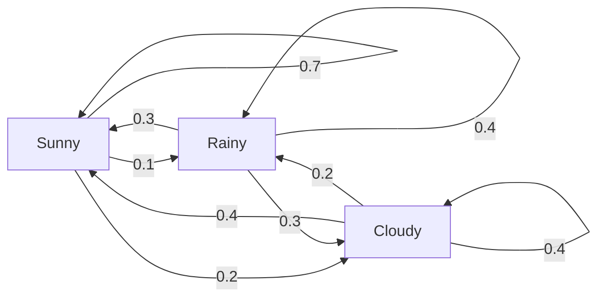
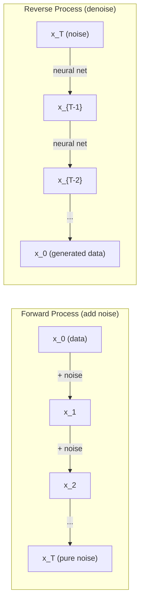

# Стохастические процессы

> Случайность со структурой. Математика, лежащая в основе случайных блужданий, марковских цепей и диффузионных моделей.

**Type:** Learn
**Language:** Python
**Prerequisites:** Фаза 1, уроки 06-07 (вероятность, теорема Байеса)
**Time:** ~75 минут

## Цели обучения

- Смоделировать одномерные и двумерные случайные блуждания и проверить масштабирование смещения по корню из n
- Построить симулятор марковской цепи и вычислить её стационарное распределение через разложение по собственным векторам
- Реализовать Metropolis-Hastings MCMC и динамику Ланжевена для сэмплирования из целевых распределений
- Связать процесс прямой диффузии с броуновским движением и объяснить, как обратный процесс генерирует данные

## Проблема

Многие ИИ-системы содержат случайность, которая эволюционирует во времени. Не статическую случайность — структурированную, последовательную случайность, где каждый шаг зависит от предыдущего.

Языковые модели генерируют токены один за другим. Каждый токен зависит от предыдущего контекста. Модель выдаёт распределение вероятностей, сэмплирует из него и двигается дальше. Это стохастический процесс.

Диффузионные модели добавляют шум к изображению шаг за шагом, пока оно не превратится в чистый шум. Затем они обращают процесс, шаг за шагом убирая шум, пока не появится новое изображение. Прямой процесс — это марковская цепь. Обратный процесс — это обученная марковская цепь, работающая в обратном направлении.

Агенты обучения с подкреплением совершают действия в среде. Каждое действие ведёт к новому состоянию с некоторой вероятностью. Агент следует случайной политике в случайном мире. Всё это вместе — марковский процесс принятия решений.

Сэмплирование MCMC — основа байесовского вывода — строит марковскую цепь, стационарное распределение которой совпадает с апостериорным распределением, из которого вы хотите сэмплировать.

Всё это опирается на четыре фундаментальные идеи:
1. Случайные блуждания — простейший стохастический процесс
2. Марковские цепи — структурированная случайность с матрицей переходов
3. Динамика Ланжевена — градиентный спуск с шумом
4. Metropolis-Hastings — сэмплирование из произвольного распределения

## Концепция

### Случайные блуждания

Начните с позиции 0. На каждом шаге подбрасывайте честную монету. Орёл: двигайтесь вправо (+1). Решка: двигайтесь влево (-1).

После n шагов ваша позиция — это сумма n случайных значений +/-1. Ожидаемая позиция равна 0 (блуждание без смещения). Но ожидаемое расстояние от начала координат растёт как корень из n.

Это противоречит интуиции. Блуждание честное — дрейфа в ту или иную сторону нет. Но со временем оно уходит всё дальше и дальше от исходной точки. Стандартное отклонение после n шагов равно корню из n.

```
Step 0:  Position = 0
Step 1:  Position = +1 or -1
Step 2:  Position = +2, 0, or -2
...
Step 100: Expected distance from origin ~ 10 (sqrt(100))
Step 10000: Expected distance from origin ~ 100 (sqrt(10000))
```

**В 2D** блуждание двигается вверх, вниз, влево или вправо с равной вероятностью. Такое же масштабирование по корню из n применимо к расстоянию от начала координат. Траектория образует фракталоподобный узор.

**Почему корень из n?** Каждый шаг равен +1 или -1 с равной вероятностью. После n шагов позиция S_n = X_1 + X_2 + ... + X_n, где каждый X_i равен +/-1. Дисперсия каждого шага равна 1, а шаги независимы, поэтому Var(S_n) = n. Стандартное отклонение = корень из n. По центральной предельной теореме S_n / sqrt(n) сходится к стандартному нормальному распределению.

Это масштабирование по корню из n встречается повсюду в машинном обучении. Шум SGD масштабируется как 1/sqrt(размер_батча). Размерности эмбеддингов масштабируются как корень из d. Квадратный корень — это характерный признак независимых случайных слагаемых.

**Связь с броуновским движением.** Возьмите случайное блуждание с размером шага 1/sqrt(n) и n шагами на единицу времени. При n, стремящемся к бесконечности, блуждание сходится к броуновскому движению B(t) — непрерывному по времени процессу, где B(t) имеет нормальное распределение со средним 0 и дисперсией t.

Броуновское движение — это математическая основа диффузии. Оно моделирует случайное дрожание частиц в жидкости, колебания цен акций и — что критически важно — процесс шума в диффузионных моделях.

**Задача разорения игрока.** Случайный блуждающий начинает в позиции k, с поглощающими барьерами в 0 и N. Какова вероятность достичь N раньше, чем 0? Для честного блуждания: P(достичь N) = k/N. Это удивительно просто и элегантно. Это связано с теорией мартингалов — честное случайное блуждание является мартингалом (ожидаемое будущее значение = текущему значению).

### Марковские цепи

Марковская цепь — это система, которая переходит между состояниями согласно фиксированным вероятностям. Ключевое свойство: следующее состояние зависит только от текущего состояния, а не от истории.

```
P(X_{t+1} = j | X_t = i, X_{t-1} = ...) = P(X_{t+1} = j | X_t = i)
```

Это и есть марковское свойство. Оно означает, что всю динамику можно описать матрицей переходов P:

```
P[i][j] = probability of going from state i to state j
```

Сумма элементов каждой строки P равна 1 (вы должны куда-то перейти).

**Пример — погода:**

```
States: Sunny (0), Rainy (1), Cloudy (2)

P = [[0.7, 0.1, 0.2],    (if sunny: 70% sunny, 10% rainy, 20% cloudy)
     [0.3, 0.4, 0.3],    (if rainy: 30% sunny, 40% rainy, 30% cloudy)
     [0.4, 0.2, 0.4]]    (if cloudy: 40% sunny, 20% rainy, 40% cloudy)
```

Начните с любого состояния. После многих переходов распределение состояний сходится к стационарному распределению pi, где pi * P = pi. Это левый собственный вектор P с собственным значением 1.

Для цепи погоды стационарное распределение равно [0.55, 0.18, 0.27] — в долгосрочной перспективе солнечно 55% времени независимо от начального состояния.



**Вычисление стационарного распределения.** Есть два подхода:

1. **Степенной метод**: многократно умножайте любое начальное распределение на P. После достаточного числа итераций оно сходится.
2. **Метод собственных значений**: найдите левый собственный вектор P с собственным значением 1. Это собственный вектор P^T с собственным значением 1.

Оба подхода требуют, чтобы цепь удовлетворяла условиям сходимости.

**Условия сходимости.** Марковская цепь сходится к единственному стационарному распределению, если она:
- **Неприводима**: каждое состояние достижимо из любого другого состояния
- **Апериодична**: цепь не циклична с фиксированным периодом

Большинство цепей, встречающихся в машинном обучении, удовлетворяют обоим условиям.

**Поглощающие состояния.** Состояние является поглощающим, если, попав в него, вы уже никогда из него не выйдете (P[i][i] = 1). Марковские цепи с поглощением моделируют процессы с терминальными состояниями — игру, которая заканчивается, клиента, который уходит, последовательность токенов, которая достигает токена конца текста.

**Время перемешивания.** Сколько шагов требуется, чтобы цепь оказалась «близко» к стационарному распределению? Формально это число шагов, после которого расстояние по полной вариации от стационарности падает ниже некоторого порога. Быстрое перемешивание = нужно мало шагов. Спектральный зазор P (1 минус второе по величине собственное значение) определяет время перемешивания. Больший зазор = более быстрое перемешивание.

### Связь с языковыми моделями

Генерация токенов в языковой модели приблизительно является марковским процессом. Имея текущий контекст, модель выдаёт распределение по следующему токену. Температура управляет резкостью:

```
P(token_i) = exp(logit_i / temperature) / sum(exp(logit_j / temperature))
```

- Температура = 1.0: стандартное распределение
- Температура < 1.0: более резкое (более детерминированное)
- Температура > 1.0: более плоское (более случайное)
- Температура -> 0: argmax (жадный выбор)

Top-k-сэмплирование усекает до k токенов с наибольшей вероятностью. Top-p (nucleus)-сэмплирование усекает до наименьшего набора токенов, суммарная вероятность которых превышает p. Оба метода изменяют вероятности переходов марковской цепи.

### Броуновское движение

Непрерывный по времени предел случайного блуждания. Позиция B(t) обладает тремя свойствами:
1. B(0) = 0
2. B(t) - B(s) имеет нормальное распределение со средним 0 и дисперсией t - s (для t > s)
3. Приращения на неперекрывающихся интервалах независимы

Броуновское движение непрерывно, но нигде не дифференцируемо — оно дрожит на любом масштабе. Траектория имеет фрактальную размерность 2 на плоскости.

В дискретном моделировании броуновское движение аппроксимируется следующим образом:

```
B(t + dt) = B(t) + sqrt(dt) * z,    where z ~ N(0, 1)
```

Масштабирование по sqrt(dt) важно. Оно вытекает из центральной предельной теоремы, применённой к случайным блужданиям.

### Динамика Ланжевена

Градиентный спуск находит минимум функции. Динамика Ланжевена находит распределение вероятностей, пропорциональное exp(-U(x)/T), где U — функция энергии, а T — температура.

```
x_{t+1} = x_t - dt * gradient(U(x_t)) + sqrt(2 * T * dt) * z_t
```

На частицу действуют две силы:
1. **Градиентная сила** (-dt * gradient(U)): толкает к низкой энергии (как градиентный спуск)
2. **Случайная сила** (sqrt(2*T*dt) * z): толкает в случайных направлениях (исследование)

При температуре T = 0 это чистый градиентный спуск. При высокой температуре это почти случайное блуждание. При подходящей температуре частица исследует энергетический ландшафт и проводит больше времени в областях с низкой энергией.

**Связь с диффузионными моделями.** Прямой процесс диффузионной модели:

```
x_t = sqrt(alpha_t) * x_{t-1} + sqrt(1 - alpha_t) * noise
```

Это марковская цепь, которая постепенно смешивает данные с шумом. После достаточного числа шагов x_T становится чистым гауссовским шумом.

Обратный процесс — переход от шума обратно к данным — также является марковской цепью, но её вероятности переходов обучаются нейронной сетью. Сеть учится предсказывать шум, который был добавлен на каждом шаге, а затем вычитает его.



### MCMC: марковские цепи Монте-Карло

Иногда вам нужно сэмплировать из распределения p(x), которое можно вычислить (с точностью до константы), но из которого нельзя сэмплировать напрямую. Байесовские апостериорные распределения — классический пример: вы знаете правдоподобие, умноженное на априорное, но нормирующая константа неподъёмна для вычисления.

**Metropolis-Hastings** строит марковскую цепь, стационарное распределение которой равно p(x):

1. Начните с некоторой позиции x
2. Предложите новую позицию x' из распределения предложений Q(x'|x)
3. Вычислите коэффициент принятия: a = p(x') * Q(x|x') / (p(x) * Q(x'|x))
4. Примите x' с вероятностью min(1, a). В противном случае оставайтесь в x.
5. Повторите.

Если Q симметрично (например, Q(x'|x) = Q(x|x') = N(x, sigma^2)), коэффициент упрощается до a = p(x') / p(x). Вам нужно только отношение вероятностей — нормирующая константа сокращается.

Цепь гарантированно сходится к p(x) при мягких условиях. Но сходимость может быть медленной, если предложение слишком мало (случайное блуждание) или слишком велико (высокий уровень отклонений). Настройка предложения — это искусство MCMC.

**Почему это работает.** Коэффициент принятия обеспечивает детальный баланс: вероятность находиться в x и перейти в x' равна вероятности находиться в x' и перейти в x. Детальный баланс подразумевает, что p(x) является стационарным распределением цепи. Поэтому после достаточного числа шагов сэмплы берутся из p(x).

**Практические соображения:**
- **Прогрев (burn-in)**: отбросьте первые N сэмплов. Цепи требуется время, чтобы достичь стационарного распределения от начальной точки.
- **Прореживание (thinning)**: сохраняйте каждый k-й сэмпл, чтобы уменьшить автокорреляцию.
- **Несколько цепей**: запустите несколько цепей из разных начальных точек. Если они сходятся к одному и тому же распределению, это свидетельствует о сходимости.
- **Коэффициент принятия**: для гауссовских предложений в d измерениях оптимальный коэффициент принятия составляет около 23% (Roberts & Rosenthal, 2001). Слишком высокий означает, что цепь почти не двигается. Слишком низкий означает, что она отклоняет почти всё.

### Стохастические процессы в ИИ

| Процесс | Применение в ИИ |
|---------|---------------|
| Случайное блуждание | Исследование в RL, эмбеддинги Node2Vec |
| Марковская цепь | Генерация текста, сэмплирование MCMC |
| Броуновское движение | Диффузионные модели (прямой процесс) |
| Динамика Ланжевена | Генеративные модели на основе score, SGLD |
| Марковский процесс принятия решений | Обучение с подкреплением |
| Metropolis-Hastings | Байесовский вывод, сэмплирование апостериорного распределения |

```figure
random-walk-diffusion
```

## Построение

### Шаг 1: симулятор случайного блуждания

```python
import numpy as np

def random_walk_1d(n_steps, seed=None):
    rng = np.random.RandomState(seed)
    steps = rng.choice([-1, 1], size=n_steps)
    positions = np.concatenate([[0], np.cumsum(steps)])
    return positions


def random_walk_2d(n_steps, seed=None):
    rng = np.random.RandomState(seed)
    directions = rng.choice(4, size=n_steps)
    dx = np.zeros(n_steps)
    dy = np.zeros(n_steps)
    dx[directions == 0] = 1   # right
    dx[directions == 1] = -1  # left
    dy[directions == 2] = 1   # up
    dy[directions == 3] = -1  # down
    x = np.concatenate([[0], np.cumsum(dx)])
    y = np.concatenate([[0], np.cumsum(dy)])
    return x, y
```

Одномерное блуждание хранит накопленные суммы. Каждый шаг равен +1 или -1. После n шагов позиция — это сумма. Дисперсия растёт линейно с n, поэтому стандартное отклонение растёт как корень из n.

### Шаг 2: марковская цепь

```python
class MarkovChain:
    def __init__(self, transition_matrix, state_names=None):
        self.P = np.array(transition_matrix, dtype=float)
        self.n_states = len(self.P)
        self.state_names = state_names or [str(i) for i in range(self.n_states)]

    def step(self, current_state, rng=None):
        if rng is None:
            rng = np.random.RandomState()
        probs = self.P[current_state]
        return rng.choice(self.n_states, p=probs)

    def simulate(self, start_state, n_steps, seed=None):
        rng = np.random.RandomState(seed)
        states = [start_state]
        current = start_state
        for _ in range(n_steps):
            current = self.step(current, rng)
            states.append(current)
        return states

    def stationary_distribution(self):
        eigenvalues, eigenvectors = np.linalg.eig(self.P.T)
        idx = np.argmin(np.abs(eigenvalues - 1.0))
        stationary = np.real(eigenvectors[:, idx])
        stationary = stationary / stationary.sum()
        return np.abs(stationary)
```

Стационарное распределение — это левый собственный вектор P с собственным значением 1. Мы находим его, вычисляя собственные векторы P^T (транспонирование превращает левые собственные векторы в правые).

### Шаг 3: динамика Ланжевена

```python
def langevin_dynamics(grad_U, x0, dt, temperature, n_steps, seed=None):
    rng = np.random.RandomState(seed)
    x = np.array(x0, dtype=float)
    trajectory = [x.copy()]
    for _ in range(n_steps):
        noise = rng.randn(*x.shape)
        x = x - dt * grad_U(x) + np.sqrt(2 * temperature * dt) * noise
        trajectory.append(x.copy())
    return np.array(trajectory)
```

Градиент толкает x к низкой энергии. Шум не даёт ей застрять. В равновесии распределение сэмплов пропорционально exp(-U(x)/temperature).

### Шаг 4: Metropolis-Hastings

```python
def metropolis_hastings(target_log_prob, proposal_std, x0, n_samples, seed=None):
    rng = np.random.RandomState(seed)
    x = np.array(x0, dtype=float)
    samples = [x.copy()]
    accepted = 0
    for _ in range(n_samples - 1):
        x_proposed = x + rng.randn(*x.shape) * proposal_std
        log_ratio = target_log_prob(x_proposed) - target_log_prob(x)
        if np.log(rng.rand()) < log_ratio:
            x = x_proposed
            accepted += 1
        samples.append(x.copy())
    acceptance_rate = accepted / (n_samples - 1)
    return np.array(samples), acceptance_rate
```

Алгоритм предлагает новую точку, проверяет, имеет ли она более высокую вероятность (или принимает с вероятностью, пропорциональной отношению), и повторяет. Коэффициент принятия должен составлять около 23-50% для хорошего перемешивания.

## Применение

На практике вы используете устоявшиеся библиотеки для этих алгоритмов. Но понимание механики важно для отладки и настройки.

```python
import numpy as np

rng = np.random.RandomState(42)
walk = np.cumsum(rng.choice([-1, 1], size=10000))
print(f"Final position: {walk[-1]}")
print(f"Expected distance: {np.sqrt(10000):.1f}")
print(f"Actual distance: {abs(walk[-1])}")
```

### numpy для матриц переходов

```python
import numpy as np

P = np.array([[0.7, 0.1, 0.2],
              [0.3, 0.4, 0.3],
              [0.4, 0.2, 0.4]])

distribution = np.array([1.0, 0.0, 0.0])
for _ in range(100):
    distribution = distribution @ P

print(f"Stationary distribution: {np.round(distribution, 4)}")
```

Умножайте начальное распределение на P многократно. После достаточного числа итераций оно сходится к стационарному распределению независимо от того, откуда вы начали. Это степенной метод поиска доминирующего левого собственного вектора.

### Связи с реальными фреймворками

- **PyTorch diffusion:** `DDPMScheduler` в Hugging Face `diffusers` реализует прямую и обратную марковские цепи
- **NumPyro / PyMC:** используют MCMC (сэмплер NUTS, который улучшает Metropolis-Hastings) для байесовского вывода
- **Gymnasium (RL):** функция шага среды определяет марковский процесс принятия решений

### Проверка сходимости марковской цепи

```python
import numpy as np

P = np.array([[0.9, 0.1], [0.3, 0.7]])

eigenvalues = np.linalg.eigvals(P)
spectral_gap = 1 - sorted(np.abs(eigenvalues))[-2]
print(f"Eigenvalues: {eigenvalues}")
print(f"Spectral gap: {spectral_gap:.4f}")
print(f"Approximate mixing time: {1/spectral_gap:.1f} steps")
```

Спектральный зазор показывает, насколько быстро цепь забывает своё начальное состояние. Зазор 0.2 означает примерно 5 шагов до перемешивания. Зазор 0.01 означает примерно 100 шагов. Всегда проверяйте это перед запуском длительных симуляций — медленно перемешивающаяся цепь впустую расходует вычислительные ресурсы.

## Оформление результата

Этот урок производит:
- `outputs/prompt-stochastic-process-advisor.md` — промпт, который помогает определить, какая структура стохастического процесса применима к данной задаче

## Связи

| Концепция | Где встречается |
|---------|------------------|
| Случайное блуждание | Графовые эмбеддинги Node2Vec, исследование в RL |
| Марковская цепь | Генерация токенов в LLM, сэмплирование MCMC |
| Броуновское движение | Прямой процесс диффузии в DDPM, модели на основе SDE |
| Динамика Ланжевена | Генеративные модели на основе score, стохастическая градиентная динамика Ланжевена (SGLD) |
| Стационарное распределение | Цель сходимости MCMC, PageRank |
| Metropolis-Hastings | Сэмплирование апостериорного байесовского распределения, имитация отжига |
| Температура | Сэмплирование в LLM, исследование Больцмана в RL, имитация отжига |
| Время перемешивания | Скорость сходимости MCMC, анализ спектрального зазора |
| Поглощающее состояние | Токен конца последовательности, терминальные состояния в RL |
| Детальный баланс | Гарантия корректности для сэмплеров MCMC |

Диффузионные модели заслуживают особого внимания. DDPM (Ho et al., 2020) определяет прямую марковскую цепь:

```
q(x_t | x_{t-1}) = N(x_t; sqrt(1-beta_t) * x_{t-1}, beta_t * I)
```

где beta_t — расписание шума. После T шагов x_T приблизительно равно N(0, I). Обратный процесс параметризуется нейронной сетью, которая предсказывает шум:

```
p_theta(x_{t-1} | x_t) = N(x_{t-1}; mu_theta(x_t, t), sigma_t^2 * I)
```

Каждый шаг генерации — это шаг обученной марковской цепи. Понимание марковских цепей означает понимание того, как и почему диффузионные модели генерируют данные.

SGLD (стохастическая градиентная динамика Ланжевена) объединяет мини-батчевый градиентный спуск с шумом Ланжевена. Вместо вычисления полного градиента вы используете стохастическую оценку и добавляете откалиброванный шум. По мере затухания скорости обучения SGLD переходит от оптимизации к сэмплированию — вы получаете приближённые байесовские апостериорные сэмплы бесплатно. Это один из простейших способов получить оценки неопределённости от нейронной сети.

Ключевая идея, объединяющая все эти связи: стохастические процессы — это не просто теоретические инструменты. Это вычислительные механизмы внутри современных ИИ-систем. Когда вы настраиваете температуру LLM, вы настраиваете марковскую цепь. Когда вы обучаете диффузионную модель, вы учитесь обращать процесс, похожий на броуновское движение. Когда вы выполняете байесовский вывод, вы строите цепь, которая сходится к апостериорному распределению.

## Упражнения

1. **Смоделируйте 1000 случайных блужданий по 10000 шагов.** Постройте распределение конечных позиций. Проверьте, что оно приблизительно гауссово со средним 0 и стандартным отклонением sqrt(10000) = 100.

2. **Постройте генератор текста на основе марковской цепи.** Обучите на небольшом корпусе: для каждого слова посчитайте переходы к следующему слову. Постройте матрицу переходов. Генерируйте новые предложения, сэмплируя из цепи.

3. **Реализуйте имитацию отжига** с использованием Metropolis-Hastings. Начните при высокой температуре (принимать почти всё) и постепенно охлаждайтесь (принимать только улучшения). Используйте это для нахождения минимума функции с множеством локальных минимумов.

4. **Сравните динамику Ланжевена при разных температурах.** Сэмплируйте из потенциала с двумя ямами U(x) = (x^2 - 1)^2. При низкой температуре сэмплы скапливаются в одной яме. При высокой температуре они распределяются по обеим ямам. Найдите критическую температуру, при которой цепь начинает перемешиваться между ямами.

5. **Реализуйте процесс прямой диффузии.** Начните с одномерного сигнала (например, синусоиды). Добавляйте шум постепенно в течение 100 шагов с линейным расписанием шума. Покажите, как сигнал деградирует до чистого шума. Затем реализуйте простой денойзер, который обращает процесс (даже наивный, который просто вычитает оценённый шум).

## Ключевые термины

| Термин | Что говорят люди | Что это на самом деле означает |
|------|----------------|----------------------|
| Случайное блуждание | «Движение по подбрасыванию монеты» | Процесс, в котором позиция меняется на случайные приращения на каждом шаге |
| Марковское свойство | «Без памяти» | Будущее зависит только от текущего состояния, а не от истории |
| Матрица переходов | «Таблица вероятностей» | P[i][j] = вероятность перехода из состояния i в состояние j |
| Стационарное распределение | «Долгосрочное среднее» | Распределение pi, где pi*P = pi — равновесие цепи |
| Броуновское движение | «Случайное дрожание» | Непрерывный по времени предел случайного блуждания, B(t) ~ N(0, t) |
| Динамика Ланжевена | «Градиентный спуск с шумом» | Правило обновления, объединяющее детерминированный градиент и случайное возмущение |
| MCMC | «Движение к цели» | Построение марковской цепи, стационарное распределение которой — то, что вам нужно |
| Metropolis-Hastings | «Предложить и принять/отклонить» | Алгоритм MCMC, использующий коэффициенты принятия для обеспечения сходимости |
| Температура | «Регулятор случайности» | Параметр, управляющий компромиссом между исследованием и использованием |
| Процесс диффузии | «Шум туда, шум обратно» | Прямой: постепенно добавляется шум. Обратный: постепенно удаляется. Генерирует данные. |

## Дополнительное чтение

- **Ho, Jain, Abbeel (2020)** — «Denoising Diffusion Probabilistic Models». Статья о DDPM, запустившая революцию диффузионных моделей. Чёткий вывод прямой и обратной марковских цепей.
- **Song & Ermon (2019)** — «Generative Modeling by Estimating Gradients of the Data Distribution». Подход на основе score с использованием динамики Ланжевена для сэмплирования.
- **Roberts & Rosenthal (2004)** — «General state space Markov chains and MCMC algorithms».