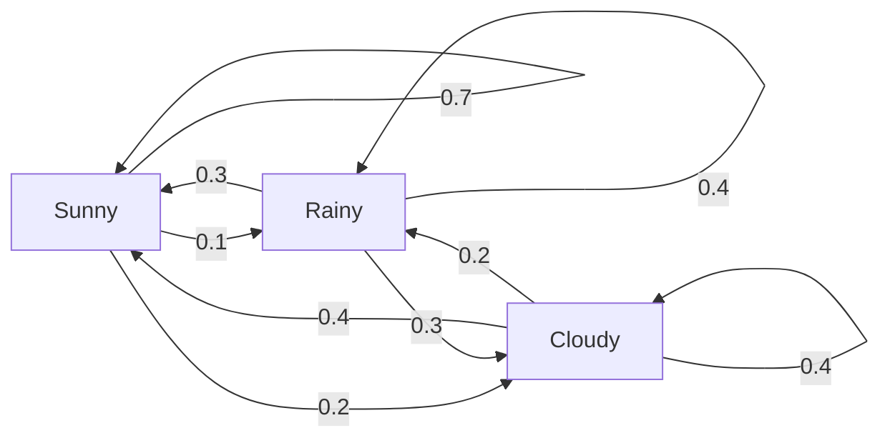
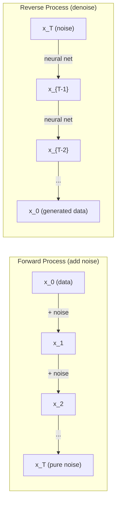

# Стохастические процессы

> Случайность со структурой. Математика позади случайных блужданий, цепей Маркова и моделей диффузии.

**Type:** Learn
**Language:** Python
**Prerequisites:** Phase 1, Lessons 06-07 (probability, Bayes)
**Time:** ~75 minutes

## Learning Objectives

- Симулировать одномерные и двумерные случайные блуждания и проверить масштабирование sqrt(n) смещения
- Построить симулятор цепи Маркова и вычислить её стационарное распределение через декомпозицию по собственным значениям
- Реализовать MCMC Metropolis-Hastings и динамику Ланжевена для выборки из целевых распределений
- Связать прямой процесс диффузии с броуновским движением и объяснить, как обратный процесс генерирует данные

## The Problem

Многие AI-системы включают случайность, которая эволюционирует во времени. Не статическую случайность — структурированную, последовательную случайность, где каждый шаг зависит от предыдущего.

Языковые модели генерируют токены один за другим. Каждый токен зависит от предыдущего контекста. Модель выводит распределение вероятностей, выборку из него и двигается дальше. Это стохастический процесс.

Модели диффузии добавляют шум к изображению шаг за шагом, пока оно не станет чистым статическим шумом. Затем они обращают процесс, убирая шум шаг за шагом, пока не появится новое изображение. Прямой процесс — это цепь Маркова. Обратный процесс — это обученная цепь Маркова, работающая в обратном направлении.

Агенты усиленного обучения выполняют действия в окружении. Каждое действие приводит к новому состоянию с некоторой вероятностью. Агент следует случайной политике в случайном мире. Всё это — марковский процесс принятия решений.

Выборка MCMC — основа байесовского вывода — конструирует цепь Маркова, чьё стационарное распределение является апостериори, из которого вы хотите выбирать.

Все это основано на четырёх фундаментальных идеях:
1. Случайные блуждания — простейший стохастический процесс
2. Цепи Маркова — структурированная случайность с матрицей переходов
3. Динамика Ланжевена — градиентный спуск с шумом
4. Metropolis-Hastings — выборка из любого распределения

## The Concept

### Случайные блуждания

Начните в позиции 0. На каждом шаге бросьте честную монету. Орёл: двигайтесь вправо (+1). Решка: двигайтесь влево (-1).

После n шагов ваша позиция — это сумма n случайных значений +/-1. Ожидаемая позиция равна 0 (блуждание несмещённое). Но ожидаемое расстояние от начала растёт как sqrt(n).

Это контринтуитивно. Блуждание честное — нет дрейфа в обе стороны. Но со временем оно блуждает всё дальше и дальше от начальной точки. Стандартное отклонение после n шагов равно sqrt(n).

```
Step 0:  Position = 0
Step 1:  Position = +1 or -1
Step 2:  Position = +2, 0, or -2
...
Step 100: Expected distance from origin ~ 10 (sqrt(100))
Step 10000: Expected distance from origin ~ 100 (sqrt(10000))
```

**В 2D** блуждание движется вверх, вниз, влево или вправо с равной вероятностью. То же масштабирование sqrt(n) применяется к расстоянию от начала. Путь образует фрактально-подобный паттерн.

**Почему sqrt(n)?** Каждый шаг это +1 или -1 с равной вероятностью. После n шагов позиция S_n = X_1 + X_2 + ... + X_n, где каждый X_i это +/-1. Дисперсия каждого шага равна 1, и шаги независимы, поэтому Var(S_n) = n. Стандартное отклонение = sqrt(n). По центральной предельной теореме S_n / sqrt(n) сходится к стандартному нормальному распределению.

Это масштабирование sqrt(n) появляется везде в ML. Шум SGD масштабируется как 1/sqrt(batch_size). Размеры эмбеддингов масштабируются как sqrt(d). Квадратный корень — это сигнатура независимых случайных добавлений.

**Связь с броуновским движением.** Возьмите случайное блуждание с размером шага 1/sqrt(n) и n шагов на единицу времени. Когда n стремится к бесконечности, блуждание сходится к броуновскому движению B(t) — процессу непрерывного времени, где B(t) нормально распределено со средним 0 и дисперсией t.

Броуновское движение — математическая основа диффузии. Оно моделирует случайное колебание частиц в жидкости, флуктуации цен акций и — решающее — процесс шума в моделях диффузии.

**Разорение игрока.** Случайный ходок, начиная в позиции k, с поглощающими барьерами в 0 и N. Какова вероятность достичь N раньше, чем 0? Для честного блуждания: P(reach N) = k/N. Это удивительно просто и элегантно. Это связано с теорией мартингалов — честное случайное блуждание это мартингал (ожидаемое будущее значение = текущее значение).

### Цепи Маркова

Цепь Маркова — это система, которая переходит между состояниями согласно фиксированным вероятностям. Ключевое свойство: следующее состояние зависит только от текущего состояния, а не от истории.

```
P(X_{t+1} = j | X_t = i, X_{t-1} = ...) = P(X_{t+1} = j | X_t = i)
```

Это свойство Маркова. Это означает, что вы можете описать всю динамику с помощью матрицы переходов P:

```
P[i][j] = probability of going from state i to state j
```

Каждая строка P суммируется в 1 (вы должны куда-то перейти).

**Пример — Погода:**

```
States: Sunny (0), Rainy (1), Cloudy (2)

P = [[0.7, 0.1, 0.2],    (if sunny: 70% sunny, 10% rainy, 20% cloudy)
     [0.3, 0.4, 0.3],    (if rainy: 30% sunny, 40% rainy, 30% cloudy)
     [0.4, 0.2, 0.4]]    (if cloudy: 40% sunny, 20% rainy, 40% cloudy)
```

Начните в любом состоянии. После множества переходов распределение состояний сходится к стационарному распределению pi, где pi * P = pi. Это левый собственный вектор P с собственным значением 1.

Для цепи погоды стационарное распределение это [0.55, 0.18, 0.27] — в долгосрочной перспективе солнечно 55% времени независимо от начального состояния.



**Вычисление стационарного распределения.** Есть два подхода:

1. **Степенной метод**: умножьте любое начальное распределение на P повторно. После достаточно большого количества итераций оно сходится.
2. **Метод собственных значений**: найдите левый собственный вектор P с собственным значением 1. Это правый собственный вектор P^T с собственным значением 1.

Оба подхода требуют, чтобы цепь удовлетворяла условиям сходимости.

**Условия сходимости.** Цепь Маркова сходится к уникальному стационарному распределению, если она:
- **Неприводима**: каждое состояние достижимо из любого другого состояния
- **Апериодична**: цепь не циклирует с фиксированным периодом

Большинство цепей, встречаемых в ML, удовлетворяют обоим условиям.

**Поглощающие состояния.** Состояние поглощающее, если, однажды войдя в него, вы никогда его не покидаете (P[i][i] = 1). Поглощающие цепи Маркова моделируют процессы с терминальными состояниями — игра, которая заканчивается, клиент, который ушёл, последовательность токенов, которая достигает токена конца текста.

**Время перемешивания.** Сколько шагов нужно, пока цепь не будет "близка" к стационарному распределению? Формально число шагов до того, как расстояние полной вариации от стационарности упадёт ниже некоторого порога. Быстрое перемешивание = мало нужных шагов. Спектральный зазор P (1 минус второе по величине собственное значение) контролирует время перемешивания. Больший зазор = быстрее перемешивание.

### Связь с языковыми моделями

Генерация токенов в языковой модели приблизительно является марковским процессом. Учитывая текущий контекст, модель выводит распределение над следующим токеном. Температура контролирует резкость:

```
P(token_i) = exp(logit_i / temperature) / sum(exp(logit_j / temperature))
```

- Температура = 1.0: стандартное распределение
- Температура < 1.0: резче (более детерминированно)
- Температура > 1.0: более плоское (более случайно)
- Температура -> 0: argmax (жадный)

Выборка Top-k усекает до k токенов с наибольшей вероятностью. Top-p (ядро) выборка усекает до наименьшего набора токенов, чья кумулятивная вероятность превышает p. Оба изменяют вероятности переходов марковской цепи.

### Броуновское движение

Предел непрерывного времени случайного блуждания. Позиция B(t) имеет три свойства:
1. B(0) = 0
2. B(t) - B(s) нормально распределено со средним 0 и дисперсией t - s (для t > s)
3. Приращения на неперекрывающихся интервалах независимы

Броуновское движение непрерывно, но не дифференцируемо нигде — оно колеблется на каждом масштабе. Путь имеет фрактальную размерность 2 на плоскости.

При дискретной симуляции вы аппроксимируете броуновское движение:

```
B(t + dt) = B(t) + sqrt(dt) * z,    where z ~ N(0, 1)
```

Масштабирование sqrt(dt) важно. Оно происходит из центральной предельной теоремы, применённой к случайным блужданиям.

### Динамика Ланжевена

Градиентный спуск находит минимум функции. Динамика Ланжевена находит распределение вероятностей, пропорциональное exp(-U(x)/T), где U — функция энергии и T — температура.

```
x_{t+1} = x_t - dt * gradient(U(x_t)) + sqrt(2 * T * dt) * z_t
```

Две силы действуют на частицу:
1. **Сила градиента** (-dt * gradient(U)): толкает к низкой энергии (как градиентный спуск)
2. **Случайная сила** (sqrt(2*T*dt) * z): толкает в случайные направления (исследование)

При температуре T = 0 это чистый градиентный спуск. При высокой температуре это почти случайное блуждание. При правильной температуре частица исследует энергетический ландшафт и тратит больше времени в низкоэнергетических регионах.

**Связь с моделями диффузии.** Прямой процесс модели диффузии это:

```
x_t = sqrt(alpha_t) * x_{t-1} + sqrt(1 - alpha_t) * noise
```

Это цепь Маркова, которая постепенно смешивает данные с шумом. После достаточного числа шагов x_T приблизительно N(0, I).

Обратный процесс — переход от шума обратно к данным — также цепь Маркова, но его вероятности переходов обучены нейронной сетью. Сеть учится предсказывать шум, который был добавлен на каждом шаге, затем вычитает его.



### MCMC: Markov Chain Monte Carlo

Иногда вам нужна выборка из распределения p(x), которое вы можете оценить (с точностью до константы), но не можете напрямую выбирать. Байесовские апостериори — классический пример — вы знаете вероятность, умноженную на априори, но нормирующая константа неприступна.

**Metropolis-Hastings** конструирует цепь Маркова, чьё стационарное распределение это p(x):

1. Начните в некоторой позиции x
2. Предложите новую позицию x' из распределения предложения Q(x'|x)
3. Вычислите коэффициент принятия: a = p(x') * Q(x|x') / (p(x) * Q(x'|x))
4. Принимите x' с вероятностью min(1, a). Иначе останьтесь в x.
5. Повторите.

Если Q симметрично (например, Q(x'|x) = Q(x|x') = N(x, sigma^2)), коэффициент упрощается до a = p(x') / p(x). Вам нужен только коэффициент вероятностей — нормирующая константа сокращается.

Цепь гарантированно сходится к p(x) при мягких условиях. Но сходимость может быть медленной, если предложение слишком маленькое (случайное блуждание) или слишком большое (высокое отклонение). Настройка предложения — это искусство MCMC.

**Почему это работает.** Коэффициент принятия обеспечивает детальный баланс: вероятность быть в x и перейти в x' равна вероятности быть в x' и перейти в x. Детальный баланс подразумевает, что p(x) — стационарное распределение цепи. Поэтому после достаточного числа шагов выборки происходят из p(x).

**Практические соображения:**
- **Burnin**: отбросьте первые N выборок. Цепи нужно время, чтобы достичь стационарного распределения от начальной точки.
- **Thinning**: сохраняйте каждую k-ую выборку, чтобы снизить автокорреляцию.
- **Множественные цепи**: запустите несколько цепей из разных начальных точек. Если они сходятся к одному распределению, у вас есть свидетельство сходимости.
- **Коэффициент принятия**: для гауссовых предложений в d измерениях оптимальный коэффициент принятия составляет около 23% (Roberts & Rosenthal, 2001). Слишком высокий означает, что цепь едва движется. Слишком низкий означает, что она отклоняет всё.

### Стохастические процессы в AI

| Процесс | Применение в AI |
|---------|-----------------|
| Случайное блуждание | Исследование в RL, эмбеддинги Node2Vec |
| Цепь Маркова | Генерация текста, выборка MCMC |
| Броуновское движение | Модели диффузии (прямой процесс) |
| Динамика Ланжевена | Модели генерирования на основе оценок, SGLD |
| Марковский процесс принятия решений | Усиленное обучение |
| Metropolis-Hastings | Байесовский вывод, выборка апостериори |

```figure
random-walk-diffusion
```

## Build It

### Step 1: Симулятор случайного блуждания

```python
import numpy as np

def random_walk_1d(n_steps, seed=None):
    rng = np.random.RandomState(seed)
    steps = rng.choice([-1, 1], size=n_steps)
    positions = np.concatenate([[0], np.cumsum(steps)])
    return positions


def random_walk_2d(n_steps, seed=None):
    rng = np.random.RandomState(seed)
    directions = rng.choice(4, size=n_steps)
    dx = np.zeros(n_steps)
    dy = np.zeros(n_steps)
    dx[directions == 0] = 1   # right
    dx[directions == 1] = -1  # left
    dy[directions == 2] = 1   # up
    dy[directions == 3] = -1  # down
    x = np.concatenate([[0], np.cumsum(dx)])
    y = np.concatenate([[0], np.cumsum(dy)])
    return x, y
```

1D блуждание сохраняет кумулятивные суммы. Каждый шаг это +1 или -1. После n шагов позиция — это сумма. Дисперсия растёт линейно с n, поэтому стандартное отклонение растёт как sqrt(n).

### Step 2: Цепь Маркова

```python
class MarkovChain:
    def __init__(self, transition_matrix, state_names=None):
        self.P = np.array(transition_matrix, dtype=float)
        self.n_states = len(self.P)
        self.state_names = state_names or [str(i) for i in range(self.n_states)]

    def step(self, current_state, rng=None):
        if rng is None:
            rng = np.random.RandomState()
        probs = self.P[current_state]
        return rng.choice(self.n_states, p=probs)

    def simulate(self, start_state, n_steps, seed=None):
        rng = np.random.RandomState(seed)
        states = [start_state]
        current = start_state
        for _ in range(n_steps):
            current = self.step(current, rng)
            states.append(current)
        return states

    def stationary_distribution(self):
        eigenvalues, eigenvectors = np.linalg.eig(self.P.T)
        idx = np.argmin(np.abs(eigenvalues - 1.0))
        stationary = np.real(eigenvectors[:, idx])
        stationary = stationary / stationary.sum()
        return np.abs(stationary)
```

Стационарное распределение — это левый собственный вектор P с собственным значением 1. Мы находим его, вычисляя собственные векторы P^T (транспонирование преобразует левые собственные векторы в правые).

### Step 3: Динамика Ланжевена

```python
def langevin_dynamics(grad_U, x0, dt, temperature, n_steps, seed=None):
    rng = np.random.RandomState(seed)
    x = np.array(x0, dtype=float)
    trajectory = [x.copy()]
    for _ in range(n_steps):
        noise = rng.randn(*x.shape)
        x = x - dt * grad_U(x) + np.sqrt(2 * temperature * dt) * noise
        trajectory.append(x.copy())
    return np.array(trajectory)
```

Градиент толкает x к низкой энергии. Шум предотвращает его застревание. При равновесии распределение выборок пропорционально exp(-U(x)/temperature).

### Step 4: Metropolis-Hastings

```python
def metropolis_hastings(target_log_prob, proposal_std, x0, n_samples, seed=None):
    rng = np.random.RandomState(seed)
    x = np.array(x0, dtype=float)
    samples = [x.copy()]
    accepted = 0
    for _ in range(n_samples - 1):
        x_proposed = x + rng.randn(*x.shape) * proposal_std
        log_ratio = target_log_prob(x_proposed) - target_log_prob(x)
        if np.log(rng.rand()) < log_ratio:
            x = x_proposed
            accepted += 1
        samples.append(x.copy())
    acceptance_rate = accepted / (n_samples - 1)
    return np.array(samples), acceptance_rate
```

Алгоритм предлагает новую точку, проверяет, имеет ли она более высокую вероятность (или принимает с вероятностью, пропорциональной коэффициенту), и повторяет. Коэффициент принятия должен быть около 23-50% для хорошего перемешивания.

## Use It

На практике вы используете установленные библиотеки для этих алгоритмов. Но понимание механики важно для отладки и настройки.

```python
import numpy as np

rng = np.random.RandomState(42)
walk = np.cumsum(rng.choice([-1, 1], size=10000))
print(f"Final position: {walk[-1]}")
print(f"Expected distance: {np.sqrt(10000):.1f}")
print(f"Actual distance: {abs(walk[-1])}")
```

### numpy для матриц переходов

```python
import numpy as np

P = np.array([[0.7, 0.1, 0.2],
              [0.3, 0.4, 0.3],
              [0.4, 0.2, 0.4]])

distribution = np.array([1.0, 0.0, 0.0])
for _ in range(100):
    distribution = distribution @ P

print(f"Stationary distribution: {np.round(distribution, 4)}")
```

Умножьте начальное распределение на P повторно. После достаточного количества итераций оно сходится к стационарному распределению независимо от того, где вы начали. Это степенной метод поиска доминирующего левого собственного вектора.

### Связи с реальными фреймворками

- **PyTorch diffusion:** `DDPMScheduler` в Hugging Face `diffusers` реализует прямые и обратные цепи Маркова
- **NumPyro / PyMC:** используют MCMC (семплер NUTS, который улучшает Metropolis-Hastings) для байесовского вывода
- **Gymnasium (RL):** функция step окружения определяет марковский процесс принятия решений

### Проверка сходимости цепи Маркова

```python
import numpy as np

P = np.array([[0.9, 0.1], [0.3, 0.7]])

eigenvalues = np.linalg.eigvals(P)
spectral_gap = 1 - sorted(np.abs(eigenvalues))[-2]
print(f"Eigenvalues: {eigenvalues}")
print(f"Spectral gap: {spectral_gap:.4f}")
print(f"Approximate mixing time: {1/spectral_gap:.1f} steps")
```

Спектральный зазор говорит, как быстро цепь забывает своё начальное состояние. Зазор 0.2 означает примерно 5 шагов перемешивания. Зазор 0.01 означает примерно 100 шагов. Всегда проверяйте это перед запуском длинных симуляций — медленно перемешивающаяся цепь тратит вычисления впустую.

## Ship It

Этот урок создаёт:
- `outputs/prompt-stochastic-process-advisor.md` — подсказку, которая помогает определить, какой фреймворк стохастического процесса применяется к данной задаче

## Connections

| Концепция | Где она появляется |
|-----------|-------------------|
| Случайное блуждание | Эмбеддинги Node2Vec графов, исследование в RL |
| Цепь Маркова | Генерация токенов в LLM, выборка MCMC |
| Броуновское движение | Прямой процесс диффузии в DDPM, модели на основе SDE |
| Динамика Ланжевена | Модели генерирования на основе оценок, стохастическая градиентная динамика Ланжевена (SGLD) |
| Стационарное распределение | Целевая сходимость MCMC, PageRank |
| Metropolis-Hastings | Выборка апостериори Байеса, имитируемый отжиг |
| Температура | Выборка LLM, исследование Больцмана в RL, имитируемый отжиг |
| Время перемешивания | Скорость сходимости MCMC, анализ спектрального зазора |
| Поглощающее состояние | Токен конца последовательности, терминальные состояния в RL |
| Детальный баланс | Гарантия корректности для семплеров MCMC |

Модели диффузии заслуживают особого внимания. DDPM (Ho et al., 2020) определяет прямую цепь Маркова:

```
q(x_t | x_{t-1}) = N(x_t; sqrt(1-beta_t) * x_{t-1}, beta_t * I)
```

где beta_t — это график шума. После T шагов x_T приблизительно N(0, I). Обратный процесс параметризован нейронной сетью, которая предсказывает шум:

```
p_theta(x_{t-1} | x_t) = N(x_{t-1}; mu_theta(x_t, t), sigma_t^2 * I)
```

Каждый шаг генерирования — это шаг в обученной цепи Маркова. Понимание цепей Маркова означает понимание того, как и почему модели диффузии генерируют данные.

SGLD (Stochastic Gradient Langevin Dynamics) комбинирует мини-пакетный градиентный спуск с шумом Ланжевена. Вместо вычисления полного градиента вы используете стохастическую оценку и добавляете откалиброванный шум. При затухании скорости обучения SGLD переходит от оптимизации к выборке — вы получаете приблизительные байесовские выборки апостериори бесплатно. Это один из самых простых способов получить оценки неопределённости из нейронной сети.

Ключевое понимание во всех этих связях: стохастические процессы — это не просто теоретические инструменты. Они являются вычислительными механизмами внутри современных систем AI. Когда вы настраиваете температуру LLM, вы настраиваете цепь Маркова. Когда вы тренируете модель диффузии, вы учитесь обращать процесс, похожий на броуновское движение. Когда вы запускаете байесовский вывод, вы конструируете цепь, которая сходится к апостериори.

## Exercises

1. **Симулируйте 1000 случайных блужданий по 10000 шагов.** Постройте график распределения конечных позиций. Проверьте, что оно приблизительно гауссово со средним 0 и стандартным отклонением sqrt(10000) = 100.

2. **Постройте генератор текста, используя цепь Маркова.** Тренируйте на маленьком корпусе: для каждого слова подсчитайте переходы к следующему слову. Постройте матрицу переходов. Генерируйте новые предложения, выбирая из цепи.

3. **Реализуйте имитируемый отжиг** используя Metropolis-Hastings. Начните при высокой температуре (принимайте почти всё) и постепенно охлаждайтесь (принимайте только улучшения). Используйте это для поиска минимума функции со множеством локальных минимумов.

4. **Сравните динамику Ланжевена при разных температурах.** Выборка из двойного потенциала U(x) = (x^2 - 1)^2. При низкой температуре выборки кластеризуются в одной яме. При высокой температуре они распределяются по обеим ямам. Найдите критическую температуру, где цепь перемешивается между ямами.

5. **Реализуйте прямой процесс диффузии.** Начните с 1D сигнала (например, синусоидальную волну). Добавляйте шум прогрессивно более чем за 100 шагов с линейным графиком шума. Покажите, как сигнал деградирует в чистый шум. Затем реализуйте простой шумоподавитель, который обращает процесс (даже наивный, который просто вычитает предполагаемый шум).

## Key Terms

| Термин | Что люди говорят | Что это на самом деле означает |
|--------|-----------------|-------------------------------|
| Случайное блуждание | "Движение от бросания монеты" | Процесс, где позиция изменяется на случайные приращения на каждом шаге |
| Свойство Маркова | "Без памяти" | Будущее зависит только от текущего состояния, а не от истории |
| Матрица переходов | "Таблица вероятностей" | P[i][j] = вероятность перехода из состояния i в состояние j |
| Стационарное распределение | "Долгосрочный средний" | Распределение pi, где pi*P = pi — равновесие цепи |
| Броуновское движение | "Случайное колебание" | Предел непрерывного времени случайного блуждания, B(t) ~ N(0, t) |
| Динамика Ланжевена | "Градиентный спуск с шумом" | Правило обновления, которое объединяет детерминированный градиент и случайное возмущение |
| MCMC | "Ходьба к цели" | Конструирование цепи Маркова, чьё стационарное распределение это то, которое вам нужно |
| Metropolis-Hastings | "Предложи и принимай/отклоняй" | Алгоритм MCMC, который использует коэффициенты принятия для обеспечения сходимости |
| Температура | "Ручка случайности" | Параметр, управляющий компромиссом между исследованием и эксплуатацией |
| Процесс диффузии | "Шум в, шум из" | Прямой: постепенно добавляйте шум. Обратный: постепенно удаляйте его. Генерирует данные. |

## Further Reading

- **Ho, Jain, Abbeel (2020)** -- "Denoising Diffusion Probabilistic Models." Статья DDPM, которая запустила революцию моделей диффузии. Чёткая выводимость прямых и обратных цепей Маркова.
- **Song & Ermon (2019)** -- "Generative Modeling by Estimating Gradients of the Data Distribution." Подход на основе оценок, использующий динамику Ланжевена для выборки.
- **Roberts & Rosenthal (2004)** -- "General state space Markov chains and MCMC algorithms." Теория позади того, когда и почему работает MCMC.
- **Norris (1997)** -- "Markov Chains." Стандартный учебник. Охватывает сходимость, стационарные распределения и времена попадания.
- **Welling & Teh (2011)** -- "Bayesian Learning via Stochastic Gradient Langevin Dynamics." Объединяет SGD с динамикой Ланжевена для масштабируемого байесовского вывода.