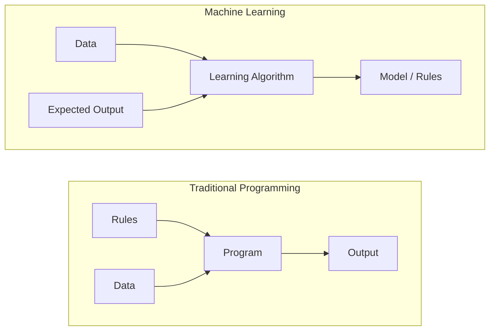
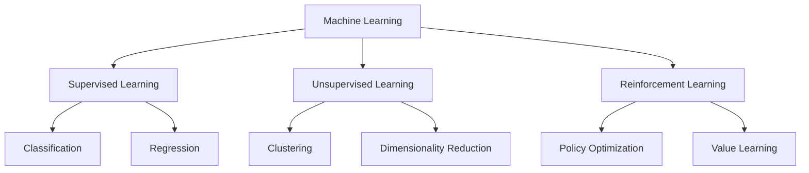
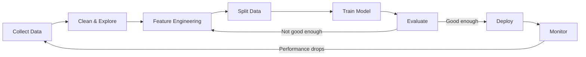
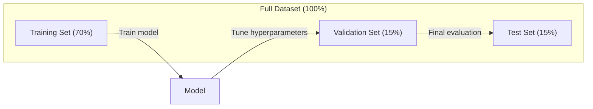
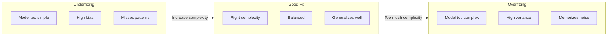
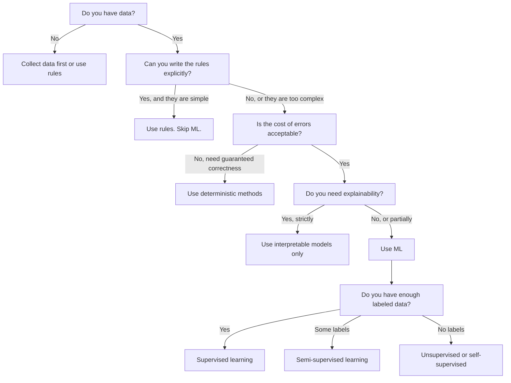

# Что такое машинное обучение

> Машинное обучение — это обучение компьютеров находить закономерности в данных вместо того, чтобы писать правила вручную.

**Type:** Learn
**Languages:** Python
**Prerequisites:** Phase 1 (Математические основы)
**Time:** ~45 минут

## Цели обучения

- Объяснить разницу между обучением с учителем, без учителя и с подкреплением и определять, какой тип подходит для заданной задачи
- Реализовать с нуля классификатор ближайшего центроида и сравнить его со случайным базовым решением
- Различать задачи классификации и регрессии и выбирать подходящую функцию потерь для каждой из них
- Оценивать, подходит ли конкретная бизнес-задача для ML или лучше решается детерминированными правилами

## Проблема

Вы хотите построить спам-фильтр. Традиционный подход: сесть и написать сотни правил. «Если письмо содержит 'FREE MONEY', пометить как спам. Если в нём больше 3 восклицательных знаков, пометить как спам». Вы тратите недели на написание правил. Затем спамеры меняют формулировки. Ваши правила перестают работать. Вы пишете ещё правила. Цикл никогда не заканчивается.

Машинное обучение переворачивает этот подход. Вместо написания правил вы даёте компьютеру тысячи размеченных писем («спам» или «не спам») и позволяете ему самому вывести правила. Компьютер находит закономерности, до которых вы бы никогда не додумались. Когда спамеры меняют тактику, вы переобучаете модель на новых данных вместо переписывания кода.

Этот переход от «программирования правил» к «обучению на данных» лежит в основе машинного обучения. Каждая рекомендательная система, голосовой помощник, беспилотный автомобиль и языковая модель работают именно так.

## Концепция

### Обучение на данных, а не на правилах

Традиционное программирование и машинное обучение решают задачи в противоположных направлениях.



Традиционное программирование: вы пишете правила. Программа применяет их к данным, чтобы получить результат.

Машинное обучение: вы предоставляете данные и ожидаемые результаты. Алгоритм сам находит правила.

«Модель», получаемая в результате обучения, И ЕСТЬ эти правила, закодированные в виде чисел (весов, параметров). Она обобщает примеры, которые видела, чтобы делать предсказания на данных, которых никогда не встречала.

### Три типа машинного обучения



**Обучение с учителем (Supervised Learning)**: у вас есть пары «вход-выход». Модель учится отображать входы в выходы.
- «Вот 10 000 фотографий с подписью кошка или собака. Научись их различать».
- «Вот характеристики домов и их цены. Научись предсказывать цену».

**Обучение без учителя (Unsupervised Learning)**: у вас есть только входные данные. Без меток. Модель сама находит структуру.
- «Вот 10 000 историй покупок клиентов. Найди естественные группы».
- «Вот точки данных в 1000-мерном пространстве. Сократи до 2 измерений, сохранив структуру».

**Обучение с подкреплением (Reinforcement Learning)**: агент совершает действия в среде и получает награды или штрафы. Он учится стратегии (политике) для максимизации суммарной награды.
- «Играй в эту игру. +1 за победу, -1 за поражение. Придумай стратегию».
- «Управляй этой роботизированной рукой. +1 за захват объекта, -0.01 за каждую потраченную секунду».

Большая часть того, что вы будете строить на практике, использует обучение с учителем. Обучение без учителя часто применяется для предобработки и исследования данных. Обучение с подкреплением лежит в основе игрового ИИ, робототехники и RLHF для языковых моделей.

### За пределами большой тройки

Три категории выше — чёткие и ясные, но в реальном мире ML часто размывает эти границы.

**Полу-контролируемое обучение (Semi-supervised learning)** использует небольшой набор размеченных данных и большой набор неразмеченных. У вас может быть 100 размеченных медицинских изображений и 100 000 неразмеченных. Техники включают:

- **Распространение меток (Label propagation):** постройте граф, соединяющий похожие точки данных. Метки распространяются от размеченных узлов к неразмеченным соседям через граф.
- **Псевдо-разметка (Pseudo-labeling):** обучите модель на размеченных данных, используйте её для предсказания меток неразмеченных данных, затем переобучите на всём наборе. Модель сама формирует свой обучающий набор.
- **Регуляризация согласованности (Consistency regularization):** модель должна давать одинаковое предсказание для входа и его слегка искажённой версии. Это работает даже без меток.

**Самоконтролируемое обучение (Self-supervised learning)** создаёт разметку из самих данных. Человеческая разметка вообще не нужна. Модель сама создаёт задачу предсказания из структуры данных.

- **Маскированное языковое моделирование (BERT):** скройте 15% слов в предложении, обучите модель предсказывать пропущенные слова. «Метки» берутся из исходного текста.
- **Контрастивное обучение (SimCLR):** возьмите изображение, создайте две аугментированные версии. Обучите модель распознавать, что они происходят из одного изображения, отличая их от аугментированных версий других изображений.
- **Предсказание следующего токена (GPT):** предсказывайте следующее слово по всем предыдущим словам. Каждый текстовый документ становится обучающим примером.

Это не отдельные категории от большой тройки. Это стратегии, объединяющие идеи обучения с учителем и без учителя. Самоконтролируемое обучение технически является обучением с учителем (модель что-то предсказывает), но метки генерируются автоматически, а не человеком.

### Классификация против регрессии

Это две основные задачи обучения с учителем.

| Аспект | Классификация | Регрессия |
|--------|---------------|------------|
| Выход | Дискретные категории | Непрерывные числа |
| Пример | «Это письмо — спам?» | «Какой будет цена дома?» |
| Пространство выхода | {кошка, собака, птица} | Любое вещественное число |
| Функция потерь | Кросс-энтропия, точность | Среднеквадратичная ошибка, MAE |
| Решение | Границы между классами | Кривая, подогнанная под данные |

Классификация отвечает на вопрос «какая категория?» Регрессия отвечает на вопрос «сколько?»

Некоторые задачи можно сформулировать и так, и так. Предсказание, пойдёт ли акция вверх или вниз, — это классификация. Предсказание точной цены — это регрессия.

### Рабочий процесс ML

Каждый проект машинного обучения следует одному и тому же конвейеру, независимо от алгоритма.



**Сбор данных**: соберите исходные данные. Больше данных почти всегда лучше, но качество важнее количества.

**Очистка и исследование**: обработайте пропущенные значения, удалите дубликаты, визуализируйте распределения, выявите аномалии. Этот шаг часто занимает 60-80% всего времени проекта.

**Разработка признаков (Feature Engineering)**: преобразуйте исходные данные в признаки, которые модель может использовать. Превратите даты в день недели. Нормализуйте числовые столбцы. Закодируйте категориальные переменные. Хорошие признаки важнее навороченных алгоритмов.

**Разбиение данных**: разделите на обучающую, валидационную и тестовую выборки. Модель обучается на обучающих данных, вы настраиваете гиперпараметры на валидационных данных и сообщаете итоговую производительность на тестовых данных.

**Обучение модели**: подайте обучающие данные в алгоритм. Алгоритм подстраивает внутренние параметры, чтобы минимизировать функцию потерь.

**Оценка**: измерьте производительность на валидационных/тестовых данных. Если производительность неприемлема, вернитесь назад и попробуйте другие признаки, алгоритмы или гиперпараметры.

**Развёртывание**: внедрите модель в промышленную эксплуатацию, где она делает предсказания на новых данных.

**Мониторинг**: отслеживайте производительность со временем. Распределения данных меняются (дрейф данных), и модели деградируют. Когда производительность падает — переобучайте.

### Обучающая, валидационная и тестовая выборки

Это самое важное понятие, которое начинающие понимают неправильно. Вы должны оценивать модель на данных, которых она никогда не видела во время обучения. Иначе вы измеряете запоминание, а не обучение.



| Выборка | Назначение | Когда используется | Типичный размер |
|-------|---------|-----------|-------------|
| Обучающая | Модель учится на этих данных | Во время обучения | 60-80% |
| Валидационная | Настройка гиперпараметров, сравнение моделей | После каждого цикла обучения | 10-20% |
| Тестовая | Итоговая непредвзятая оценка производительности | Один раз, в самом конце | 10-20% |

Тестовая выборка священна. Вы смотрите на неё ровно один раз. Если вы продолжаете корректировать модель на основе результатов на тестовой выборке, вы фактически обучаетесь на тестовом наборе, и ваши итоговые показатели теряют смысл.

Для небольших датасетов используйте k-блочную кросс-валидацию: разбейте данные на k частей, обучайтесь на k-1 частях, проверяйте на оставшейся части, чередуйте и усредняйте результаты.

### Переобучение против недообучения



**Недообучение (Underfitting)**: модель слишком проста, чтобы уловить закономерности в данных. Прямая линия, пытающаяся подогнаться под изогнутую зависимость. Ошибка на обучении высока. Ошибка на тесте высока.

**Переобучение (Overfitting)**: модель слишком сложна и запоминает обучающие данные, включая шум. Извилистая кривая, проходящая через каждую обучающую точку, но не работающая на новых данных. Ошибка на обучении низка. Ошибка на тесте высока.

**Хорошая подгонка**: модель улавливает реальные закономерности, не запоминая шум. Ошибка на обучении и ошибка на тесте обе достаточно низки.

Признаки переобучения:
- Точность на обучении значительно выше точности на валидации
- Модель хорошо работает на обучающих данных, но плохо на новых
- Добавление новых обучающих данных улучшает производительность (модель запоминала, а не училась)

Способы борьбы с переобучением:
- Получить больше обучающих данных
- Уменьшить сложность модели (меньше параметров, более простая архитектура)
- Регуляризация (добавить штраф за большие веса)
- Dropout (случайно обнулять нейроны во время обучения)
- Ранняя остановка (остановить обучение, когда ошибка на валидации начинает расти)

Способы борьбы с недообучением:
- Использовать более сложную модель
- Добавить больше признаков
- Уменьшить регуляризацию
- Обучать дольше

### Компромисс смещение-дисперсия (Bias-Variance Tradeoff)

Это математическая основа, лежащая за переобучением и недообучением.

**Смещение (Bias)**: ошибка из-за неверных предположений модели. Линейная модель имеет высокое смещение, когда истинная зависимость нелинейна. Высокое смещение приводит к недообучению.

**Дисперсия (Variance)**: ошибка из-за чувствительности к небольшим колебаниям в обучающих данных. Модель с высокой дисперсией даёт очень разные предсказания при обучении на разных подвыборках данных. Высокая дисперсия приводит к переобучению.

| Сложность модели | Смещение | Дисперсия | Результат |
|-----------------|------|----------|--------|
| Слишком низкая (линейная модель для изогнутых данных) | Высокое | Низкая | Недообучение |
| Подходящая | Среднее | Средняя | Хорошее обобщение |
| Слишком высокая (полином 20-й степени для 10 точек) | Низкое | Высокая | Переобучение |

Суммарная ошибка = Смещение^2 + Дисперсия + Неустранимый шум

Неустранимый шум нельзя уменьшить (это случайность самих данных). Вы хотите найти оптимальную точку, где минимизируется сумма смещение^2 + дисперсия.

### Теорема об отсутствии бесплатных обедов (No Free Lunch Theorem)

Не существует единственного алгоритма, который лучше всего работает для каждой задачи. Алгоритм, который хорошо справляется с одним классом задач, будет плохо работать на другом. Поэтому специалисты по данным пробуют несколько алгоритмов и сравнивают результаты.

На практике выбор зависит от:
- Сколько у вас данных
- Сколько признаков
- Является ли зависимость линейной или нелинейной
- Нужна ли вам интерпретируемость
- Сколько вычислительных ресурсов вы можете себе позволить

### Когда НЕ стоит использовать машинное обучение

ML мощный инструмент, но не всегда подходящий. Прежде чем браться за модель, спросите себя, действительно ли она нужна.

**Не используйте ML, когда:**

- **Правила простые и чётко определены.** Расчёт налогов, алгоритмы сортировки, преобразование единиц измерения. Если логику можно записать в виде нескольких if-операторов, модель добавляет сложность без какой-либо пользы.
- **У вас нет данных или их очень мало.** ML нужны примеры для обучения. На 10 точках данных нельзя обучить ничего осмысленного. Сначала соберите данные.
- **Цена ошибки катастрофична, и вам нужна гарантированная корректность.** Расчёт дозировки лекарств, управление ядерным реактором, криптографическая верификация. ML-модели вероятностны. Они иногда ошибаются. Если «иногда ошибается» неприемлемо — используйте детерминированные методы.
- **Таблица соответствий или эвристика решает задачу.** Если простой порог или таблица покрывают 99% случаев, добавление ML увеличивает затраты на поддержку без значимого улучшения.
- **Вы не можете объяснить решение, а объяснимость требуется.** В регулируемых отраслях (кредитование, страхование, уголовное правосудие) иногда требуется, чтобы каждое решение было полностью объяснимо. Некоторые ML-модели интерпретируемы (линейная регрессия, небольшие деревья решений). Большинство — нет.
- **Задача меняется быстрее, чем вы успеваете переобучать модель.** Если правила меняются ежедневно, а переобучение занимает неделю, модель всегда устаревает.

Используйте эту блок-схему решения:



```figure
f3-learning-boundary
```

## Реализация

Код в `code/ml_intro.py` реализует с нуля классификатор ближайшего центроида — простейший из возможных ML-алгоритмов. Он демонстрирует основную идею: учиться на данных, затем предсказывать на новых данных.

### Шаг 1: классификатор ближайшего центроида с нуля

Классификатор ближайшего центроида вычисляет центр (среднее) каждого класса в обучающих данных. Для предсказания он присваивает каждой новой точке класс, центр которого к ней ближе всего.

```python
class NearestCentroid:
    def fit(self, X, y):
        self.classes = np.unique(y)
        self.centroids = np.array([
            X[y == c].mean(axis=0) for c in self.classes
        ])

    def predict(self, X):
        distances = np.array([
            np.sqrt(((X - c) ** 2).sum(axis=1))
            for c in self.centroids
        ])
        return self.classes[distances.argmin(axis=0)]
```

Это и есть весь алгоритм. Fit вычисляет два средних. Predict вычисляет расстояния. Никакого градиентного спуска, никаких итераций, никаких гиперпараметров.

### Шаг 2: обучение на синтетических данных

Мы создаём двумерный датасет для классификации с двумя слегка перекрывающимися классами. Классификатор центроидов проводит линейную границу решения между центрами классов.

```python
rng = np.random.RandomState(42)
X_class0 = rng.randn(100, 2) + np.array([1.0, 1.0])
X_class1 = rng.randn(100, 2) + np.array([-1.0, -1.0])
X = np.vstack([X_class0, X_class1])
y = np.array([0] * 100 + [1] * 100)
```

### Шаг 3: сравнение с базовым решением

Каждую ML-модель следует сравнивать с тривиальным базовым решением. Здесь базовое решение предсказывает случайный класс. Если ваша ML-модель не превосходит случайное угадывание, что-то не так.

```python
baseline_preds = rng.choice([0, 1], size=len(y_test))
baseline_acc = np.mean(baseline_preds == y_test)
```

Классификатор центроидов должен получить около 90%+ точности на этом чистом датасете. Случайное базовое решение получает около 50%.

### Почему это важно

Классификатор ближайшего центроида тривиально прост. У него нет гиперпараметров, нет итераций, нет градиентного спуска. Тем не менее он отражает фундаментальный паттерн ML:

1. **Обучиться (Learn)** представлению на обучающих данных (центроиды)
2. **Предсказать (Predict)** на новых данных, используя это представление (ближайшее расстояние)
3. **Оценить (Evaluate)** относительно базового решения (случайное угадывание)

Каждый ML-алгоритм, от логистической регрессии до трансформеров, следует этому же трёхшаговому паттерну. Представление становится сложнее, но рабочий процесс остаётся тем же.

### Шаг 4: что классификатор центроида не умеет

Классификатор ближайшего центроида предполагает, что каждый класс образует единое облако. Он проводит линейные границы решения. Он не справляется, когда:

- У классов несколько кластеров (например, цифра «1» может быть написана несколькими разными способами)
- Граница решения нелинейна (например, один класс огибает другой)
- Признаки имеют очень разные масштабы (расстояние доминируется признаком с наибольшим масштабом)

Эти ограничения мотивируют появление каждого следующего алгоритма, который вы изучите. K-ближайших соседей справляется с несколькими кластерами. Деревья решений справляются с нелинейными границами. Масштабирование признаков решает проблему масштаба. Каждый урок строится на ограничениях предыдущего.

## Применение

sklearn предоставляет `NearestCentroid` и генераторы синтетических данных:

```python
from sklearn.neighbors import NearestCentroid
from sklearn.datasets import make_classification
from sklearn.model_selection import train_test_split

X, y = make_classification(
    n_samples=500, n_features=2, n_redundant=0,
    n_clusters_per_class=1, random_state=42
)
X_train, X_test, y_train, y_test = train_test_split(X, y, test_size=0.3)

clf = NearestCentroid()
clf.fit(X_train, y_train)
print(f"Accuracy: {clf.score(X_test, y_test):.3f}")
```

## Публикация

Этот урок создаёт `outputs/prompt-ml-problem-framer.md` — промпт, который превращает расплывчатые бизнес-задачи в конкретные ML-задачи. Дайте ему описание задачи («мы хотим снизить отток клиентов» или «предсказать спрос на следующий квартал»), и он определит тип обучения, задаст целевую переменную предсказания, перечислит кандидатов на признаки, подберёт метрику успеха, установит базовое решение и отметит подводные камни, такие как утечка данных или дисбаланс классов. Используйте его в начале любого ML-проекта, чтобы не строить не то, что нужно.

## Ключевые термины

| Термин | Что обычно говорят | Что это на самом деле означает |
|------|----------------|----------------------|
| Модель (Model) | «Искусственный интеллект» | Математическая функция с обучаемыми параметрами, отображающая входы в выходы |
| Обучение (Training) | «Обучение ИИ» | Запуск алгоритма оптимизации для подстройки параметров модели так, чтобы предсказания совпадали с известными выходами |
| Признак (Feature) | «Входной столбец» | Измеримое свойство данных, которое модель использует для предсказаний |
| Метка (Label) | «Ответ» | Известный выход для обучающего примера, используемый для вычисления сигнала ошибки |
| Гиперпараметр (Hyperparameter) | «Настройка, которую подкручивают» | Параметр, устанавливаемый до обучения, который управляет процессом обучения (скорость обучения, число слоёв) |
| Функция потерь (Loss function) | «Насколько ошибается модель» | Функция, измеряющая разрыв между предсказанными и фактическими выходами, которую обучение пытается минимизировать |
| Переобучение (Overfitting) | «Запомнила тест» | Модель выучила шум, специфичный для обучающих данных, вместо общих закономерностей, из-за чего проваливается на новых данных |
| Недообучение (Underfitting) | «Ничему не научилась» | Модель слишком проста, чтобы уловить реальные закономерности в данных |
| Обобщение (Generalization) | «Работает на новых данных» | Способность модели делать точные предсказания на данных, на которых она не обучалась |
| Кросс-валидация (Cross-validation) | «Тестирование на разных кусках» | Многократное разбиение данных на обучающие/тестовые части и усреднение результатов, дающее более устойчивую оценку производительности |
| Регуляризация (Regularization) | «Удержание весов небольшими» | Добавление штрафного члена к функции потерь, препятствующего чрезмерно сложным моделям |
| Дрейф данных (Data drift) | «Мир изменился» | Статистическое распределение входящих данных смещается со временем, ухудшая производительность модели |

## Упражнения

1. Возьмите любой датасет (например, Iris, Titanic). Разбейте его 70/15/15 на обучающую, валидационную и тестовую выборки. Объясните, почему нельзя настраивать гиперпараметры на тестовой выборке.
2. Перечислите три реальные задачи. Для каждой определите, является ли она классификацией, регрессией или кластеризацией, и является ли она обучением с учителем или без учителя.
3. Модель получает 99% точности на обучающих данных, но 60% на тестовых. Диагностируйте проблему и перечислите три способа её устранения, которые вы бы попробовали.

## Дополнительное чтение

- [An Introduction to Statistical Learning](https://www.statlearning.com/) — бесплатный учебник, охватывающий все классические методы ML с практическими примерами
- [Google's Machine Learning Crash Course](https://developers.google.com/machine-learning/crash-course) — краткое наглядное введение в концепции ML
- [Scikit-learn User Guide](https://scikit-learn.org/stable/user_guide.html) — практический справочник по реализации ML на Python