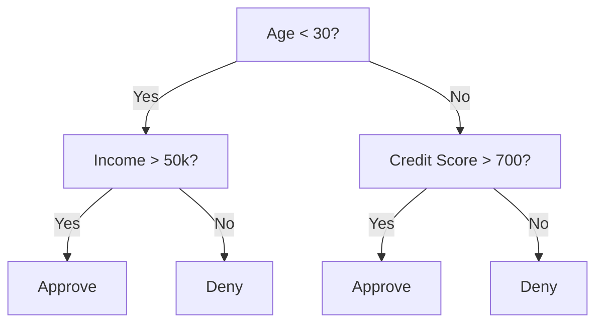
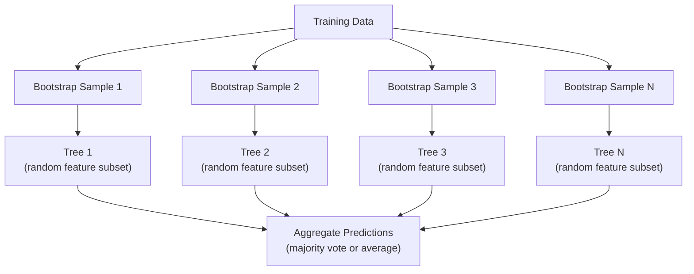

# Деревья решений и случайные леса

> Дерево решений — это просто блок-схема. Но лес из таких деревьев — один из самых мощных инструментов в ML.

**Type:** Build
**Language:** Python
**Prerequisites:** Phase 1 (Lessons 09 Information Theory, 06 Probability)
**Time:** ~90 минут

## Цели обучения

- Реализовать вычисление коэффициента Джини, энтропии и информационного выигрыша для поиска оптимальных разбиений дерева решений
- Построить классификатор на основе дерева решений с нуля с механизмами пре-прунинга (максимальная глубина, минимальное число образцов)
- Построить случайный лес с использованием бутстрэп-выборки и рандомизации признаков и объяснить, почему это снижает дисперсию
- Сравнить важность признаков по MDI с перестановочной важностью (permutation importance) и определить, когда MDI даёт смещённую оценку

## Проблема

У вас есть табличные данные. Строки — это образцы, столбцы — признаки, и есть целевой столбец, который нужно предсказать. Можно было бы бросить на это нейронную сеть. Но для табличных данных древовидные модели (деревья решений, случайные леса, градиентный бустинг деревьев) стабильно превосходят глубокое обучение. Соревнования Kaggle по структурированным данным доминируются XGBoost и LightGBM, а не трансформерами.

Почему? Деревья обрабатывают смешанные типы признаков (числовые и категориальные) без предобработки. Они обрабатывают нелинейные зависимости без разработки признаков. Они интерпретируемы: вы можете посмотреть на дерево и увидеть, почему именно был сделан тот или иной прогноз. А случайные леса, усредняющие множество деревьев, обладают высокой устойчивостью к переобучению на наборах данных умеренного размера.

В этом уроке деревья решений строятся с нуля с помощью рекурсивного разбиения, а затем на их основе строится случайный лес. Вы реализуете математику, стоящую за критериями разбиения (коэффициент Джини, энтропия, информационный выигрыш), и поймёте, почему ансамбль слабых моделей становится сильной моделью.

## Концепция

### Что делает дерево решений

Дерево решений разбивает пространство признаков на прямоугольные области, задавая последовательность вопросов «да/нет».



Каждый внутренний узел проверяет признак относительно порогового значения. Каждый лист делает предсказание. Чтобы классифицировать новую точку данных, вы начинаете с корня и следуете по ветвям, пока не достигнете листа.

Дерево строится сверху вниз: на каждом узле выбирается признак и порог, которые лучше всего разделяют данные. «Лучше всего» определяется критерием разбиения.

### Критерии разбиения: измерение примеси

В каждом узле у нас есть набор образцов. Мы хотим разбить их так, чтобы получившиеся дочерние узлы были максимально «чистыми», то есть чтобы каждый дочерний узел содержал преимущественно один класс.

**Коэффициент Джини (Gini impurity)** измеряет вероятность того, что случайно выбранный образец будет классифицирован неверно, если его метить согласно распределению классов в данном узле.

```
Gini(S) = 1 - sum(p_k^2)

where p_k is the proportion of class k in set S.
```

Для чистого узла (все образцы одного класса) Gini = 0. Для бинарного разбиения с распределением классов 50/50 Gini = 0.5. Чем меньше, тем лучше.

```
Example: 6 cats, 4 dogs

Gini = 1 - (0.6^2 + 0.4^2) = 1 - (0.36 + 0.16) = 0.48
```

**Энтропия** измеряет информационное содержание (беспорядок) в узле. Рассматривалась в Phase 1 Lesson 09.

```
Entropy(S) = -sum(p_k * log2(p_k))
```

Для чистого узла энтропия = 0. Для бинарного разбиения 50/50 энтропия = 1.0. Чем меньше, тем лучше.

```
Example: 6 cats, 4 dogs

Entropy = -(0.6 * log2(0.6) + 0.4 * log2(0.4))
        = -(0.6 * -0.737 + 0.4 * -1.322)
        = 0.442 + 0.529
        = 0.971 bits
```

**Информационный выигрыш (information gain)** — это уменьшение примеси (энтропии или Джини) после разбиения.

```
IG(S, feature, threshold) = Impurity(S) - weighted_avg(Impurity(S_left), Impurity(S_right))

where the weights are the proportions of samples in each child.
```

Жадный алгоритм в каждом узле: перебрать все признаки и все возможные пороги. Выбрать пару (признак, порог), максимизирующую информационный выигрыш.

### Как работает разбиение

Для набора данных с n признаками и m образцами в текущем узле:

1. Для каждого признака j (j = от 1 до n):
   - Отсортировать образцы по признаку j
   - Попробовать в качестве порога каждую среднюю точку между последовательными различными значениями
   - Вычислить информационный выигрыш для каждого порога
2. Выбрать признак и порог с наибольшим информационным выигрышем
3. Разбить данные на левую (признак <= порог) и правую (признак > порог) части
4. Рекурсивно повторить для каждого дочернего узла

Этот жадный подход не гарантирует глобально оптимальное дерево. Поиск оптимального дерева является NP-трудной задачей. Но жадное разбиение хорошо работает на практике.

### Условия остановки

Без условий остановки дерево растёт, пока каждый лист не станет чистым (один образец на лист). Это приводит к идеальному запоминанию обучающих данных и крайне плохому обобщению.

**Пре-прунинг (pre-pruning)** останавливает рост дерева до его полного построения:
- Максимальная глубина: прекратить разбиение, когда дерево достигает заданной глубины
- Минимальное число образцов на лист: остановиться, если в узле меньше k образцов
- Минимальный информационный выигрыш: остановиться, если лучшее разбиение улучшает примесь меньше, чем на пороговое значение
- Максимальное число листьев: ограничить общее количество листьев

**Пост-прунинг (post-pruning)** выращивает полное дерево, а затем обрезает его:
- Прунинг по стоимости-сложности (используется в scikit-learn): добавляет штраф, пропорциональный числу листьев. Увеличение штрафа даёт более компактные деревья
- Прунинг по уменьшению ошибки: удалить поддерево, если ошибка на валидации не возрастает

Пре-прунинг проще и быстрее. Пост-прунинг часто даёт лучшие деревья, потому что он не останавливает преждевременно разбиения, которые могли бы привести к полезным дальнейшим разбиениям.

### Деревья решений для регрессии

Для регрессии предсказание в листе — это среднее значение целевой переменной в этом листе. Критерий разбиения тоже меняется:

**Уменьшение дисперсии (variance reduction)** заменяет информационный выигрыш:

```
VR(S, feature, threshold) = Var(S) - weighted_avg(Var(S_left), Var(S_right))
```

Выбирается разбиение, которое уменьшает дисперсию сильнее всего. Дерево разбивает входное пространство на области и предсказывает константу (среднее) в каждой из них.

### Случайные леса: сила ансамблей

Одно дерево решений обладает высокой дисперсией. Небольшие изменения в данных могут приводить к совершенно разным деревьям. Случайные леса устраняют эту проблему, усредняя множество деревьев.



Разнообразие деревьев обеспечивается двумя источниками случайности:

**Бэггинг (бутстрэп-агрегирование):** Каждое дерево обучается на бутстрэп-выборке — случайной выборке с возвращением из обучающих данных. Примерно 63% исходных образцов попадают в каждую бутстрэп-выборку (остальные — это out-of-bag образцы, которые можно использовать для валидации).

**Рандомизация признаков:** При каждом разбиении рассматривается только случайное подмножество признаков. Для классификации по умолчанию используется sqrt(n_features). Для регрессии — n_features/3. Это предотвращает ситуацию, когда все деревья разбиваются по одному и тому же доминирующему признаку.

Ключевая идея: усреднение множества некоррелированных деревьев снижает дисперсию, не увеличивая смещение. Каждое отдельное дерево может быть посредственным. Ансамбль же оказывается сильным.

### Важность признаков

Случайные леса естественным образом предоставляют оценки важности признаков. Наиболее распространённый метод:

**Mean Decrease in Impurity (MDI, среднее уменьшение примеси):** Для каждого признака суммируется общее уменьшение примеси по всем деревьям и всем узлам, где этот признак использовался. Признаки, дающие большее уменьшение примеси на более ранних разбиениях, считаются более важными.

```
importance(feature_j) = sum over all nodes where feature_j is used:
    (n_samples_at_node / n_total_samples) * impurity_decrease
```

Этот метод быстрый (вычисляется во время обучения), но смещён в пользу признаков с большой мощностью множества значений и признаков с большим числом возможных точек разбиения.

**Перестановочная важность (permutation importance)** — альтернативный метод: перемешать значения одного признака и измерить, насколько упадёт точность модели. Более надёжный, но более медленный.

### Когда деревья превосходят нейронные сети

Деревья и леса доминируют над нейронными сетями на табличных данных. Причин несколько:

| Фактор | Деревья | Нейронные сети |
|--------|-------|----------------|
| Смешанные типы (числовые + категориальные) | Нативная поддержка | Требуется кодирование |
| Малые наборы данных (< 10 тыс. строк) | Работают хорошо | Переобучаются |
| Взаимодействия признаков | Находятся за счёт разбиения | Требуют проектирования архитектуры |
| Интерпретируемость | Полная прозрачность | Чёрный ящик |
| Время обучения | Минуты | Часы |
| Чувствительность к гиперпараметрам | Низкая | Высокая |

Нейронные сети побеждают, когда данные обладают пространственной или последовательной структурой (изображения, текст, аудио). Для плоских таблиц признаков деревья — вариант по умолчанию.

```figure
decision-tree-depth
```

## Реализация

### Шаг 1: Коэффициент Джини и энтропия

Реализуйте оба критерия разбиения с нуля и убедитесь, что они согласуются в том, какие разбиения хороши.

```python
import math

def gini_impurity(labels):
    n = len(labels)
    if n == 0:
        return 0.0
    counts = {}
    for label in labels:
        counts[label] = counts.get(label, 0) + 1
    return 1.0 - sum((c / n) ** 2 for c in counts.values())

def entropy(labels):
    n = len(labels)
    if n == 0:
        return 0.0
    counts = {}
    for label in labels:
        counts[label] = counts.get(label, 0) + 1
    return -sum(
        (c / n) * math.log2(c / n) for c in counts.values() if c > 0
    )
```

### Шаг 2: Поиск лучшего разбиения

Переберите все признаки и все пороги. Верните тот, что даёт наибольший информационный выигрыш.

```python
def information_gain(parent_labels, left_labels, right_labels, criterion="gini"):
    measure = gini_impurity if criterion == "gini" else entropy
    n = len(parent_labels)
    n_left = len(left_labels)
    n_right = len(right_labels)
    if n_left == 0 or n_right == 0:
        return 0.0
    parent_impurity = measure(parent_labels)
    child_impurity = (
        (n_left / n) * measure(left_labels) +
        (n_right / n) * measure(right_labels)
    )
    return parent_impurity - child_impurity
```

### Шаг 3: Создание класса DecisionTree

Рекурсивное разбиение, предсказание и отслеживание важности признаков. `_build` — это сердце дерева: оно останавливается, когда узел чист или достигнут предел пре-прунинга, иначе берёт лучшее разбиение и рекурсивно вызывает себя для обоих дочерних узлов.

```python
import random

class DecisionTree:
    def __init__(self, max_depth=None, min_samples_split=2,
                 min_samples_leaf=1, criterion="gini",
                 max_features=None):
        self.max_depth = max_depth
        self.min_samples_split = min_samples_split
        self.min_samples_leaf = min_samples_leaf
        self.criterion = criterion
        self.max_features = max_features
        self.tree = None
        self.feature_importances_ = None

    def fit(self, X, y):
        self.n_features = len(X[0])
        self.feature_importances_ = [0.0] * self.n_features
        self.n_samples = len(X)
        self.tree = self._build(X, y, depth=0)
        total = sum(self.feature_importances_)
        if total > 0:
            self.feature_importances_ = [
                fi / total for fi in self.feature_importances_
            ]

    def predict(self, X):
        return [self._predict_one(x, self.tree) for x in X]

    def _build(self, X, y, depth):
        if len(set(y)) == 1:
            return {"leaf": True, "value": y[0]}

        if self.max_depth is not None and depth >= self.max_depth:
            return self._make_leaf(y)

        if len(y) < self.min_samples_split:
            return self._make_leaf(y)

        best_feature, best_threshold, best_gain = self._best_split(X, y)

        if best_feature is None or best_gain <= 0:
            return self._make_leaf(y)

        left_X, left_y, right_X, right_y = self._split_data(
            X, y, best_feature, best_threshold
        )

        if len(left_y) < self.min_samples_leaf or len(right_y) < self.min_samples_leaf:
            return self._make_leaf(y)

        weight = len(y) / self.n_samples
        self.feature_importances_[best_feature] += weight * best_gain

        return {
            "leaf": False,
            "feature": best_feature,
            "threshold": best_threshold,
            "left": self._build(left_X, left_y, depth + 1),
            "right": self._build(right_X, right_y, depth + 1),
        }

    def _make_leaf(self, y):
        counts = {}
        for label in y:
            counts[label] = counts.get(label, 0) + 1
        return {"leaf": True, "value": max(counts, key=counts.get)}

    def _best_split(self, X, y):
        best_feature = None
        best_threshold = None
        best_gain = -1.0

        if self.max_features == "sqrt":
            k = max(1, int(math.sqrt(self.n_features)))
            feature_indices = random.sample(range(self.n_features), k)
        elif isinstance(self.max_features, int):
            if self.max_features < 1:
                raise ValueError("max_features must be at least 1 when given as an integer")
            k = min(self.max_features, self.n_features)
            feature_indices = random.sample(range(self.n_features), k)
        else:
            feature_indices = list(range(self.n_features))

        for feature_idx in feature_indices:
            values = sorted(set(X[i][feature_idx] for i in range(len(X))))
            if len(values) <= 1:
                continue

            for i in range(len(values) - 1):
                threshold = (values[i] + values[i + 1]) / 2.0
                left_y = [y[j] for j in range(len(X)) if X[j][feature_idx] <= threshold]
                right_y = [y[j] for j in range(len(X)) if X[j][feature_idx] > threshold]

                if len(left_y) < self.min_samples_leaf or len(right_y) < self.min_samples_leaf:
                    continue

                gain = information_gain(y, left_y, right_y, self.criterion)
                if gain > best_gain:
                    best_gain = gain
                    best_feature = feature_idx
                    best_threshold = threshold

        return best_feature, best_threshold, best_gain

    def _split_data(self, X, y, feature, threshold):
        left_X, left_y, right_X, right_y = [], [], [], []
        for i in range(len(X)):
            if X[i][feature] <= threshold:
                left_X.append(X[i])
                left_y.append(y[i])
            else:
                right_X.append(X[i])
                right_y.append(y[i])
        return left_X, left_y, right_X, right_y

    def _predict_one(self, x, node):
        if node["leaf"]:
            return node["value"]
        if x[node["feature"]] <= node["threshold"]:
            return self._predict_one(x, node["left"])
        return self._predict_one(x, node["right"])
```

### Шаг 4: Создание класса RandomForest

Бутстрэп-выборка, рандомизация признаков и голосование большинством.

```python
class RandomForest:
    def __init__(self, n_trees=100, max_depth=None,
                 min_samples_split=2, max_features="sqrt",
                 criterion="gini"):
        self.n_trees = n_trees
        self.max_depth = max_depth
        self.min_samples_split = min_samples_split
        self.max_features = max_features
        self.criterion = criterion
        self.trees = []

    def fit(self, X, y):
        n = len(X)
        for _ in range(self.n_trees):
            indices = [random.randint(0, n - 1) for _ in range(n)]
            X_boot = [X[i] for i in indices]
            y_boot = [y[i] for i in indices]
            tree = DecisionTree(
                max_depth=self.max_depth,
                min_samples_split=self.min_samples_split,
                max_features=self.max_features,
                criterion=self.criterion,
            )
            tree.fit(X_boot, y_boot)
            self.trees.append(tree)

    def predict(self, X):
        all_preds = [tree.predict(X) for tree in self.trees]
        predictions = []
        for i in range(len(X)):
            votes = {}
            for preds in all_preds:
                v = preds[i]
                votes[v] = votes.get(v, 0) + 1
            predictions.append(max(votes, key=votes.get))
        return predictions
```

Полную реализацию со всеми вспомогательными методами см. в `code/trees.py`.

## Применение

С scikit-learn обучение случайного леса занимает три строки:

```python
from sklearn.ensemble import RandomForestClassifier
from sklearn.datasets import load_iris
from sklearn.model_selection import train_test_split

X, y = load_iris(return_X_y=True)
X_train, X_test, y_train, y_test = train_test_split(X, y, random_state=42)

rf = RandomForestClassifier(n_estimators=100, random_state=42)
rf.fit(X_train, y_train)
print(f"Accuracy: {rf.score(X_test, y_test):.4f}")
print(f"Feature importances: {rf.feature_importances_}")
```

На практике градиентный бустинг деревьев (XGBoost, LightGBM, CatBoost) часто оказывается сильнее случайных лесов, поскольку деревья строятся последовательно, и каждое новое дерево исправляет ошибки предыдущих. Но случайные леса сложнее неправильно настроить, и они почти не требуют подбора гиперпараметров.

## Применение на практике (Ship It)

Этот урок даёт `outputs/prompt-tree-interpreter.md` — промпт, который интерпретирует разбиения дерева решений для бизнес-заинтересованных сторон. Передайте ему структуру обученного дерева (глубину, признаки, пороги разбиения, точность), и он переведёт модель в понятные правила на обычном языке, ранжирует важность признаков, укажет на переобучение или утечку данных и предложит дальнейшие шаги. Используйте его всякий раз, когда нужно объяснить древовидную модель человеку, не читающему код.

## Упражнения

1. Обучите одно дерево решений на 2D-наборе данных с 3 классами. Вручную проследите разбиения и нарисуйте прямоугольные границы решений. Сравните границы при max_depth=2 и max_depth=10.

2. Реализуйте разбиение по уменьшению дисперсии для регрессионных деревьев. Сгенерируйте y = sin(x) + шум для 200 точек и обучите своё регрессионное дерево. Постройте график кусочно-постоянных предсказаний дерева в сравнении с истинной кривой.

3. Постройте случайный лес с 1, 5, 10, 50 и 200 деревьями. Постройте график точности на обучающей и тестовой выборках в зависимости от числа деревьев. Обратите внимание, что точность на тестовой выборке выходит на плато, но не снижается (леса устойчивы к переобучению).

4. Сравните коэффициент Джини и энтропию как критерии разбиения на 5 различных наборах данных. Измерьте точность и глубину дерева. В большинстве случаев они дают почти идентичные результаты. Объясните, почему.

5. Реализуйте перестановочную важность. Сравните её с важностью по MDI на наборе данных, где один признак является случайным шумом, но имеет высокую мощность множества значений. MDI поставит шумовому признаку высокий ранг. Перестановочная важность — нет.

## Ключевые термины

| Термин | Что говорят люди | Что это на самом деле означает |
|------|----------------|----------------------|
| Decision tree (дерево решений) | «Блок-схема для предсказаний» | Модель, которая разбивает пространство признаков на прямоугольные области, обучая последовательность разбиений если/иначе |
| Gini impurity (коэффициент Джини) | «Насколько перемешан узел» | Вероятность неверной классификации случайного образца в узле. 0 = чистый, 0.5 = максимальная примесь для бинарного случая |
| Entropy (энтропия) | «Беспорядок в узле» | Информационное содержание узла. 0 = чистый, 1.0 = максимальная неопределённость для бинарного случая. Из теории информации |
| Information gain (информационный выигрыш) | «Насколько хорошо разбиение» | Уменьшение примеси после разбиения. Жадный критерий для выбора разбиений |
| Pre-pruning (пре-прунинг) | «Остановить дерево раньше» | Досрочная остановка роста дерева путём задания максимальной глубины, минимального числа образцов или минимального порога выигрыша |
| Post-pruning (пост-прунинг) | «Обрезать дерево после» | Выращивание полного дерева с последующим удалением поддеревьев, не улучшающих качество на валидации |
| Bagging (бэггинг) | «Обучение на случайных подвыборках» | Бутстрэп-агрегирование. Обучение каждой модели на отдельной случайной выборке с возвращением |
| Random forest (случайный лес) | «Куча деревьев» | Ансамбль деревьев решений, каждое из которых обучено на бутстрэп-выборке со случайными подмножествами признаков при каждом разбиении |
| Feature importance (MDI) (важность признаков) | «Какие признаки важны» | Суммарное уменьшение примеси, вносимое каждым признаком, просуммированное по всем деревьям и узлам |
| Permutation importance (перестановочная важность) | «Перемешать и проверить» | Падение точности при случайном перемешивании значений признака. Более надёжный метод, чем MDI, для зашумлённых признаков |
| Variance reduction (уменьшение дисперсии) | «Регрессионная версия информационного выигрыша» | Аналог информационного выигрыша для регрессионных деревьев. Выбирает разбиение, максимально уменьшающее дисперсию целевой переменной |
| Bootstrap sample (бутстрэп-выборка) | «Случайная выборка с повторами» | Случайная выборка, сформированная с возвращением из исходного набора данных. Того же размера, но с дубликатами |

## Дополнительные материалы

- [Breiman: Random Forests (2001)](https://link.springer.com/article/10.1023/A:1010933404324) — оригинальная статья о случайных лесах
- [Grinsztajn et al.: Why do tree-based models still outperform deep learning on tabular data? (2022)](https://arxiv.org/abs/2207.08815) — строгое сравнение деревьев и нейронных сетей на табличных задачах
- [Документация scikit-learn по деревьям решений](https://scikit-learn.org/stable/modules/tree.html) — практическое руководство с инструментами визуализации
- [XGBoost: A Scalable Tree Boosting System (Chen & Guestrin, 2016)](https://arxiv.org/abs/1603.02754) — статья о градиентном бустинге, доминирующем на Kaggle