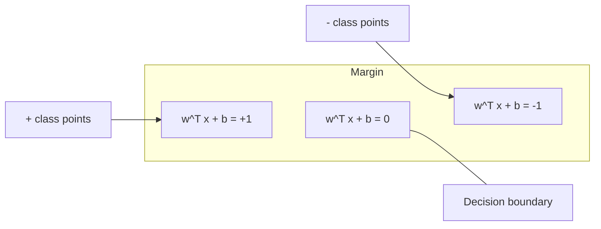
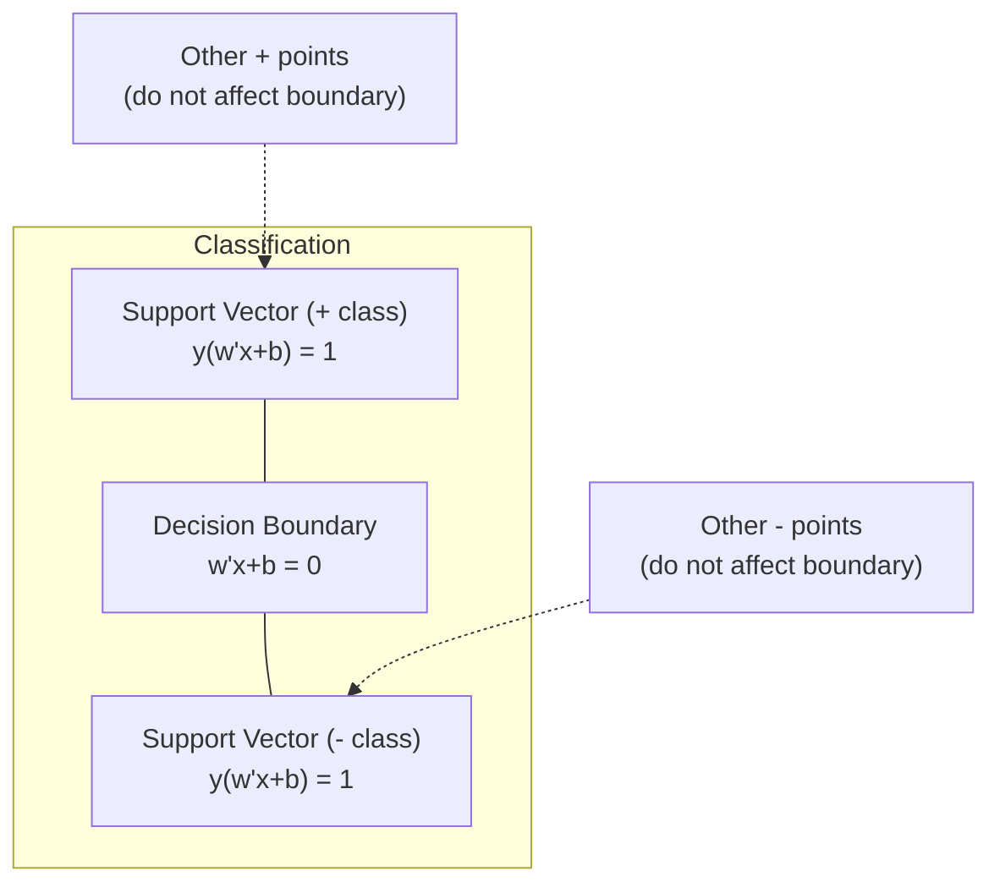
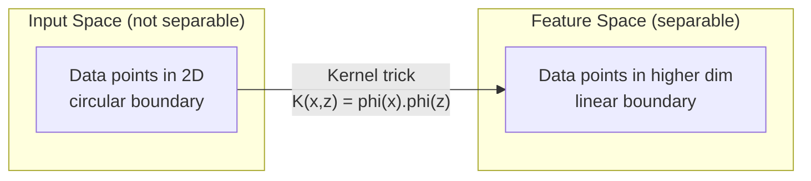

# Метод опорных векторов (Support Vector Machines)

> Найти самую широкую улицу между двумя классами. Это и есть вся идея.

**Type:** Build
**Language:** Python
**Prerequisites:** Phase 1 (Lessons 08 Optimization, 14 Norms and Distances, 18 Convex Optimization)
**Time:** ~90 minutes

## Цели обучения

- Реализовать линейный SVM с нуля, используя hinge loss и градиентный спуск на прямой (primal) формулировке
- Объяснить принцип максимального зазора и уметь определять опорные векторы в обученной модели
- Сравнить линейное, полиномиальное и RBF-ядра и объяснить, как kernel trick позволяет избежать явного отображения в пространство высокой размерности
- Оценить компромисс, который контролируется параметром C, между шириной зазора и количеством ошибок классификации

## Проблема

У вас есть две категории точек данных, и нужно провести линию (или гиперплоскость), разделяющую их. Подойти может бесконечно много линий. Какую выбрать?

Ту, у которой наибольший зазор. Зазор — это расстояние между границей принятия решения и ближайшими точками данных с каждой стороны. Чем шире зазор, тем увереннее классификатор и тем лучше он обобщается на новые данные.

Эта интуиция приводит к методу опорных векторов (Support Vector Machines) — одному из самых математически элегантных алгоритмов в машинном обучении. SVM были доминирующим методом классификации до эпохи глубокого обучения и остаются лучшим выбором для небольших наборов данных, данных высокой размерности и задач, где нужна принципиальная, хорошо изученная модель с теоретическими гарантиями.

SVM напрямую связаны с Phase 1: оптимизация является выпуклой (Lesson 18), зазор измеряется с помощью норм (Lesson 14), а kernel trick использует скалярные произведения для работы с нелинейными границами, никогда не вычисляя их явно в пространстве высокой размерности.

## Концепция

### Классификатор максимального зазора

Пусть дан линейно разделимый набор данных с метками y_i из {-1, +1} и векторами признаков x_i. Мы хотим найти гиперплоскость w^T x + b = 0, разделяющую классы.

Расстояние от точки x_i до гиперплоскости:

```
distance = |w^T x_i + b| / ||w||
```

Для правильно классифицированной точки: y_i * (w^T x_i + b) > 0. Зазор — это удвоенное расстояние от гиперплоскости до ближайшей точки с каждой стороны.



Задача оптимизации:

```
maximize    2 / ||w||     (the margin width)
subject to  y_i * (w^T x_i + b) >= 1  for all i
```

Эквивалентно (минимизировать ||w||^2 проще в оптимизации):

```
minimize    (1/2) ||w||^2
subject to  y_i * (w^T x_i + b) >= 1  for all i
```

Это выпуклая квадратичная программа. У неё есть единственное глобальное решение. Точки данных, лежащие точно на границах зазора (где y_i * (w^T x_i + b) = 1), называются опорными векторами. Только они определяют границу принятия решения. Переместите или удалите любую точку, не являющуюся опорным вектором, и граница не изменится.

### Опорные векторы: критически важное меньшинство



Большинство обучающих точек не имеют значения. Важны только опорные векторы. Именно поэтому SVM экономичны по памяти на этапе предсказания: достаточно хранить только опорные векторы, а не весь обучающий набор.

Количество опорных векторов также даёт оценку ошибки обобщения. Чем меньше опорных векторов относительно размера набора данных, тем лучше обобщение.

### Мягкий зазор: обработка шума с помощью параметра C

Реальные данные редко бывают идеально разделимы. Некоторые точки могут оказаться не на той стороне границы или внутри зазора. Формулировка с мягким зазором (soft margin) допускает нарушения, вводя переменные нестрогости (slack variables).

```
minimize    (1/2) ||w||^2 + C * sum(xi_i)
subject to  y_i * (w^T x_i + b) >= 1 - xi_i
            xi_i >= 0  for all i
```

Переменная нестрогости xi_i измеряет, насколько точка i нарушает зазор. C управляет компромиссом:

| Значение C | Поведение |
|---------|----------|
| Большое C | Сильно штрафует нарушения. Узкий зазор, меньше ошибок классификации. Переобучение |
| Малое C | Допускает больше нарушений. Широкий зазор, больше ошибок классификации. Недообучение |

C — это сила регуляризации, но инвертированная. Большое C = меньше регуляризации. Малое C = больше регуляризации.

### Hinge loss: функция потерь SVM

Формулировку SVM с мягким зазором можно переписать как задачу безусловной оптимизации:

```
minimize    (1/2) ||w||^2 + C * sum(max(0, 1 - y_i * (w^T x_i + b)))
```

Слагаемое max(0, 1 - y_i * f(x_i)) — это hinge loss. Оно равно нулю, если точка правильно классифицирована и находится за пределами зазора. Оно линейно, если точка находится внутри зазора или классифицирована неправильно.

```
Hinge loss for a single point:

loss
  |
  | \
  |  \
  |   \
  |    \
  |     \_______________
  |
  +-----|-----|-------->  y * f(x)
       0     1

Zero loss when y*f(x) >= 1 (correctly classified, outside margin).
Linear penalty when y*f(x) < 1.
```

Сравните с логистической функцией потерь (логистическая регрессия):

```
Hinge:     max(0, 1 - y*f(x))          Hard cutoff at margin
Logistic:  log(1 + exp(-y*f(x)))        Smooth, never exactly zero
```

Hinge loss даёт разреженные решения (ненулевой вклад вносят только опорные векторы). Логистическая функция потерь использует все точки данных. Поэтому SVM экономичнее по памяти на этапе предсказания.

### Обучение линейного SVM градиентным спуском

Линейный SVM можно обучить с помощью градиентного спуска по hinge loss плюс L2-регуляризация, не решая ограниченную QP-задачу:

```
L(w, b) = (lambda/2) * ||w||^2 + (1/n) * sum(max(0, 1 - y_i * (w^T x_i + b)))

Gradient with respect to w:
  If y_i * (w^T x_i + b) >= 1:  dL/dw = lambda * w
  If y_i * (w^T x_i + b) < 1:   dL/dw = lambda * w - y_i * x_i

Gradient with respect to b:
  If y_i * (w^T x_i + b) >= 1:  dL/db = 0
  If y_i * (w^T x_i + b) < 1:   dL/db = -y_i
```

Это называется прямой (primal) формулировкой. Она выполняется за O(n * d) на эпоху, где n — число образцов, а d — число признаков. Для больших, разреженных данных высокой размерности (классификация текста) это быстро.

### Двойственная формулировка и kernel trick

Лагранжева двойственная задача SVM (из Phase 1 Lesson 18, условия KKT) имеет вид:

```
maximize    sum(alpha_i) - (1/2) * sum_ij(alpha_i * alpha_j * y_i * y_j * (x_i . x_j))
subject to  0 <= alpha_i <= C
            sum(alpha_i * y_i) = 0
```

Двойственная задача включает только скалярные произведения x_i . x_j между точками данных. В этом и заключается ключевая идея. Замените каждое скалярное произведение функцией ядра K(x_i, x_j), и SVM сможет обучать нелинейные границы, никогда явно не вычисляя преобразование.

```
Linear kernel:      K(x, z) = x . z
Polynomial kernel:  K(x, z) = (x . z + c)^d
RBF (Gaussian):     K(x, z) = exp(-gamma * ||x - z||^2)
```

RBF-ядро отображает данные в пространство бесконечной размерности. Точки, близкие в исходном пространстве, имеют значение ядра, близкое к 1. Точки, далёкие друг от друга, имеют значение ядра, близкое к 0. Это ядро способно выучить любую гладкую границу принятия решения.



Kernel trick вычисляет скалярное произведение в пространстве высокой размерности, никогда туда не попадая. Для полиномиального ядра степени d в D измерениях явное пространство признаков имеет размерность O(D^d). Но K(x, z) вычисляется за время O(D).

### SVM для регрессии (SVR)

Support Vector Regression подбирает «трубку» ширины epsilon вокруг данных. Точки внутри трубки имеют нулевую потерю. Точки вне трубки штрафуются линейно.

```
minimize    (1/2) ||w||^2 + C * sum(xi_i + xi_i*)
subject to  y_i - (w^T x_i + b) <= epsilon + xi_i
            (w^T x_i + b) - y_i <= epsilon + xi_i*
            xi_i, xi_i* >= 0
```

Параметр epsilon управляет шириной трубки. Шире трубка — меньше опорных векторов — более гладкая аппроксимация. Уже трубка — больше опорных векторов — более точная подгонка.

### Почему SVM уступили глубокому обучению (и когда они всё ещё побеждают)

SVM доминировали в машинном обучении с конца 1990-х до начала 2010-х годов. Глубокое обучение превзошло их по нескольким причинам:

| Фактор | SVM | Глубокое обучение |
|--------|------|---------------|
| Инженерия признаков | Требуется | Признаки изучаются автоматически |
| Масштабируемость | O(n^2) – O(n^3) для ядра | O(n) на эпоху с SGD |
| Изображения/текст/аудио | Нужны вручную созданные признаки | Обучение на сырых данных |
| Большие наборы данных (>100k) | Медленно | Хорошо масштабируется |
| Ускорение на GPU | Ограниченная польза | Огромное ускорение |

SVM по-прежнему выигрывают в следующих ситуациях:
- Небольшие наборы данных (от сотен до нескольких тысяч образцов)
- Разреженные данные высокой размерности (текст с признаками TF-IDF)
- Когда нужны математические гарантии (границы зазора)
- Когда время обучения должно быть минимальным (линейный SVM очень быстр)
- Бинарная классификация с чёткой структурой зазора
- Обнаружение аномалий (one-class SVM)

```figure
svm-margin
```

## Реализация

### Шаг 1: Hinge loss и градиент

Основа. Вычислите hinge loss для батча и его градиент.

```python
def hinge_loss(X, y, w, b):
    n = len(X)
    total_loss = 0.0
    for i in range(n):
        margin = y[i] * (dot(w, X[i]) + b)
        total_loss += max(0.0, 1.0 - margin)
    return total_loss / n
```

### Шаг 2: Линейный SVM через градиентный спуск

Обучение путём минимизации регуляризованного hinge loss. QP-солвер не нужен.

```python
class LinearSVM:
    def __init__(self, lr=0.001, lambda_param=0.01, n_epochs=1000):
        self.lr = lr
        self.lambda_param = lambda_param
        self.n_epochs = n_epochs
        self.w = None
        self.b = 0.0

    def fit(self, X, y):
        n_features = len(X[0])
        self.w = [0.0] * n_features
        self.b = 0.0

        for epoch in range(self.n_epochs):
            for i in range(len(X)):
                margin = y[i] * (dot(self.w, X[i]) + self.b)
                if margin >= 1:
                    self.w = [wj - self.lr * self.lambda_param * wj
                              for wj in self.w]
                else:
                    self.w = [wj - self.lr * (self.lambda_param * wj - y[i] * X[i][j])
                              for j, wj in enumerate(self.w)]
                    self.b -= self.lr * (-y[i])

    def predict(self, X):
        return [1 if dot(self.w, x) + self.b >= 0 else -1 for x in X]
```

### Шаг 3: Функции ядра

Реализуйте линейное, полиномиальное и RBF-ядра.

```python
def linear_kernel(x, z):
    return dot(x, z)

def polynomial_kernel(x, z, degree=3, c=1.0):
    return (dot(x, z) + c) ** degree

def rbf_kernel(x, z, gamma=0.5):
    diff = [xi - zi for xi, zi in zip(x, z)]
    return math.exp(-gamma * dot(diff, diff))
```

### Шаг 4: Определение зазора и опорных векторов

После обучения определите, какие точки являются опорными векторами, и вычислите ширину зазора.

```python
def find_support_vectors(X, y, w, b, tol=1e-3):
    support_vectors = []
    for i in range(len(X)):
        margin = y[i] * (dot(w, X[i]) + b)
        if abs(margin - 1.0) < tol:
            support_vectors.append(i)
    return support_vectors
```

Полную реализацию со всеми демонстрациями см. в `code/svm.py`.

## Применение

С помощью scikit-learn:

```python
from sklearn.svm import SVC, LinearSVC, SVR
from sklearn.preprocessing import StandardScaler
from sklearn.pipeline import Pipeline

clf = Pipeline([
    ("scaler", StandardScaler()),
    ("svm", SVC(kernel="rbf", C=1.0, gamma="scale")),
])
clf.fit(X_train, y_train)
print(f"Accuracy: {clf.score(X_test, y_test):.4f}")
print(f"Support vectors: {clf['svm'].n_support_}")
```

Важно: всегда масштабируйте признаки перед обучением SVM. SVM чувствительны к масштабу признаков, поскольку зазор зависит от ||w||, и немасштабированные признаки искажают геометрию.

Для больших наборов данных используйте `LinearSVC` (прямая формулировка, O(n) на эпоху) вместо `SVC` (двойственная формулировка, O(n^2) – O(n^3)):

```python
from sklearn.svm import LinearSVC

clf = Pipeline([
    ("scaler", StandardScaler()),
    ("svm", LinearSVC(C=1.0, max_iter=10000)),
])
```

## Упражнения

1. Сгенерируйте двумерный линейно разделимый набор данных. Обучите свой LinearSVM и определите опорные векторы. Убедитесь, что опорные векторы — это точки, ближайшие к границе принятия решения.

2. Изменяйте C от 0.001 до 1000 на зашумлённом наборе данных. Постройте границу принятия решения для каждого значения C. Понаблюдайте за переходом от широкого зазора (недообучение) к узкому зазору (переобучение).

3. Создайте набор данных, в котором границы классов имеют круговую форму (не линейную). Покажите, что линейный SVM не справляется с этой задачей. Вычислите матрицу RBF-ядра и покажите, что классы становятся разделимыми в пространстве признаков, порождённом ядром.

4. Сравните hinge loss и логистическую функцию потерь на одном и том же наборе данных. Обучите линейный SVM и логистическую регрессию. Подсчитайте, сколько обучающих точек вносят вклад в границу принятия решения каждой модели (опорные векторы против всех точек).

5. Реализуйте SVR (epsilon-нечувствительная функция потерь). Подгоните её к y = sin(x) + шум. Постройте график epsilon-трубки вокруг предсказаний и выделите опорные векторы (точки вне трубки).

## Ключевые термины

| Термин | Что это на самом деле значит |
|------|----------------------|
| Опорные векторы | Обучающие точки, ближайшие к границе принятия решения. Единственные точки, определяющие гиперплоскость |
| Зазор (Margin) | Расстояние между границей принятия решения и ближайшими опорными векторами. SVM максимизируют эту величину |
| Hinge loss | max(0, 1 - y*f(x)). Равна нулю при правильной классификации вне зазора. В остальных случаях — линейный штраф |
| Параметр C | Компромисс между шириной зазора и количеством ошибок классификации. Большое C = узкий зазор, малое C = широкий зазор |
| Мягкий зазор (Soft margin) | Формулировка SVM, допускающая нарушения зазора через переменные нестрогости. Работает с неразделимыми данными |
| Kernel trick | Вычисление скалярных произведений в пространстве признаков высокой размерности без явного отображения в это пространство |
| Линейное ядро | K(x, z) = x . z. Эквивалентно стандартному скалярному произведению. Для линейно разделимых данных |
| RBF-ядро | K(x, z) = exp(-gamma * \|\|x-z\|\|^2). Отображает в бесконечномерное пространство. Способно выучить любую гладкую границу |
| Полиномиальное ядро | K(x, z) = (x . z + c)^d. Отображает в пространство признаков полиномиальных комбинаций |
| Двойственная формулировка | Переформулировка задачи SVM, зависящая только от скалярных произведений между точками данных. Делает возможным использование ядер |
| SVR | Support Vector Regression. Подбирает epsilon-трубку вокруг данных. Точки внутри трубки имеют нулевую потерю |
| Переменные нестрогости (Slack variables) | xi_i: измеряют, насколько точка нарушает зазор. Равны нулю для правильно классифицированных точек вне зазора |
| Максимальный зазор | Принцип выбора гиперплоскости, максимизирующей расстояние до ближайших точек каждого класса |

## Дополнительные материалы

- [Vapnik: The Nature of Statistical Learning Theory (1995)](https://link.springer.com/book/10.1007/978-1-4757-3264-1) — основополагающий текст по SVM и статистической теории обучения
- [Cortes & Vapnik: Support-vector networks (1995)](https://link.springer.com/article/10.1007/BF00994018) — оригинальная статья о SVM
- [Platt: Sequential Minimal Optimization (1998)](https://www.microsoft.com/en-us/research/publication/sequential-minimal-optimization-a-fast-algorithm-for-training-support-vector-machines/) — алгоритм SMO, сделавший обучение SVM практически применимым
- [Документация scikit-learn по SVM](https://scikit-learn.org/stable/modules/svm.html) — практическое руководство с подробностями реализации
- [LIBSVM: A Library for Support Vector Machines](https://www.csie.ntu.edu.tw/~cjlin/libsvm/) — библиотека на C++, лежащая в основе большинства реализаций SVM