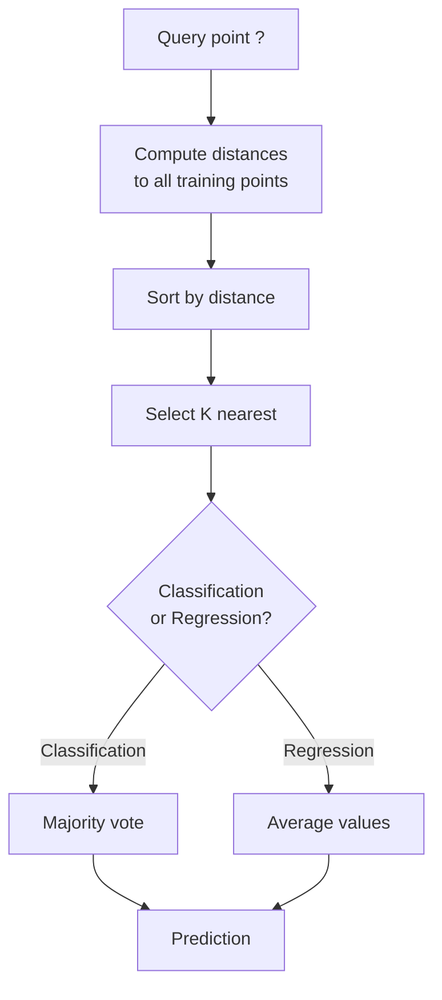
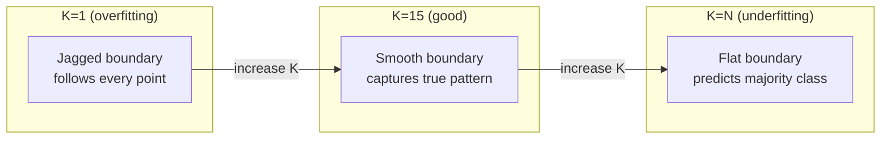
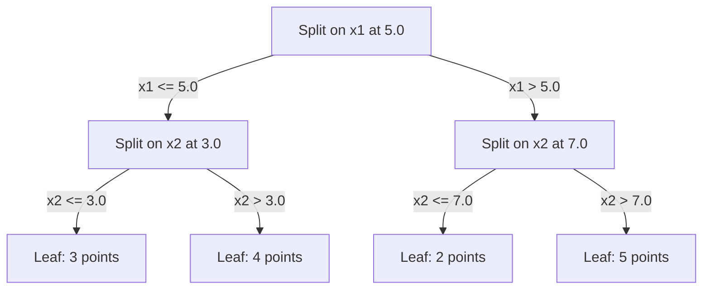

# Метод K ближайших соседей и расстояния

> Храните всё. Предсказывайте, глядя на соседей. Простейший алгоритм, который реально работает.

**Type:** Build
**Language:** Python
**Prerequisites:** Phase 1 (Lesson 14 Norms and Distances)
**Time:** ~90 минут

## Цели обучения

- Реализовать классификацию и регрессию KNN с нуля с настраиваемым K и голосованием с учётом веса по расстоянию
- Сравнить метрики расстояния L1, L2, косинусное и Minkowski и выбрать подходящую для заданного типа данных
- Объяснить проклятие размерности и продемонстрировать, почему качество KNN падает в пространствах высокой размерности
- Построить KD-дерево для эффективного поиска ближайших соседей и проанализировать, когда оно превосходит полный перебор

## Проблема

У вас есть набор данных. Поступает новая точка данных. Нужно классифицировать её или предсказать её значение. Вместо обучения параметров по данным (как в линейной регрессии или SVM), вы просто находите K ближайших к новой точке обучающих точек и даёте им проголосовать.

Это и есть метод K ближайших соседей. Здесь нет фазы обучения. Нет параметров для изучения. Нет функции потерь для минимизации. Вы храните весь обучающий набор и вычисляете расстояния во время предсказания.

Звучит слишком просто, чтобы работать. Но KNN удивительно конкурентоспособен для многих задач, особенно на небольших и средних наборах данных, а глубокое понимание этого метода раскрывает фундаментальные концепции: выбор метрики расстояния (связь с Phase 1 Lesson 14), проклятие размерности и разницу между ленивым и энергичным обучением.

KNN также встречается повсюду в современном ИИ, просто под другими именами. Векторные базы данных выполняют KNN-поиск по эмбеддингам. Retrieval-augmented generation (RAG) находит K ближайших фрагментов документов. Рекомендательные системы находят похожих пользователей или товары. Алгоритм тот же. Масштаб и структуры данных — другие.

## Концепция

### Как работает KNN

Дан набор размеченных точек и новая запрашиваемая точка:

1. Вычислить расстояние от запроса до каждой точки в наборе данных
2. Отсортировать по расстоянию
3. Взять K ближайших точек
4. Для классификации: голосование большинством среди K соседей
5. Для регрессии: среднее (или взвешенное среднее) значений K соседей



Это и есть весь алгоритм. Никакого обучения. Никакого градиентного спуска. Никаких эпох.

### Выбор K

K — единственный гиперпараметр. Он управляет компромиссом между смещением и дисперсией:

| K | Поведение |
|---|----------|
| K = 1 | Граница решения следует каждой точке. Нулевая ошибка на обучении. Высокая дисперсия. Переобучение |
| Малое K (3-5) | Чувствителен к локальной структуре. Способен улавливать сложные границы |
| Большое K | Более гладкие границы. Более устойчив к шуму. Может недообучаться |
| K = N | Предсказывает мажоритарный класс для каждой точки. Максимальное смещение |

Обычная отправная точка — K = sqrt(N) для набора данных из N точек. Используйте нечётное K для бинарной классификации, чтобы избежать ничьих.



### Метрики расстояния

Функция расстояния определяет, что значит "близко". Разные метрики дают разных соседей, разные предсказания.

**L2 (Евклидово)** — метрика по умолчанию. Расстояние по прямой линии.

```
d(a, b) = sqrt(sum((a_i - b_i)^2))
```

Чувствительно к масштабу признаков. Всегда стандартизируйте признаки перед использованием L2 с KNN.

**L1 (Манхэттенское)** суммирует абсолютные разности. Более устойчиво к выбросам, чем L2, поскольку не возводит разности в квадрат.

```
d(a, b) = sum(|a_i - b_i|)
```

**Косинусное расстояние** измеряет угол между векторами, игнорируя величину. Незаменимо для текстовых данных и эмбеддингов.

```
d(a, b) = 1 - (a . b) / (||a|| * ||b||)
```

**Minkowski** обобщает L1 и L2 с параметром p.

```
d(a, b) = (sum(|a_i - b_i|^p))^(1/p)

p=1: Manhattan
p=2: Euclidean
p->inf: Chebyshev (max absolute difference)
```

Выбор метрики зависит от данных:

| Тип данных | Лучшая метрика | Почему |
|-----------|------------|-----|
| Числовые признаки, схожий масштаб | L2 (Евклидово) | По умолчанию, работает для пространственных данных |
| Числовые признаки, выбросы | L1 (Манхэттенское) | Устойчиво, не усиливает большие различия |
| Текстовые эмбеддинги | Косинусное | Величина — это шум, направление — это смысл |
| Высокоразмерные разреженные | Косинусное или L1 | L2 страдает от проклятия размерности |
| Смешанные типы | Пользовательское расстояние | Комбинируйте метрики по типу признака |

### Взвешенный KNN

Стандартный KNN придаёт равный вес всем K соседям. Но сосед на расстоянии 0.1 должен значить больше, чем сосед на расстоянии 5.0.

**KNN с весом по расстоянию** взвешивает каждого соседа обратно пропорционально расстоянию:

```
weight_i = 1 / (distance_i + epsilon)

For classification: weighted vote
For regression:     weighted average = sum(w_i * y_i) / sum(w_i)
```

Эпсилон предотвращает деление на ноль, когда запрашиваемая точка в точности совпадает с обучающей точкой.

Взвешенный KNN менее чувствителен к выбору K, поскольку дальние соседи вносят очень малый вклад независимо от его значения.

### Проклятие размерности

Производительность KNN ухудшается в пространствах высокой размерности. Это не смутное опасение. Это математический факт.

**Проблема 1: расстояния сходятся.** По мере роста размерности отношение максимального расстояния к минимальному стремится к 1. Все точки становятся одинаково "далёкими" от запроса.

```
In d dimensions, for random uniform points:

d=2:    max_dist / min_dist = varies widely
d=100:  max_dist / min_dist ~ 1.01
d=1000: max_dist / min_dist ~ 1.001

When all distances are nearly equal, "nearest" is meaningless.
```

**Проблема 2: объём взрывается.** Чтобы захватить K соседей в пределах фиксированной доли данных, нужно расширить радиус поиска, охватывая гораздо большую долю пространства признаков. "Окрестность" в высокой размерности охватывает почти всё пространство.

**Проблема 3: доминируют углы.** В единичном гиперкубе в d измерениях большая часть объёма сосредоточена вблизи углов, а не в центре. Сфера, вписанная в куб, содержит исчезающе малую долю объёма при росте d.

Практическое следствие: KNN хорошо работает примерно до 20-50 признаков. Сверх этого нужно снижение размерности (PCA, UMAP, t-SNE) перед применением KNN, либо использование древовидных структур поиска, использующих внутреннюю более низкую размерность данных.

### KD-деревья: быстрый поиск ближайших соседей

Полный перебор при KNN вычисляет расстояние от запроса до каждой обучающей точки. Это O(n * d) на запрос. Для больших наборов данных это слишком медленно.

KD-дерево рекурсивно разбивает пространство вдоль осей признаков. На каждом уровне оно делит по одному измерению по медианному значению.



Чтобы найти ближайшего соседа, проходим дерево до листа, содержащего запрос, затем возвращаемся назад и проверяем соседние разделы только в том случае, если они могут содержать более близкие точки.

Среднее время запроса: O(log n) для низкой размерности. Но KD-деревья деградируют до O(n) в высокой размерности (d > 20), поскольку обратный проход отсекает всё меньше и меньше ветвей.

### Ball-деревья: лучше для умеренной размерности

Ball-деревья разбивают данные на вложенные гиперсферы вместо выровненных по осям прямоугольников. Каждый узел определяет шар (центр + радиус), содержащий все точки этого поддерева.

Преимущества перед KD-деревьями:
- Лучше работают в умеренной размерности (до ~50)
- Обрабатывают структуру, не выровненную по осям
- Более плотные ограничивающие объёмы означают, что при поиске отсекается больше ветвей

И KD-деревья, и ball-деревья — точные алгоритмы. Для действительно крупномасштабного поиска (миллионы точек, сотни измерений) используются приближённые методы поиска ближайших соседей (HNSW, IVF, product quantization). Они рассматриваются в Phase 1 Lesson 14.

### Ленивое обучение против энергичного обучения

KNN — ленивый алгоритм (lazy learner): он не выполняет никакой работы во время обучения и всю работу — во время предсказания. Большинство других алгоритмов (линейная регрессия, SVM, нейронные сети) — энергичные алгоритмы (eager learners): они выполняют тяжёлые вычисления во время обучения, чтобы построить компактную модель, после чего предсказания выполняются быстро.

| Аспект | Ленивый (KNN) | Энергичный (SVM, нейросеть) |
|--------|------------|------------------------|
| Время обучения | O(1), просто сохранить данные | O(n * эпохи) |
| Время предсказания | O(n * d) на запрос | O(d) или O(параметры) |
| Память во время предсказания | Хранится весь обучающий набор | Хранятся только параметры модели |
| Адаптация к новым данным | Точки добавляются мгновенно | Нужно переобучать модель |
| Граница решения | Неявная, вычисляется на лету | Явная, зафиксирована после обучения |

Ленивое обучение идеально, когда:
- Набор данных часто изменяется (точки добавляются/удаляются без переобучения)
- Нужны предсказания для очень небольшого числа запросов
- Требуется нулевое время обучения
- Набор данных достаточно мал, чтобы полный перебор работал быстро

### KNN для регрессии

Вместо голосования большинством, KNN для регрессии усредняет целевые значения K соседей.

```
prediction = (1/K) * sum(y_i for i in K nearest neighbors)

Or with distance weighting:
prediction = sum(w_i * y_i) / sum(w_i)
where w_i = 1 / distance_i
```

KNN-регрессия даёт кусочно-постоянные (или кусочно-гладкие при взвешивании) предсказания. Она не может экстраполировать за пределы диапазона обучающих данных. Если все обучающие целевые значения находятся между 0 и 100, KNN никогда не предскажет 200.

```figure
knn-smoothness
```

## Реализация

### Шаг 1: Функции расстояния

Реализуйте расстояния L1, L2, косинусное и Minkowski. Они напрямую связаны с Phase 1 Lesson 14.

```python
import math

def l2_distance(a, b):
    return math.sqrt(sum((ai - bi) ** 2 for ai, bi in zip(a, b)))

def l1_distance(a, b):
    return sum(abs(ai - bi) for ai, bi in zip(a, b))

def cosine_distance(a, b):
    dot_val = sum(ai * bi for ai, bi in zip(a, b))
    norm_a = math.sqrt(sum(ai ** 2 for ai in a))
    norm_b = math.sqrt(sum(bi ** 2 for bi in b))
    if norm_a == 0 or norm_b == 0:
        return 1.0
    return 1.0 - dot_val / (norm_a * norm_b)

def minkowski_distance(a, b, p=2):
    if p == float('inf'):
        return max(abs(ai - bi) for ai, bi in zip(a, b))
    return sum(abs(ai - bi) ** p for ai, bi in zip(a, b)) ** (1 / p)
```

### Шаг 2: Классификатор и регрессор KNN

Постройте полноценный KNN с настраиваемым K, метрикой расстояния и опциональным взвешиванием по расстоянию.

```python
class KNN:
    def __init__(self, k=5, distance_fn=l2_distance, weighted=False,
                 task="classification"):
        self.k = k
        self.distance_fn = distance_fn
        self.weighted = weighted
        self.task = task
        self.X_train = None
        self.y_train = None

    def fit(self, X, y):
        self.X_train = X
        self.y_train = y

    def predict(self, X):
        return [self._predict_one(x) for x in X]
```

### Шаг 3: KD-дерево для эффективного поиска

Постройте с нуля KD-дерево, которое рекурсивно разбивает по медиане каждого измерения.

```python
class KDTree:
    def __init__(self, X, indices=None, depth=0):
        # Recursively partition the data
        self.axis = depth % len(X[0])
        # Split on median of the current axis
        ...

    def query(self, point, k=1):
        # Traverse to leaf, then backtrack
        ...
```

Полную реализацию со всеми вспомогательными методами и демонстрациями см. в `code/knn.py`.

### Шаг 4: Масштабирование признаков

KNN требует масштабирования признаков, поскольку расстояния чувствительны к величинам признаков. Признак, варьирующийся от 0 до 1000, будет доминировать над признаком, варьирующимся от 0 до 1.

```python
def standardize(X):
    n = len(X)
    d = len(X[0])
    means = [sum(X[i][j] for i in range(n)) / n for j in range(d)]
    stds = [
        max(1e-10, (sum((X[i][j] - means[j]) ** 2 for i in range(n)) / n) ** 0.5)
        for j in range(d)
    ]
    return [[((X[i][j] - means[j]) / stds[j]) for j in range(d)] for i in range(n)], means, stds
```

## Применение

С scikit-learn:

```python
from sklearn.neighbors import KNeighborsClassifier
from sklearn.preprocessing import StandardScaler
from sklearn.pipeline import Pipeline

clf = Pipeline([
    ("scaler", StandardScaler()),
    ("knn", KNeighborsClassifier(n_neighbors=5, metric="euclidean")),
])
clf.fit(X_train, y_train)
print(f"Accuracy: {clf.score(X_test, y_test):.4f}")
```

Scikit-learn автоматически использует KD-деревья или ball-деревья, когда набор данных достаточно велик, а размерность достаточно низка. Для данных высокой размерности он переключается на полный перебор. Этим можно управлять с помощью параметра `algorithm`.

Для крупномасштабного поиска ближайших соседей (миллионы векторов) используйте FAISS, Annoy или векторную базу данных:

```python
import faiss

index = faiss.IndexFlatL2(dimension)
index.add(embeddings)
distances, indices = index.search(query_vectors, k=5)
```

## Упражнения

1. Реализуйте классификацию KNN на 2D-наборе данных с 3 классами. Постройте границу решения для K=1, K=5, K=15 и K=N. Понаблюдайте переход от переобучения к недообучению.

2. Сгенерируйте 1000 случайных точек в 2, 5, 10, 50, 100 и 500 измерениях. Для каждой размерности вычислите отношение максимального парного расстояния к минимальному. Постройте график отношения в зависимости от размерности, чтобы визуализировать проклятие размерности.

3. Сравните расстояния L1, L2 и косинусное для KNN на задаче классификации текста (используйте TF-IDF векторы). Какая метрика даёт наилучшую точность? Почему косинусное расстояние обычно побеждает для текста?

4. Реализуйте KD-дерево и измерьте время запроса в сравнении с полным перебором для наборов данных из 1k, 10k и 100k точек в 2D, 10D и 50D. При какой размерности KD-дерево перестаёт быть быстрее полного перебора?

5. Постройте взвешенный KNN-регрессор для y = sin(x) + шум. Сравните его с невзвешенным KNN для K=3, 10, 30. Покажите, что взвешивание даёт более гладкие предсказания, особенно для большого K.

## Ключевые термины

| Термин | Что это на самом деле означает |
|------|----------------------|
| Метод K ближайших соседей | Непараметрический алгоритм, предсказывающий путём нахождения K ближайших обучающих точек к запросу |
| Ленивое обучение | Нет вычислений во время обучения. Вся работа происходит во время предсказания. KNN — канонический пример |
| Энергичное обучение | Тяжёлые вычисления во время обучения для построения компактной модели. Большинство алгоритмов МО — энергичные |
| Проклятие размерности | В высокой размерности расстояния сходятся, а окрестности расширяются, охватывая почти всё пространство, что делает KNN неэффективным |
| KD-дерево | Бинарное дерево, рекурсивно разбивающее пространство вдоль осей признаков. Запросы за O(log n) в низкой размерности |
| Ball-дерево | Дерево вложенных гиперсфер. Работает лучше, чем KD-деревья, в умеренной размерности (до ~50) |
| Взвешенный KNN | Соседи взвешиваются обратно пропорционально расстоянию. Более близкие соседи сильнее влияют на предсказание |
| Масштабирование признаков | Нормализация признаков до сопоставимых диапазонов. Требуется для методов на основе расстояний, таких как KNN |
| Голосование большинством | Классификация путём подсчёта, какой класс наиболее часто встречается среди K соседей |
| Полный перебор | Вычисление расстояния до каждой обучающей точки. O(n*d) на запрос. Точный, но медленный при больших n |
| Приближённый поиск ближайших соседей | Алгоритмы (HNSW, LSH, IVF), находящие приближённо ближайшие точки значительно быстрее точного поиска |
| Диаграмма Вороного | Разбиение пространства, при котором каждая область содержит все точки, более близкие к одной обучающей точке, чем к любой другой. KNN при K=1 даёт границы Вороного |

## Дополнительное чтение

- [Cover & Hart: Nearest Neighbor Pattern Classification (1967)](https://ieeexplore.ieee.org/document/1053964) — основополагающая статья о KNN, доказывающая, что его частота ошибок не более чем вдвое превышает байесовскую оптимальную
- [Friedman, Bentley, Finkel: An Algorithm for Finding Best Matches in Logarithmic Expected Time (1977)](https://dl.acm.org/doi/10.1145/355744.355745) — оригинальная статья о KD-деревьях
- [Beyer et al.: When Is "Nearest Neighbor" Meaningful? (1999)](https://link.springer.com/chapter/10.1007/3-540-49257-7_15) — формальный анализ проклятия размерности для метода ближайших соседей
- [Документация scikit-learn Nearest Neighbors](https://scikit-learn.org/stable/modules/neighbors.html) — практическое руководство по выбору алгоритма
- [FAISS: A Library for Efficient Similarity Search](https://github.com/facebookresearch/faiss) — библиотека Meta для приближённого поиска ближайших соседей в масштабе миллиардов записей