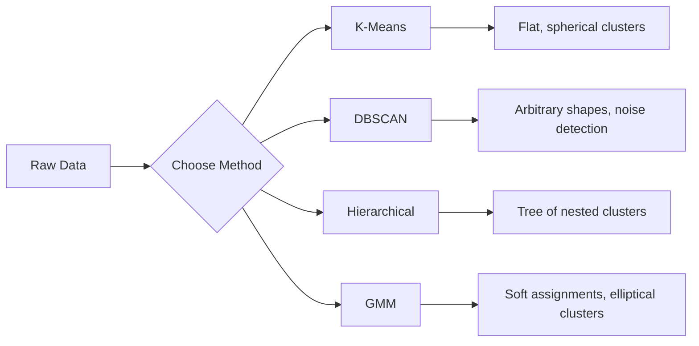

# Обучение без учителя

> Нет меток, нет учителя. Алгоритм сам находит структуру.

**Type:** Build
**Languages:** Python
**Prerequisites:** Phase 1 (нормы и расстояния, вероятность и распределения), Phase 2, уроки 1-6
**Time:** ~90 минут

## Цели обучения

- Реализовать K-Means, DBSCAN и гауссовы смеси (Gaussian Mixture Models) с нуля и сравнить их поведение при кластеризации
- Оценить качество кластеризации с помощью силуэтного коэффициента (silhouette score) и метода локтя (elbow method) для выбора оптимального K
- Объяснить, когда DBSCAN превосходит K-Means, и определить, какой алгоритм лучше справляется с кластерами неправильной формы и выбросами
- Построить конвейер обнаружения аномалий с использованием методов кластеризации для выявления точек, отклоняющихся от нормального паттерна

## Проблема

Все предыдущие уроки по ML предполагали размеченные данные: "вот вход, вот правильный выход". В реальном мире метки стоят дорого. У больницы есть миллионы записей пациентов, но никто вручную не присвоил каждой из них категорию заболевания. У сайта электронной коммерции миллионы пользовательских сессий, но никто вручную не размечал сегменты клиентов. У команды безопасности есть логи сети, но никто не пометил каждую аномалию.

Обучение без учителя находит паттерны, не зная заранее, что искать. Оно группирует похожие точки данных, обнаруживает скрытые структуры и выявляет аномалии. Если обучение с учителем — это изучение учебника с ответами, то обучение без учителя — это разглядывание необработанных данных до тех пор, пока паттерны не проявятся сами.

Загвоздка в том, что без меток нельзя напрямую измерить "правильно" или "неправильно". Нужны другие инструменты, чтобы оценить, является ли структура, найденная алгоритмом, осмысленной.

## Концепция

### Кластеризация: группировка похожих объектов

Кластеризация присваивает каждую точку данных группе (кластеру) так, чтобы точки внутри одной группы были более похожи друг на друга, чем на точки из других групп. Вопрос всегда один: что значит "похожи"?



### K-Means: рабочая лошадка

K-Means разбивает данные ровно на K кластеров. У каждого кластера есть центроид (его центр масс), и каждая точка принадлежит ближайшему центроиду.

Алгоритм Ллойда:

1. Выбрать K случайных точек в качестве начальных центроидов
2. Присвоить каждую точку данных ближайшему центроиду
3. Пересчитать каждый центроид как среднее присвоенных ему точек
4. Повторять шаги 2-3, пока присвоения не перестанут меняться

Целевая функция (инерция) измеряет суммарное квадратичное расстояние от каждой точки до её присвоенного центроида. K-Means минимизирует эту величину, но находит только локальный минимум. Разные инициализации могут давать разные результаты.

### Выбор K

Два стандартных метода:

**Метод локтя:** Запустить K-Means для K = 1, 2, 3, ..., n. Построить график инерции в зависимости от K. Найти "локоть" — точку, после которой добавление новых кластеров перестаёт заметно снижать инерцию.

**Силуэтный коэффициент:** Для каждой точки измерить, насколько она похожа на свой собственный кластер (a) по сравнению с ближайшим другим кластером (b). Силуэтный коэффициент равен (b - a) / max(a, b) и находится в диапазоне от -1 (неверный кластер) до +1 (хорошо кластеризована). Усреднение по всем точкам даёт глобальную оценку.

### DBSCAN: кластеризация на основе плотности

K-Means предполагает, что кластеры сферические, и требует заранее выбрать K. DBSCAN не делает ни того, ни другого допущения. Он находит кластеры как плотные области, разделённые разреженными областями.

Два параметра:
- **eps**: радиус окрестности
- **min_samples**: минимальное число точек, необходимое для формирования плотной области

Три типа точек:
- **Опорная точка (core point)**: имеет не менее min_samples точек в пределах расстояния eps
- **Граничная точка (border point)**: находится в пределах eps от опорной точки, но сама не является опорной
- **Точка шума (noise point)**: ни опорная, ни граничная. Это выбросы.

DBSCAN объединяет опорные точки, находящиеся в пределах eps друг от друга, в один кластер. Граничные точки присоединяются к кластеру соседней опорной точки. Точки шума не принадлежат ни одному кластеру.

Сильные стороны: находит кластеры любой формы, автоматически определяет число кластеров, выявляет выбросы. Слабая сторона: плохо справляется с кластерами разной плотности.

### Иерархическая кластеризация

Строит дерево (дендрограмму) вложенных кластеров.

Агломеративная (снизу вверх):
1. Начать с того, что каждая точка — это отдельный кластер
2. Объединить два ближайших кластера
3. Повторять, пока не останется один кластер
4. Разрезать дендрограмму на нужном уровне, чтобы получить K кластеров

"Близость" между кластерами может измеряться как:
- **Одиночная связь (single linkage)**: минимальное расстояние между любыми двумя точками из двух кластеров
- **Полная связь (complete linkage)**: максимальное расстояние между любыми двумя точками
- **Средняя связь (average linkage)**: среднее расстояние по всем парам
- **Метод Уорда (Ward's method)**: объединение, вызывающее наименьший прирост общей внутрикластерной дисперсии

### Гауссовы смеси (Gaussian Mixture Models, GMM)

K-Means даёт жёсткие присвоения: каждая точка принадлежит ровно одному кластеру. GMM даёт мягкие присвоения: у каждой точки есть вероятность принадлежности к каждому кластеру.

GMM предполагает, что данные сгенерированы смесью K гауссовых распределений, каждое со своим средним и ковариацией. Алгоритм Expectation-Maximization (EM) чередует:

- **E-шаг**: вычисление вероятности принадлежности каждой точки каждому гауссиану
- **M-шаг**: обновление среднего, ковариации и веса смешивания каждого гауссиана для максимизации правдоподобия данных

GMM может моделировать эллиптические кластеры (а не только сферические, как K-Means) и естественным образом обрабатывает перекрывающиеся кластеры.

### Когда что использовать

| Метод | Лучше всего для | Следует избегать, когда |
|--------|----------|------------|
| K-Means | Больших наборов данных, сферических кластеров, известного K | Неправильные формы, наличие выбросов |
| DBSCAN | Неизвестного K, произвольных форм, обнаружения выбросов | Разная плотность, очень высокая размерность |
| Hierarchical | Небольших наборов данных, когда нужна дендрограмма, неизвестного K | Большие наборы данных (память O(n^2)) |
| GMM | Перекрывающихся кластеров, когда нужны мягкие присвоения | Очень большие наборы данных, слишком много измерений |

### Обнаружение аномалий с помощью кластеризации

Кластеризация естественным образом поддерживает обнаружение аномалий:
- **K-Means**: точки, далёкие от любого центроида, — это аномалии
- **DBSCAN**: точки шума по определению являются аномалиями
- **GMM**: точки с низкой вероятностью при всех гауссианах — это аномалии

```figure
kmeans-step
```

## Реализация

### Шаг 1: K-Means с нуля

```python
import math
import random


def euclidean_distance(a, b):
    return math.sqrt(sum((ai - bi) ** 2 for ai, bi in zip(a, b)))


def kmeans(data, k, max_iterations=100, seed=42):
    random.seed(seed)
    n_features = len(data[0])

    centroids = random.sample(data, k)

    for iteration in range(max_iterations):
        clusters = [[] for _ in range(k)]
        assignments = []

        for point in data:
            distances = [euclidean_distance(point, c) for c in centroids]
            nearest = distances.index(min(distances))
            clusters[nearest].append(point)
            assignments.append(nearest)

        new_centroids = []
        for cluster in clusters:
            if len(cluster) == 0:
                new_centroids.append(random.choice(data))
                continue
            centroid = [
                sum(point[j] for point in cluster) / len(cluster)
                for j in range(n_features)
            ]
            new_centroids.append(centroid)

        if all(
            euclidean_distance(old, new) < 1e-6
            for old, new in zip(centroids, new_centroids)
        ):
            print(f"  Converged at iteration {iteration + 1}")
            break

        centroids = new_centroids

    return assignments, centroids
```

### Шаг 2: Метод локтя и силуэтный коэффициент

```python
def compute_inertia(data, assignments, centroids):
    total = 0.0
    for point, cluster_id in zip(data, assignments):
        total += euclidean_distance(point, centroids[cluster_id]) ** 2
    return total


def silhouette_score(data, assignments):
    n = len(data)
    if n < 2:
        return 0.0

    clusters = {}
    for i, c in enumerate(assignments):
        clusters.setdefault(c, []).append(i)

    if len(clusters) < 2:
        return 0.0

    scores = []
    for i in range(n):
        own_cluster = assignments[i]
        own_members = [j for j in clusters[own_cluster] if j != i]

        if len(own_members) == 0:
            scores.append(0.0)
            continue

        a = sum(euclidean_distance(data[i], data[j]) for j in own_members) / len(own_members)

        b = float("inf")
        for cluster_id, members in clusters.items():
            if cluster_id == own_cluster:
                continue
            avg_dist = sum(euclidean_distance(data[i], data[j]) for j in members) / len(members)
            b = min(b, avg_dist)

        if max(a, b) == 0:
            scores.append(0.0)
        else:
            scores.append((b - a) / max(a, b))

    return sum(scores) / len(scores)


def find_best_k(data, max_k=10):
    print("Elbow method:")
    inertias = []
    for k in range(1, max_k + 1):
        assignments, centroids = kmeans(data, k)
        inertia = compute_inertia(data, assignments, centroids)
        inertias.append(inertia)
        print(f"  K={k}: inertia={inertia:.2f}")

    print("\nSilhouette scores:")
    for k in range(2, max_k + 1):
        assignments, centroids = kmeans(data, k)
        score = silhouette_score(data, assignments)
        print(f"  K={k}: silhouette={score:.4f}")

    return inertias
```

### Шаг 3: DBSCAN с нуля

```python
def dbscan(data, eps, min_samples):
    n = len(data)
    labels = [-1] * n
    cluster_id = 0

    def region_query(point_idx):
        neighbors = []
        for i in range(n):
            if euclidean_distance(data[point_idx], data[i]) <= eps:
                neighbors.append(i)
        return neighbors

    visited = [False] * n

    for i in range(n):
        if visited[i]:
            continue
        visited[i] = True

        neighbors = region_query(i)

        if len(neighbors) < min_samples:
            labels[i] = -1
            continue

        labels[i] = cluster_id
        seed_set = list(neighbors)
        seed_set.remove(i)

        j = 0
        while j < len(seed_set):
            q = seed_set[j]

            if not visited[q]:
                visited[q] = True
                q_neighbors = region_query(q)
                if len(q_neighbors) >= min_samples:
                    for nb in q_neighbors:
                        if nb not in seed_set:
                            seed_set.append(nb)

            if labels[q] == -1:
                labels[q] = cluster_id

            j += 1

        cluster_id += 1

    return labels
```

### Шаг 4: Гауссова смесь (алгоритм EM)

```python
def gmm(data, k, max_iterations=100, seed=42):
    random.seed(seed)
    n = len(data)
    d = len(data[0])

    indices = random.sample(range(n), k)
    means = [list(data[i]) for i in indices]
    variances = [1.0] * k
    weights = [1.0 / k] * k

    def gaussian_pdf(x, mean, variance):
        d = len(x)
        coeff = 1.0 / ((2 * math.pi * variance) ** (d / 2))
        exponent = -sum((xi - mi) ** 2 for xi, mi in zip(x, mean)) / (2 * variance)
        return coeff * math.exp(max(exponent, -500))

    for iteration in range(max_iterations):
        responsibilities = []
        for i in range(n):
            probs = []
            for j in range(k):
                probs.append(weights[j] * gaussian_pdf(data[i], means[j], variances[j]))
            total = sum(probs)
            if total == 0:
                total = 1e-300
            responsibilities.append([p / total for p in probs])

        old_means = [list(m) for m in means]

        for j in range(k):
            r_sum = sum(responsibilities[i][j] for i in range(n))
            if r_sum < 1e-10:
                continue

            weights[j] = r_sum / n

            for dim in range(d):
                means[j][dim] = sum(
                    responsibilities[i][j] * data[i][dim] for i in range(n)
                ) / r_sum

            variances[j] = sum(
                responsibilities[i][j]
                * sum((data[i][dim] - means[j][dim]) ** 2 for dim in range(d))
                for i in range(n)
            ) / (r_sum * d)
            variances[j] = max(variances[j], 1e-6)

        shift = sum(
            euclidean_distance(old_means[j], means[j]) for j in range(k)
        )
        if shift < 1e-6:
            print(f"  GMM converged at iteration {iteration + 1}")
            break

    assignments = []
    for i in range(n):
        assignments.append(responsibilities[i].index(max(responsibilities[i])))

    return assignments, means, weights, responsibilities
```

### Шаг 5: Генерация тестовых данных и запуск всего

```python
def make_blobs(centers, n_per_cluster=50, spread=0.5, seed=42):
    random.seed(seed)
    data = []
    true_labels = []
    for label, (cx, cy) in enumerate(centers):
        for _ in range(n_per_cluster):
            x = cx + random.gauss(0, spread)
            y = cy + random.gauss(0, spread)
            data.append([x, y])
            true_labels.append(label)
    return data, true_labels


def make_moons(n_samples=200, noise=0.1, seed=42):
    random.seed(seed)
    data = []
    labels = []
    n_half = n_samples // 2
    for i in range(n_half):
        angle = math.pi * i / n_half
        x = math.cos(angle) + random.gauss(0, noise)
        y = math.sin(angle) + random.gauss(0, noise)
        data.append([x, y])
        labels.append(0)
    for i in range(n_half):
        angle = math.pi * i / n_half
        x = 1 - math.cos(angle) + random.gauss(0, noise)
        y = 1 - math.sin(angle) - 0.5 + random.gauss(0, noise)
        data.append([x, y])
        labels.append(1)
    return data, labels


if __name__ == "__main__":
    centers = [[2, 2], [8, 3], [5, 8]]
    data, true_labels = make_blobs(centers, n_per_cluster=50, spread=0.8)

    print("=== K-Means on 3 blobs ===")
    assignments, centroids = kmeans(data, k=3)
    print(f"  Centroids: {[[round(c, 2) for c in cent] for cent in centroids]}")
    sil = silhouette_score(data, assignments)
    print(f"  Silhouette score: {sil:.4f}")

    print("\n=== Elbow Method ===")
    find_best_k(data, max_k=6)

    print("\n=== DBSCAN on 3 blobs ===")
    db_labels = dbscan(data, eps=1.5, min_samples=5)
    n_clusters = len(set(db_labels) - {-1})
    n_noise = db_labels.count(-1)
    print(f"  Found {n_clusters} clusters, {n_noise} noise points")

    print("\n=== GMM on 3 blobs ===")
    gmm_assignments, gmm_means, gmm_weights, _ = gmm(data, k=3)
    print(f"  Means: {[[round(m, 2) for m in mean] for mean in gmm_means]}")
    print(f"  Weights: {[round(w, 3) for w in gmm_weights]}")
    gmm_sil = silhouette_score(data, gmm_assignments)
    print(f"  Silhouette score: {gmm_sil:.4f}")

    print("\n=== DBSCAN on moons (non-spherical clusters) ===")
    moon_data, moon_labels = make_moons(n_samples=200, noise=0.1)
    moon_db = dbscan(moon_data, eps=0.3, min_samples=5)
    n_moon_clusters = len(set(moon_db) - {-1})
    n_moon_noise = moon_db.count(-1)
    print(f"  Found {n_moon_clusters} clusters, {n_moon_noise} noise points")

    print("\n=== K-Means on moons (will fail to separate) ===")
    moon_km, moon_centroids = kmeans(moon_data, k=2)
    moon_sil = silhouette_score(moon_data, moon_km)
    print(f"  Silhouette score: {moon_sil:.4f}")
    print("  K-Means splits moons poorly because they are not spherical")

    print("\n=== Anomaly detection with DBSCAN ===")
    anomaly_data = list(data)
    anomaly_data.append([20.0, 20.0])
    anomaly_data.append([-5.0, -5.0])
    anomaly_data.append([15.0, 0.0])
    anomaly_labels = dbscan(anomaly_data, eps=1.5, min_samples=5)
    anomalies = [
        anomaly_data[i]
        for i in range(len(anomaly_labels))
        if anomaly_labels[i] == -1
    ]
    print(f"  Detected {len(anomalies)} anomalies")
    for a in anomalies[-3:]:
        print(f"    Point {[round(v, 2) for v in a]}")
```

## Применение

В scikit-learn те же алгоритмы реализуются в одну строку:

```python
from sklearn.cluster import KMeans, DBSCAN, AgglomerativeClustering
from sklearn.mixture import GaussianMixture
from sklearn.metrics import silhouette_score as sklearn_silhouette

km = KMeans(n_clusters=3, random_state=42).fit(data)
db = DBSCAN(eps=1.5, min_samples=5).fit(data)
agg = AgglomerativeClustering(n_clusters=3).fit(data)
gmm_model = GaussianMixture(n_components=3, random_state=42).fit(data)
```

Версии, написанные с нуля, показывают именно то, что вычисляют эти библиотеки. K-Means чередует присвоение и пересчёт. DBSCAN выращивает кластеры из плотных зародышей. GMM чередует ожидание и максимизацию. Библиотечные версии добавляют численную устойчивость, более умную инициализацию (K-Means++) и ускорение на GPU, но базовая логика та же.

## Итог

Этот урок даёт рабочие реализации K-Means, DBSCAN и GMM с нуля. Код кластеризации можно повторно использовать как основу для более продвинутых методов обучения без учителя.

## Упражнения

1. Реализуйте инициализацию K-Means++: вместо выбора случайных центроидов выбирайте первый случайно, а каждый следующий центроид — с вероятностью, пропорциональной квадрату расстояния от ближайшего из уже выбранных центроидов. Сравните скорость сходимости со случайной инициализацией.
2. Добавьте в код иерархическую агломеративную кластеризацию. Реализуйте связывание по методу Уорда и постройте дендрограмму (в виде вложенного списка объединений). Разрежьте её на разных уровнях и сравните с результатами K-Means.
3. Постройте простой конвейер обнаружения аномалий: запустите DBSCAN и GMM на одних и тех же данных, пометьте точки, которые оба метода считают выбросами (шум в DBSCAN, низкая вероятность в GMM). Измерьте пересечение и обсудите, в каких случаях методы расходятся во мнениях.

## Ключевые термины

| Термин | Что говорят люди | Что это на самом деле означает |
|------|----------------|----------------------|
| Clustering (кластеризация) | "Группировка похожих объектов" | Разбиение данных на подмножества, где сходство внутри группы превышает сходство между группами, измеряемое конкретной метрикой расстояния |
| Centroid (центроид) | "Центр кластера" | Среднее всех точек, присвоенных кластеру; используется K-Means в качестве представителя кластера |
| Inertia (инерция) | "Насколько плотные кластеры" | Сумма квадратов расстояний от каждой точки до её присвоенного центроида; чем меньше, тем плотнее |
| Silhouette score (силуэтный коэффициент) | "Насколько хорошо разделены кластеры" | Для каждой точки (b - a) / max(a, b), где a — среднее внутрикластерное расстояние, а b — среднее расстояние до ближайшего кластера |
| Core point (опорная точка) | "Точка в плотной области" | Точка, имеющая не менее min_samples соседей в пределах расстояния eps, в DBSCAN |
| EM algorithm (алгоритм EM) | "Мягкий K-Means" | Expectation-Maximization: итеративное вычисление вероятностей принадлежности (E-шаг) и обновление параметров распределения (M-шаг) |
| Dendrogram (дендрограмма) | "Дерево кластеров" | Древовидная диаграмма, показывающая порядок и расстояние, на которых кластеры объединялись при иерархической кластеризации |
| Anomaly (аномалия) | "Выброс" | Точка данных, не соответствующая ожидаемому паттерну, определяемая как шум в DBSCAN или как точка с низкой вероятностью в GMM |

## Дополнительные материалы

- [Stanford CS229 - Unsupervised Learning](https://cs229.stanford.edu/notes2022fall/main_notes.pdf) — конспекты лекций Эндрю Ына по кластеризации и EM
- [scikit-learn Clustering Guide](https://scikit-learn.org/stable/modules/clustering.html) — практическое сравнение всех алгоритмов кластеризации с наглядными примерами
- [DBSCAN original paper (Ester et al., 1996)](https://www.aaai.org/Papers/KDD/1996/KDD96-037.pdf) — статья, представившая кластеризацию на основе плотности