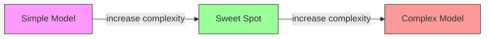
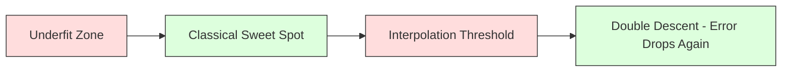
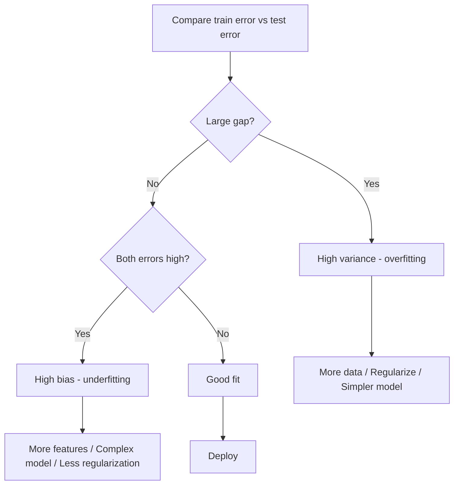
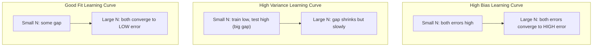
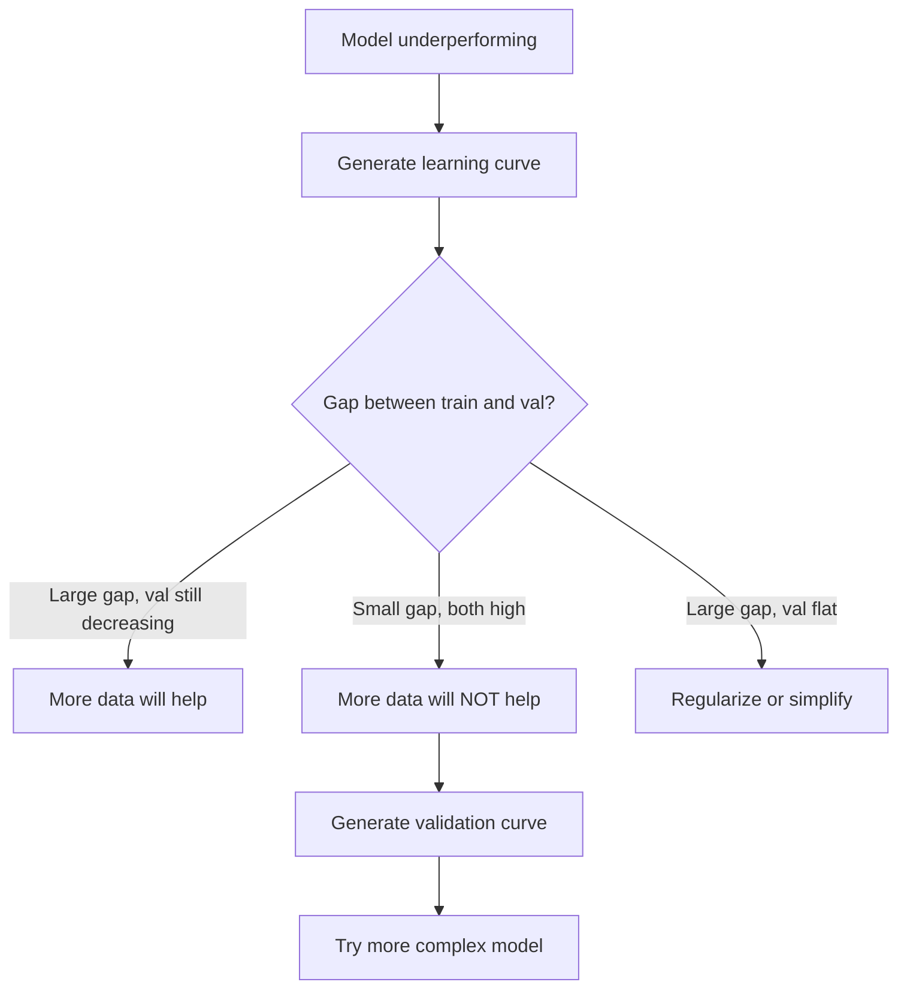

# Bias-Variance Tradeoff

> Любая ошибка модели происходит из одного из трёх источников: смещения (bias), разброса (variance) или шума. Контролировать вы можете только первые два.

**Type:** Learn
**Language:** Python
**Prerequisites:** Phase 2, Lessons 01-09 (основы ML, регрессия, классификация, оценка качества)
**Time:** ~75 минут

## Learning Objectives

- Вывести разложение ожидаемой ошибки предсказания на смещение и разброс и объяснить роль неустранимого шума
- Диагностировать, страдает ли модель от высокого смещения или высокого разброса, используя паттерны ошибок на обучающей и тестовой выборках
- Объяснить, как методы регуляризации (L1, L2, dropout, early stopping) обменивают смещение на разброс
- Реализовать эксперименты, визуализирующие bias-variance tradeoff для моделей возрастающей сложности

## The Problem

Вы обучили модель. У неё есть некоторая ошибка на тестовых данных. Откуда берётся эта ошибка?

Если ваша модель слишком простая (линейная регрессия на криволинейном датасете), она будет систематически промахиваться мимо истинной закономерности. Это смещение. Если ваша модель слишком сложная (полином 20-й степени на 15 точках данных), она идеально подгонится под обучающие данные, но даст совершенно разные предсказания на новых данных. Это разброс.

Вы не можете минимизировать оба показателя одновременно при фиксированной ёмкости модели. Снижаете смещение — растёт разброс. Снижаете разброс — растёт смещение. Понимание этого компромисса — самый полезный диагностический навык в машинном обучении. Он подсказывает, нужно ли усложнить модель или упростить её, нужно ли собрать больше данных или улучшить признаки, нужно ли усилить регуляризацию или ослабить её.

## The Concept

### Bias: систематическая ошибка

Смещение измеряет, насколько среднее предсказание вашей модели отличается от истинного значения. Если бы вы обучили одну и ту же модель на множестве разных обучающих выборок, взятых из одного и того же распределения, и усреднили предсказания, смещение — это разрыв между этим средним и истиной.

Высокое смещение означает, что модель слишком негибкая, чтобы уловить реальную закономерность. Прямая линия, подогнанная под параболу, всегда будет промахиваться мимо кривой, сколько бы данных вы ей ни давали. Это недообучение (underfitting).

```
High bias (underfitting):
  Model always predicts roughly the same wrong thing.
  Training error: HIGH
  Test error: HIGH
  Gap between them: SMALL
```

### Variance: чувствительность к обучающим данным

Разброс измеряет, насколько сильно меняются ваши предсказания при обучении на разных подмножествах данных. Если небольшие изменения в обучающей выборке вызывают большие изменения в модели, разброс высокий.

Высокий разброс означает, что модель подгоняется под шум в обучающих данных, а не под истинный сигнал. Полином 20-й степени пройдёт через каждую обучающую точку, но будет дико колебаться между ними. Это переобучение (overfitting).

```
High variance (overfitting):
  Model fits training data perfectly but fails on new data.
  Training error: LOW
  Test error: HIGH
  Gap between them: LARGE
```

### The Decomposition

Для любой точки x ожидаемая ошибка предсказания при квадратичной функции потерь раскладывается точно следующим образом:

```
Expected Error = Bias^2 + Variance + Irreducible Noise

where:
  Bias^2   = (E[f_hat(x)] - f(x))^2
  Variance = E[(f_hat(x) - E[f_hat(x)])^2]
  Noise    = E[(y - f(x))^2]             (sigma^2)
```

- `f(x)` — истинная функция
- `f_hat(x)` — предсказание вашей модели
- `E[...]` — математическое ожидание по разным обучающим выборкам
- `y` — наблюдаемая метка (истинная функция плюс шум)

Слагаемое с шумом неустранимо. Ни одна модель не может превзойти sigma^2 на зашумлённых данных. Ваша задача — найти правильный баланс между bias^2 и variance.

### Model Complexity vs Error



Классическая U-образная кривая:

| Сложность | Смещение | Разброс | Суммарная ошибка |
|-----------|------|----------|-------------|
| Слишком низкая | ВЫСОКОЕ | НИЗКИЙ | ВЫСОКАЯ (недообучение) |
| В самый раз | УМЕРЕННОЕ | УМЕРЕННЫЙ | НАИМЕНЬШАЯ |
| Слишком высокая | НИЗКОЕ | ВЫСОКИЙ | ВЫСОКАЯ (переобучение) |

### Regularization as Bias-Variance Control

Регуляризация намеренно увеличивает смещение, чтобы снизить разброс. Она ограничивает модель так, чтобы она не могла гнаться за шумом.

- **L2 (Ridge):** сжимает все веса к нулю. Сохраняет все признаки, но уменьшает их влияние.
- **L1 (Lasso):** обнуляет некоторые веса полностью. Выполняет отбор признаков.
- **Dropout:** случайно отключает нейроны во время обучения. Заставляет формировать избыточные представления.
- **Early stopping:** останавливает обучение до того, как модель полностью подгонится под обучающие данные.

Сила регуляризации (lambda, dropout rate, число эпох) напрямую определяет, в какой точке bias-variance кривой вы находитесь. Больше регуляризации — больше смещения, меньше разброса.

### Double Descent: The Modern Perspective

Классическая теория гласит: после оптимальной точки усложнение модели всегда вредит. Но исследования с 2019 года показали кое-что неожиданное. Если продолжать наращивать ёмкость модели далеко за порог интерполяции (точку, где у модели достаточно параметров, чтобы идеально подогнаться под обучающие данные), тестовая ошибка может снова снизиться.



Этот феномен «двойного спуска» (double descent) объясняет, почему сильно перепараметризованные нейронные сети (с гораздо большим числом параметров, чем обучающих примеров) всё равно хорошо обобщаются. Классический bias-variance tradeoff не ошибочен, но он неполон для современного режима.

Ключевые наблюдения о double descent:
- Это происходит в линейных моделях, деревьях решений и нейронных сетях
- Больше данных может фактически навредить в зоне интерполяции (sample-wise double descent)
- Больше эпох обучения тоже может это вызвать (epoch-wise double descent)
- Регуляризация сглаживает пик, но не устраняет его

Почему это происходит? На пороге интерполяции у модели ровно столько ёмкости, чтобы подогнаться под все обучающие точки. Её вынуждают выбрать очень конкретное решение, проходящее через каждую точку, и малые возмущения в данных вызывают большие изменения подгонки. Именно здесь разброс достигает пика. За порогом у модели появляется множество возможных решений, идеально подгоняющихся под данные. Алгоритм обучения (например, градиентный спуск с неявной регуляризацией) склонен выбирать простейшее из них. Это неявное смещение в сторону простых решений объясняет, почему перепараметризованные модели хорошо обобщаются.

| Режим | Параметры относительно выборки | Поведение |
|--------|----------------------|----------|
| Недопараметризованный | p << n | Применяется классический tradeoff |
| Порог интерполяции | p ~ n | Разброс достигает пика, тестовая ошибка резко растёт |
| Перепараметризованный | p >> n | Включается неявная регуляризация, тестовая ошибка снижается |

Практический вывод: если вы используете нейронные сети или большие ансамбли деревьев, не останавливайтесь на пороге интерполяции. Либо держитесь хорошо ниже него (с явной регуляризацией), либо идите далеко за него. Худшее место — находиться точно на пороге.

### Diagnosing Your Model



| Симптом | Диагноз | Решение |
|---------|-----------|-----|
| Высокая ошибка на обучении, высокая на тесте | Смещение | Больше признаков, более сложная модель, меньше регуляризации |
| Низкая ошибка на обучении, высокая на тесте | Разброс | Больше данных, регуляризация, более простая модель, dropout |
| Низкая ошибка на обучении, низкая на тесте | Хорошая подгонка | Можно отправлять в продакшн |
| Ошибка на обучении снижается, на тесте растёт | Переобучение в процессе | Early stopping |

### Practical Strategies

**Когда проблема в смещении:**
- Добавьте полиномиальные или взаимодействующие признаки
- Используйте более гибкую модель (ансамбль деревьев вместо линейной)
- Уменьшите силу регуляризации
- Обучайте дольше (если модель ещё не сошлась)

**Когда проблема в разбросе:**
- Соберите больше обучающих данных
- Используйте бэггинг (random forests)
- Увеличьте регуляризацию (выше lambda, больше dropout)
- Отбор признаков (уберите шумные признаки)
- Используйте кросс-валидацию для раннего обнаружения

### Ensemble Methods and Variance Reduction

Ансамблевые методы — самый практичный инструмент для борьбы с разбросом.

**Bagging (Bootstrap Aggregating)** обучает несколько моделей на разных бутстреп-выборках обучающих данных, а затем усредняет их предсказания. Каждая отдельная модель имеет высокий разброс, но среднее значение имеет гораздо более низкий разброс. Random forests — это бэггинг, применённый к деревьям решений.

Почему это работает математически: если усреднить N независимых предсказаний, каждое с разбросом sigma^2, разброс среднего составит sigma^2 / N. Модели не являются по-настоящему независимыми (все они видят похожие данные), поэтому снижение меньше, чем 1/N, но всё равно существенное.

**Boosting** снижает смещение, строя модели последовательно, где каждая новая модель фокусируется на ошибках ансамбля, накопленных до этого момента. Gradient boosting и AdaBoost — основные примеры. Boosting может переобучиться, если добавить слишком много моделей, поэтому нужны early stopping или регуляризация.

| Метод | Основной эффект | Изменение смещения | Изменение разброса |
|--------|---------------|-------------|-----------------|
| Bagging | Снижает разброс | Без изменений | Снижается |
| Boosting | Снижает смещение | Снижается | Может расти |
| Stacking | Снижает оба | Зависит от мета-модели | Зависит от базовых моделей |
| Dropout | Неявный бэггинг | Небольшое увеличение | Снижается |

**Практическое правило:** если ваша базовая модель имеет высокий разброс (глубокие деревья, полиномы высокой степени), используйте bagging. Если ваша базовая модель имеет высокое смещение (неглубокие пни, простые линейные модели), используйте boosting.

### Learning Curves

Кривые обучения строят ошибку на обучающей и валидационной выборках в зависимости от размера обучающей выборки. Это самый практичный диагностический инструмент, который у вас есть. В отличие от простого сравнения train/test, кривые обучения показывают траекторию вашей модели и подсказывают, поможет ли больше данных.



Как их читать:

| Сценарий | Ошибка на обучении | Ошибка на валидации | Разрыв | Что это значит | Что делать |
|----------|---------------|-----------------|-----|---------------|------------|
| Высокое смещение | Высокая | Высокая | Маленький | Модель не может уловить закономерность | Больше признаков, более сложная модель, меньше регуляризации |
| Высокий разброс | Низкая | Высокая | Большой | Модель запоминает обучающие данные | Больше данных, регуляризация, более простая модель |
| Хорошая подгонка | Умеренная | Умеренная | Маленький | Модель хорошо обобщается | Можно отправлять в продакшн |
| Высокий разброс, улучшается | Низкая | Снижается с увеличением данных | Сокращается | Проблема разброса, которую можно решить данными | Собрать больше данных |
| Высокое смещение, плато | Высокая | Высокая и плоская | Маленький и плоский | Больше данных НЕ поможет | Изменить архитектуру модели |

Критическая мысль: если обе кривые вышли на плато и разрыв небольшой, но обе ошибки высокие, больше данных бесполезно. Нужна лучшая модель. Если разрыв большой и всё ещё сокращается, больше данных поможет.

### How to Generate Learning Curves

Есть два подхода:

**Подход 1: варьировать размер обучающей выборки, модель фиксирована.** Зафиксируйте модель и гиперпараметры. Обучайте на всё более крупных подмножествах обучающих данных. Измеряйте ошибку на обучении и валидации при каждом размере. Это стандартная кривая обучения.

**Подход 2: варьировать сложность модели, данные фиксированы.** Зафиксируйте данные. Пройдитесь по параметру сложности (степень полинома, глубина дерева, число слоёв). Измеряйте ошибку на обучении и валидации при каждом уровне сложности. Это кривая валидации, и она напрямую показывает bias-variance tradeoff.

Оба подхода дополняют друг друга. Первый подскажет, поможет ли больше данных. Второй подскажет, поможет ли другая модель. Запустите оба, прежде чем принимать решения о следующем шаге.



```figure
bias-variance
```

## Build It

Код в `code/bias_variance.py` запускает полный эксперимент по разложению bias-variance. Вот подход, шаг за шагом.

### Step 1: Generate Synthetic Data from a Known Function

Мы используем `f(x) = sin(1.5x) + 0.5x` с гауссовым шумом. Знание истинной функции позволяет нам точно вычислить смещение и разброс.

```python
def true_function(x):
    return np.sin(1.5 * x) + 0.5 * x

def generate_data(n_samples=30, noise_std=0.5, x_range=(-3, 3), seed=None):
    rng = np.random.RandomState(seed)
    x = rng.uniform(x_range[0], x_range[1], n_samples)
    y = true_function(x) + rng.normal(0, noise_std, n_samples)
    return x, y
```

### Step 2: Bootstrap Sampling and Polynomial Fitting

Для каждой степени полинома мы берём множество бутстреп-выборок для обучения, подгоняем полином и записываем предсказания на фиксированной тестовой сетке. Это даёт нам распределение предсказаний в каждой тестовой точке.

```python
def fit_polynomial(x_train, y_train, degree, lam=0.0):
    X = np.column_stack([x_train ** d for d in range(degree + 1)])
    if lam > 0:
        penalty = lam * np.eye(X.shape[1])
        penalty[0, 0] = 0
        w = np.linalg.solve(X.T @ X + penalty, X.T @ y_train)
    else:
        w = np.linalg.lstsq(X, y_train, rcond=None)[0]
    return w
```

Мы обучаемся на 200 разных бутстреп-выборках. Каждая бутстреп-выборка взята из того же базового распределения, но содержит разные точки.

### Step 3: Computing Bias^2, Variance Decomposition

Имея 200 наборов предсказаний в каждой тестовой точке, мы можем вычислить разложение напрямую из определения:

```python
mean_pred = predictions.mean(axis=0)
bias_sq = np.mean((mean_pred - y_true) ** 2)
variance = np.mean(predictions.var(axis=0))
total_error = np.mean(np.mean((predictions - y_true) ** 2, axis=1))
```

- `mean_pred` — это E[f_hat(x)], оценённое по бутстреп-выборкам
- `bias_sq` — квадрат разрыва между средним предсказанием и истиной
- `variance` — средний разброс предсказаний по бутстреп-выборкам
- `total_error` должно примерно равняться bias^2 + variance + noise

### Step 4: Learning Curves

Кривые обучения варьируют размер обучающей выборки при фиксированной сложности модели. Они показывают, ограничена ли ваша модель данными или ёмкостью.

```python
def demo_learning_curves():
    sizes = [10, 15, 20, 30, 50, 75, 100, 150, 200, 300]
    degree = 5

    for n in sizes:
        train_errors = []
        test_errors = []
        for seed in range(50):
            x_train, y_train = generate_data(n_samples=n, seed=seed * 100)
            w = fit_polynomial(x_train, y_train, degree)
            train_pred = predict_polynomial(x_train, w)
            train_mse = np.mean((train_pred - y_train) ** 2)
            test_pred = predict_polynomial(x_test, w)
            test_mse = np.mean((test_pred - y_test) ** 2)
            train_errors.append(train_mse)
            test_errors.append(test_mse)
        # Average over runs gives the learning curve point
```

Для модели с высоким разбросом (степень 5 при малом объёме данных) вы увидите:
- Ошибка на обучении начинается низкой и растёт, поскольку с большим объёмом данных запоминание становится сложнее
- Ошибка на тесте начинается высокой и снижается по мере получения моделью большего сигнала
- Разрыв сокращается с увеличением объёма данных

Для модели с высоким смещением (степень 1) обе ошибки быстро сходятся к одному и тому же высокому значению, и больше данных не помогает.

### Step 5: Regularization Sweep

Код также включает `demo_regularization_sweep()`, который фиксирует полином высокой степени (степень 15) и варьирует силу Ridge-регуляризации от 0.001 до 100. Это показывает bias-variance tradeoff под другим углом: вместо варьирования сложности модели мы варьируем силу ограничения.

```python
def demo_regularization_sweep():
    alphas = [0.001, 0.005, 0.01, 0.05, 0.1, 0.5, 1.0, 5.0, 10.0, 50.0, 100.0]
    for alpha in alphas:
        results = bias_variance_decomposition([15], lam=alpha)
        r = results[15]
        print(f"alpha={alpha:.3f}  bias={r['bias_sq']:.4f}  var={r['variance']:.4f}")
```

При низком alpha полином 15-й степени практически не ограничен. Доминирует разброс, потому что модель гонится за шумом в каждой бутстреп-выборке. При высоком alpha штраф настолько силён, что модель фактически становится почти постоянной функцией. Доминирует смещение. Оптимальный alpha находится между этими крайностями.

Это та же U-образная кривая, что и при варьировании степени полинома, но управляется непрерывным параметром вместо дискретного. На практике регуляризация — предпочтительный способ управления tradeoff'ом, поскольку позволяет точную настройку без изменения набора признаков.

## Use It

sklearn предоставляет `learning_curve` и `validation_curve` для автоматизации этих диагностик без написания бутстреп-циклов вручную.

### Validation Curve: Sweep Model Complexity

```python
from sklearn.model_selection import validation_curve
from sklearn.pipeline import make_pipeline
from sklearn.preprocessing import PolynomialFeatures
from sklearn.linear_model import Ridge

degrees = list(range(1, 16))
train_scores_all = []
val_scores_all = []

for d in degrees:
    pipe = make_pipeline(PolynomialFeatures(d), Ridge(alpha=0.01))
    train_scores, val_scores = validation_curve(
        pipe, X, y, param_name="polynomialfeatures__degree",
        param_range=[d], cv=5, scoring="neg_mean_squared_error"
    )
    train_scores_all.append(-train_scores.mean())
    val_scores_all.append(-val_scores.mean())
```

Это напрямую даёт вам кривую bias-variance tradeoff. Там, где валидационная оценка хуже всего относительно оценки на обучении, доминирует разброс. Там, где обе плохие, доминирует смещение.

### Learning Curve: Sweep Training Set Size

```python
from sklearn.model_selection import learning_curve

pipe = make_pipeline(PolynomialFeatures(5), Ridge(alpha=0.01))
train_sizes, train_scores, val_scores = learning_curve(
    pipe, X, y, train_sizes=np.linspace(0.1, 1.0, 10),
    cv=5, scoring="neg_mean_squared_error"
)
train_mse = -train_scores.mean(axis=1)
val_mse = -val_scores.mean(axis=1)
```

Постройте график `train_mse` и `val_mse` в зависимости от `train_sizes`. Форма кривой расскажет всё о вашей модели.

### Cross-Validation with Regularization Sweep

```python
from sklearn.model_selection import cross_val_score

alphas = [0.001, 0.01, 0.1, 1.0, 10.0, 100.0]
for alpha in alphas:
    pipe = make_pipeline(PolynomialFeatures(10), Ridge(alpha=alpha))
    scores = cross_val_score(pipe, X, y, cv=5, scoring="neg_mean_squared_error")
    print(f"alpha={alpha:>7.3f}  MSE={-scores.mean():.4f} +/- {scores.std():.4f}")
```

Это варьирует силу регуляризации при фиксированной сложности модели. Вы увидите тот же bias-variance tradeoff: низкий alpha означает высокий разброс, высокий alpha означает высокое смещение.

### Putting It All Together: A Complete Diagnostic Workflow

На практике эти диагностики выполняются последовательно:

1. Обучите вашу модель. Вычислите ошибку на обучении и тесте.
2. Если обе ошибки высокие: у вас проблема со смещением. Переходите сразу к шагу 4.
3. Если ошибка на обучении низкая, а на тесте высокая: у вас проблема с разбросом. Постройте кривую обучения, чтобы увидеть, поможет ли больше данных. Если нет, регуляризуйте.
4. Постройте кривую валидации, варьируя ваш основной параметр сложности. Найдите оптимальную точку.
5. В оптимальной точке постройте кривую обучения. Если разрыв всё ещё большой, нужны больше данных или регуляризация.
6. Попробуйте Ridge/Lasso с разными значениями alpha с помощью `cross_val_score`. Выберите alpha, при котором кросс-валидационная ошибка наименьшая.

Это занимает 10-15 минут вычислений для большинства табличных датасетов и экономит часы догадок.

## Ship It

Этот урок производит: `outputs/prompt-model-diagnostics.md`

## Exercises

1. Запустите разложение с `noise_std=0` (без шума). Что происходит с неустранимым слагаемым ошибки? Меняется ли оптимальная сложность?

2. Увеличьте размер обучающей выборки с 30 до 300. Как это влияет на компонент разброса? Смещается ли оптимальная степень полинома?

3. Добавьте L2-регуляризацию (Ridge-регрессию) к эксперименту. Для фиксированного полинома высокой степени (степень 15) варьируйте lambda от 0 до 100. Постройте графики bias^2 и variance как функций lambda.

4. Измените истинную функцию с полинома на `sin(x)`. Как изменяется разложение bias-variance? Остаётся ли чёткая оптимальная степень?

5. Реализуйте простую обёртку bootstrap aggregating (bagging): обучите 10 моделей на бутстреп-выборках и усредните предсказания. Покажите, что это снижает разброс, почти не увеличивая смещение.

## Key Terms

| Термин | Что обычно говорят | Что это на самом деле означает |
|------|----------------|----------------------|
| Bias (смещение) | «Модель слишком простая» | Систематическая ошибка из-за неверных предположений. Разрыв между средним предсказанием модели и истиной. |
| Variance (разброс) | «Модель переобучается» | Ошибка из-за чувствительности к обучающим данным. Насколько сильно меняются предсказания на разных обучающих выборках. |
| Irreducible error (неустранимая ошибка) | «Шум в данных» | Ошибка из-за случайности в истинном процессе генерации данных. Ни одна модель не может её устранить. |
| Underfitting (недообучение) | «Недостаточно обучается» | У модели высокое смещение. Она не улавливает реальную закономерность даже на обучающих данных. |
| Overfitting (переобучение) | «Запоминание данных» | У модели высокий разброс. Она подгоняется под шум в обучающих данных, который не обобщается. |
| Regularization (регуляризация) | «Ограничение модели» | Добавление штрафа для снижения сложности модели, обмен смещения на более низкий разброс. |
| Double descent (двойной спуск) | «Больше параметров может помочь» | Тестовая ошибка снова снижается, когда ёмкость модели значительно превышает порог интерполяции. |
| Model complexity (сложность модели) | «Насколько гибка модель» | Способность модели подгоняться под произвольные закономерности. Контролируется архитектурой, признаками или регуляризацией. |

## Further Reading

- [Hastie, Tibshirani, Friedman: Elements of Statistical Learning, Ch. 7](https://hastie.su.domains/ElemStatLearn/) -- наиболее полное изложение разложения bias-variance
- [Belkin et al., Reconciling modern machine learning practice and the bias-variance trade-off (2019)](https://arxiv.org/abs/1812.11118) -- статья о double descent
- [Nakkiran et al., Deep Double Descent (2019)](https://arxiv.org/abs/1912.02292) -- epoch-wise и sample-wise double descent
- [Scott Fortmann-Roe: Understanding the Bias-Variance Tradeoff](http://scott.fortmann-roe.com/docs/BiasVariance.html) -- наглядное визуальное объяснение