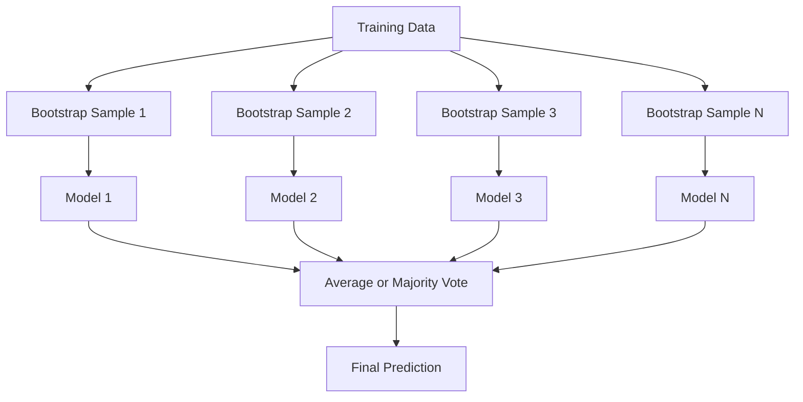
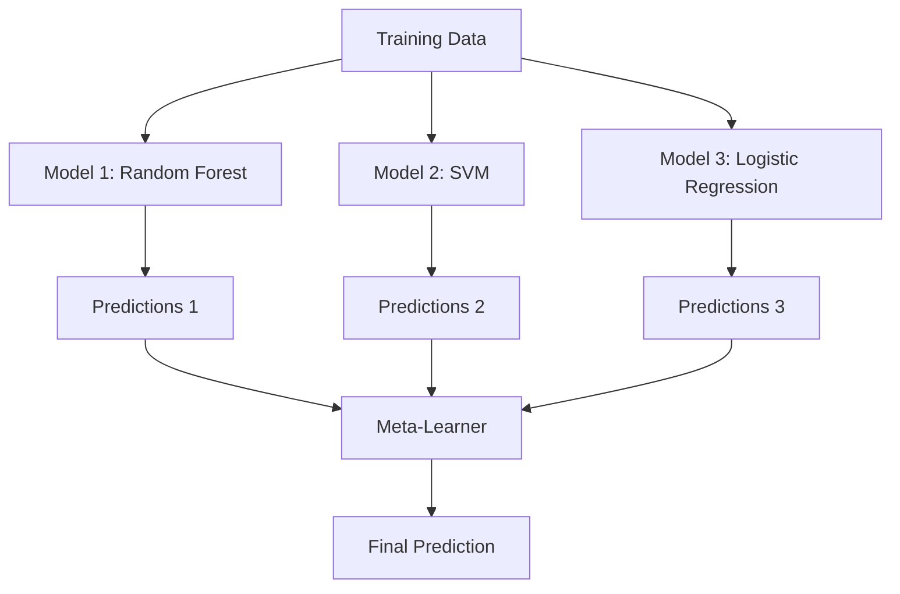

# Ансамблевые методы

> Группа слабых обучающихся алгоритмов, объединённых правильным образом, становится сильным обучающимся алгоритмом. Это не метафора. Это теорема.

**Type:** Build
**Language:** Python
**Prerequisites:** Этап 2, Урок 10 (Компромисс смещения и дисперсии)
**Time:** ~120 минут

## Цели обучения

- Реализовать AdaBoost и градиентный бустинг с нуля и объяснить, как бустинг последовательно уменьшает смещение
- Построить бэггинг-ансамбль и продемонстрировать, как усреднение декоррелированных моделей уменьшает дисперсию без увеличения смещения
- Сравнить бэггинг, бустинг и стекинг с точки зрения того, какой компонент ошибки устраняет каждый метод
- Оценить разнообразие ансамбля и объяснить, почему точность мажоритарного голосования растёт с увеличением числа независимых слабых обучающихся алгоритмов

## Проблема

Одно дерево решений быстро обучается и легко интерпретируется, но переобучается. Одна линейная модель недообучается на сложных границах. Вы могли бы потратить дни на проектирование идеальной архитектуры модели. А можно просто объединить набор несовершенных моделей и получить что-то лучшее, чем любая из них по отдельности.

Ансамблевые методы делают именно это. Это самая надёжная техника для победы в соревнованиях Kaggle на табличных данных, она лежит в основе большинства промышленных ML-систем и наглядно иллюстрирует компромисс смещения и дисперсии в действии. Бэггинг уменьшает дисперсию. Бустинг уменьшает смещение. Стекинг учится определять, каким моделям доверять на каких входных данных.

## Концепция

### Почему ансамбли работают

Предположим, у вас есть N независимых классификаторов, каждый с точностью p > 0.5. Точность мажоритарного голосования равна:

```
P(majority correct) = sum over k > N/2 of C(N,k) * p^k * (1-p)^(N-k)
```

Для 21 классификатора с точностью 60% каждый точность мажоритарного голосования составляет около 74%. При 101 классификаторе она возрастает до 84%. Ошибки компенсируют друг друга, когда модели ошибаются по-разному.

Ключевое требование — **разнообразие**. Если все модели совершают одни и те же ошибки, их объединение ничего не даёт. Ансамбли работают, потому что обеспечивают разнообразие моделей за счёт:

- Разных подвыборок обучающих данных (бэггинг)
- Разных подмножеств признаков (случайные леса)
- Последовательной коррекции ошибок (бустинг)
- Разных семейств моделей (стекинг)

### Бэггинг (Bootstrap Aggregating)

Бэггинг создаёт разнообразие, обучая каждую модель на отдельной bootstrap-выборке обучающих данных.



Bootstrap-выборка извлекается с возвращением из исходных данных и имеет тот же размер, что и исходный набор. Около 63.2% уникальных образцов попадает в каждую bootstrap-выборку. Оставшиеся 36.8% (out-of-bag образцы) дают бесплатный набор для валидации.

Бэггинг уменьшает дисперсию, почти не увеличивая смещение. Каждое отдельное дерево переобучается на своей bootstrap-выборке, но переобучение у каждого дерева разное, поэтому усреднение гасит шум.

**Случайные леса** — это бэггинг с дополнительной особенностью: при каждом разбиении рассматривается только случайное подмножество признаков. Это создаёт ещё больше разнообразия среди деревьев. Типичное число признаков-кандидатов — `sqrt(n_features)` для классификации и `n_features / 3` для регрессии.

### Бустинг (последовательная коррекция ошибок)

Бустинг обучает модели последовательно. Каждая новая модель фокусируется на примерах, с которыми предыдущие модели не справились.


Бустинг уменьшает смещение. Каждая новая модель исправляет систематические ошибки текущего ансамбля. Итоговое предсказание представляет собой взвешенную сумму всех моделей, где более удачным моделям присваиваются бóльшие веса.

Компромисс: бустинг может переобучиться при слишком большом числе итераций, поскольку он продолжает подстраиваться под всё более сложные примеры, часть которых может оказаться шумом.

### AdaBoost

AdaBoost (Adaptive Boosting) стал первым практичным алгоритмом бустинга. Он работает с любым базовым обучающимся алгоритмом, обычно с решающими пнями (деревьями глубины 1).

Алгоритм:

```
1. Initialize sample weights: w_i = 1/N for all i

2. For t = 1 to T:
   a. Train weak learner h_t on weighted data
   b. Compute weighted error:
      err_t = sum(w_i * I(h_t(x_i) != y_i)) / sum(w_i)
   c. Compute model weight:
      alpha_t = 0.5 * ln((1 - err_t) / err_t)
   d. Update sample weights:
      w_i = w_i * exp(-alpha_t * y_i * h_t(x_i))
   e. Normalize weights to sum to 1

3. Final prediction: H(x) = sign(sum(alpha_t * h_t(x)))
```

Модели с меньшей ошибкой получают больший alpha. Неправильно классифицированные образцы получают больший вес, чтобы следующая модель сосредоточилась на них.

### Градиентный бустинг

Градиентный бустинг обобщает бустинг на произвольные функции потерь. Вместо перевзвешивания образцов он обучает каждую новую модель на остатках (отрицательном градиенте функции потерь) текущего ансамбля.

```
1. Initialize: F_0(x) = argmin_c sum(L(y_i, c))

2. For t = 1 to T:
   a. Compute pseudo-residuals:
      r_i = -dL(y_i, F_{t-1}(x_i)) / dF_{t-1}(x_i)
   b. Fit a tree h_t to the residuals r_i
   c. Find optimal step size:
      gamma_t = argmin_gamma sum(L(y_i, F_{t-1}(x_i) + gamma * h_t(x_i)))
   d. Update:
      F_t(x) = F_{t-1}(x) + learning_rate * gamma_t * h_t(x)

3. Final prediction: F_T(x)
```

Для квадратичной функции потерь псевдо-остатки — это просто фактические остатки: `r_i = y_i - F_{t-1}(x_i)`. Каждое дерево буквально подстраивается под ошибки предыдущего ансамбля.

Скорость обучения (shrinkage) определяет вклад каждого дерева. Меньшая скорость обучения требует больше деревьев, но даёт лучшую обобщающую способность. Типичные значения: от 0.01 до 0.3.

### XGBoost: почему он доминирует на табличных данных

XGBoost (eXtreme Gradient Boosting) — это градиентный бустинг с инженерными оптимизациями, которые делают его быстрым, точным и устойчивым к переобучению:

- **Регуляризованная целевая функция:** штрафы L1 и L2 на веса листьев не позволяют отдельным деревьям быть излишне уверенными
- **Приближение второго порядка:** использует как первую, так и вторую производные функции потерь, что даёт более качественные решения о разбиениях
- **Разбиения с учётом разреженности:** нативно обрабатывает пропущенные значения, обучаясь выбирать лучшее направление для пропущенных данных при каждом разбиении
- **Подвыборка столбцов:** как и случайные леса, сэмплирует признаки при каждом разбиении для разнообразия
- **Взвешенная квантильная схема (weighted quantile sketch):** эффективно находит точки разбиения для непрерывных признаков на распределённых данных
- **Кэш-ориентированная блочная структура:** расположение данных в памяти оптимизировано под строки кэша процессора

На табличных данных XGBoost (и его преемник LightGBM) стабильно превосходит нейронные сети. В ближайшее время это не изменится. Если ваши данные помещаются в таблицу со строками и столбцами, начинайте с градиентного бустинга.

### Стекинг (мета-обучение)

Стекинг использует предсказания нескольких базовых моделей в качестве признаков для мета-обучающегося алгоритма.



Мета-обучающийся алгоритм учится, какой базовой модели доверять на каких входных данных. Если случайный лес лучше работает в одних областях, а SVM — в других, мета-алгоритм научится распределять решения соответствующим образом.

Чтобы избежать утечки данных, предсказания базовых моделей необходимо генерировать с помощью кросс-валидации на обучающем наборе. Нельзя обучать базовые модели и генерировать мета-признаки на одних и тех же данных.

### Голосование

Самый простой ансамбль. Просто объединяет предсказания напрямую.

- **Жёсткое голосование (hard voting):** мажоритарное голосование по меткам классов.
- **Мягкое голосование (soft voting):** усреднение предсказанных вероятностей, выбор класса с наибольшей средней вероятностью. Обычно лучше, поскольку использует информацию об уверенности.

```figure
f3-ensemble-average
```

## Реализация

### Шаг 1: Решающий пень (базовый обучающийся алгоритм)

Код в `code/ensembles.py` реализует всё с нуля. Начнём с решающего пня: дерева с единственным разбиением.

```python
class DecisionStump:
    def __init__(self):
        self.feature_idx = None
        self.threshold = None
        self.polarity = 1
        self.alpha = None

    def fit(self, X, y, weights):
        n_samples, n_features = X.shape
        best_error = float("inf")

        for f in range(n_features):
            thresholds = np.unique(X[:, f])
            for thresh in thresholds:
                for polarity in [1, -1]:
                    pred = np.ones(n_samples)
                    pred[polarity * X[:, f] < polarity * thresh] = -1
                    error = np.sum(weights[pred != y])
                    if error < best_error:
                        best_error = error
                        self.feature_idx = f
                        self.threshold = thresh
                        self.polarity = polarity

    def predict(self, X):
        n = X.shape[0]
        pred = np.ones(n)
        idx = self.polarity * X[:, self.feature_idx] < self.polarity * self.threshold
        pred[idx] = -1
        return pred
```

### Шаг 2: AdaBoost с нуля

```python
class AdaBoostScratch:
    def __init__(self, n_estimators=50):
        self.n_estimators = n_estimators
        self.stumps = []
        self.alphas = []

    def fit(self, X, y):
        n = X.shape[0]
        weights = np.full(n, 1 / n)

        for _ in range(self.n_estimators):
            stump = DecisionStump()
            stump.fit(X, y, weights)
            pred = stump.predict(X)

            err = np.sum(weights[pred != y])
            err = np.clip(err, 1e-10, 1 - 1e-10)

            alpha = 0.5 * np.log((1 - err) / err)
            weights *= np.exp(-alpha * y * pred)
            weights /= weights.sum()

            stump.alpha = alpha
            self.stumps.append(stump)
            self.alphas.append(alpha)

    def predict(self, X):
        total = sum(a * s.predict(X) for a, s in zip(self.alphas, self.stumps))
        return np.sign(total)
```

### Шаг 3: Градиентный бустинг с нуля

```python
class GradientBoostingScratch:
    def __init__(self, n_estimators=100, learning_rate=0.1, max_depth=3):
        self.n_estimators = n_estimators
        self.lr = learning_rate
        self.max_depth = max_depth
        self.trees = []
        self.initial_pred = None

    def fit(self, X, y):
        self.initial_pred = np.mean(y)
        current_pred = np.full(len(y), self.initial_pred)

        for _ in range(self.n_estimators):
            residuals = y - current_pred
            tree = SimpleRegressionTree(max_depth=self.max_depth)
            tree.fit(X, residuals)
            update = tree.predict(X)
            current_pred += self.lr * update
            self.trees.append(tree)

    def predict(self, X):
        pred = np.full(X.shape[0], self.initial_pred)
        for tree in self.trees:
            pred += self.lr * tree.predict(X)
        return pred
```

### Шаг 4: Сравнение со sklearn

Код проверяет, что наши реализации с нуля дают точность, схожую с sklearn'овскими `AdaBoostClassifier` и `GradientBoostingClassifier`, и сравнивает все методы рядом друг с другом.

## Применение

### Когда использовать каждый метод

| Метод | Уменьшает | Лучше всего для | Остерегайтесь |
|--------|---------|----------|---------------|
| Бэггинг / случайный лес | Дисперсию | Шумные данные, много признаков | Не помогает со смещением |
| AdaBoost | Смещение | Чистые данные, простые базовые алгоритмы | Чувствителен к выбросам и шуму |
| Градиентный бустинг | Смещение | Табличные данные, соревнования | Медленное обучение, легко переобучить без настройки |
| XGBoost / LightGBM | И то, и другое | Промышленный табличный ML | Много гиперпараметров |
| Стекинг | И то, и другое | Выжимание последних 1-2% точности | Сложный, риск переобучения мета-алгоритма |
| Голосование | Дисперсию | Быстрое объединение разнообразных моделей | Помогает только при разнообразии моделей |

### Промышленный стек для табличных данных

Для большинства задач табличного прогнозирования порядок проб такой:

1. **LightGBM или XGBoost** с параметрами по умолчанию
2. Настройте n_estimators, learning_rate, max_depth, min_child_weight
3. Если нужны последние 0.5%, постройте стекинг-ансамбль из 3-5 разнообразных моделей
4. Используйте кросс-валидацию на всех этапах

Нейронные сети на табличных данных почти всегда уступают градиентному бустингу, несмотря на продолжающиеся исследовательские попытки. TabNet, NODE и подобные архитектуры иногда сравниваются с хорошо настроенным XGBoost, но редко превосходят его.

## Отправка в продакшн

Этот урок производит `outputs/prompt-ensemble-selector.md` — промпт, который помогает выбрать правильный ансамблевый метод для конкретного набора данных. Опишите свои данные (размер, типы признаков, уровень шума, баланс классов) и решаемую задачу. Промпт проводит вас через контрольный список решений, рекомендует метод, предлагает начальные гиперпараметры и предупреждает о типичных ошибках для этого метода. Также производится `outputs/skill-ensemble-builder.md` с полным руководством по выбору.

## Упражнения

1. Модифицируйте реализацию AdaBoost, чтобы отслеживать точность обучения после каждого раунда. Постройте график точности в зависимости от числа обучающихся алгоритмов. Когда наступает сходимость?

2. Реализуйте случайный лес с нуля, добавив случайную подвыборку признаков в дерево регрессии. Обучите 100 деревьев с `max_features=sqrt(n_features)` и усредните предсказания. Сравните уменьшение дисперсии с одним деревом.

3. В реализации градиентного бустинга добавьте раннюю остановку: отслеживайте потери на валидации после каждого раунда и останавливайтесь, если улучшения не было в течение 10 раундов подряд. Сколько деревьев в действительности требуется?

4. Постройте стекинг-ансамбль из трёх базовых моделей (логистическая регрессия, дерево решений, k ближайших соседей) с мета-алгоритмом на основе логистической регрессии. Используйте 5-блочную кросс-валидацию для генерации мета-признаков. Сравните с каждой базовой моделью по отдельности.

5. Запустите XGBoost на том же наборе данных с параметрами по умолчанию. Сравните его точность с вашим градиентным бустингом, написанным с нуля. Замерьте время обоих. Насколько велика разница в скорости?

## Ключевые термины

| Термин | Что говорят люди | Что это на самом деле означает |
|------|----------------|----------------------|
| Бэггинг | "Обучение на случайных подвыборках" | Bootstrap aggregating: обучение моделей на bootstrap-выборках, усреднение предсказаний для уменьшения дисперсии |
| Бустинг | "Фокус на сложных примерах" | Последовательное обучение моделей, каждая из которых исправляет ошибки текущего ансамбля, для уменьшения смещения |
| AdaBoost | "Перевзвешивание данных" | Бустинг через обновление весов образцов; неправильно классифицированные точки получают больший вес для следующего обучающегося алгоритма |
| Градиентный бустинг | "Подгонка остатков" | Бустинг через обучение каждой новой модели на отрицательном градиенте функции потерь |
| XGBoost | "Оружие Kaggle" | Градиентный бустинг с регуляризацией, оптимизацией второго порядка и системными трюками для скорости |
| Стекинг | "Модели поверх моделей" | Использование предсказаний базовых моделей как входных признаков для мета-алгоритма |
| Случайный лес | "Множество рандомизированных деревьев" | Бэггинг с деревьями решений, с добавлением случайной подвыборки признаков при каждом разбиении для разнообразия |
| Разнообразие ансамбля | "Совершать разные ошибки" | Модели должны быть некоррелированы по своим ошибкам, чтобы ансамбль превосходил отдельные модели |
| Out-of-bag ошибка | "Бесплатная валидация" | Образцы, не попавшие в bootstrap-выборку (~36.8%), служат набором для валидации без необходимости выделять отдельную выборку |

## Дополнительные материалы

- [Schapire & Freund: Boosting: Foundations and Algorithms](https://mitpress.mit.edu/9780262526036/) — книга создателей AdaBoost
- [Friedman: Greedy Function Approximation: A Gradient Boosting Machine (2001)](https://doi.org/10.1214/aos/1013203451) — оригинальная статья о градиентном бустинге
- [Chen & Guestrin: XGBoost (2016)](https://arxiv.org/abs/1603.02754) — статья об XGBoost
- [Wolpert: Stacked Generalization (1992)](https://www.sciencedirect.com/science/article/abs/pii/S0893608005800231) — оригинальная статья о стекинге
- [scikit-learn Ensemble Methods](https://scikit-learn.org/stable/modules/ensemble.html) — практический справочник