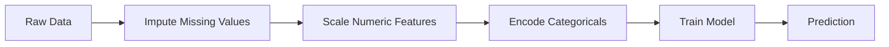
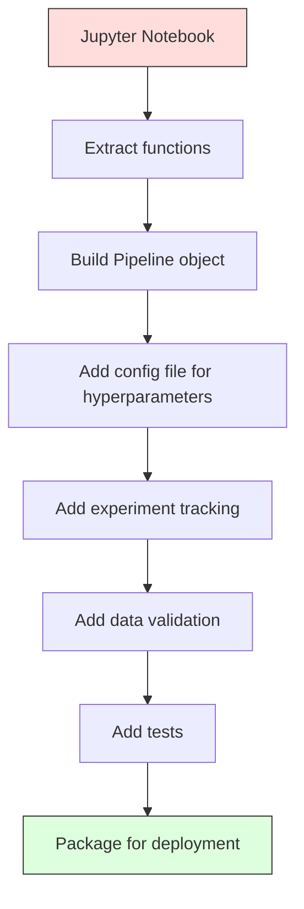

# ML-конвейеры

> Модель — это не продукт. Продукт — это конвейер. Конвейер охватывает всё: от сырых данных до развёрнутого предсказания, и каждый шаг должен быть воспроизводим.

**Type:** Build
**Language:** Python
**Prerequisites:** Фаза 2, урок 12 (Настройка гиперпараметров)
**Time:** ~120 минут

## Цели обучения

- Построить ML-конвейер с нуля, объединяющий импутацию, масштабирование, кодирование и обучение модели в единый воспроизводимый объект
- Выявлять сценарии утечки данных и объяснять, как конвейеры предотвращают их, подгоняя трансформеры только на обучающих данных
- Сконструировать ColumnTransformer, применяющий разную предобработку к числовым и категориальным признакам
- Реализовать сериализацию конвейера и продемонстрировать, что один и тот же обученный конвейер даёт идентичные результаты при обучении и в продакшене

## Проблема

У вас есть ноутбук, который загружает данные, заполняет пропуски медианой, масштабирует признаки, обучает модель и выводит точность. Он работает. Вы его отправляете в продакшен.

Через месяц кто-то переобучает модель и получает другие результаты. Медиана была вычислена по всему датасету, включая тестовые данные (утечка данных). Параметры масштабирования не были сохранены, поэтому инференс использует другую статистику. Код инженерии признаков копировался между обучением и обслуживанием, и копии разошлись. Категориальный столбец получил в продакшене новое значение, которого кодировщик никогда не видел.

Это не гипотетические сценарии. Это самые распространённые причины отказов ML-систем в продакшене. Конвейеры решают все эти проблемы, упаковывая каждый шаг преобразования в единый, упорядоченный, воспроизводимый объект.

## Концепция

### Что такое конвейер

Конвейер — это упорядоченная последовательность преобразований данных, за которой следует модель. Каждый шаг принимает на вход результат предыдущего шага. Весь конвейер подгоняется один раз на обучающих данных. На этапе инференса тот же обученный конвейер преобразует новые данные и выдаёт предсказания.



Конвейер гарантирует:
- Преобразования подгоняются только на обучающих данных (без утечек)
- Те же преобразования применяются на этапе инференса
- Весь объект можно сериализовать и развернуть как единый артефакт
- Кросс-валидация применяет конвейер отдельно для каждого фолда, предотвращая скрытые утечки

### Утечка данных: тихий убийца

Утечка данных происходит, когда информация из тестового набора или из будущих данных попадает в обучение. Конвейеры предотвращают самые распространённые формы утечки.

**Неправильно (с утечкой):**
```python
X = df.drop("target", axis=1)
y = df["target"]

scaler = StandardScaler()
X_scaled = scaler.fit_transform(X)

X_train, X_test = X_scaled[:800], X_scaled[800:]
y_train, y_test = y[:800], y[800:]
```

Скейлер увидел тестовые данные. Среднее и стандартное отклонение включают тестовые образцы. Это завышает оценки точности.

**Правильно:**
```python
X_train, X_test = X[:800], X[800:]

scaler = StandardScaler()
X_train_scaled = scaler.fit_transform(X_train)
X_test_scaled = scaler.transform(X_test)
```

С конвейером вам не нужно думать об этом. Конвейер решает это автоматически.

### sklearn Pipeline

`Pipeline` из sklearn объединяет в цепочку трансформеры и оценщик (estimator). Он предоставляет методы `.fit()`, `.predict()` и `.score()`, которые применяют все шаги по порядку.

```python
from sklearn.pipeline import Pipeline
from sklearn.preprocessing import StandardScaler
from sklearn.linear_model import LogisticRegression

pipe = Pipeline([
    ("scaler", StandardScaler()),
    ("model", LogisticRegression()),
])

pipe.fit(X_train, y_train)
predictions = pipe.predict(X_test)
```

При вызове `pipe.fit(X_train, y_train)`:
1. Скейлер вызывает `fit_transform` на X_train
2. Модель вызывает `fit` на масштабированном X_train

При вызове `pipe.predict(X_test)`:
1. Скейлер вызывает `transform` (не fit_transform) на X_test
2. Модель вызывает `predict` на масштабированном X_test

Скейлер никогда не видит тестовые данные во время подгонки. В этом весь смысл.

### ColumnTransformer: разные конвейеры для разных столбцов

В реальных датасетах есть числовые и категориальные столбцы, требующие разной предобработки. `ColumnTransformer` решает эту задачу.

```python
from sklearn.compose import ColumnTransformer
from sklearn.preprocessing import StandardScaler, OneHotEncoder
from sklearn.impute import SimpleImputer

numeric_pipe = Pipeline([
    ("impute", SimpleImputer(strategy="median")),
    ("scale", StandardScaler()),
])

categorical_pipe = Pipeline([
    ("impute", SimpleImputer(strategy="most_frequent")),
    ("encode", OneHotEncoder(handle_unknown="ignore")),
])

preprocessor = ColumnTransformer([
    ("num", numeric_pipe, ["age", "income", "score"]),
    ("cat", categorical_pipe, ["city", "gender", "plan"]),
])

full_pipeline = Pipeline([
    ("preprocess", preprocessor),
    ("model", GradientBoostingClassifier()),
])
```

Параметр `handle_unknown="ignore"` в OneHotEncoder критически важен для продакшена. Когда появляется новая категория (город, которого модель никогда не видела), он выдаёт нулевой вектор вместо аварийного завершения.

### Отслеживание экспериментов

Конвейер делает обучение воспроизводимым, но вам также нужно отслеживать, что происходило в разных экспериментах: какие использовались гиперпараметры, какая версия датасета, какими были метрики, какой код выполнялся.

**MLflow** — самое распространённое решение с открытым исходным кодом:

```python
import mlflow

with mlflow.start_run():
    mlflow.log_param("max_depth", 5)
    mlflow.log_param("n_estimators", 100)
    mlflow.log_param("learning_rate", 0.1)

    pipe.fit(X_train, y_train)
    accuracy = pipe.score(X_test, y_test)

    mlflow.log_metric("accuracy", accuracy)
    mlflow.sklearn.log_model(pipe, "model")
```

Каждый запуск фиксируется с параметрами, метриками, артефактами и полной моделью. Вы можете сравнивать запуски, воспроизводить любой эксперимент и развёртывать любую версию модели.

**Weights & Biases (wandb)** предоставляет ту же функциональность с хостируемой панелью:

```python
import wandb

wandb.init(project="my-pipeline")
wandb.config.update({"max_depth": 5, "n_estimators": 100})

pipe.fit(X_train, y_train)
accuracy = pipe.score(X_test, y_test)

wandb.log({"accuracy": accuracy})
```

### Версионирование моделей

После отслеживания экспериментов вам нужно управлять версиями моделей. Какая модель в продакшене? Какая в стейджинге? Какая была на прошлой неделе?

Model Registry в MLflow предоставляет:
- **Отслеживание версий:** Каждая сохранённая модель получает номер версии
- **Переходы между стадиями:** "Staging", "Production", "Archived"
- **Процесс одобрения:** Модели должны быть явно переведены в продакшен
- **Откат:** Мгновенное переключение на предыдущую версию

### Версионирование данных с DVC

Код версионируется с помощью git. Данные тоже следует версионировать, но git не справляется с большими файлами. DVC (Data Version Control) решает эту задачу.

```
dvc init
dvc add data/training.csv
git add data/training.csv.dvc data/.gitignore
git commit -m "Track training data"
dvc push
```

DVC хранит сами данные в удалённом хранилище (S3, GCS, Azure), а в git хранит небольшой файл `.dvc`, фиксирующий хэш. При переключении на коммит git команда `dvc checkout` восстанавливает именно те данные, которые использовались.

Это означает, что каждый коммит git фиксирует и код, и данные. Полная воспроизводимость.

### Воспроизводимые эксперименты

Воспроизводимый эксперимент требует четырёх вещей:

1. **Фиксированные случайные зерна (seed):** Задайте seed для numpy, random и используемого фреймворка (torch, sklearn)
2. **Закреплённые зависимости:** requirements.txt или poetry.lock с точными версиями
3. **Версионированные данные:** DVC или аналог
4. **Конфигурационные файлы:** Все гиперпараметры в конфиге, а не захардкожены

```python
import numpy as np
import random

def set_seed(seed=42):
    random.seed(seed)
    np.random.seed(seed)
    try:
        import torch
        torch.manual_seed(seed)
        torch.cuda.manual_seed_all(seed)
        torch.backends.cudnn.deterministic = True
    except ImportError:
        pass
```

### От ноутбука к продакшен-конвейеру



Типичный путь развития:

1. **Исследование в ноутбуке:** Быстрые эксперименты, визуализации, идеи признаков
2. **Выделение функций:** Перенос предобработки, инженерии признаков, оценки в модули
3. **Построение Pipeline:** Объединение преобразований в sklearn Pipeline или собственный класс
4. **Управление конфигурацией:** Перенос всех гиперпараметров в YAML/JSON-конфиг
5. **Отслеживание экспериментов:** Добавление логирования через MLflow или wandb
6. **Валидация данных:** Проверка схемы, распределений и паттернов пропущенных значений перед обучением
7. **Тесты:** Модульные тесты для трансформеров, интеграционные тесты для всего конвейера
8. **Развёртывание:** Сериализация конвейера, обёртывание в API (FastAPI, Flask), контейнеризация

### Типичные ошибки в конвейерах

| Ошибка | Почему это плохо | Исправление |
|---------|-------------|-----|
| Подгонка на полном датасете перед разбиением | Утечка данных | Используйте Pipeline с cross_val_score |
| Инженерия признаков вне конвейера | Разные преобразования при обучении и обслуживании | Поместите все преобразования в Pipeline |
| Отсутствие обработки неизвестных категорий | Падение продакшена на новых значениях | OneHotEncoder(handle_unknown="ignore") |
| Захардкоженные имена столбцов | Ломается при изменении схемы | Используйте списки имён столбцов из конфига |
| Отсутствие валидации данных | Тихо неверные предсказания на плохих данных | Добавьте проверки схемы перед предсказанием |
| Расхождение обучения и обслуживания | Модель видит разные признаки в продакшене | Один объект Pipeline для обоих случаев |

```figure
f3-pipeline-flow
```

## Создайте это

Код в `code/pipeline.py` строит полный ML-конвейер с нуля:

### Шаг 1: Собственный трансформер

```python
class CustomTransformer:
    def __init__(self):
        self.means = None
        self.stds = None

    def fit(self, X):
        self.means = np.mean(X, axis=0)
        self.stds = np.std(X, axis=0)
        self.stds[self.stds == 0] = 1.0
        return self

    def transform(self, X):
        return (X - self.means) / self.stds

    def fit_transform(self, X):
        return self.fit(X).transform(X)
```

### Шаг 2: Конвейер с нуля

```python
class PipelineFromScratch:
    def __init__(self, steps):
        self.steps = steps

    def fit(self, X, y=None):
        X_current = X.copy()
        for name, step in self.steps[:-1]:
            X_current = step.fit_transform(X_current)
        name, model = self.steps[-1]
        model.fit(X_current, y)
        return self

    def predict(self, X):
        X_current = X.copy()
        for name, step in self.steps[:-1]:
            X_current = step.transform(X_current)
        name, model = self.steps[-1]
        return model.predict(X_current)
```

### Шаг 3: Кросс-валидация с конвейером

Код демонстрирует, как кросс-валидация с конвейером предотвращает утечку данных: скейлер отдельно подгоняется на обучающих данных каждого фолда.

### Шаг 4: Полный продакшен-конвейер с sklearn

Полный конвейер с `ColumnTransformer`, несколькими путями предобработки и моделью, обученный с правильной кросс-валидацией и логированием экспериментов.

## Отправьте это в продакшен

Этот урок даёт:
- `outputs/prompt-ml-pipeline.md` -- навык построения и отладки ML-конвейеров
- `code/pipeline.py` -- полный конвейер с нуля вплоть до sklearn

## Упражнения

1. Постройте конвейер, обрабатывающий датасет с 3 числовыми столбцами и 2 категориальными столбцами. Используйте `ColumnTransformer`, чтобы применить импутацию медианой + масштабирование к числовым признакам и импутацию наиболее частым значением + one-hot-кодирование к категориальным. Обучите с 5-фолдовой кросс-валидацией.

2. Намеренно внесите утечку данных: подгоните скейлер на полном датасете перед разбиением. Сравните оценку кросс-валидации (с утечкой) с оценкой кросс-валидации конвейера (без утечки). Насколько велика разница?

3. Сериализуйте ваш конвейер с помощью `joblib.dump`. Загрузите его в отдельном скрипте и запустите предсказания. Убедитесь, что предсказания идентичны.

4. Добавьте в конвейер собственный трансформер, создающий полиномиальные признаки (степень 2) для двух самых важных числовых столбцов. Куда его следует поместить в конвейере?

5. Настройте отслеживание MLflow для конвейера. Запустите 5 экспериментов с разными гиперпараметрами. Используйте интерфейс MLflow (`mlflow ui`), чтобы сравнить запуски и выбрать лучшую модель.

## Ключевые термины

| Термин | Что говорят люди | Что это на самом деле означает |
|------|----------------|----------------------|
| Pipeline (конвейер) | "Цепочка преобразований + модель" | Упорядоченная последовательность обученных трансформеров и модели, применяемая как единое целое для предотвращения утечек |
| Data leakage (утечка данных) | "Информация из теста просочилась в обучение" | Использование информации извне обучающего набора при построении модели, завышающее оценки производительности |
| ColumnTransformer | "Разная предобработка для разных столбцов" | Применяет разные конвейеры к разным подмножествам столбцов, объединяя результаты |
| Experiment tracking (отслеживание экспериментов) | "Логирование ваших запусков" | Фиксация параметров, метрик, артефактов и версий кода для каждого запуска обучения |
| MLflow | "Отслеживание и развёртывание моделей" | Платформа с открытым исходным кодом для отслеживания экспериментов, реестра моделей и развёртывания |
| DVC | "Git для данных" | Система контроля версий для больших файлов данных, хранящая хэши в git, а данные — в удалённом хранилище |
| Model registry (реестр моделей) | "Каталог версий моделей" | Система, отслеживающая версии моделей с метками стадии (staging, production, archived) |
| Training/serving skew (расхождение обучения и обслуживания) | "В ноутбуке же работало" | Различия в обработке данных при обучении и при инференсе, вызывающие скрытые ошибки |
| Reproducibility (воспроизводимость) | "Тот же код, тот же результат" | Способность получать идентичные результаты из того же кода, данных и конфигурации |

## Дополнительные материалы

- [Документация scikit-learn Pipeline](https://scikit-learn.org/stable/modules/compose.html) -- официальный справочник по конвейерам
- [Документация MLflow](https://mlflow.org/docs/latest/index.html) -- отслеживание экспериментов и реестр моделей
- [Документация DVC](https://dvc.org/doc) -- версионирование данных
- [Sculley et al., Hidden Technical Debt in Machine Learning Systems (2015)](https://papers.nips.cc/paper/2015/hash/86df7dcfd896fcaf2674f757a2463eba-Abstract.html) -- основополагающая статья о сложности ML-систем
- [Google ML Best Practices: Rules of ML](https://developers.google.com/machine-learning/guides/rules-of-ml) -- практические советы по продакшен ML