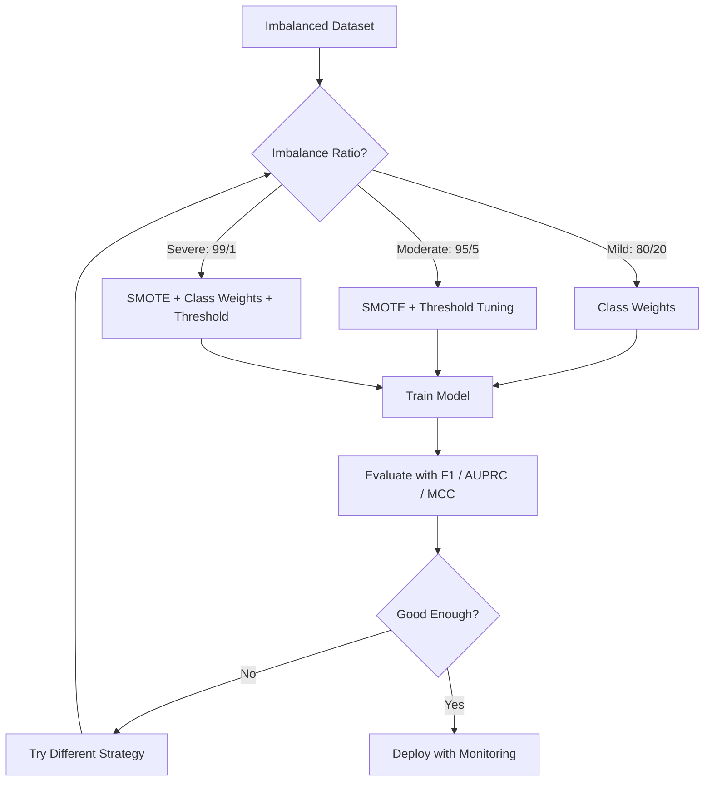
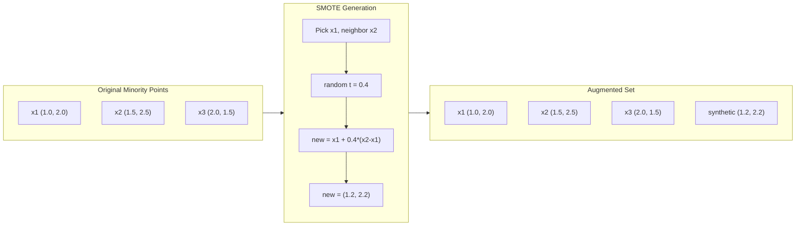
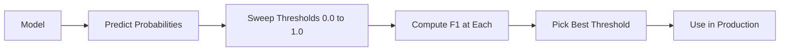
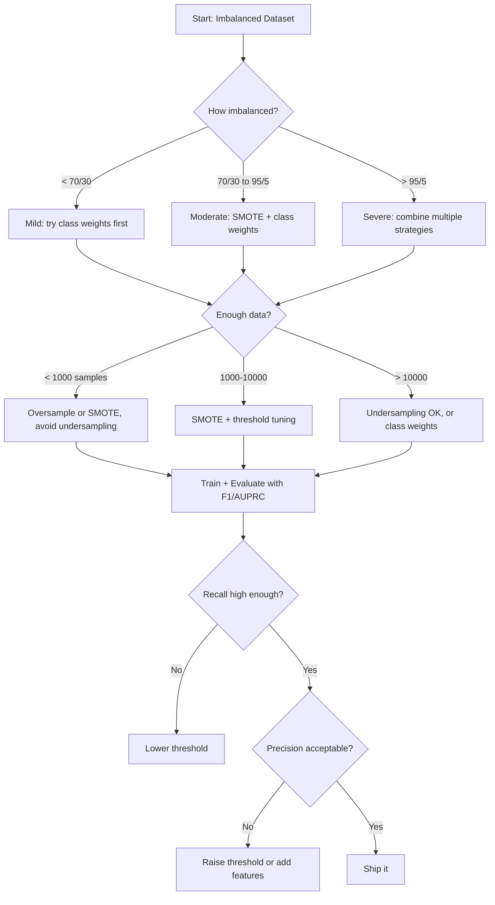

# Работа с несбалансированными данными

> Когда 99% ваших данных — «норма», точность (accuracy) лжёт.

**Type:** Build
**Language:** Python
**Prerequisites:** Phase 2, Lessons 01-09 (especially evaluation metrics)
**Time:** ~90 минут

## Цели обучения

- Реализовать SMOTE с нуля и объяснить, чем синтетический оверсэмплинг отличается от случайного дублирования
- Оценивать классификаторы на несбалансированных данных с помощью F1, AUPRC и коэффициента корреляции Мэттьюса вместо accuracy
- Сравнить взвешивание классов, подбор порога и стратегии ресэмплинга и выбрать подходящий подход для заданного коэффициента дисбаланса
- Построить полный пайплайн работы с несбалансированными данными, объединяющий SMOTE, веса классов и оптимизацию порога

## Проблема

Вы строите модель обнаружения мошенничества. Она достигает точности 99,9%. Вы радуетесь. Затем выясняется, что она предсказывает «не мошенничество» для абсолютно каждой транзакции.

Это не баг. Это рациональное поведение, когда только 0,1% транзакций являются мошенническими. Модель учится, что постоянное предсказание большинства класса минимизирует общую ошибку. Технически это верно и абсолютно бесполезно.

Так происходит везде, где классификация имеет реальное значение. Диагностика заболеваний: 1% положительных случаев. Сетевые вторжения: 0,01% атак. Производственный брак: 0,5% дефектных изделий. Фильтрация спама: 20% спама. Прогноз оттока клиентов: 5% уходящих. Чем важнее меньшинство класса, тем реже оно встречается.

Accuracy подводит, потому что трактует все правильные предсказания одинаково. Правильная маркировка легитимной транзакции и правильное обнаружение мошенничества одинаково засчитываются как один балл точности. Но обнаружение мошенничества — это вся причина существования модели. Нам нужны метрики, техники и стратегии обучения, которые заставят модель уделять внимание редкому, но важному классу.

## Концепция

### Почему accuracy подводит

Рассмотрим датасет из 1000 образцов: 990 отрицательных, 10 положительных. Модель, которая всегда предсказывает отрицательный класс:

|  | Предсказан положительный | Предсказан отрицательный |
|--|---|---|
| Фактически положительный | 0 (TP) | 10 (FN) |
| Фактически отрицательный | 0 (FP) | 990 (TN) |

Accuracy = (0 + 990) / 1000 = 99,0%

Модель не обнаруживает ни одного случая мошенничества. Ни одного заболевания. Ни одного дефекта. Но accuracy говорит 99%. Именно поэтому accuracy опасна для несбалансированных задач.

### Более удачные метрики

**Precision (точность)** = TP / (TP + FP). Из всего, что помечено как положительное, сколько действительно таковым является? Высокая precision означает мало ложных срабатываний.

**Recall (полнота)** = TP / (TP + FN). Из всего, что действительно положительно, сколько мы обнаружили? Высокий recall означает мало пропущенных положительных случаев.

**F1 Score** = 2 * precision * recall / (precision + recall). Среднее гармоническое. Сильнее, чем среднее арифметическое, штрафует за экстремальный дисбаланс между precision и recall.

**F-beta Score** = (1 + beta^2) * precision * recall / (beta^2 * precision + recall). Когда beta > 1, важнее recall. Когда beta < 1, важнее precision. F2 часто используется при обнаружении мошенничества (пропустить мошенничество хуже, чем ложная тревога).

**AUPRC** (площадь под кривой precision-recall). Похожа на AUC-ROC, но более информативна для несбалансированных данных. У случайного классификатора AUPRC равна доле положительного класса (а не 0,5, как у ROC). Это делает улучшения более заметными.

**Коэффициент корреляции Мэттьюса** = (TP * TN - FP * FN) / sqrt((TP+FP)(TP+FN)(TN+FP)(TN+FN)). Диапазон от -1 до +1. Даёт высокий балл только тогда, когда модель хорошо работает на обоих классах. Сбалансирован даже при сильно отличающихся размерах классов.

Для модели «всегда предсказывать отрицательный класс» выше: precision = 0/0 (не определено, часто принимается за 0), recall = 0/10 = 0, F1 = 0, MCC = 0. Эти метрики корректно показывают, что модель бесполезна.

### Пайплайн работы с несбалансированными данными



### SMOTE: техника синтетического оверсэмплинга меньшинства

Случайный оверсэмплинг дублирует существующие образцы меньшинства. Это работает, но рискует переобучением, потому что модель многократно видит идентичные точки.

SMOTE создаёт новые синтетические образцы меньшинства, которые правдоподобны, но не являются копиями. Алгоритм:

1. Для каждого образца меньшинства x найти его k ближайших соседей среди других образцов меньшинства
2. Выбрать одного соседа случайным образом
3. Создать новый образец на отрезке между x и этим соседом

Формула: `new_sample = x + random(0, 1) * (neighbor - x)`

Это интерполирует между реальными точками меньшинства, создавая образцы в той же области пространства признаков, не просто копируя существующие данные.



### Сравнение стратегий сэмплинга

**Случайный оверсэмплинг**: дублирование образцов меньшинства до количества большинства.
- Плюсы: просто, нет потери информации
- Минусы: точные дубликаты вызывают переобучение, увеличивает время обучения

**Случайный андерсэмплинг**: удаление образцов большинства до количества меньшинства.
- Плюсы: быстрое обучение, просто
- Минусы: выбрасываются потенциально полезные данные большинства, выше дисперсия

**SMOTE**: создание синтетических образцов меньшинства путём интерполяции.
- Плюсы: генерирует новые точки данных, уменьшает переобучение по сравнению со случайным оверсэмплингом
- Минусы: может создавать шумные образцы вблизи границы принятия решения, не учитывает распределение класса большинства

| Стратегия | Что меняется в данных | Риск | Когда использовать |
|----------|-------------|------|-------------|
| Оверсэмплинг | Меньшинство дублируется | Переобучение | Небольшие датасеты, умеренный дисбаланс |
| Андерсэмплинг | Большинство удаляется | Потеря информации | Большие датасеты, нужно быстрое обучение |
| SMOTE | Добавляется синтетическое меньшинство | Шум на границе | Умеренный дисбаланс, достаточно образцов меньшинства для k-NN |

### Веса классов

Вместо изменения данных — изменить, как модель относится к ошибкам. Назначить более высокий вес за неправильную классификацию меньшинства.

Для бинарной задачи с 950 отрицательными и 50 положительными образцами:
- Вес отрицательного класса = n_samples / (2 * n_negative) = 1000 / (2 * 950) = 0,526
- Вес положительного класса = n_samples / (2 * n_positive) = 1000 / (2 * 50) = 10,0

Положительный класс получает вес в 19 раз больше. Ошибка на одном положительном образце стоит столько же, сколько ошибка на 19 отрицательных образцах. Модель вынуждена обращать внимание на класс меньшинства.

В логистической регрессии это модифицирует функцию потерь:

```
weighted_loss = -sum(w_i * [y_i * log(p_i) + (1-y_i) * log(1-p_i)])
```

где w_i зависит от класса образца i.

Веса классов математически эквивалентны оверсэмплингу в ожидании, но без создания новых точек данных. Это делает их быстрее и избавляет от риска переобучения на дублированных образцах.

### Подбор порога

Большинство классификаторов выдают вероятность. Порог по умолчанию — 0,5: если P(положительный) >= 0,5, предсказываем положительный класс. Но 0,5 — произвольное значение. При дисбалансе классов оптимальный порог обычно значительно ниже.

Процесс:
1. Обучить модель
2. Получить предсказанные вероятности на валидационном наборе
3. Пройтись по порогам от 0,0 до 1,0
4. Вычислить F1 (или выбранную метрику) для каждого порога
5. Выбрать порог, максимизирующий метрику



Модель может выдать P(мошенничество) = 0,15 для мошеннической транзакции. При пороге 0,5 это классифицируется как не мошенничество. При пороге 0,10 — корректно обнаруживается. Калибровка вероятностей важна меньше, чем ранжирование — пока мошенничество получает более высокие вероятности, чем не мошенничество, существует порог, который их разделит.

### Обучение с учётом стоимости ошибок (cost-sensitive learning)

Обобщение весов классов. Вместо единообразных затрат — назначение конкретных затрат за неправильную классификацию:

| | Предсказан положительный | Предсказан отрицательный |
|--|---|---|
| Фактически положительный | 0 (верно) | C_FN = 100 |
| Фактически отрицательный | C_FP = 1 | 0 (верно) |

Пропуск мошеннической транзакции (FN) стоит в 100 раз дороже, чем ложная тревога (FP). Модель оптимизирует общую стоимость, а не общее количество ошибок.

Это наиболее обоснованный подход, когда вы можете оценить реальные затраты. Пропущенный диагноз рака имеет совершенно иную стоимость, чем ложная тревога, ведущая к дополнительной биопсии. Явное указание этих затрат вынуждает к правильным компромиссам.

### Схема принятия решения



```figure
class-imbalance
```

## Реализация

### Шаг 1: Генерация несбалансированного датасета

```python
import numpy as np


def make_imbalanced_data(n_majority=950, n_minority=50, seed=42):
    rng = np.random.RandomState(seed)

    X_maj = rng.randn(n_majority, 2) * 1.0 + np.array([0.0, 0.0])
    X_min = rng.randn(n_minority, 2) * 0.8 + np.array([2.5, 2.5])

    X = np.vstack([X_maj, X_min])
    y = np.concatenate([np.zeros(n_majority), np.ones(n_minority)])

    shuffle_idx = rng.permutation(len(y))
    return X[shuffle_idx], y[shuffle_idx]
```

### Шаг 2: SMOTE с нуля

```python
def euclidean_distance(a, b):
    return np.sqrt(np.sum((a - b) ** 2))


def find_k_neighbors(X, idx, k):
    distances = []
    for i in range(len(X)):
        if i == idx:
            continue
        d = euclidean_distance(X[idx], X[i])
        distances.append((i, d))
    distances.sort(key=lambda x: x[1])
    return [d[0] for d in distances[:k]]


def smote(X_minority, k=5, n_synthetic=100, seed=42):
    rng = np.random.RandomState(seed)
    n_samples = len(X_minority)
    k = min(k, n_samples - 1)
    synthetic = []

    for _ in range(n_synthetic):
        idx = rng.randint(0, n_samples)
        neighbors = find_k_neighbors(X_minority, idx, k)
        neighbor_idx = neighbors[rng.randint(0, len(neighbors))]
        t = rng.random()
        new_point = X_minority[idx] + t * (X_minority[neighbor_idx] - X_minority[idx])
        synthetic.append(new_point)

    return np.array(synthetic)
```

### Шаг 3: Случайный оверсэмплинг и андерсэмплинг

```python
def random_oversample(X, y, seed=42):
    rng = np.random.RandomState(seed)
    classes, counts = np.unique(y, return_counts=True)
    max_count = counts.max()

    X_resampled = list(X)
    y_resampled = list(y)

    for cls, count in zip(classes, counts):
        if count < max_count:
            cls_indices = np.where(y == cls)[0]
            n_needed = max_count - count
            chosen = rng.choice(cls_indices, size=n_needed, replace=True)
            X_resampled.extend(X[chosen])
            y_resampled.extend(y[chosen])

    X_out = np.array(X_resampled)
    y_out = np.array(y_resampled)
    shuffle = rng.permutation(len(y_out))
    return X_out[shuffle], y_out[shuffle]


def random_undersample(X, y, seed=42):
    rng = np.random.RandomState(seed)
    classes, counts = np.unique(y, return_counts=True)
    min_count = counts.min()

    X_resampled = []
    y_resampled = []

    for cls in classes:
        cls_indices = np.where(y == cls)[0]
        chosen = rng.choice(cls_indices, size=min_count, replace=False)
        X_resampled.extend(X[chosen])
        y_resampled.extend(y[chosen])

    X_out = np.array(X_resampled)
    y_out = np.array(y_resampled)
    shuffle = rng.permutation(len(y_out))
    return X_out[shuffle], y_out[shuffle]
```

### Шаг 4: Логистическая регрессия с весами классов

```python
def sigmoid(z):
    return 1.0 / (1.0 + np.exp(-np.clip(z, -500, 500)))


def logistic_regression_weighted(X, y, weights, lr=0.01, epochs=200):
    n_samples, n_features = X.shape
    w = np.zeros(n_features)
    b = 0.0

    for _ in range(epochs):
        z = X @ w + b
        pred = sigmoid(z)
        error = pred - y
        weighted_error = error * weights

        gradient_w = (X.T @ weighted_error) / n_samples
        gradient_b = np.mean(weighted_error)

        w -= lr * gradient_w
        b -= lr * gradient_b

    return w, b


def compute_class_weights(y):
    classes, counts = np.unique(y, return_counts=True)
    n_samples = len(y)
    n_classes = len(classes)
    weight_map = {}
    for cls, count in zip(classes, counts):
        weight_map[cls] = n_samples / (n_classes * count)
    return np.array([weight_map[yi] for yi in y])
```

### Шаг 5: Подбор порога

```python
def find_optimal_threshold(y_true, y_probs, metric="f1"):
    best_threshold = 0.5
    best_score = -1.0

    for threshold in np.arange(0.05, 0.96, 0.01):
        y_pred = (y_probs >= threshold).astype(int)
        tp = np.sum((y_pred == 1) & (y_true == 1))
        fp = np.sum((y_pred == 1) & (y_true == 0))
        fn = np.sum((y_pred == 0) & (y_true == 1))

        if metric == "f1":
            precision = tp / (tp + fp) if (tp + fp) > 0 else 0.0
            recall = tp / (tp + fn) if (tp + fn) > 0 else 0.0
            score = 2 * precision * recall / (precision + recall) if (precision + recall) > 0 else 0.0
        elif metric == "recall":
            score = tp / (tp + fn) if (tp + fn) > 0 else 0.0
        elif metric == "precision":
            score = tp / (tp + fp) if (tp + fp) > 0 else 0.0

        if score > best_score:
            best_score = score
            best_threshold = threshold

    return best_threshold, best_score
```

### Шаг 6: Функции оценки

```python
def confusion_matrix_values(y_true, y_pred):
    tp = np.sum((y_pred == 1) & (y_true == 1))
    tn = np.sum((y_pred == 0) & (y_true == 0))
    fp = np.sum((y_pred == 1) & (y_true == 0))
    fn = np.sum((y_pred == 0) & (y_true == 1))
    return tp, tn, fp, fn


def compute_metrics(y_true, y_pred):
    tp, tn, fp, fn = confusion_matrix_values(y_true, y_pred)
    accuracy = (tp + tn) / (tp + tn + fp + fn)
    precision = tp / (tp + fp) if (tp + fp) > 0 else 0.0
    recall = tp / (tp + fn) if (tp + fn) > 0 else 0.0
    f1 = 2 * precision * recall / (precision + recall) if (precision + recall) > 0 else 0.0

    denom = np.sqrt(float((tp + fp) * (tp + fn) * (tn + fp) * (tn + fn)))
    mcc = (tp * tn - fp * fn) / denom if denom > 0 else 0.0

    return {
        "accuracy": accuracy,
        "precision": precision,
        "recall": recall,
        "f1": f1,
        "mcc": mcc,
    }
```

### Шаг 7: Сравнение всех подходов

```python
X, y = make_imbalanced_data(950, 50, seed=42)
split = int(0.8 * len(y))
X_train, X_test = X[:split], X[split:]
y_train, y_test = y[:split], y[split:]

# Baseline: no treatment
w_base, b_base = logistic_regression_weighted(
    X_train, y_train, np.ones(len(y_train)), lr=0.1, epochs=300
)
probs_base = sigmoid(X_test @ w_base + b_base)
preds_base = (probs_base >= 0.5).astype(int)

# Oversampled
X_over, y_over = random_oversample(X_train, y_train)
w_over, b_over = logistic_regression_weighted(
    X_over, y_over, np.ones(len(y_over)), lr=0.1, epochs=300
)
preds_over = (sigmoid(X_test @ w_over + b_over) >= 0.5).astype(int)

# SMOTE
minority_mask = y_train == 1
X_minority = X_train[minority_mask]
synthetic = smote(X_minority, k=5, n_synthetic=len(y_train) - 2 * int(minority_mask.sum()))
X_smote = np.vstack([X_train, synthetic])
y_smote = np.concatenate([y_train, np.ones(len(synthetic))])
w_sm, b_sm = logistic_regression_weighted(
    X_smote, y_smote, np.ones(len(y_smote)), lr=0.1, epochs=300
)
preds_smote = (sigmoid(X_test @ w_sm + b_sm) >= 0.5).astype(int)

# Class weights
sample_weights = compute_class_weights(y_train)
w_cw, b_cw = logistic_regression_weighted(
    X_train, y_train, sample_weights, lr=0.1, epochs=300
)
probs_cw = sigmoid(X_test @ w_cw + b_cw)
preds_cw = (probs_cw >= 0.5).astype(int)

# Threshold tuning (tune on held-out validation set, not test set)
probs_val = sigmoid(X_val @ w_cw + b_cw)
best_thresh, best_f1 = find_optimal_threshold(y_val, probs_val, metric="f1")
preds_thresh = (probs_cw >= best_thresh).astype(int)
```

Файл кода запускает всё это в едином скрипте и выводит результаты.

## Применение

С помощью scikit-learn и imbalanced-learn эти техники реализуются в одну строку:

```python
from sklearn.linear_model import LogisticRegression
from sklearn.metrics import classification_report, f1_score
from sklearn.model_selection import train_test_split
from imblearn.over_sampling import SMOTE
from imblearn.under_sampling import RandomUnderSampler
from imblearn.pipeline import Pipeline

X_train, X_test, y_train, y_test = train_test_split(X, y, stratify=y)

model_weighted = LogisticRegression(class_weight="balanced")
model_weighted.fit(X_train, y_train)
print(classification_report(y_test, model_weighted.predict(X_test)))

smote = SMOTE(random_state=42)
X_resampled, y_resampled = smote.fit_resample(X_train, y_train)
model_smote = LogisticRegression()
model_smote.fit(X_resampled, y_resampled)
print(classification_report(y_test, model_smote.predict(X_test)))

pipeline = Pipeline([
    ("smote", SMOTE()),
    ("model", LogisticRegression(class_weight="balanced")),
])
pipeline.fit(X_train, y_train)
print(classification_report(y_test, pipeline.predict(X_test)))
```

Реализации с нуля показывают в точности, что делает каждая техника. SMOTE — это просто интерполяция по k-NN на классе меньшинства. Веса классов умножают функцию потерь. Подбор порога — это цикл по значениям отсечения. Никакой магии.

## Результат

Этот урок производит:
- `outputs/skill-imbalanced-data.md` — контрольный список для принятия решений при работе с несбалансированными задачами классификации

## Упражнения

1. **Borderline-SMOTE**: модифицируйте реализацию SMOTE так, чтобы она генерировала синтетические образцы только для точек меньшинства, находящихся вблизи границы принятия решения (тех, чьи k ближайших соседей включают образцы класса большинства). Сравните результаты со стандартным SMOTE на датасете, где классы перекрываются.

2. **Оптимизация матрицы затрат**: реализуйте обучение с учётом стоимости ошибок, где матрица затрат является параметром. Создайте функцию, которая принимает матрицу затрат и возвращает оптимальные предсказания, минимизирующие ожидаемую стоимость. Протестируйте с разными соотношениями затрат (1:10, 1:100, 1:1000) и постройте график изменения компромисса precision-recall.

3. **Калибровка порога**: реализуйте шкалирование Платта (обучите логистическую регрессию на сырых выходах модели для получения калиброванных вероятностей). Сравните кривую precision-recall до и после калибровки. Покажите, что калибровка не меняет ранжирование (AUC остаётся прежним), но делает вероятности более осмысленными.

4. **Ансамбль с балансированным бэггингом**: обучите несколько моделей, каждую на сбалансированной бутстрэп-выборке (всё меньшинство + случайное подмножество большинства). Усредните их предсказания. Сравните этот подход с одной моделью с SMOTE. Измерьте и производительность, и дисперсию по запускам.

5. **Эксперимент с коэффициентом дисбаланса**: возьмите сбалансированный датасет и постепенно увеличивайте коэффициент дисбаланса (50/50, 70/30, 90/10, 95/5, 99/1). Для каждого соотношения обучите модель с SMOTE и без него. Постройте график F1 в зависимости от коэффициента дисбаланса для обоих подходов. При каком соотношении SMOTE начинает давать значимую разницу?

## Ключевые термины

| Термин | Что говорят люди | Что это на самом деле значит |
|------|----------------|----------------------|
| Дисбаланс классов | «У одного класса намного больше образцов» | Распределение классов в датасете значительно смещено, из-за чего модели склоняются к классу большинства |
| SMOTE | «Синтетический оверсэмплинг» | Создаёт новые образцы меньшинства путём интерполяции между существующими образцами меньшинства и их k ближайшими соседями из меньшинства |
| Веса классов | «Делаем ошибки на редких классах дороже» | Умножение функции потерь на специфичные для класса веса, чтобы модель сильнее штрафовала за неправильную классификацию меньшинства |
| Подбор порога | «Сдвиг границы принятия решения» | Изменение порога вероятности для классификации с значения по умолчанию 0,5 на значение, оптимизирующее нужную метрику |
| Компромисс precision-recall | «Нельзя получить и то, и другое» | Снижение порога позволяет поймать больше положительных случаев (выше recall), но также даёт больше ложных срабатываний (ниже precision), и наоборот |
| AUPRC | «Площадь под PR-кривой» | Сводит кривую precision-recall к одному числу; более информативна, чем AUC-ROC, при сильном дисбалансе классов |
| Коэффициент корреляции Мэттьюса | «Сбалансированная метрика» | Корреляция между предсказанными и фактическими метками, дающая высокий балл только когда модель хорошо работает на обоих классах |
| Обучение с учётом стоимости ошибок | «Разные ошибки стоят по-разному» | Включение реальных затрат за неправильную классификацию в цель обучения, чтобы модель оптимизировала общую стоимость, а не количество ошибок |
| Случайный оверсэмплинг | «Дублируем меньшинство» | Повторение образцов класса меньшинства для балансировки количества классов; просто, но рискует переобучением на дублированных точках |

## Дополнительное чтение

- [SMOTE: Synthetic Minority Over-sampling Technique (Chawla et al., 2002)](https://arxiv.org/abs/1106.1813) — оригинальная статья по SMOTE, всё ещё самая цитируемая работа по обучению на несбалансированных данных
- [Learning from Imbalanced Data (He & Garcia, 2009)](https://ieeexplore.ieee.org/document/5128907) — всесторонний обзор, охватывающий сэмплинг, обучение с учётом стоимости ошибок и алгоритмические подходы
- [imbalanced-learn documentation](https://imbalanced-learn.org/stable/) — библиотека Python с вариантами SMOTE, стратегиями андерсэмплинга и интеграцией в пайплайны
- [The Precision-Recall Plot Is More Informative than the ROC Plot (Saito & Rehmsmeier, 2015)](https://journals.plos.org/plosone/article?id=10.1371/journal.pone.0118432) — когда и почему стоит предпочитать PR-кривые ROC-кривым для несбалансированных задач