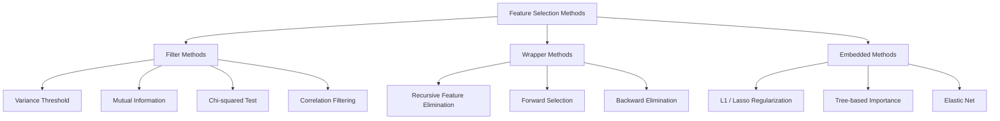
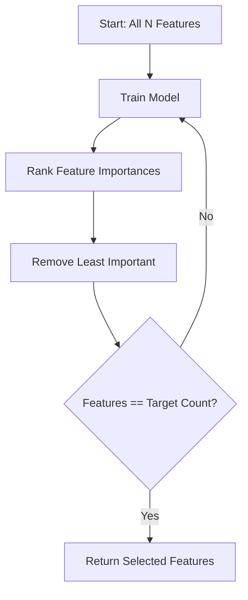
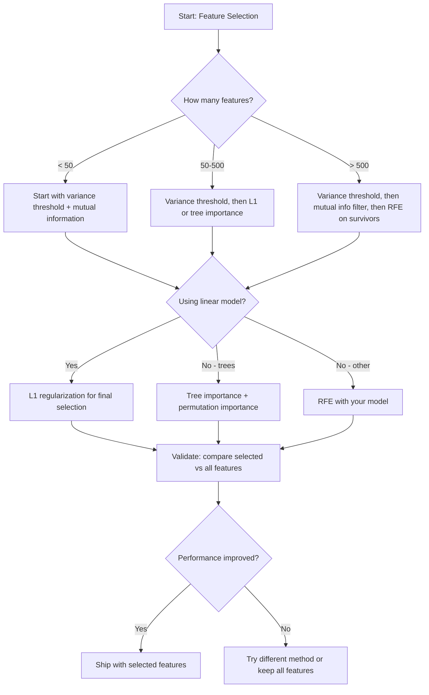

# Отбор признаков

> Больше признаков — не значит лучше. Правильные признаки — вот что лучше.

**Type:** Build
**Language:** Python
**Prerequisites:** Фаза 2, уроки 01-09, 08 (инженерия признаков)
**Time:** ~75 минут

## Цели обучения

- Реализовать методы фильтрации (порог дисперсии, взаимная информация, хи-квадрат) и методы-обёртки (RFE, прямой отбор) с нуля
- Объяснить, почему взаимная информация улавливает нелинейные связи между признаком и целевой переменной, которые упускает корреляция
- Сравнить L1-регуляризацию (встроенный отбор) с RFE (отбор-обёртка) и оценить их вычислительные компромиссы
- Построить конвейер отбора признаков, объединяющий несколько методов, и продемонстрировать улучшенную обобщающую способность на отложенных данных

## Проблема

У вас есть 500 признаков. Ваша модель медленно обучается, постоянно переобучается, и никто не может объяснить, чему она научилась. Вы добавляете всё больше признаков в надежде улучшить качество. Становится только хуже.

Это проклятие размерности в действии. По мере роста числа признаков объём пространства признаков взрывообразно растёт. Точки данных становятся разреженными. Расстояния между точками сходятся друг к другу. Модели требуется экспоненциально больше данных, чтобы найти реальные закономерности. Шумовые признаки заглушают сигнальные. Переобучение становится нормой.

Отбор признаков — это противоядие. Отсеять шум. Убрать избыточность. Оставить признаки, которые несут реальную информацию о целевой переменной. Результат: более быстрое обучение, лучшая обобщающая способность и модели, которые действительно можно объяснить.

Цель не в том, чтобы использовать всю доступную информацию. Цель — использовать правильную информацию.

## Концепция

### Три категории отбора признаков

Каждый метод отбора признаков попадает в одну из трёх категорий:



**Методы фильтрации** оценивают каждый признак независимо, используя статистическую меру. Они не используют модель. Быстрые, но пропускают взаимодействия между признаками.

**Методы-обёртки** обучают модель для оценки подмножеств признаков. В качестве оценки используется производительность модели. Результаты лучше, но дороже, поскольку модель переобучается много раз.

**Встроенные методы** отбирают признаки в процессе обучения модели. L1-регуляризация сводит веса к нулю. Деревья решений разбивают данные по наиболее полезным признакам. Отбор происходит во время подгонки модели, а не как отдельный шаг.

### Порог дисперсии

Самый простой фильтр. Если признак почти не варьируется между образцами, он несёт почти нулевую информацию.

Рассмотрим признак, равный 0.0 для 999 из 1000 образцов. Его дисперсия близка к нулю. Ни одна модель не сможет использовать его для различения классов. Удалите его.

```
variance(x) = mean((x - mean(x))^2)
```

Задайте порог (например, 0.01). Удалите каждый признак с дисперсией ниже него. Это убирает константные или почти константные признаки, вообще не глядя на целевую переменную.

Когда использовать: как шаг предобработки перед другими методами. Он отлавливает явно бесполезные признаки практически бесплатно.

Ограничение: признак может иметь высокую дисперсию и при этом оставаться чистым шумом. Порог дисперсии необходим, но недостаточен.

### Взаимная информация

Взаимная информация измеряет, насколько знание значения признака X уменьшает неопределённость относительно целевой переменной Y.

```
I(X; Y) = sum_x sum_y p(x, y) * log(p(x, y) / (p(x) * p(y)))
```

Если X и Y независимы, p(x, y) = p(x) * p(y), поэтому логарифмический член равен нулю, и I(X; Y) = 0. Чем больше X говорит вам о Y, тем выше взаимная информация.

Ключевое преимущество перед корреляцией: взаимная информация улавливает нелинейные связи. Признак может иметь нулевую корреляцию с целевой переменной, но высокую взаимную информацию, потому что связь квадратичная или периодическая.

Для непрерывных признаков сначала разбейте их на интервалы (оценка на основе гистограммы). Количество интервалов влияет на оценку — слишком мало интервалов теряет информацию, слишком много добавляет шум. Распространённый выбор: sqrt(n) интервалов или правило Стёрджеса (1 + log2(n)).


### Рекурсивное исключение признаков (RFE)

RFE — это метод-обёртка. Он использует собственную оценку важности признаков моделью для итеративного прореживания:

1. Обучить модель на всех признаках
2. Ранжировать признаки по важности (коэффициенты для линейных моделей, снижение неоднородности для деревьев)
3. Удалить наименее важный признак(и)
4. Повторять, пока не останется желаемое количество признаков



RFE учитывает взаимодействия признаков, потому что модель видит все оставшиеся признаки вместе. Удаление одного признака меняет важность остальных. Это делает метод более тщательным, чем методы фильтрации.

Цена: модель обучается N - target раз. При 500 признаках и целевом значении 10 это 490 запусков обучения. Для дорогих моделей это медленно. Можно ускорить процесс, удаляя несколько признаков за шаг (например, удалять нижние 10% на каждом раунде).

### L1-регуляризация (Lasso)

L1-регуляризация добавляет абсолютное значение весов к функции потерь:

```
loss = prediction_error + alpha * sum(|w_i|)
```

Параметр alpha контролирует, насколько агрессивно отсекаются признаки. Чем выше alpha, тем больше весов обращается ровно в ноль.

Почему именно в ноль? L1-штраф создаёт область ограничений в форме ромба в пространстве весов. Оптимальное решение, как правило, оказывается в углу этого ромба, где один или несколько весов равны нулю. L2-регуляризация (ridge) создаёт круговую область ограничений, где веса уменьшаются, но редко достигают нуля.

Это встроенный отбор признаков: модель во время обучения сама учится, какие признаки игнорировать. Признаки с нулевым весом фактически удалены.

Преимущества: единственный запуск обучения, обработка коррелированных признаков (выбирается один, остальные обнуляются), встроено в большинство реализаций линейных моделей.

Ограничение: работает только для линейных моделей. Не способно уловить нелинейную важность признаков.

### Важность признаков на основе деревьев

Деревья решений и их ансамбли (случайные леса, градиентный бустинг) естественным образом ранжируют признаки. Каждое разбиение уменьшает неоднородность (Джини или энтропия для классификации, дисперсия для регрессии). Признаки, дающие большее снижение неоднородности, более важны.

Для случайного леса с T деревьями:

```
importance(feature_j) = (1/T) * sum over all trees of
    sum over all nodes splitting on feature_j of
        (n_samples * impurity_decrease)
```

Это даёт нормализованную оценку важности для каждого признака. Такой подход автоматически учитывает нелинейные связи и взаимодействия признаков.

Предостережение: важность на основе деревьев смещена в сторону признаков с большим числом уникальных значений (высокой кардинальностью). Столбец со случайными ID будет казаться важным, потому что он идеально разбивает каждый образец. Используйте важность на основе перестановок (permutation importance) в качестве проверки на здравый смысл.

### Важность на основе перестановок (Permutation Importance)

Метод, не зависящий от модели:

1. Обучить модель и зафиксировать базовую производительность на валидационных данных
2. Для каждого признака: случайным образом перемешать его значения, измерить падение производительности
3. Чем больше падение, тем важнее признак

Если перемешивание признака не вредит производительности, модель от него не зависит. Если производительность резко падает, этот признак критически важен.

Важность на основе перестановок избегает смещения по кардинальности, присущего важности на основе деревьев. Но она медленная: одна полная оценка на каждый признак, повторяемая несколько раз для устойчивости.

### Сравнительная таблица

| Метод | Тип | Скорость | Нелинейность | Взаимодействия признаков |
|--------|------|-------|-----------|---------------------|
| Порог дисперсии | Фильтр | Очень быстро | Нет | Нет |
| Взаимная информация | Фильтр | Быстро | Да | Нет |
| Корреляционный фильтр | Фильтр | Быстро | Нет | Нет |
| RFE | Обёртка | Медленно | Зависит от модели | Да |
| L1 / Lasso | Встроенный | Быстро | Нет (линейный) | Нет |
| Важность деревьев | Встроенный | Средне | Да | Да |
| Важность на основе перестановок | Модельно-независимый | Медленно | Да | Да |

### Блок-схема принятия решений



```figure
f3-feature-prune
```

## Реализация

### Шаг 1: Сгенерировать синтетические данные с известной структурой признаков

```python
import numpy as np


def make_feature_selection_data(n_samples=500, seed=42):
    rng = np.random.RandomState(seed)

    x1 = rng.randn(n_samples)
    x2 = rng.randn(n_samples)
    x3 = rng.randn(n_samples)
    x4 = x1 + 0.1 * rng.randn(n_samples)
    x5 = x2 + 0.1 * rng.randn(n_samples)

    informative = np.column_stack([x1, x2, x3, x4, x5])

    correlated = np.column_stack([
        x1 * 0.9 + 0.1 * rng.randn(n_samples),
        x2 * 0.8 + 0.2 * rng.randn(n_samples),
        x3 * 0.7 + 0.3 * rng.randn(n_samples),
        x1 * 0.5 + x2 * 0.5 + 0.1 * rng.randn(n_samples),
        x2 * 0.6 + x3 * 0.4 + 0.1 * rng.randn(n_samples),
    ])

    noise = rng.randn(n_samples, 10) * 0.5

    X = np.hstack([informative, correlated, noise])
    y = (2 * x1 - 1.5 * x2 + x3 + 0.5 * rng.randn(n_samples) > 0).astype(int)

    feature_names = (
        [f"info_{i}" for i in range(5)]
        + [f"corr_{i}" for i in range(5)]
        + [f"noise_{i}" for i in range(10)]
    )

    return X, y, feature_names
```

Мы знаем истинную картину: признаки 0-4 информативны (при этом 3 и 4 — коррелированные копии 0 и 1), признаки 5-9 коррелируют с информативными признаками, признаки 10-19 — чистый шум. Хороший метод отбора должен ранжировать 0-4 как наиболее важные, а 10-19 — как наименее важные.

### Шаг 2: Порог дисперсии

```python
def variance_threshold(X, threshold=0.01):
    variances = np.var(X, axis=0)
    mask = variances > threshold
    return mask, variances
```

### Шаг 3: Взаимная информация (дискретная)

```python
def discretize(x, n_bins=10):
    min_val, max_val = x.min(), x.max()
    if max_val == min_val:
        return np.zeros_like(x, dtype=int)
    bin_edges = np.linspace(min_val, max_val, n_bins + 1)
    binned = np.digitize(x, bin_edges[1:-1])
    return binned


def mutual_information(X, y, n_bins=10):
    n_samples, n_features = X.shape
    mi_scores = np.zeros(n_features)

    y_vals, y_counts = np.unique(y, return_counts=True)
    p_y = y_counts / n_samples

    for f in range(n_features):
        x_binned = discretize(X[:, f], n_bins)
        x_vals, x_counts = np.unique(x_binned, return_counts=True)
        p_x = dict(zip(x_vals, x_counts / n_samples))

        mi = 0.0
        for xv in x_vals:
            for yi, yv in enumerate(y_vals):
                joint_mask = (x_binned == xv) & (y == yv)
                p_xy = np.sum(joint_mask) / n_samples
                if p_xy > 0:
                    mi += p_xy * np.log(p_xy / (p_x[xv] * p_y[yi]))
        mi_scores[f] = mi

    return mi_scores
```

### Шаг 4: Рекурсивное исключение признаков

```python
def simple_logistic_importance(X, y, lr=0.1, epochs=100):
    n_samples, n_features = X.shape
    w = np.zeros(n_features)
    b = 0.0

    for _ in range(epochs):
        z = X @ w + b
        pred = 1.0 / (1.0 + np.exp(-np.clip(z, -500, 500)))
        error = pred - y
        w -= lr * (X.T @ error) / n_samples
        b -= lr * np.mean(error)

    return w, b


def rfe(X, y, n_features_to_select=5, lr=0.1, epochs=100):
    n_total = X.shape[1]
    remaining = list(range(n_total))
    rankings = np.ones(n_total, dtype=int)
    rank = n_total

    while len(remaining) > n_features_to_select:
        X_subset = X[:, remaining]
        w, _ = simple_logistic_importance(X_subset, y, lr, epochs)
        importances = np.abs(w)

        least_idx = np.argmin(importances)
        original_idx = remaining[least_idx]
        rankings[original_idx] = rank
        rank -= 1
        remaining.pop(least_idx)

    for idx in remaining:
        rankings[idx] = 1

    selected_mask = rankings == 1
    return selected_mask, rankings
```

### Шаг 5: Отбор признаков с L1

```python
def soft_threshold(w, alpha):
    return np.sign(w) * np.maximum(np.abs(w) - alpha, 0)


def l1_feature_selection(X, y, alpha=0.1, lr=0.01, epochs=500):
    n_samples, n_features = X.shape
    w = np.zeros(n_features)
    b = 0.0

    for _ in range(epochs):
        z = X @ w + b
        pred = 1.0 / (1.0 + np.exp(-np.clip(z, -500, 500)))
        error = pred - y

        gradient_w = (X.T @ error) / n_samples
        gradient_b = np.mean(error)

        w -= lr * gradient_w
        w = soft_threshold(w, lr * alpha)
        b -= lr * gradient_b

    selected_mask = np.abs(w) > 1e-6
    return selected_mask, w
```

### Шаг 6: Важность на основе деревьев (простое дерево решений)

```python
def gini_impurity(y):
    if len(y) == 0:
        return 0.0
    classes, counts = np.unique(y, return_counts=True)
    probs = counts / len(y)
    return 1.0 - np.sum(probs ** 2)


def best_split(X, y, feature_idx):
    values = np.unique(X[:, feature_idx])
    if len(values) <= 1:
        return None, -1.0

    best_threshold = None
    best_gain = -1.0
    parent_gini = gini_impurity(y)
    n = len(y)

    for i in range(len(values) - 1):
        threshold = (values[i] + values[i + 1]) / 2.0
        left_mask = X[:, feature_idx] <= threshold
        right_mask = ~left_mask

        n_left = np.sum(left_mask)
        n_right = np.sum(right_mask)

        if n_left == 0 or n_right == 0:
            continue

        gain = parent_gini - (n_left / n) * gini_impurity(y[left_mask]) - (n_right / n) * gini_impurity(y[right_mask])

        if gain > best_gain:
            best_gain = gain
            best_threshold = threshold

    return best_threshold, best_gain


def tree_importance(X, y, n_trees=50, max_depth=5, seed=42):
    rng = np.random.RandomState(seed)
    n_samples, n_features = X.shape
    importances = np.zeros(n_features)

    for _ in range(n_trees):
        sample_idx = rng.choice(n_samples, size=n_samples, replace=True)
        feature_subset = rng.choice(n_features, size=max(1, int(np.sqrt(n_features))), replace=False)

        X_boot = X[sample_idx]
        y_boot = y[sample_idx]

        tree_imp = _build_tree_importance(X_boot, y_boot, feature_subset, max_depth)
        importances += tree_imp

    total = importances.sum()
    if total > 0:
        importances /= total

    return importances


def _build_tree_importance(X, y, feature_subset, max_depth, depth=0):
    n_features = X.shape[1]
    importances = np.zeros(n_features)

    if depth >= max_depth or len(np.unique(y)) <= 1 or len(y) < 4:
        return importances

    best_feature = None
    best_threshold = None
    best_gain = -1.0

    for f in feature_subset:
        threshold, gain = best_split(X, y, f)
        if gain > best_gain:
            best_gain = gain
            best_feature = f
            best_threshold = threshold

    if best_feature is None or best_gain <= 0:
        return importances

    importances[best_feature] += best_gain * len(y)

    left_mask = X[:, best_feature] <= best_threshold
    right_mask = ~left_mask

    importances += _build_tree_importance(X[left_mask], y[left_mask], feature_subset, max_depth, depth + 1)
    importances += _build_tree_importance(X[right_mask], y[right_mask], feature_subset, max_depth, depth + 1)

    return importances
```

### Шаг 7: Запустить все методы и сравнить

Файл с кодом запускает все пять методов на одном и том же синтетическом наборе данных и выводит сравнительную таблицу, показывающую, какие признаки выбирает каждый метод.

## Применение

В scikit-learn отбор признаков встроен в конвейер:

```python
from sklearn.feature_selection import (
    VarianceThreshold,
    mutual_info_classif,
    RFE,
    SelectFromModel,
)
from sklearn.linear_model import Lasso, LogisticRegression
from sklearn.ensemble import RandomForestClassifier

vt = VarianceThreshold(threshold=0.01)
X_filtered = vt.fit_transform(X)

mi_scores = mutual_info_classif(X, y)
top_k = np.argsort(mi_scores)[-10:]

rfe_selector = RFE(LogisticRegression(), n_features_to_select=10)
rfe_selector.fit(X, y)
X_rfe = rfe_selector.transform(X)

lasso_selector = SelectFromModel(Lasso(alpha=0.01))
lasso_selector.fit(X, y)
X_lasso = lasso_selector.transform(X)

rf = RandomForestClassifier(n_estimators=100)
rf.fit(X, y)
importances = rf.feature_importances_
```

Реализации с нуля показывают, что именно происходит внутри каждого метода. Порог дисперсии — это просто вычисление `var(X, axis=0)` и применение маски. Взаимная информация — это подсчёт совместных и маргинальных частот в таблице сопряжённости. RFE — это цикл, который обучает, ранжирует и прореживает. L1 — это градиентный спуск с шагом мягкого порогового отсечения (soft-thresholding). Важность деревьев накапливает снижение неоднородности по всем разбиениям. Никакой магии — только статистика и циклы.

Версии sklearn добавляют надёжность (например, mutual_info_classif использует оценку плотности на основе k-NN вместо разбиения на интервалы), скорость (реализации на C) и интеграцию в конвейеры.

## Результат

Этот урок производит:
- `outputs/skill-feature-selector.md` — краткий справочник-дерево решений для выбора подходящего метода отбора признаков

## Упражнения

1. **Прямой отбор (forward selection)**: реализуйте противоположность RFE. Начните с нуля признаков. На каждом шаге добавляйте признак, который больше всего улучшает производительность модели. Остановитесь, когда добавление признаков перестаёт помогать. Сравните отобранные признаки с результатами RFE. Что быстрее? Что даёт лучшие результаты?

2. **Стабильностный отбор (stability selection)**: запустите отбор признаков с L1 50 раз, каждый раз на случайной 80%-ной подвыборке данных, с немного разными значениями alpha. Посчитайте, как часто каждый признак отбирается. Признаки, отобранные более чем в 80% запусков, считаются «стабильными». Сравните стабильные признаки с результатами одиночного запуска L1. Что надёжнее?

3. **Обнаружение мультиколлинеарности**: вычислите корреляционную матрицу для всех признаков. Реализуйте функцию, которая при заданном пороге корреляции (например, 0.9) удаляет один признак из каждой сильно коррелированной пары (оставляя тот, у которого взаимная информация с целевой переменной выше). Протестируйте на синтетическом наборе данных и убедитесь, что она удаляет избыточные коррелированные признаки.

4. **Конвейер отбора признаков**: объедините порог дисперсии, фильтр по взаимной информации и RFE в единый конвейер. Сначала удалите признаки с почти нулевой дисперсией, затем оставьте топ-50% по взаимной информации, затем запустите RFE на оставшихся. Сравните этот конвейер с запуском RFE напрямую на всех признаках. Быстрее ли конвейер? Так же ли он точен?

5. **Важность на основе перестановок с нуля**: реализуйте важность на основе перестановок. Для каждого признака перемешайте его значения 10 раз, измерьте среднее падение F1-меры. Сравните ранжирование с важностью на основе деревьев. Найдите случаи расхождения и объясните, почему (подсказка: коррелированные признаки).

## Ключевые термины

| Термин | Что говорят люди | Что это на самом деле означает |
|------|----------------|----------------------|
| Метод фильтрации | «Оценивать признаки независимо» | Подход к отбору признаков, который ранжирует признаки с помощью статистической меры без обучения модели, оценивая каждый признак изолированно |
| Метод-обёртка | «Использовать модель для выбора признаков» | Подход к отбору признаков, который оценивает подмножества признаков путём обучения модели и использования её производительности как критерия отбора |
| Встроенный метод | «Модель отбирает признаки в процессе обучения» | Отбор признаков, происходящий как часть подгонки модели, например, L1-регуляризация, обнуляющая веса |
| Взаимная информация | «Насколько одна переменная говорит о другой» | Мера снижения неопределённости относительно Y при знании X, учитывающая как линейные, так и нелинейные зависимости |
| Рекурсивное исключение признаков | «Обучить, ранжировать, прореживать, повторить» | Итеративный метод-обёртка, который обучает модель, удаляет наименее важный(е) признак(и) и повторяет, пока не достигнуто целевое количество |
| L1 / Lasso-регуляризация | «Штраф, убивающий признаки» | Добавление суммы абсолютных значений весов к функции потерь, что обращает веса неважных признаков точно в ноль |
| Порог дисперсии | «Удалить константные признаки» | Отбрасывание признаков, чья дисперсия по образцам ниже заданного порога, фильтрация признаков, не несущих информации |
| Важность признаков | «Какие признаки важнее всего» | Оценка, показывающая, насколько каждый признак вносит вклад в предсказания модели, вычисляемая на основе прироста при разбиениях (деревья) или величины коэффициентов (линейные модели) |
| Важность на основе перестановок | «Перемешать и измерить ущерб» | Оценка важности признаков путём случайного перемешивания значений каждого признака и измерения возникающего падения производительности модели |
| Проклятие размерности | «Слишком много признаков, недостаточно данных» | Явление, при котором добавление признаков экспоненциально увеличивает объём пространства признаков, делая данные разреженными, а расстояния — бессмысленными |

## Дополнительное чтение

- [An Introduction to Variable and Feature Selection (Guyon & Elisseeff, 2003)](https://jmlr.org/papers/v3/guyon03a.html) — основополагающий обзор методов отбора признаков, всё ещё широко цитируемый
- [scikit-learn Feature Selection Guide](https://scikit-learn.org/stable/modules/feature_selection.html) — практический справочник по методам фильтрации, обёртки и встроенным методам с примерами кода
- [Stability Selection (Meinshausen & Buhlmann, 2010)](https://arxiv.org/abs/0809.2932) — объединяет подвыборку с отбором признаков для получения устойчивых, воспроизводимых результатов
- [Beware Default Random Forest Importances (Strobl et al., 2007)](https://bmcbioinformatics.biomedcentral.com/articles/10.1186/1471-2105-8-25) — демонстрирует смещение по кардинальности в важности на основе деревьев и предлагает условную важность в качестве альтернативы